# Ship catalogue

Generated by `make ships` from [the authoritative TOML folder](../Sources/L337Core/Resources/Ships). Each animation uses the actual game renderer and embedded design. Do not edit this document or GIFs by hand.

All values below are standard hull values. Carried equipment modifies them in the game. Top speed uses the cockpit scale (34.3 for Peregrine Mk V); world travel is speed x 18 units/second. Shields and energy are native game pools. See [conversions, fitting and economics](SHIP-FILES.md) and [source/design provenance](SHIP-PROVENANCE.md).

Exchange at a main station: new hull price less 75% of your current hull price. Compatible equipment, cargo, fuel and mission property transfer unchanged; conflicts block the trade. There are no free missiles, lasers or fuel. Normal fabrication requires actual paid EMP disable of the selected hull, authorized empty-section cutting and physical receiving of at least 50 kg, followed by a current arrival at a qualified living main station. Destruction, disable alone and targeting grant no purchase. Catalogue capability is separate from commander knowledge. XYZZY-only hulls are excluded from normal purchase and discovery; pending native mechanics are labelled explicitly.

## SH001 - Mule

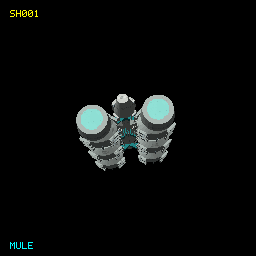

**Class:** Ship | [Definition](../Sources/L337Core/Resources/Ships/SH001.toml) | [Provenance](SHIP-PROVENANCE.md#sh001)

| Game specification | Value |
| --- | --- |
| Project family | mule |
| Primary display type | Trader |
| Functional AI role | trader |
| Object kind / origin | ship / human |
| Capital parent / subtype | No |
| Catalogue discovery eligibility | Yes |
| Encounter provision | authored; mechanics pending |
| Rarity | pending |
| Player flyable | No |
| Normal purchase capability | No |
| Purchase policy | pendingFabrication |
| Minimum displayed build Tech Level | Not applicable |
| Collection milestone | blueprintAndFabrication |
| Damage policy | destructible |
| Cargo (t) | 76 |
| Top speed | 33.2 |
| Acceleration (speed/s) | 9.6 |
| Energy capacity | 290.0 |
| Energy recharge /s | 4.0 |
| Roll (rad/s) | 0.9 |
| Pitch (rad/s) | 0.8 |
| Yaw (rad/s) | 0.7 |
| Each shield | 240.0 |
| Shield recharge /s | 1.5 |
| Fuel tank (LY) | 13.0 |
| Base jump (LY) | 9.0 |
| Jump charge (s) | 12.0 |
| Missile pylons | 5 |
| Laser mounts | Front, Rear |
| Cargo bay upgrade (t) | 25 |
| Hull price (CR) | 310,000 |
| Power index | 1474.0 |
| Trade-in (CR) | 232500.0 |
| Design | 4360 vertices; 7236 faces |

## SH002 - Gyrfalcon Assault

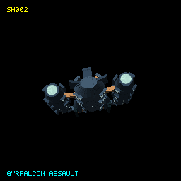

**Class:** Ship | [Definition](../Sources/L337Core/Resources/Ships/SH002.toml) | [Provenance](SHIP-PROVENANCE.md#sh002)

| Game specification | Value |
| --- | --- |
| Project family | gyrfalcon |
| Primary display type | Military |
| Functional AI role | military |
| Object kind / origin | ship / human |
| Capital parent / subtype | No |
| Catalogue discovery eligibility | Yes |
| Encounter provision | natural; mechanics ready |
| Rarity | uncommon |
| Player flyable | Yes |
| Normal purchase capability | Yes |
| Purchase policy | blueprintFabrication |
| Minimum displayed build Tech Level | 11 |
| Collection milestone | blueprintAndFabrication |
| Damage policy | destructible |
| Cargo (t) | 14 |
| Top speed | 44.8 |
| Acceleration (speed/s) | 15.4 |
| Energy capacity | 420.0 |
| Energy recharge /s | 5.4 |
| Roll (rad/s) | 1.3 |
| Pitch (rad/s) | 1.2 |
| Yaw (rad/s) | 1.1 |
| Each shield | 280.0 |
| Shield recharge /s | 2.0 |
| Fuel tank (LY) | 12.0 |
| Base jump (LY) | 8.0 |
| Jump charge (s) | 12.0 |
| Missile pylons | 8 |
| Laser mounts | Front, Rear, Left |
| Cargo bay upgrade (t) | 5 |
| Hull price (CR) | 366,000 |
| Power index | 2048.8 |
| Trade-in (CR) | 274500.0 |
| Design | 2692 vertices; 4600 faces |

## SH003 - Gyrfalcon Command

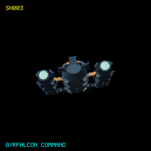

**Class:** Ship | [Definition](../Sources/L337Core/Resources/Ships/SH003.toml) | [Provenance](SHIP-PROVENANCE.md#sh003)

| Game specification | Value |
| --- | --- |
| Project family | gyrfalcon |
| Primary display type | Military |
| Functional AI role | military |
| Object kind / origin | ship / human |
| Capital parent / subtype | No |
| Catalogue discovery eligibility | Yes |
| Encounter provision | natural; mechanics ready |
| Rarity | uncommon |
| Player flyable | Yes |
| Normal purchase capability | Yes |
| Purchase policy | blueprintFabrication |
| Minimum displayed build Tech Level | 11 |
| Collection milestone | blueprintAndFabrication |
| Damage policy | destructible |
| Cargo (t) | 28 |
| Top speed | 39.0 |
| Acceleration (speed/s) | 15.4 |
| Energy capacity | 460.0 |
| Energy recharge /s | 6.8 |
| Roll (rad/s) | 1.3 |
| Pitch (rad/s) | 1.2 |
| Yaw (rad/s) | 1.1 |
| Each shield | 280.0 |
| Shield recharge /s | 2.0 |
| Fuel tank (LY) | 12.0 |
| Base jump (LY) | 10.0 |
| Jump charge (s) | 12.0 |
| Missile pylons | 5 |
| Laser mounts | Front, Rear, Left, Right |
| Cargo bay upgrade (t) | 5 |
| Hull price (CR) | 397,000 |
| Power index | 2069.6 |
| Trade-in (CR) | 297750.0 |
| Design | 4102 vertices; 7480 faces |

## SH004 - Gyrfalcon Patrol

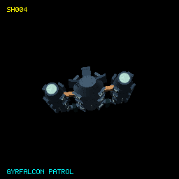

**Class:** Ship | [Definition](../Sources/L337Core/Resources/Ships/SH004.toml) | [Provenance](SHIP-PROVENANCE.md#sh004)

| Game specification | Value |
| --- | --- |
| Project family | gyrfalcon |
| Primary display type | Military |
| Functional AI role | military |
| Object kind / origin | ship / human |
| Capital parent / subtype | No |
| Catalogue discovery eligibility | Yes |
| Encounter provision | natural; mechanics ready |
| Rarity | uncommon |
| Player flyable | Yes |
| Normal purchase capability | Yes |
| Purchase policy | blueprintFabrication |
| Minimum displayed build Tech Level | 12 |
| Collection milestone | blueprintAndFabrication |
| Damage policy | destructible |
| Cargo (t) | 20 |
| Top speed | 44.0 |
| Acceleration (speed/s) | 15.4 |
| Energy capacity | 340.0 |
| Energy recharge /s | 5.0 |
| Roll (rad/s) | 1.3 |
| Pitch (rad/s) | 1.2 |
| Yaw (rad/s) | 1.1 |
| Each shield | 280.0 |
| Shield recharge /s | 2.0 |
| Fuel tank (LY) | 12.0 |
| Base jump (LY) | 10.0 |
| Jump charge (s) | 12.0 |
| Missile pylons | 6 |
| Laser mounts | Front, Rear |
| Cargo bay upgrade (t) | 5 |
| Hull price (CR) | 345,000 |
| Power index | 1700.0 |
| Trade-in (CR) | 258750.0 |
| Design | 2176 vertices; 3640 faces |

## SH005 - Bison

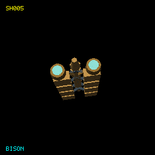

**Class:** Ship | [Definition](../Sources/L337Core/Resources/Ships/SH005.toml) | [Provenance](SHIP-PROVENANCE.md#sh005)

| Game specification | Value |
| --- | --- |
| Project family | bison |
| Primary display type | Transporter |
| Functional AI role | transporter |
| Object kind / origin | ship / human |
| Capital parent / subtype | No |
| Catalogue discovery eligibility | Yes |
| Encounter provision | natural; mechanics pending |
| Rarity | uncommon |
| Player flyable | Yes |
| Normal purchase capability | No |
| Purchase policy | pendingFabrication |
| Minimum displayed build Tech Level | 9 |
| Collection milestone | blueprintAndFabrication |
| Damage policy | destructible |
| Cargo (t) | 1,108 |
| Top speed | 17.7 |
| Acceleration (speed/s) | 3.4 |
| Energy capacity | 1120.0 |
| Energy recharge /s | 6.4 |
| Roll (rad/s) | 0.3 |
| Pitch (rad/s) | 0.2 |
| Yaw (rad/s) | 0.2 |
| Each shield | 590.0 |
| Shield recharge /s | 1.7 |
| Fuel tank (LY) | 13.0 |
| Base jump (LY) | 7.0 |
| Jump charge (s) | 16.0 |
| Missile pylons | 7 |
| Laser mounts | Front, Rear, Left, Right |
| Cargo bay upgrade (t) | 445 |
| Hull price (CR) | 814,000 |
| Power index | 3464.8 |
| Trade-in (CR) | 610500.0 |
| Design | 1320 vertices; 2212 faces |

## SH006 - Bison Mk II

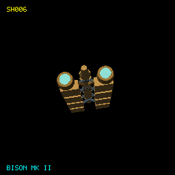

**Class:** Ship | [Definition](../Sources/L337Core/Resources/Ships/SH006.toml) | [Provenance](SHIP-PROVENANCE.md#sh006)

| Game specification | Value |
| --- | --- |
| Project family | bison |
| Primary display type | Transporter |
| Functional AI role | transporter |
| Object kind / origin | ship / human |
| Capital parent / subtype | No |
| Catalogue discovery eligibility | Yes |
| Encounter provision | natural; mechanics pending |
| Rarity | uncommon |
| Player flyable | Yes |
| Normal purchase capability | No |
| Purchase policy | pendingFabrication |
| Minimum displayed build Tech Level | 11 |
| Collection milestone | blueprintAndFabrication |
| Damage policy | destructible |
| Cargo (t) | 1,220 |
| Top speed | 16.8 |
| Acceleration (speed/s) | 3.4 |
| Energy capacity | 1300.0 |
| Energy recharge /s | 7.1 |
| Roll (rad/s) | 0.3 |
| Pitch (rad/s) | 0.2 |
| Yaw (rad/s) | 0.2 |
| Each shield | 640.0 |
| Shield recharge /s | 1.8 |
| Fuel tank (LY) | 13.0 |
| Base jump (LY) | 7.0 |
| Jump charge (s) | 16.0 |
| Missile pylons | 8 |
| Laser mounts | Front, Rear, Left, Right |
| Cargo bay upgrade (t) | 490 |
| Hull price (CR) | 908,000 |
| Power index | 3831.2 |
| Trade-in (CR) | 681000.0 |
| Design | 1320 vertices; 2212 faces |

## SH007 - Impala Voyager

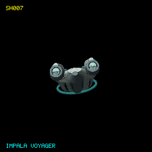

**Class:** Ship | [Definition](../Sources/L337Core/Resources/Ships/SH007.toml) | [Provenance](SHIP-PROVENANCE.md#sh007)

| Game specification | Value |
| --- | --- |
| Project family | impala |
| Primary display type | Leisure |
| Functional AI role | leisure |
| Object kind / origin | ship / human |
| Capital parent / subtype | No |
| Catalogue discovery eligibility | Yes |
| Encounter provision | authored; mechanics pending |
| Rarity | rare |
| Player flyable | Yes |
| Normal purchase capability | No |
| Purchase policy | pendingFabrication |
| Minimum displayed build Tech Level | 14 |
| Collection milestone | blueprintAndFabrication |
| Damage policy | destructible |
| Cargo (t) | 60 |
| Top speed | 38.0 |
| Acceleration (speed/s) | 11.0 |
| Energy capacity | 260.0 |
| Energy recharge /s | 3.8 |
| Roll (rad/s) | 1.0 |
| Pitch (rad/s) | 0.9 |
| Yaw (rad/s) | 0.8 |
| Each shield | 220.0 |
| Shield recharge /s | 1.7 |
| Fuel tank (LY) | 14.0 |
| Base jump (LY) | 12.0 |
| Jump charge (s) | 12.0 |
| Missile pylons | 4 |
| Laser mounts | Front, Rear |
| Cargo bay upgrade (t) | 15 |
| Hull price (CR) | 319,000 |
| Power index | 1333.6 |
| Trade-in (CR) | 239250.0 |
| Design | 2582 vertices; 5044 faces |

## SH008 - Goshawk Explorer

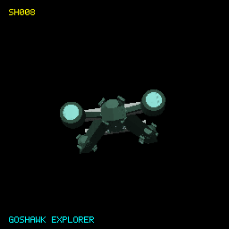

**Class:** Ship | [Definition](../Sources/L337Core/Resources/Ships/SH008.toml) | [Provenance](SHIP-PROVENANCE.md#sh008)

| Game specification | Value |
| --- | --- |
| Project family | goshawk |
| Primary display type | Leisure |
| Functional AI role | leisure |
| Object kind / origin | ship / human |
| Capital parent / subtype | No |
| Catalogue discovery eligibility | Yes |
| Encounter provision | authored; mechanics pending |
| Rarity | uncommon |
| Player flyable | No |
| Normal purchase capability | No |
| Purchase policy | pendingFabrication |
| Minimum displayed build Tech Level | 9 |
| Collection milestone | blueprintAndFabrication |
| Damage policy | destructible |
| Cargo (t) | 40 |
| Top speed | 41.0 |
| Acceleration (speed/s) | 11.5 |
| Energy capacity | 250.0 |
| Energy recharge /s | 4.6 |
| Roll (rad/s) | 1.0 |
| Pitch (rad/s) | 0.9 |
| Yaw (rad/s) | 0.8 |
| Each shield | 230.0 |
| Shield recharge /s | 1.7 |
| Fuel tank (LY) | 15.0 |
| Base jump (LY) | 13.0 |
| Jump charge (s) | 12.0 |
| Missile pylons | 4 |
| Laser mounts | Front |
| Cargo bay upgrade (t) | 15 |
| Hull price (CR) | 333,000 |
| Power index | 1241.2 |
| Trade-in (CR) | 249750.0 |
| Design | 2072 vertices; 3484 faces |

## SH009 - Goshawk Mk II

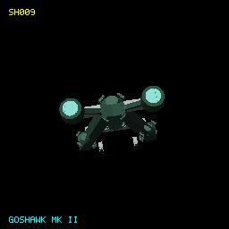

**Class:** Ship | [Definition](../Sources/L337Core/Resources/Ships/SH009.toml) | [Provenance](SHIP-PROVENANCE.md#sh009)

| Game specification | Value |
| --- | --- |
| Project family | goshawk |
| Primary display type | Military |
| Functional AI role | military |
| Object kind / origin | ship / human |
| Capital parent / subtype | No |
| Catalogue discovery eligibility | Yes |
| Encounter provision | authored; mechanics pending |
| Rarity | uncommon |
| Player flyable | No |
| Normal purchase capability | No |
| Purchase policy | pendingFabrication |
| Minimum displayed build Tech Level | 8 |
| Collection milestone | blueprintAndFabrication |
| Damage policy | destructible |
| Cargo (t) | 20 |
| Top speed | 42.0 |
| Acceleration (speed/s) | 11.3 |
| Energy capacity | 420.0 |
| Energy recharge /s | 6.2 |
| Roll (rad/s) | 0.9 |
| Pitch (rad/s) | 0.8 |
| Yaw (rad/s) | 0.8 |
| Each shield | 330.0 |
| Shield recharge /s | 2.1 |
| Fuel tank (LY) | 12.0 |
| Base jump (LY) | 8.0 |
| Jump charge (s) | 12.0 |
| Missile pylons | 8 |
| Laser mounts | Front, Rear, Left |
| Cargo bay upgrade (t) | 10 |
| Hull price (CR) | 375,000 |
| Power index | 2174.4 |
| Trade-in (CR) | 281250.0 |
| Design | 2104 vertices; 3532 faces |

## SH010 - Goshawk Mk II Custom

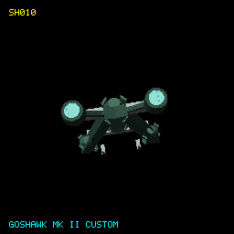

**Class:** Ship | [Definition](../Sources/L337Core/Resources/Ships/SH010.toml) | [Provenance](SHIP-PROVENANCE.md#sh010)

| Game specification | Value |
| --- | --- |
| Project family | goshawk |
| Primary display type | Military |
| Functional AI role | military |
| Object kind / origin | ship / human |
| Capital parent / subtype | No |
| Catalogue discovery eligibility | Yes |
| Encounter provision | authored; mechanics pending |
| Rarity | pending |
| Player flyable | No |
| Normal purchase capability | No |
| Purchase policy | pendingFabrication |
| Minimum displayed build Tech Level | Not applicable |
| Collection milestone | blueprintAndFabrication |
| Damage policy | destructible |
| Cargo (t) | 16 |
| Top speed | 40.0 |
| Acceleration (speed/s) | 13.1 |
| Energy capacity | 470.0 |
| Energy recharge /s | 7.4 |
| Roll (rad/s) | 1.1 |
| Pitch (rad/s) | 1.0 |
| Yaw (rad/s) | 0.9 |
| Each shield | 330.0 |
| Shield recharge /s | 2.1 |
| Fuel tank (LY) | 12.0 |
| Base jump (LY) | 9.0 |
| Jump charge (s) | 12.0 |
| Missile pylons | 5 |
| Laser mounts | Front, Rear |
| Cargo bay upgrade (t) | 10 |
| Hull price (CR) | 398,000 |
| Power index | 1942.8 |
| Trade-in (CR) | 298500.0 |
| Design | 2104 vertices; 3532 faces |

## SH011 - Goshawk Scout

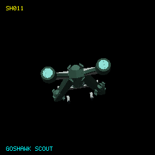

**Class:** Ship | [Definition](../Sources/L337Core/Resources/Ships/SH011.toml) | [Provenance](SHIP-PROVENANCE.md#sh011)

| Game specification | Value |
| --- | --- |
| Project family | goshawk |
| Primary display type | Military |
| Functional AI role | military |
| Object kind / origin | ship / human |
| Capital parent / subtype | No |
| Catalogue discovery eligibility | Yes |
| Encounter provision | authored; mechanics pending |
| Rarity | pending |
| Player flyable | No |
| Normal purchase capability | No |
| Purchase policy | pendingFabrication |
| Minimum displayed build Tech Level | Not applicable |
| Collection milestone | blueprintAndFabrication |
| Damage policy | destructible |
| Cargo (t) | 12 |
| Top speed | 48.0 |
| Acceleration (speed/s) | 13.4 |
| Energy capacity | 280.0 |
| Energy recharge /s | 4.5 |
| Roll (rad/s) | 1.1 |
| Pitch (rad/s) | 1.0 |
| Yaw (rad/s) | 0.9 |
| Each shield | 300.0 |
| Shield recharge /s | 2.0 |
| Fuel tank (LY) | 14.0 |
| Base jump (LY) | 12.0 |
| Jump charge (s) | 12.0 |
| Missile pylons | 4 |
| Laser mounts | Front |
| Cargo bay upgrade (t) | 5 |
| Hull price (CR) | 333,000 |
| Power index | 1408.0 |
| Trade-in (CR) | 249750.0 |
| Design | 2104 vertices; 3532 faces |

## SH012 - Sable Liner

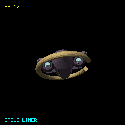

**Class:** Ship | [Definition](../Sources/L337Core/Resources/Ships/SH012.toml) | [Provenance](SHIP-PROVENANCE.md#sh012)

| Game specification | Value |
| --- | --- |
| Project family | sable-liner |
| Primary display type | Leisure |
| Functional AI role | leisure |
| Object kind / origin | ship / human |
| Capital parent / subtype | No |
| Catalogue discovery eligibility | Yes |
| Encounter provision | natural; mechanics ready |
| Rarity | uncommon |
| Player flyable | Yes |
| Normal purchase capability | Yes |
| Purchase policy | blueprintFabrication |
| Minimum displayed build Tech Level | 12 |
| Collection milestone | blueprintAndFabrication |
| Damage policy | destructible |
| Cargo (t) | 160 |
| Top speed | 31.0 |
| Acceleration (speed/s) | 10.3 |
| Energy capacity | 400.0 |
| Energy recharge /s | 5.3 |
| Roll (rad/s) | 0.9 |
| Pitch (rad/s) | 0.8 |
| Yaw (rad/s) | 0.7 |
| Each shield | 220.0 |
| Shield recharge /s | 1.7 |
| Fuel tank (LY) | 16.0 |
| Base jump (LY) | 12.0 |
| Jump charge (s) | 12.0 |
| Missile pylons | 4 |
| Laser mounts | Front, Rear |
| Cargo bay upgrade (t) | 10 |
| Hull price (CR) | 395,000 |
| Power index | 1521.6 |
| Trade-in (CR) | 296250.0 |
| Design | 2308 vertices; 4496 faces |

## SH013 - Buffalo

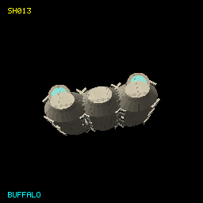

**Class:** Ship | [Definition](../Sources/L337Core/Resources/Ships/SH013.toml) | [Provenance](SHIP-PROVENANCE.md#sh013)

| Game specification | Value |
| --- | --- |
| Project family | buffalo |
| Primary display type | Transporter |
| Functional AI role | transporter |
| Object kind / origin | ship / human |
| Capital parent / subtype | No |
| Catalogue discovery eligibility | Yes |
| Encounter provision | authored; mechanics pending |
| Rarity | common |
| Player flyable | Yes |
| Normal purchase capability | No |
| Purchase policy | pendingFabrication |
| Minimum displayed build Tech Level | 8 |
| Collection milestone | blueprintAndFabrication |
| Damage policy | destructible |
| Cargo (t) | 396 |
| Top speed | 21.9 |
| Acceleration (speed/s) | 5.6 |
| Energy capacity | 710.0 |
| Energy recharge /s | 5.2 |
| Roll (rad/s) | 0.4 |
| Pitch (rad/s) | 0.4 |
| Yaw (rad/s) | 0.3 |
| Each shield | 470.0 |
| Shield recharge /s | 1.7 |
| Fuel tank (LY) | 15.0 |
| Base jump (LY) | 10.0 |
| Jump charge (s) | 14.0 |
| Missile pylons | 6 |
| Laser mounts | Front, Rear, Left |
| Cargo bay upgrade (t) | 160 |
| Hull price (CR) | 522,000 |
| Power index | 2584.4 |
| Trade-in (CR) | 391500.0 |
| Design | 2056 vertices; 3460 faces |

## SH014 - Buffalo Mk II

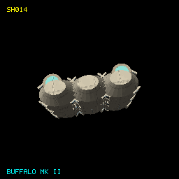

**Class:** Ship | [Definition](../Sources/L337Core/Resources/Ships/SH014.toml) | [Provenance](SHIP-PROVENANCE.md#sh014)

| Game specification | Value |
| --- | --- |
| Project family | buffalo |
| Primary display type | Transporter |
| Functional AI role | transporter |
| Object kind / origin | ship / human |
| Capital parent / subtype | No |
| Catalogue discovery eligibility | Yes |
| Encounter provision | authored; mechanics pending |
| Rarity | common |
| Player flyable | Yes |
| Normal purchase capability | No |
| Purchase policy | pendingFabrication |
| Minimum displayed build Tech Level | 11 |
| Collection milestone | blueprintAndFabrication |
| Damage policy | destructible |
| Cargo (t) | 460 |
| Top speed | 20.5 |
| Acceleration (speed/s) | 5.5 |
| Energy capacity | 850.0 |
| Energy recharge /s | 5.9 |
| Roll (rad/s) | 0.4 |
| Pitch (rad/s) | 0.4 |
| Yaw (rad/s) | 0.3 |
| Each shield | 510.0 |
| Shield recharge /s | 1.8 |
| Fuel tank (LY) | 15.0 |
| Base jump (LY) | 10.0 |
| Jump charge (s) | 14.0 |
| Missile pylons | 7 |
| Laser mounts | Front, Rear, Left, Right |
| Cargo bay upgrade (t) | 175 |
| Hull price (CR) | 590,000 |
| Power index | 3018.8 |
| Trade-in (CR) | 442500.0 |
| Design | 2056 vertices; 3460 faces |

## SH015 - Raven

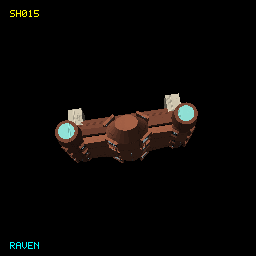

**Class:** Ship | [Definition](../Sources/L337Core/Resources/Ships/SH015.toml) | [Provenance](SHIP-PROVENANCE.md#sh015)

| Game specification | Value |
| --- | --- |
| Project family | raven |
| Primary display type | Pirate |
| Functional AI role | pirate |
| Object kind / origin | ship / human |
| Capital parent / subtype | No |
| Catalogue discovery eligibility | Yes |
| Encounter provision | authored; mechanics pending |
| Rarity | pending |
| Player flyable | No |
| Normal purchase capability | No |
| Purchase policy | pendingFabrication |
| Minimum displayed build Tech Level | Not applicable |
| Collection milestone | blueprintAndFabrication |
| Damage policy | destructible |
| Cargo (t) | 30 |
| Top speed | 46.0 |
| Acceleration (speed/s) | 13.8 |
| Energy capacity | 250.0 |
| Energy recharge /s | 3.3 |
| Roll (rad/s) | 1.4 |
| Pitch (rad/s) | 1.2 |
| Yaw (rad/s) | 1.1 |
| Each shield | 170.0 |
| Shield recharge /s | 1.6 |
| Fuel tank (LY) | 12.0 |
| Base jump (LY) | 9.0 |
| Jump charge (s) | 12.0 |
| Missile pylons | 5 |
| Laser mounts | Front, Rear |
| Cargo bay upgrade (t) | 10 |
| Hull price (CR) | 304,000 |
| Power index | 1271.6 |
| Trade-in (CR) | 228000.0 |
| Design | 2080 vertices; 3496 faces |

## SH016 - Mole Miner

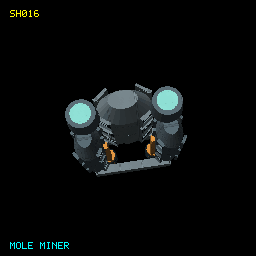

**Class:** Ship | [Definition](../Sources/L337Core/Resources/Ships/SH016.toml) | [Provenance](SHIP-PROVENANCE.md#sh016)

| Game specification | Value |
| --- | --- |
| Project family | mole |
| Primary display type | Miner |
| Functional AI role | miner |
| Object kind / origin | ship / human |
| Capital parent / subtype | No |
| Catalogue discovery eligibility | Yes |
| Encounter provision | authored; mechanics pending |
| Rarity | pending |
| Player flyable | No |
| Normal purchase capability | No |
| Purchase policy | pendingFabrication |
| Minimum displayed build Tech Level | Not applicable |
| Collection milestone | blueprintAndFabrication |
| Damage policy | destructible |
| Cargo (t) | 128 |
| Top speed | 25.0 |
| Acceleration (speed/s) | 8.3 |
| Energy capacity | 400.0 |
| Energy recharge /s | 5.2 |
| Roll (rad/s) | 0.7 |
| Pitch (rad/s) | 0.6 |
| Yaw (rad/s) | 0.6 |
| Each shield | 310.0 |
| Shield recharge /s | 1.8 |
| Fuel tank (LY) | 12.0 |
| Base jump (LY) | 8.0 |
| Jump charge (s) | 12.0 |
| Missile pylons | 4 |
| Laser mounts | Front, Rear |
| Cargo bay upgrade (t) | 45 |
| Hull price (CR) | 349,000 |
| Power index | 1698.4 |
| Trade-in (CR) | 261750.0 |
| Design | 6760 vertices; 12836 faces |

## SH017 - Mole Prospector

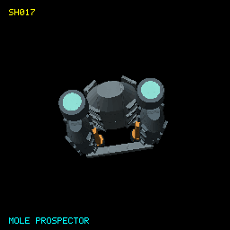

**Class:** Ship | [Definition](../Sources/L337Core/Resources/Ships/SH017.toml) | [Provenance](SHIP-PROVENANCE.md#sh017)

| Game specification | Value |
| --- | --- |
| Project family | mole |
| Primary display type | Miner |
| Functional AI role | miner |
| Object kind / origin | ship / human |
| Capital parent / subtype | No |
| Catalogue discovery eligibility | Yes |
| Encounter provision | authored; mechanics pending |
| Rarity | pending |
| Player flyable | No |
| Normal purchase capability | No |
| Purchase policy | pendingFabrication |
| Minimum displayed build Tech Level | Not applicable |
| Collection milestone | blueprintAndFabrication |
| Damage policy | destructible |
| Cargo (t) | 96 |
| Top speed | 29.0 |
| Acceleration (speed/s) | 8.3 |
| Energy capacity | 350.0 |
| Energy recharge /s | 4.8 |
| Roll (rad/s) | 0.7 |
| Pitch (rad/s) | 0.6 |
| Yaw (rad/s) | 0.6 |
| Each shield | 310.0 |
| Shield recharge /s | 1.8 |
| Fuel tank (LY) | 13.0 |
| Base jump (LY) | 11.0 |
| Jump charge (s) | 12.0 |
| Missile pylons | 4 |
| Laser mounts | Front |
| Cargo bay upgrade (t) | 45 |
| Hull price (CR) | 347,000 |
| Power index | 1507.6 |
| Trade-in (CR) | 260250.0 |
| Design | 6760 vertices; 12836 faces |

## SH018 - Onager

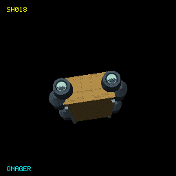

**Class:** Ship | [Definition](../Sources/L337Core/Resources/Ships/SH018.toml) | [Provenance](SHIP-PROVENANCE.md#sh018)

| Game specification | Value |
| --- | --- |
| Project family | onager |
| Primary display type | Trader |
| Functional AI role | trader |
| Object kind / origin | ship / human |
| Capital parent / subtype | No |
| Catalogue discovery eligibility | Yes |
| Encounter provision | natural; mechanics ready |
| Rarity | common |
| Player flyable | Yes |
| Normal purchase capability | Yes |
| Purchase policy | blueprintFabrication |
| Minimum displayed build Tech Level | 5 |
| Collection milestone | blueprintAndFabrication |
| Damage policy | destructible |
| Cargo (t) | 58 |
| Top speed | 39.0 |
| Acceleration (speed/s) | 11.0 |
| Energy capacity | 220.0 |
| Energy recharge /s | 3.1 |
| Roll (rad/s) | 1.0 |
| Pitch (rad/s) | 0.9 |
| Yaw (rad/s) | 0.8 |
| Each shield | 220.0 |
| Shield recharge /s | 1.5 |
| Fuel tank (LY) | 13.0 |
| Base jump (LY) | 10.0 |
| Jump charge (s) | 12.0 |
| Missile pylons | 4 |
| Laser mounts | Front, Rear |
| Cargo bay upgrade (t) | 20 |
| Hull price (CR) | 281,000 |
| Power index | 1271.2 |
| Trade-in (CR) | 210750.0 |
| Design | 1992 vertices; 3864 faces |

## SH019 - Gazelle Explorer

**Class:** Ship | [Definition](../Sources/L337Core/Resources/Ships/SH019.toml) | [Provenance](SHIP-PROVENANCE.md#sh019)

| Game specification | Value |
| --- | --- |
| Project family | gazelle |
| Primary display type | Leisure |
| Functional AI role | leisure |
| Object kind / origin | ship / human |
| Capital parent / subtype | No |
| Catalogue discovery eligibility | Yes |
| Encounter provision | natural; mechanics ready |
| Rarity | uncommon |
| Player flyable | Yes |
| Normal purchase capability | Yes |
| Purchase policy | blueprintFabrication |
| Minimum displayed build Tech Level | 11 |
| Collection milestone | blueprintAndFabrication |
| Damage policy | destructible |
| Cargo (t) | 34 |
| Top speed | 43.0 |
| Acceleration (speed/s) | 12.0 |
| Energy capacity | 230.0 |
| Energy recharge /s | 3.8 |
| Roll (rad/s) | 1.1 |
| Pitch (rad/s) | 0.9 |
| Yaw (rad/s) | 0.9 |
| Each shield | 220.0 |
| Shield recharge /s | 1.7 |
| Fuel tank (LY) | 16.0 |
| Base jump (LY) | 14.0 |
| Jump charge (s) | 12.0 |
| Missile pylons | 4 |
| Laser mounts | Front |
| Cargo bay upgrade (t) | 10 |
| Hull price (CR) | 321,000 |
| Power index | 1175.6 |
| Trade-in (CR) | 240750.0 |
| Design | 3008 vertices; 5900 faces |

## SH020 - Crow Prototype

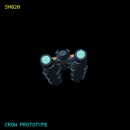

**Class:** Ship | [Definition](../Sources/L337Core/Resources/Ships/SH020.toml) | [Provenance](SHIP-PROVENANCE.md#sh020)

| Game specification | Value |
| --- | --- |
| Project family | crow |
| Primary display type | Pirate |
| Functional AI role | pirate |
| Object kind / origin | ship / human |
| Capital parent / subtype | No |
| Catalogue discovery eligibility | Yes |
| Encounter provision | authored; mechanics pending |
| Rarity | pending |
| Player flyable | No |
| Normal purchase capability | No |
| Purchase policy | pendingFabrication |
| Minimum displayed build Tech Level | Not applicable |
| Collection milestone | blueprintAndFabrication |
| Damage policy | destructible |
| Cargo (t) | 18 |
| Top speed | 54.0 |
| Acceleration (speed/s) | 15.0 |
| Energy capacity | 210.0 |
| Energy recharge /s | 3.5 |
| Roll (rad/s) | 1.4 |
| Pitch (rad/s) | 1.3 |
| Yaw (rad/s) | 1.2 |
| Each shield | 170.0 |
| Shield recharge /s | 1.6 |
| Fuel tank (LY) | 14.0 |
| Base jump (LY) | 11.0 |
| Jump charge (s) | 12.0 |
| Missile pylons | 4 |
| Laser mounts | Front |
| Cargo bay upgrade (t) | 10 |
| Hull price (CR) | 306,000 |
| Power index | 1046.0 |
| Trade-in (CR) | 229500.0 |
| Design | 2064 vertices; 3472 faces |

## SH021 - Zebra

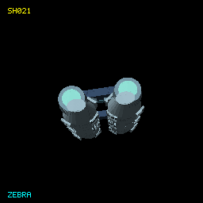

**Class:** Ship | [Definition](../Sources/L337Core/Resources/Ships/SH021.toml) | [Provenance](SHIP-PROVENANCE.md#sh021)

| Game specification | Value |
| --- | --- |
| Project family | zebra |
| Primary display type | Trader |
| Functional AI role | trader |
| Object kind / origin | ship / human |
| Capital parent / subtype | No |
| Catalogue discovery eligibility | Yes |
| Encounter provision | authored; mechanics pending |
| Rarity | pending |
| Player flyable | No |
| Normal purchase capability | No |
| Purchase policy | pendingFabrication |
| Minimum displayed build Tech Level | Not applicable |
| Collection milestone | blueprintAndFabrication |
| Damage policy | destructible |
| Cargo (t) | 66 |
| Top speed | 34.0 |
| Acceleration (speed/s) | 9.4 |
| Energy capacity | 330.0 |
| Energy recharge /s | 3.4 |
| Roll (rad/s) | 0.8 |
| Pitch (rad/s) | 0.7 |
| Yaw (rad/s) | 0.7 |
| Each shield | 260.0 |
| Shield recharge /s | 1.5 |
| Fuel tank (LY) | 13.0 |
| Base jump (LY) | 9.0 |
| Jump charge (s) | 12.0 |
| Missile pylons | 6 |
| Laser mounts | Front, Rear, Left, Right |
| Cargo bay upgrade (t) | 25 |
| Hull price (CR) | 316,000 |
| Power index | 1854.8 |
| Trade-in (CR) | 237000.0 |
| Design | 1488 vertices; 2528 faces |

## SH022 - Peregrine Mk I

**Class:** Ship | [Definition](../Sources/L337Core/Resources/Ships/SH022.toml) | [Provenance](SHIP-PROVENANCE.md#sh022)

| Game specification | Value |
| --- | --- |
| Project family | peregrine |
| Primary display type | Trader |
| Functional AI role | trader |
| Object kind / origin | ship / human |
| Capital parent / subtype | No |
| Catalogue discovery eligibility | Yes |
| Encounter provision | authored; mechanics pending |
| Rarity | pending |
| Player flyable | No |
| Normal purchase capability | No |
| Purchase policy | pendingFabrication |
| Minimum displayed build Tech Level | Not applicable |
| Collection milestone | blueprintAndFabrication |
| Damage policy | destructible |
| Cargo (t) | 64 |
| Top speed | 37.0 |
| Acceleration (speed/s) | 10.0 |
| Energy capacity | 260.0 |
| Energy recharge /s | 3.2 |
| Roll (rad/s) | 0.9 |
| Pitch (rad/s) | 0.8 |
| Yaw (rad/s) | 0.7 |
| Each shield | 230.0 |
| Shield recharge /s | 1.5 |
| Fuel tank (LY) | 13.0 |
| Base jump (LY) | 9.0 |
| Jump charge (s) | 12.0 |
| Missile pylons | 5 |
| Laser mounts | Front, Rear |
| Cargo bay upgrade (t) | 25 |
| Hull price (CR) | 292,000 |
| Power index | 1398.4 |
| Trade-in (CR) | 219000.0 |
| Design | 2072 vertices; 3484 faces |

## SH023 - Peregrine Mk III

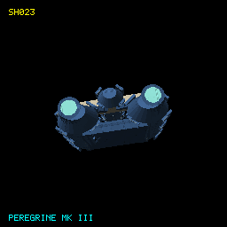

**Class:** Ship | [Definition](../Sources/L337Core/Resources/Ships/SH023.toml) | [Provenance](SHIP-PROVENANCE.md#sh023)

| Game specification | Value |
| --- | --- |
| Project family | peregrine |
| Primary display type | Trader |
| Functional AI role | trader |
| Object kind / origin | ship / human |
| Capital parent / subtype | No |
| Catalogue discovery eligibility | Yes |
| Encounter provision | authored; mechanics pending |
| Rarity | pending |
| Player flyable | No |
| Normal purchase capability | No |
| Purchase policy | pendingFabrication |
| Minimum displayed build Tech Level | Not applicable |
| Collection milestone | blueprintAndFabrication |
| Damage policy | destructible |
| Cargo (t) | 78 |
| Top speed | 35.7 |
| Acceleration (speed/s) | 9.5 |
| Energy capacity | 320.0 |
| Energy recharge /s | 3.7 |
| Roll (rad/s) | 0.8 |
| Pitch (rad/s) | 0.7 |
| Yaw (rad/s) | 0.7 |
| Each shield | 270.0 |
| Shield recharge /s | 1.6 |
| Fuel tank (LY) | 13.0 |
| Base jump (LY) | 9.0 |
| Jump charge (s) | 13.0 |
| Missile pylons | 7 |
| Laser mounts | Front, Rear, Left |
| Cargo bay upgrade (t) | 30 |
| Hull price (CR) | 325,000 |
| Power index | 1810.4 |
| Trade-in (CR) | 243750.0 |
| Design | 2072 vertices; 3484 faces |

## SH024 - Peregrine Mk IV

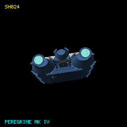

**Class:** Ship | [Definition](../Sources/L337Core/Resources/Ships/SH024.toml) | [Provenance](SHIP-PROVENANCE.md#sh024)

| Game specification | Value |
| --- | --- |
| Project family | peregrine |
| Primary display type | Trader |
| Functional AI role | trader |
| Object kind / origin | ship / human |
| Capital parent / subtype | No |
| Catalogue discovery eligibility | Yes |
| Encounter provision | authored; mechanics pending |
| Rarity | pending |
| Player flyable | No |
| Normal purchase capability | No |
| Purchase policy | pendingFabrication |
| Minimum displayed build Tech Level | Not applicable |
| Collection milestone | blueprintAndFabrication |
| Damage policy | destructible |
| Cargo (t) | 86 |
| Top speed | 34.6 |
| Acceleration (speed/s) | 9.3 |
| Energy capacity | 360.0 |
| Energy recharge /s | 4.0 |
| Roll (rad/s) | 0.8 |
| Pitch (rad/s) | 0.7 |
| Yaw (rad/s) | 0.7 |
| Each shield | 290.0 |
| Shield recharge /s | 1.7 |
| Fuel tank (LY) | 13.0 |
| Base jump (LY) | 10.0 |
| Jump charge (s) | 14.0 |
| Missile pylons | 6 |
| Laser mounts | Front, Rear, Left, Right |
| Cargo bay upgrade (t) | 35 |
| Hull price (CR) | 348,000 |
| Power index | 1964.0 |
| Trade-in (CR) | 261000.0 |
| Design | 2072 vertices; 3484 faces |

## SH025 - Peregrine Mk V

**Class:** Ship | [Definition](../Sources/L337Core/Resources/Ships/SH025.toml) | [Provenance](SHIP-PROVENANCE.md#sh025)

| Game specification | Value |
| --- | --- |
| Project family | peregrine |
| Primary display type | Trader |
| Functional AI role | trader |
| Object kind / origin | ship / human |
| Capital parent / subtype | No |
| Catalogue discovery eligibility | Yes |
| Encounter provision | natural; mechanics ready |
| Rarity | common |
| Player flyable | Yes |
| Normal purchase capability | Yes |
| Purchase policy | blueprintFabrication |
| Minimum displayed build Tech Level | 10 |
| Collection milestone | blueprintAndFabrication |
| Damage policy | destructible |
| Cargo (t) | 92 |
| Top speed | 34.3 |
| Acceleration (speed/s) | 9.1 |
| Energy capacity | 380.0 |
| Energy recharge /s | 4.2 |
| Roll (rad/s) | 0.8 |
| Pitch (rad/s) | 0.7 |
| Yaw (rad/s) | 0.7 |
| Each shield | 300.0 |
| Shield recharge /s | 1.8 |
| Fuel tank (LY) | 13.0 |
| Base jump (LY) | 9.0 |
| Jump charge (s) | 15.0 |
| Missile pylons | 9 |
| Laser mounts | Front, Rear, Left, Right |
| Cargo bay upgrade (t) | 35 |
| Hull price (CR) | 362,000 |
| Power index | 2202.4 |
| Trade-in (CR) | 271500.0 |
| Design | 2072 vertices; 3484 faces |

## SH026 - Harrier

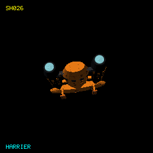

**Class:** Ship | [Definition](../Sources/L337Core/Resources/Ships/SH026.toml) | [Provenance](SHIP-PROVENANCE.md#sh026)

| Game specification | Value |
| --- | --- |
| Project family | harrier |
| Primary display type | Military |
| Functional AI role | military |
| Object kind / origin | ship / human |
| Capital parent / subtype | No |
| Catalogue discovery eligibility | Yes |
| Encounter provision | authored; mechanics pending |
| Rarity | uncommon |
| Player flyable | Yes |
| Normal purchase capability | No |
| Purchase policy | pendingFabrication |
| Minimum displayed build Tech Level | 9 |
| Collection milestone | blueprintAndFabrication |
| Damage policy | destructible |
| Cargo (t) | 18 |
| Top speed | 44.5 |
| Acceleration (speed/s) | 15.4 |
| Energy capacity | 390.0 |
| Energy recharge /s | 5.8 |
| Roll (rad/s) | 1.3 |
| Pitch (rad/s) | 1.2 |
| Yaw (rad/s) | 1.1 |
| Each shield | 280.0 |
| Shield recharge /s | 2.0 |
| Fuel tank (LY) | 12.0 |
| Base jump (LY) | 8.0 |
| Jump charge (s) | 12.0 |
| Missile pylons | 7 |
| Laser mounts | Front, Rear, Left |
| Cargo bay upgrade (t) | 5 |
| Hull price (CR) | 362,000 |
| Power index | 1967.6 |
| Trade-in (CR) | 271500.0 |
| Design | 5764 vertices; 8884 faces |

## SH027 - Ibex

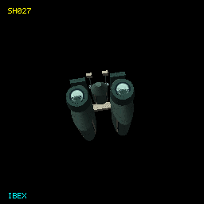

**Class:** Ship | [Definition](../Sources/L337Core/Resources/Ships/SH027.toml) | [Provenance](SHIP-PROVENANCE.md#sh027)

| Game specification | Value |
| --- | --- |
| Project family | ibex |
| Primary display type | Trader |
| Functional AI role | trader |
| Object kind / origin | ship / human |
| Capital parent / subtype | No |
| Catalogue discovery eligibility | Yes |
| Encounter provision | natural; mechanics ready |
| Rarity | common |
| Player flyable | Yes |
| Normal purchase capability | Yes |
| Purchase policy | blueprintFabrication |
| Minimum displayed build Tech Level | 5 |
| Collection milestone | blueprintAndFabrication |
| Damage policy | destructible |
| Cargo (t) | 54 |
| Top speed | 36.2 |
| Acceleration (speed/s) | 11.0 |
| Energy capacity | 270.0 |
| Energy recharge /s | 3.8 |
| Roll (rad/s) | 1.0 |
| Pitch (rad/s) | 0.9 |
| Yaw (rad/s) | 0.8 |
| Each shield | 220.0 |
| Shield recharge /s | 1.5 |
| Fuel tank (LY) | 13.0 |
| Base jump (LY) | 11.0 |
| Jump charge (s) | 12.0 |
| Missile pylons | 4 |
| Laser mounts | Front, Rear |
| Cargo bay upgrade (t) | 20 |
| Hull price (CR) | 307,000 |
| Power index | 1343.6 |
| Trade-in (CR) | 230250.0 |
| Design | 1612 vertices; 3108 faces |

## SH028 - Lion Citadel

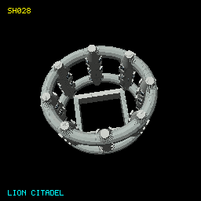

**Class:** Station | [Definition](../Sources/L337Core/Resources/Ships/SH028.toml) | [Provenance](SHIP-PROVENANCE.md#sh028)

| Game specification | Value |
| --- | --- |
| Project family | lion-citadel |
| Primary display type | None |
| Functional AI role | None |
| Object kind / origin | station / human |
| Capital parent / subtype | Yes / station |
| Catalogue discovery eligibility | Yes |
| Encounter provision | authored; mechanics pending |
| Rarity | uncommon |
| Player flyable | No |
| Normal purchase capability | No |
| Purchase policy | never |
| Minimum displayed build Tech Level | Not applicable |
| Collection milestone | docking |
| Damage policy | activeStationIndestructible |
| Native gameplay profile | pending; no player performance profile |
| Design | 5888 vertices; 10056 faces |

## SH029 - Okapi

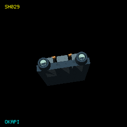

**Class:** Ship | [Definition](../Sources/L337Core/Resources/Ships/SH029.toml) | [Provenance](SHIP-PROVENANCE.md#sh029)

| Game specification | Value |
| --- | --- |
| Project family | okapi |
| Primary display type | Trader |
| Functional AI role | trader |
| Object kind / origin | ship / human |
| Capital parent / subtype | No |
| Catalogue discovery eligibility | Yes |
| Encounter provision | natural; mechanics ready |
| Rarity | common |
| Player flyable | Yes |
| Normal purchase capability | Yes |
| Purchase policy | blueprintFabrication |
| Minimum displayed build Tech Level | 7 |
| Collection milestone | blueprintAndFabrication |
| Damage policy | destructible |
| Cargo (t) | 60 |
| Top speed | 37.8 |
| Acceleration (speed/s) | 10.6 |
| Energy capacity | 280.0 |
| Energy recharge /s | 3.5 |
| Roll (rad/s) | 0.9 |
| Pitch (rad/s) | 0.8 |
| Yaw (rad/s) | 0.8 |
| Each shield | 230.0 |
| Shield recharge /s | 1.5 |
| Fuel tank (LY) | 13.0 |
| Base jump (LY) | 10.0 |
| Jump charge (s) | 12.0 |
| Missile pylons | 5 |
| Laser mounts | Front, Rear |
| Cargo bay upgrade (t) | 20 |
| Hull price (CR) | 312,000 |
| Power index | 1428.0 |
| Trade-in (CR) | 234000.0 |
| Design | 1248 vertices; 2376 faces |

## SH030 - Sparrowhawk

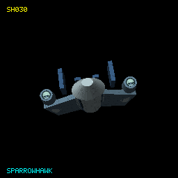

**Class:** Ship | [Definition](../Sources/L337Core/Resources/Ships/SH030.toml) | [Provenance](SHIP-PROVENANCE.md#sh030)

| Game specification | Value |
| --- | --- |
| Project family | sparrowhawk |
| Primary display type | Bounty hunter |
| Functional AI role | bountyHunter |
| Object kind / origin | ship / human |
| Capital parent / subtype | No |
| Catalogue discovery eligibility | Yes |
| Encounter provision | natural; mechanics ready |
| Rarity | uncommon |
| Player flyable | Yes |
| Normal purchase capability | Yes |
| Purchase policy | blueprintFabrication |
| Minimum displayed build Tech Level | 12 |
| Collection milestone | blueprintAndFabrication |
| Damage policy | destructible |
| Cargo (t) | 22 |
| Top speed | 51.0 |
| Acceleration (speed/s) | 17.2 |
| Energy capacity | 330.0 |
| Energy recharge /s | 5.0 |
| Roll (rad/s) | 1.5 |
| Pitch (rad/s) | 1.3 |
| Yaw (rad/s) | 1.2 |
| Each shield | 250.0 |
| Shield recharge /s | 1.9 |
| Fuel tank (LY) | 13.0 |
| Base jump (LY) | 10.0 |
| Jump charge (s) | 12.0 |
| Missile pylons | 5 |
| Laser mounts | Front, Rear |
| Cargo bay upgrade (t) | 10 |
| Hull price (CR) | 352,000 |
| Power index | 1566.0 |
| Trade-in (CR) | 264000.0 |
| Design | 1612 vertices; 3108 faces |

## SH031 - Kite Interceptor

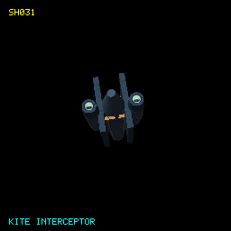

**Class:** Ship | [Definition](../Sources/L337Core/Resources/Ships/SH031.toml) | [Provenance](SHIP-PROVENANCE.md#sh031)

| Game specification | Value |
| --- | --- |
| Project family | kite |
| Primary display type | Military |
| Functional AI role | military |
| Object kind / origin | ship / human |
| Capital parent / subtype | No |
| Catalogue discovery eligibility | Yes |
| Encounter provision | natural; mechanics ready |
| Rarity | uncommon |
| Player flyable | Yes |
| Normal purchase capability | Yes |
| Purchase policy | blueprintFabrication |
| Minimum displayed build Tech Level | 7 |
| Collection milestone | blueprintAndFabrication |
| Damage policy | destructible |
| Cargo (t) | 10 |
| Top speed | 55.0 |
| Acceleration (speed/s) | 15.7 |
| Energy capacity | 270.0 |
| Energy recharge /s | 4.6 |
| Roll (rad/s) | 1.3 |
| Pitch (rad/s) | 1.1 |
| Yaw (rad/s) | 1.1 |
| Each shield | 290.0 |
| Shield recharge /s | 2.0 |
| Fuel tank (LY) | 14.0 |
| Base jump (LY) | 9.0 |
| Jump charge (s) | 12.0 |
| Missile pylons | 6 |
| Laser mounts | Front |
| Cargo bay upgrade (t) | 5 |
| Hull price (CR) | 325,000 |
| Power index | 1509.2 |
| Trade-in (CR) | 243750.0 |
| Design | 1612 vertices; 3108 faces |

## SH032 - Panther Explorer

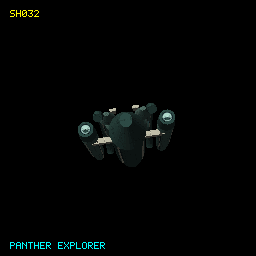

**Class:** Ship | [Definition](../Sources/L337Core/Resources/Ships/SH032.toml) | [Provenance](SHIP-PROVENANCE.md#sh032)

| Game specification | Value |
| --- | --- |
| Project family | panther |
| Primary display type | Leisure |
| Functional AI role | leisure |
| Object kind / origin | ship / human |
| Capital parent / subtype | No |
| Catalogue discovery eligibility | Yes |
| Encounter provision | natural; mechanics ready |
| Rarity | uncommon |
| Player flyable | Yes |
| Normal purchase capability | Yes |
| Purchase policy | blueprintFabrication |
| Minimum displayed build Tech Level | 10 |
| Collection milestone | blueprintAndFabrication |
| Damage policy | destructible |
| Cargo (t) | 32 |
| Top speed | 47.0 |
| Acceleration (speed/s) | 12.5 |
| Energy capacity | 220.0 |
| Energy recharge /s | 3.6 |
| Roll (rad/s) | 1.1 |
| Pitch (rad/s) | 0.9 |
| Yaw (rad/s) | 0.9 |
| Each shield | 200.0 |
| Shield recharge /s | 1.7 |
| Fuel tank (LY) | 14.0 |
| Base jump (LY) | 12.0 |
| Jump charge (s) | 12.0 |
| Missile pylons | 4 |
| Laser mounts | Front, Rear |
| Cargo bay upgrade (t) | 10 |
| Hull price (CR) | 312,000 |
| Power index | 1247.2 |
| Trade-in (CR) | 234000.0 |
| Design | 2866 vertices; 5596 faces |

## SH033 - Panther Scout

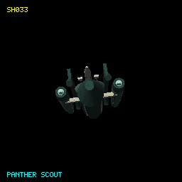

**Class:** Ship | [Definition](../Sources/L337Core/Resources/Ships/SH033.toml) | [Provenance](SHIP-PROVENANCE.md#sh033)

| Game specification | Value |
| --- | --- |
| Project family | panther |
| Primary display type | Military |
| Functional AI role | military |
| Object kind / origin | ship / human |
| Capital parent / subtype | No |
| Catalogue discovery eligibility | Yes |
| Encounter provision | natural; mechanics ready |
| Rarity | uncommon |
| Player flyable | Yes |
| Normal purchase capability | Yes |
| Purchase policy | blueprintFabrication |
| Minimum displayed build Tech Level | 8 |
| Collection milestone | blueprintAndFabrication |
| Damage policy | destructible |
| Cargo (t) | 14 |
| Top speed | 50.2 |
| Acceleration (speed/s) | 14.6 |
| Energy capacity | 300.0 |
| Energy recharge /s | 4.9 |
| Roll (rad/s) | 1.2 |
| Pitch (rad/s) | 1.0 |
| Yaw (rad/s) | 1.0 |
| Each shield | 270.0 |
| Shield recharge /s | 2.0 |
| Fuel tank (LY) | 13.0 |
| Base jump (LY) | 11.0 |
| Jump charge (s) | 12.0 |
| Missile pylons | 5 |
| Laser mounts | Front, Rear |
| Cargo bay upgrade (t) | 5 |
| Hull price (CR) | 342,000 |
| Power index | 1572.8 |
| Trade-in (CR) | 256500.0 |
| Design | 2672 vertices; 5212 faces |

## SH034 - Frog Station

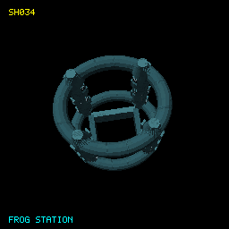

**Class:** Station | [Definition](../Sources/L337Core/Resources/Ships/SH034.toml) | [Provenance](SHIP-PROVENANCE.md#sh034)

| Game specification | Value |
| --- | --- |
| Project family | frog |
| Primary display type | None |
| Functional AI role | None |
| Object kind / origin | station / human |
| Capital parent / subtype | Yes / station |
| Catalogue discovery eligibility | Yes |
| Encounter provision | authored; mechanics pending |
| Rarity | rare |
| Player flyable | No |
| Normal purchase capability | No |
| Purchase policy | never |
| Minimum displayed build Tech Level | Not applicable |
| Collection milestone | docking |
| Damage policy | destructible |
| Native gameplay profile | pending; no player performance profile |
| Design | 3616 vertices; 6328 faces |

## SH035 - Stag Liner

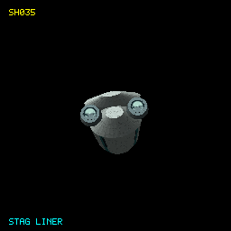

**Class:** Ship | [Definition](../Sources/L337Core/Resources/Ships/SH035.toml) | [Provenance](SHIP-PROVENANCE.md#sh035)

| Game specification | Value |
| --- | --- |
| Project family | stag |
| Primary display type | Leisure |
| Functional AI role | leisure |
| Object kind / origin | ship / human |
| Capital parent / subtype | No |
| Catalogue discovery eligibility | Yes |
| Encounter provision | natural; mechanics ready |
| Rarity | uncommon |
| Player flyable | Yes |
| Normal purchase capability | Yes |
| Purchase policy | blueprintFabrication |
| Minimum displayed build Tech Level | 8 |
| Collection milestone | blueprintAndFabrication |
| Damage policy | destructible |
| Cargo (t) | 100 |
| Top speed | 35.0 |
| Acceleration (speed/s) | 10.9 |
| Energy capacity | 330.0 |
| Energy recharge /s | 4.8 |
| Roll (rad/s) | 0.9 |
| Pitch (rad/s) | 0.8 |
| Yaw (rad/s) | 0.8 |
| Each shield | 220.0 |
| Shield recharge /s | 1.7 |
| Fuel tank (LY) | 14.0 |
| Base jump (LY) | 11.0 |
| Jump charge (s) | 12.0 |
| Missile pylons | 4 |
| Laser mounts | Front, Rear |
| Cargo bay upgrade (t) | 10 |
| Hull price (CR) | 353,000 |
| Power index | 1435.6 |
| Trade-in (CR) | 264750.0 |
| Design | 1806 vertices; 3492 faces |

## SH036 - Zebu

**Class:** Ship | [Definition](../Sources/L337Core/Resources/Ships/SH036.toml) | [Provenance](SHIP-PROVENANCE.md#sh036)

| Game specification | Value |
| --- | --- |
| Project family | zebu |
| Primary display type | Trader |
| Functional AI role | trader |
| Object kind / origin | ship / human |
| Capital parent / subtype | No |
| Catalogue discovery eligibility | Yes |
| Encounter provision | authored; mechanics pending |
| Rarity | pending |
| Player flyable | No |
| Normal purchase capability | No |
| Purchase policy | pendingFabrication |
| Minimum displayed build Tech Level | Not applicable |
| Collection milestone | blueprintAndFabrication |
| Damage policy | destructible |
| Cargo (t) | 72 |
| Top speed | 33.0 |
| Acceleration (speed/s) | 10.0 |
| Energy capacity | 300.0 |
| Energy recharge /s | 3.9 |
| Roll (rad/s) | 0.9 |
| Pitch (rad/s) | 0.8 |
| Yaw (rad/s) | 0.7 |
| Each shield | 230.0 |
| Shield recharge /s | 1.5 |
| Fuel tank (LY) | 15.0 |
| Base jump (LY) | 11.0 |
| Jump charge (s) | 12.0 |
| Missile pylons | 4 |
| Laser mounts | Front, Rear |
| Cargo bay upgrade (t) | 25 |
| Hull price (CR) | 319,000 |
| Power index | 1396.8 |
| Trade-in (CR) | 239250.0 |
| Design | 1790 vertices; 3468 faces |

## SH037 - Vulture Mk I

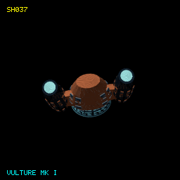

**Class:** Ship | [Definition](../Sources/L337Core/Resources/Ships/SH037.toml) | [Provenance](SHIP-PROVENANCE.md#sh037)

| Game specification | Value |
| --- | --- |
| Project family | vulture |
| Primary display type | Pirate |
| Functional AI role | pirate |
| Object kind / origin | ship / human |
| Capital parent / subtype | No |
| Catalogue discovery eligibility | Yes |
| Encounter provision | authored; mechanics pending |
| Rarity | pending |
| Player flyable | No |
| Normal purchase capability | No |
| Purchase policy | pendingFabrication |
| Minimum displayed build Tech Level | Not applicable |
| Collection milestone | blueprintAndFabrication |
| Damage policy | destructible |
| Cargo (t) | 14 |
| Top speed | 58.3 |
| Acceleration (speed/s) | 19.1 |
| Energy capacity | 140.0 |
| Energy recharge /s | 2.7 |
| Roll (rad/s) | 2.0 |
| Pitch (rad/s) | 1.8 |
| Yaw (rad/s) | 1.7 |
| Each shield | 140.0 |
| Shield recharge /s | 1.6 |
| Fuel tank (LY) | 11.0 |
| Base jump (LY) | 8.0 |
| Jump charge (s) | 10.0 |
| Missile pylons | 4 |
| Laser mounts | Front |
| Cargo bay upgrade (t) | 5 |
| Hull price (CR) | 262,000 |
| Power index | 890.4 |
| Trade-in (CR) | 196500.0 |
| Design | 5132 vertices; 8272 faces |

## SH038 - Vulture Mk II

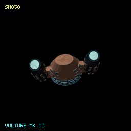

**Class:** Ship | [Definition](../Sources/L337Core/Resources/Ships/SH038.toml) | [Provenance](SHIP-PROVENANCE.md#sh038)

| Game specification | Value |
| --- | --- |
| Project family | vulture |
| Primary display type | Pirate |
| Functional AI role | pirate |
| Object kind / origin | ship / human |
| Capital parent / subtype | No |
| Catalogue discovery eligibility | Yes |
| Encounter provision | authored; mechanics pending |
| Rarity | pending |
| Player flyable | No |
| Normal purchase capability | No |
| Purchase policy | pendingFabrication |
| Minimum displayed build Tech Level | Not applicable |
| Collection milestone | blueprintAndFabrication |
| Damage policy | destructible |
| Cargo (t) | 18 |
| Top speed | 55.8 |
| Acceleration (speed/s) | 18.7 |
| Energy capacity | 210.0 |
| Energy recharge /s | 3.6 |
| Roll (rad/s) | 2.0 |
| Pitch (rad/s) | 1.7 |
| Yaw (rad/s) | 1.6 |
| Each shield | 150.0 |
| Shield recharge /s | 1.7 |
| Fuel tank (LY) | 11.0 |
| Base jump (LY) | 9.0 |
| Jump charge (s) | 10.0 |
| Missile pylons | 5 |
| Laser mounts | Front, Rear |
| Cargo bay upgrade (t) | 5 |
| Hull price (CR) | 303,000 |
| Power index | 1201.2 |
| Trade-in (CR) | 227250.0 |
| Design | 5132 vertices; 8272 faces |

## SH039 - Vulture Mk III

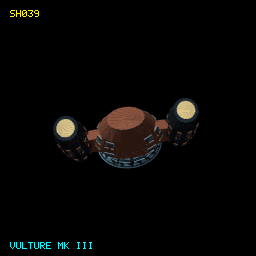

**Class:** Ship | [Definition](../Sources/L337Core/Resources/Ships/SH039.toml) | [Provenance](SHIP-PROVENANCE.md#sh039)

| Game specification | Value |
| --- | --- |
| Project family | vulture |
| Primary display type | Pirate |
| Functional AI role | pirate |
| Object kind / origin | ship / human |
| Capital parent / subtype | No |
| Catalogue discovery eligibility | Yes |
| Encounter provision | authored; mechanics pending |
| Rarity | pending |
| Player flyable | No |
| Normal purchase capability | No |
| Purchase policy | pendingFabrication |
| Minimum displayed build Tech Level | Not applicable |
| Collection milestone | blueprintAndFabrication |
| Damage policy | destructible |
| Cargo (t) | 24 |
| Top speed | 52.5 |
| Acceleration (speed/s) | 15.7 |
| Energy capacity | 300.0 |
| Energy recharge /s | 4.8 |
| Roll (rad/s) | 1.6 |
| Pitch (rad/s) | 1.4 |
| Yaw (rad/s) | 1.3 |
| Each shield | 160.0 |
| Shield recharge /s | 1.8 |
| Fuel tank (LY) | 11.0 |
| Base jump (LY) | 9.0 |
| Jump charge (s) | 11.0 |
| Missile pylons | 7 |
| Laser mounts | Front, Rear, Left |
| Cargo bay upgrade (t) | 5 |
| Hull price (CR) | 352,000 |
| Power index | 1605.6 |
| Trade-in (CR) | 264000.0 |
| Design | 5132 vertices; 8272 faces |

## SH040 - Newt Escape Pod

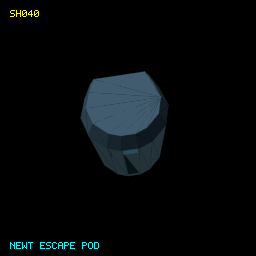

**Class:** Capsule | [Definition](../Sources/L337Core/Resources/Ships/SH040.toml) | [Provenance](SHIP-PROVENANCE.md#sh040)

| Game specification | Value |
| --- | --- |
| Project family | newt-escape-pod |
| Primary display type | None |
| Functional AI role | None |
| Object kind / origin | capsule / human |
| Capital parent / subtype | No |
| Catalogue discovery eligibility | No |
| Encounter provision | authored; mechanics pending |
| Rarity | pending |
| Player flyable | No |
| Normal purchase capability | No |
| Purchase policy | never |
| Minimum displayed build Tech Level | Not applicable |
| Collection milestone | none |
| Damage policy | destructible |
| Cargo (t) | 0 |
| Top speed | 18.0 |
| Acceleration (speed/s) | 3.0 |
| Energy capacity | 70.0 |
| Energy recharge /s | 0.6 |
| Roll (rad/s) | 0.6 |
| Pitch (rad/s) | 0.5 |
| Yaw (rad/s) | 0.5 |
| Each shield | 30.0 |
| Shield recharge /s | 0.4 |
| Fuel tank (LY) | 0.0 |
| Base jump (LY) | 0.0 |
| Jump charge (s) | 0.0 |
| Missile pylons | 0 |
| Laser mounts |  |
| Cargo bay upgrade (t) | 0 |
| Hull price (CR) | 0 |
| Power index | 149.2 |
| Trade-in (CR) | 0.0 |
| Design | 256 vertices; 415 faces |

## SH041 - Serval Fighter

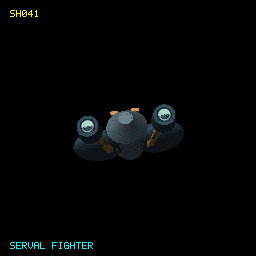

**Class:** Ship | [Definition](../Sources/L337Core/Resources/Ships/SH041.toml) | [Provenance](SHIP-PROVENANCE.md#sh041)

| Game specification | Value |
| --- | --- |
| Project family | serval |
| Primary display type | Military |
| Functional AI role | military |
| Object kind / origin | ship / human |
| Capital parent / subtype | No |
| Catalogue discovery eligibility | Yes |
| Encounter provision | authored; mechanics pending |
| Rarity | pending |
| Player flyable | No |
| Normal purchase capability | No |
| Purchase policy | pendingFabrication |
| Minimum displayed build Tech Level | Not applicable |
| Collection milestone | blueprintAndFabrication |
| Damage policy | destructible |
| Cargo (t) | 20 |
| Top speed | 43.6 |
| Acceleration (speed/s) | 13.4 |
| Energy capacity | 390.0 |
| Energy recharge /s | 6.1 |
| Roll (rad/s) | 1.1 |
| Pitch (rad/s) | 1.0 |
| Yaw (rad/s) | 0.9 |
| Each shield | 300.0 |
| Shield recharge /s | 2.0 |
| Fuel tank (LY) | 12.0 |
| Base jump (LY) | 9.0 |
| Jump charge (s) | 12.0 |
| Missile pylons | 6 |
| Laser mounts | Front, Rear, Left |
| Cargo bay upgrade (t) | 5 |
| Hull price (CR) | 365,000 |
| Power index | 1953.2 |
| Trade-in (CR) | 273750.0 |
| Design | 2172 vertices; 4236 faces |

## SH042 - Saker

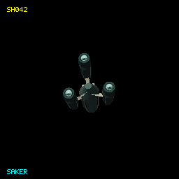

**Class:** Ship | [Definition](../Sources/L337Core/Resources/Ships/SH042.toml) | [Provenance](SHIP-PROVENANCE.md#sh042)

| Game specification | Value |
| --- | --- |
| Project family | saker |
| Primary display type | Military |
| Functional AI role | military |
| Object kind / origin | ship / human |
| Capital parent / subtype | No |
| Catalogue discovery eligibility | Yes |
| Encounter provision | authored; mechanics pending |
| Rarity | pending |
| Player flyable | No |
| Normal purchase capability | No |
| Purchase policy | pendingFabrication |
| Minimum displayed build Tech Level | Not applicable |
| Collection milestone | blueprintAndFabrication |
| Damage policy | destructible |
| Cargo (t) | 12 |
| Top speed | 51.0 |
| Acceleration (speed/s) | 15.7 |
| Energy capacity | 330.0 |
| Energy recharge /s | 5.2 |
| Roll (rad/s) | 1.3 |
| Pitch (rad/s) | 1.1 |
| Yaw (rad/s) | 1.1 |
| Each shield | 290.0 |
| Shield recharge /s | 2.0 |
| Fuel tank (LY) | 14.0 |
| Base jump (LY) | 10.0 |
| Jump charge (s) | 12.0 |
| Missile pylons | 5 |
| Laser mounts | Front, Rear |
| Cargo bay upgrade (t) | 5 |
| Hull price (CR) | 350,000 |
| Power index | 1652.4 |
| Trade-in (CR) | 262500.0 |
| Design | 1996 vertices; 3864 faces |

## SH043 - Eagle Cruiser

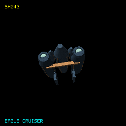

**Class:** Ship | [Definition](../Sources/L337Core/Resources/Ships/SH043.toml) | [Provenance](SHIP-PROVENANCE.md#sh043)

| Game specification | Value |
| --- | --- |
| Project family | eagle |
| Primary display type | Military |
| Functional AI role | military |
| Object kind / origin | ship / human |
| Capital parent / subtype | Yes / vessel |
| Catalogue discovery eligibility | Yes |
| Encounter provision | authored; mechanics pending |
| Rarity | pending |
| Player flyable | No |
| Normal purchase capability | No |
| Purchase policy | never |
| Minimum displayed build Tech Level | Not applicable |
| Collection milestone | destruction |
| Damage policy | destructible |
| Cargo (t) | 172 |
| Top speed | 22.8 |
| Acceleration (speed/s) | 5.2 |
| Energy capacity | 1490.0 |
| Energy recharge /s | 9.7 |
| Roll (rad/s) | 0.4 |
| Pitch (rad/s) | 0.4 |
| Yaw (rad/s) | 0.3 |
| Each shield | 600.0 |
| Shield recharge /s | 2.0 |
| Fuel tank (LY) | 14.0 |
| Base jump (LY) | 7.0 |
| Jump charge (s) | 18.0 |
| Missile pylons | 10 |
| Laser mounts | Front, Rear, Left, Right |
| Cargo bay upgrade (t) | 70 |
| Hull price (CR) | 0 |
| Power index | 4152.4 |
| Trade-in (CR) | 0.0 |
| Design | 2000 vertices; 3876 faces |

## SH044 - Harpy Assault

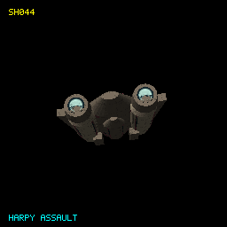

**Class:** Ship | [Definition](../Sources/L337Core/Resources/Ships/SH044.toml) | [Provenance](SHIP-PROVENANCE.md#sh044)

| Game specification | Value |
| --- | --- |
| Project family | harpy |
| Primary display type | Military |
| Functional AI role | military |
| Object kind / origin | ship / human |
| Capital parent / subtype | No |
| Catalogue discovery eligibility | Yes |
| Encounter provision | authored; mechanics pending |
| Rarity | pending |
| Player flyable | No |
| Normal purchase capability | No |
| Purchase policy | pendingFabrication |
| Minimum displayed build Tech Level | Not applicable |
| Collection milestone | blueprintAndFabrication |
| Damage policy | destructible |
| Cargo (t) | 18 |
| Top speed | 42.4 |
| Acceleration (speed/s) | 14.0 |
| Energy capacity | 480.0 |
| Energy recharge /s | 6.0 |
| Roll (rad/s) | 1.1 |
| Pitch (rad/s) | 1.0 |
| Yaw (rad/s) | 0.9 |
| Each shield | 290.0 |
| Shield recharge /s | 2.0 |
| Fuel tank (LY) | 14.0 |
| Base jump (LY) | 8.0 |
| Jump charge (s) | 12.0 |
| Missile pylons | 8 |
| Laser mounts | Front, Rear, Left |
| Cargo bay upgrade (t) | 5 |
| Hull price (CR) | 394,000 |
| Power index | 2148.0 |
| Trade-in (CR) | 295500.0 |
| Design | 1822 vertices; 3516 faces |

## SH045 - Erne Corvette

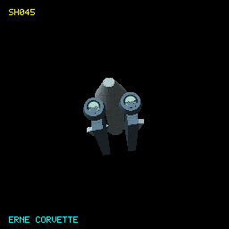

**Class:** Ship | [Definition](../Sources/L337Core/Resources/Ships/SH045.toml) | [Provenance](SHIP-PROVENANCE.md#sh045)

| Game specification | Value |
| --- | --- |
| Project family | erne |
| Primary display type | Military |
| Functional AI role | military |
| Object kind / origin | ship / human |
| Capital parent / subtype | No |
| Catalogue discovery eligibility | Yes |
| Encounter provision | authored; mechanics pending |
| Rarity | pending |
| Player flyable | No |
| Normal purchase capability | No |
| Purchase policy | pendingFabrication |
| Minimum displayed build Tech Level | Not applicable |
| Collection milestone | blueprintAndFabrication |
| Damage policy | destructible |
| Cargo (t) | 32 |
| Top speed | 36.0 |
| Acceleration (speed/s) | 13.2 |
| Energy capacity | 610.0 |
| Energy recharge /s | 7.0 |
| Roll (rad/s) | 1.1 |
| Pitch (rad/s) | 0.9 |
| Yaw (rad/s) | 0.9 |
| Each shield | 330.0 |
| Shield recharge /s | 2.0 |
| Fuel tank (LY) | 12.0 |
| Base jump (LY) | 9.0 |
| Jump charge (s) | 12.0 |
| Missile pylons | 9 |
| Laser mounts | Front, Rear, Left, Right |
| Cargo bay upgrade (t) | 5 |
| Hull price (CR) | 453,000 |
| Power index | 2582.0 |
| Trade-in (CR) | 339750.0 |
| Design | 1224 vertices; 2340 faces |

## SH046 - Harpy Dropship

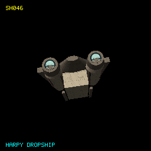

**Class:** Ship | [Definition](../Sources/L337Core/Resources/Ships/SH046.toml) | [Provenance](SHIP-PROVENANCE.md#sh046)

| Game specification | Value |
| --- | --- |
| Project family | harpy |
| Primary display type | Military |
| Functional AI role | military |
| Object kind / origin | ship / human |
| Capital parent / subtype | No |
| Catalogue discovery eligibility | Yes |
| Encounter provision | authored; mechanics pending |
| Rarity | pending |
| Player flyable | No |
| Normal purchase capability | No |
| Purchase policy | pendingFabrication |
| Minimum displayed build Tech Level | Not applicable |
| Collection milestone | blueprintAndFabrication |
| Damage policy | destructible |
| Cargo (t) | 48 |
| Top speed | 36.8 |
| Acceleration (speed/s) | 14.0 |
| Energy capacity | 450.0 |
| Energy recharge /s | 5.8 |
| Roll (rad/s) | 1.1 |
| Pitch (rad/s) | 1.0 |
| Yaw (rad/s) | 0.9 |
| Each shield | 290.0 |
| Shield recharge /s | 2.0 |
| Fuel tank (LY) | 14.0 |
| Base jump (LY) | 9.0 |
| Jump charge (s) | 12.0 |
| Missile pylons | 4 |
| Laser mounts | Front, Rear |
| Cargo bay upgrade (t) | 5 |
| Hull price (CR) | 384,000 |
| Power index | 1727.6 |
| Trade-in (CR) | 288000.0 |
| Design | 1628 vertices; 3132 faces |

## SH047 - Harpy Gunship

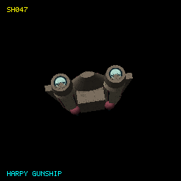

**Class:** Ship | [Definition](../Sources/L337Core/Resources/Ships/SH047.toml) | [Provenance](SHIP-PROVENANCE.md#sh047)

| Game specification | Value |
| --- | --- |
| Project family | harpy |
| Primary display type | Military |
| Functional AI role | military |
| Object kind / origin | ship / human |
| Capital parent / subtype | No |
| Catalogue discovery eligibility | Yes |
| Encounter provision | authored; mechanics pending |
| Rarity | pending |
| Player flyable | No |
| Normal purchase capability | No |
| Purchase policy | pendingFabrication |
| Minimum displayed build Tech Level | Not applicable |
| Collection milestone | blueprintAndFabrication |
| Damage policy | destructible |
| Cargo (t) | 14 |
| Top speed | 38.0 |
| Acceleration (speed/s) | 12.0 |
| Energy capacity | 560.0 |
| Energy recharge /s | 8.2 |
| Roll (rad/s) | 1.0 |
| Pitch (rad/s) | 0.9 |
| Yaw (rad/s) | 0.8 |
| Each shield | 290.0 |
| Shield recharge /s | 2.0 |
| Fuel tank (LY) | 14.0 |
| Base jump (LY) | 8.0 |
| Jump charge (s) | 12.0 |
| Missile pylons | 9 |
| Laser mounts | Front, Rear, Left, Right |
| Cargo bay upgrade (t) | 5 |
| Hull price (CR) | 436,000 |
| Power index | 2490.4 |
| Trade-in (CR) | 327000.0 |
| Design | 2584 vertices; 5040 faces |

## SH048 - Lanner

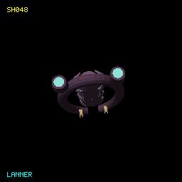

**Class:** Ship | [Definition](../Sources/L337Core/Resources/Ships/SH048.toml) | [Provenance](SHIP-PROVENANCE.md#sh048)

| Game specification | Value |
| --- | --- |
| Project family | lanner |
| Primary display type | Bounty hunter |
| Functional AI role | bountyHunter |
| Object kind / origin | ship / human |
| Capital parent / subtype | No |
| Catalogue discovery eligibility | Yes |
| Encounter provision | authored; mechanics pending |
| Rarity | pending |
| Player flyable | No |
| Normal purchase capability | No |
| Purchase policy | pendingFabrication |
| Minimum displayed build Tech Level | Not applicable |
| Collection milestone | blueprintAndFabrication |
| Damage policy | destructible |
| Cargo (t) | 10 |
| Top speed | 65.3 |
| Acceleration (speed/s) | 21.6 |
| Energy capacity | 190.0 |
| Energy recharge /s | 3.6 |
| Roll (rad/s) | 1.9 |
| Pitch (rad/s) | 1.7 |
| Yaw (rad/s) | 1.5 |
| Each shield | 190.0 |
| Shield recharge /s | 1.9 |
| Fuel tank (LY) | 12.0 |
| Base jump (LY) | 9.0 |
| Jump charge (s) | 10.0 |
| Missile pylons | 4 |
| Laser mounts | Front |
| Cargo bay upgrade (t) | 5 |
| Hull price (CR) | 302,000 |
| Power index | 1069.2 |
| Trade-in (CR) | 226500.0 |
| Design | 1476 vertices; 2696 faces |

## SH049 - Hyena

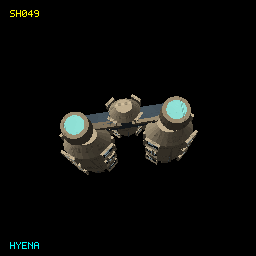

**Class:** Ship | [Definition](../Sources/L337Core/Resources/Ships/SH049.toml) | [Provenance](SHIP-PROVENANCE.md#sh049)

| Game specification | Value |
| --- | --- |
| Project family | hyena |
| Primary display type | Pirate |
| Functional AI role | pirate |
| Object kind / origin | ship / human |
| Capital parent / subtype | No |
| Catalogue discovery eligibility | Yes |
| Encounter provision | authored; mechanics pending |
| Rarity | pending |
| Player flyable | No |
| Normal purchase capability | No |
| Purchase policy | pendingFabrication |
| Minimum displayed build Tech Level | Not applicable |
| Collection milestone | blueprintAndFabrication |
| Damage policy | destructible |
| Cargo (t) | 32 |
| Top speed | 49.5 |
| Acceleration (speed/s) | 15.0 |
| Energy capacity | 280.0 |
| Energy recharge /s | 3.8 |
| Roll (rad/s) | 1.4 |
| Pitch (rad/s) | 1.3 |
| Yaw (rad/s) | 1.2 |
| Each shield | 170.0 |
| Shield recharge /s | 1.6 |
| Fuel tank (LY) | 12.0 |
| Base jump (LY) | 8.0 |
| Jump charge (s) | 12.0 |
| Missile pylons | 6 |
| Laser mounts | Front, Rear, Left |
| Cargo bay upgrade (t) | 10 |
| Hull price (CR) | 324,000 |
| Power index | 1509.6 |
| Trade-in (CR) | 243000.0 |
| Design | 2064 vertices; 3472 faces |

## SH050 - Yak

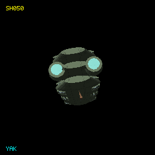

**Class:** Ship | [Definition](../Sources/L337Core/Resources/Ships/SH050.toml) | [Provenance](SHIP-PROVENANCE.md#sh050)

| Game specification | Value |
| --- | --- |
| Project family | yak |
| Primary display type | Trader |
| Functional AI role | trader |
| Object kind / origin | ship / human |
| Capital parent / subtype | No |
| Catalogue discovery eligibility | Yes |
| Encounter provision | authored; mechanics pending |
| Rarity | pending |
| Player flyable | No |
| Normal purchase capability | No |
| Purchase policy | pendingFabrication |
| Minimum displayed build Tech Level | Not applicable |
| Collection milestone | blueprintAndFabrication |
| Damage policy | destructible |
| Cargo (t) | 80 |
| Top speed | 31.5 |
| Acceleration (speed/s) | 10.0 |
| Energy capacity | 340.0 |
| Energy recharge /s | 4.3 |
| Roll (rad/s) | 0.9 |
| Pitch (rad/s) | 0.8 |
| Yaw (rad/s) | 0.7 |
| Each shield | 230.0 |
| Shield recharge /s | 1.5 |
| Fuel tank (LY) | 15.0 |
| Base jump (LY) | 10.0 |
| Jump charge (s) | 12.0 |
| Missile pylons | 5 |
| Laser mounts | Front, Rear |
| Cargo bay upgrade (t) | 25 |
| Hull price (CR) | 334,000 |
| Power index | 1513.6 |
| Trade-in (CR) | 250500.0 |
| Design | 2048 vertices; 3448 faces |

## SH051 - Jackal

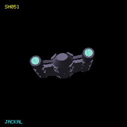

**Class:** Ship | [Definition](../Sources/L337Core/Resources/Ships/SH051.toml) | [Provenance](SHIP-PROVENANCE.md#sh051)

| Game specification | Value |
| --- | --- |
| Project family | jackal |
| Primary display type | Pirate |
| Functional AI role | pirate |
| Object kind / origin | ship / human |
| Capital parent / subtype | No |
| Catalogue discovery eligibility | Yes |
| Encounter provision | authored; mechanics pending |
| Rarity | pending |
| Player flyable | No |
| Normal purchase capability | No |
| Purchase policy | pendingFabrication |
| Minimum displayed build Tech Level | Not applicable |
| Collection milestone | blueprintAndFabrication |
| Damage policy | destructible |
| Cargo (t) | 28 |
| Top speed | 48.0 |
| Acceleration (speed/s) | 14.4 |
| Energy capacity | 250.0 |
| Energy recharge /s | 4.3 |
| Roll (rad/s) | 1.4 |
| Pitch (rad/s) | 1.2 |
| Yaw (rad/s) | 1.2 |
| Each shield | 180.0 |
| Shield recharge /s | 1.6 |
| Fuel tank (LY) | 12.0 |
| Base jump (LY) | 10.0 |
| Jump charge (s) | 12.0 |
| Missile pylons | 5 |
| Laser mounts | Front, Rear |
| Cargo bay upgrade (t) | 10 |
| Hull price (CR) | 322,000 |
| Power index | 1323.6 |
| Trade-in (CR) | 241500.0 |
| Design | 2056 vertices; 3460 faces |

## SH052 - Banteng

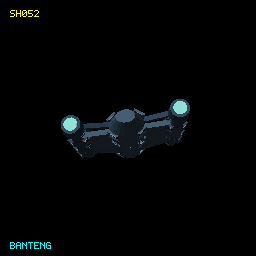

**Class:** Ship | [Definition](../Sources/L337Core/Resources/Ships/SH052.toml) | [Provenance](SHIP-PROVENANCE.md#sh052)

| Game specification | Value |
| --- | --- |
| Project family | banteng |
| Primary display type | Trader |
| Functional AI role | trader |
| Object kind / origin | ship / human |
| Capital parent / subtype | No |
| Catalogue discovery eligibility | Yes |
| Encounter provision | authored; mechanics pending |
| Rarity | pending |
| Player flyable | No |
| Normal purchase capability | No |
| Purchase policy | pendingFabrication |
| Minimum displayed build Tech Level | Not applicable |
| Collection milestone | blueprintAndFabrication |
| Damage policy | destructible |
| Cargo (t) | 68 |
| Top speed | 37.4 |
| Acceleration (speed/s) | 10.4 |
| Energy capacity | 250.0 |
| Energy recharge /s | 3.3 |
| Roll (rad/s) | 0.9 |
| Pitch (rad/s) | 0.8 |
| Yaw (rad/s) | 0.8 |
| Each shield | 210.0 |
| Shield recharge /s | 1.5 |
| Fuel tank (LY) | 13.0 |
| Base jump (LY) | 9.0 |
| Jump charge (s) | 12.0 |
| Missile pylons | 4 |
| Laser mounts | Front, Rear |
| Cargo bay upgrade (t) | 25 |
| Hull price (CR) | 288,000 |
| Power index | 1287.6 |
| Trade-in (CR) | 216000.0 |
| Design | 3192 vertices; 5324 faces |

## SH053 - Caracal Scout

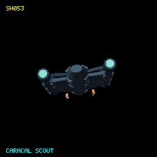

**Class:** Ship | [Definition](../Sources/L337Core/Resources/Ships/SH053.toml) | [Provenance](SHIP-PROVENANCE.md#sh053)

| Game specification | Value |
| --- | --- |
| Project family | caracal |
| Primary display type | Military |
| Functional AI role | military |
| Object kind / origin | ship / human |
| Capital parent / subtype | No |
| Catalogue discovery eligibility | Yes |
| Encounter provision | authored; mechanics pending |
| Rarity | pending |
| Player flyable | No |
| Normal purchase capability | No |
| Purchase policy | pendingFabrication |
| Minimum displayed build Tech Level | Not applicable |
| Collection milestone | blueprintAndFabrication |
| Damage policy | destructible |
| Cargo (t) | 10 |
| Top speed | 52.0 |
| Acceleration (speed/s) | 14.6 |
| Energy capacity | 300.0 |
| Energy recharge /s | 5.0 |
| Roll (rad/s) | 1.2 |
| Pitch (rad/s) | 1.0 |
| Yaw (rad/s) | 1.0 |
| Each shield | 270.0 |
| Shield recharge /s | 2.0 |
| Fuel tank (LY) | 12.0 |
| Base jump (LY) | 10.0 |
| Jump charge (s) | 12.0 |
| Missile pylons | 5 |
| Laser mounts | Front |
| Cargo bay upgrade (t) | 5 |
| Hull price (CR) | 340,000 |
| Power index | 1448.0 |
| Trade-in (CR) | 255000.0 |
| Design | 3224 vertices; 5372 faces |

## SH054 - Hobby Fighter

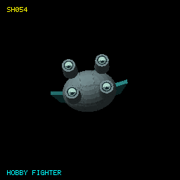

**Class:** Ship | [Definition](../Sources/L337Core/Resources/Ships/SH054.toml) | [Provenance](SHIP-PROVENANCE.md#sh054)

| Game specification | Value |
| --- | --- |
| Project family | hobby |
| Primary display type | Military |
| Functional AI role | military |
| Object kind / origin | ship / human |
| Capital parent / subtype | No |
| Catalogue discovery eligibility | Yes |
| Encounter provision | authored; mechanics pending |
| Rarity | pending |
| Player flyable | No |
| Normal purchase capability | No |
| Purchase policy | pendingFabrication |
| Minimum displayed build Tech Level | Not applicable |
| Collection milestone | blueprintAndFabrication |
| Damage policy | destructible |
| Cargo (t) | 12 |
| Top speed | 49.0 |
| Acceleration (speed/s) | 15.4 |
| Energy capacity | 280.0 |
| Energy recharge /s | 4.8 |
| Roll (rad/s) | 1.3 |
| Pitch (rad/s) | 1.2 |
| Yaw (rad/s) | 1.1 |
| Each shield | 280.0 |
| Shield recharge /s | 2.0 |
| Fuel tank (LY) | 12.0 |
| Base jump (LY) | 9.0 |
| Jump charge (s) | 12.0 |
| Missile pylons | 6 |
| Laser mounts | Front, Rear |
| Cargo bay upgrade (t) | 5 |
| Hull price (CR) | 320,000 |
| Power index | 1633.6 |
| Trade-in (CR) | 240000.0 |
| Design | 2374 vertices; 4620 faces |

## SH055 - Condor

**Class:** Ship | [Definition](../Sources/L337Core/Resources/Ships/SH055.toml) | [Provenance](SHIP-PROVENANCE.md#sh055)

| Game specification | Value |
| --- | --- |
| Project family | condor |
| Primary display type | Pirate |
| Functional AI role | pirate |
| Object kind / origin | ship / human |
| Capital parent / subtype | No |
| Catalogue discovery eligibility | Yes |
| Encounter provision | authored; mechanics pending |
| Rarity | pending |
| Player flyable | No |
| Normal purchase capability | No |
| Purchase policy | pendingFabrication |
| Minimum displayed build Tech Level | Not applicable |
| Collection milestone | blueprintAndFabrication |
| Damage policy | destructible |
| Cargo (t) | 38 |
| Top speed | 43.0 |
| Acceleration (speed/s) | 13.8 |
| Energy capacity | 320.0 |
| Energy recharge /s | 4.1 |
| Roll (rad/s) | 1.4 |
| Pitch (rad/s) | 1.2 |
| Yaw (rad/s) | 1.1 |
| Each shield | 170.0 |
| Shield recharge /s | 1.6 |
| Fuel tank (LY) | 12.0 |
| Base jump (LY) | 9.0 |
| Jump charge (s) | 12.0 |
| Missile pylons | 5 |
| Laser mounts | Front, Rear, Left, Right |
| Cargo bay upgrade (t) | 10 |
| Hull price (CR) | 337,000 |
| Power index | 1623.2 |
| Trade-in (CR) | 252750.0 |
| Design | 2308 vertices; 4504 faces |

## SH056 - Aplomado Interceptor

**Class:** Ship | [Definition](../Sources/L337Core/Resources/Ships/SH056.toml) | [Provenance](SHIP-PROVENANCE.md#sh056)

| Game specification | Value |
| --- | --- |
| Project family | aplomado |
| Primary display type | Military |
| Functional AI role | military |
| Object kind / origin | ship / human |
| Capital parent / subtype | No |
| Catalogue discovery eligibility | Yes |
| Encounter provision | authored; mechanics pending |
| Rarity | pending |
| Player flyable | No |
| Normal purchase capability | No |
| Purchase policy | pendingFabrication |
| Minimum displayed build Tech Level | Not applicable |
| Collection milestone | blueprintAndFabrication |
| Damage policy | destructible |
| Cargo (t) | 10 |
| Top speed | 56.0 |
| Acceleration (speed/s) | 15.0 |
| Energy capacity | 260.0 |
| Energy recharge /s | 4.4 |
| Roll (rad/s) | 1.3 |
| Pitch (rad/s) | 1.1 |
| Yaw (rad/s) | 1.0 |
| Each shield | 300.0 |
| Shield recharge /s | 2.0 |
| Fuel tank (LY) | 12.0 |
| Base jump (LY) | 9.0 |
| Jump charge (s) | 12.0 |
| Missile pylons | 5 |
| Laser mounts | Front |
| Cargo bay upgrade (t) | 5 |
| Hull price (CR) | 319,000 |
| Power index | 1448.8 |
| Trade-in (CR) | 239250.0 |
| Design | 1224 vertices; 2340 faces |

## SH057 - Falconet

**Class:** Ship | [Definition](../Sources/L337Core/Resources/Ships/SH057.toml) | [Provenance](SHIP-PROVENANCE.md#sh057)

| Game specification | Value |
| --- | --- |
| Project family | falconet |
| Primary display type | Military |
| Functional AI role | military |
| Object kind / origin | ship / human |
| Capital parent / subtype | No |
| Catalogue discovery eligibility | Yes |
| Encounter provision | authored; mechanics pending |
| Rarity | pending |
| Player flyable | No |
| Normal purchase capability | No |
| Purchase policy | pendingFabrication |
| Minimum displayed build Tech Level | Not applicable |
| Collection milestone | blueprintAndFabrication |
| Damage policy | destructible |
| Cargo (t) | 10 |
| Top speed | 51.8 |
| Acceleration (speed/s) | 13.4 |
| Energy capacity | 310.0 |
| Energy recharge /s | 5.4 |
| Roll (rad/s) | 1.1 |
| Pitch (rad/s) | 1.0 |
| Yaw (rad/s) | 0.9 |
| Each shield | 300.0 |
| Shield recharge /s | 2.0 |
| Fuel tank (LY) | 12.0 |
| Base jump (LY) | 8.0 |
| Jump charge (s) | 12.0 |
| Missile pylons | 6 |
| Laser mounts | Front, Rear |
| Cargo bay upgrade (t) | 5 |
| Hull price (CR) | 336,000 |
| Power index | 1722.8 |
| Trade-in (CR) | 252000.0 |
| Design | 1612 vertices; 3108 faces |

## SH058 - Muskox

**Class:** Ship | [Definition](../Sources/L337Core/Resources/Ships/SH058.toml) | [Provenance](SHIP-PROVENANCE.md#sh058)

| Game specification | Value |
| --- | --- |
| Project family | muskox |
| Primary display type | Transporter |
| Functional AI role | transporter |
| Object kind / origin | ship / human |
| Capital parent / subtype | No |
| Catalogue discovery eligibility | Yes |
| Encounter provision | authored; mechanics pending |
| Rarity | pending |
| Player flyable | No |
| Normal purchase capability | No |
| Purchase policy | pendingFabrication |
| Minimum displayed build Tech Level | Not applicable |
| Collection milestone | blueprintAndFabrication |
| Damage policy | destructible |
| Cargo (t) | 430 |
| Top speed | 20.2 |
| Acceleration (speed/s) | 5.3 |
| Energy capacity | 860.0 |
| Energy recharge /s | 5.6 |
| Roll (rad/s) | 0.4 |
| Pitch (rad/s) | 0.3 |
| Yaw (rad/s) | 0.3 |
| Each shield | 540.0 |
| Shield recharge /s | 1.7 |
| Fuel tank (LY) | 13.0 |
| Base jump (LY) | 8.0 |
| Jump charge (s) | 14.0 |
| Missile pylons | 6 |
| Laser mounts | Front, Rear, Left, Right |
| Cargo bay upgrade (t) | 165 |
| Hull price (CR) | 574,000 |
| Power index | 3015.2 |
| Trade-in (CR) | 430500.0 |
| Design | 2170 vertices; 4224 faces |

## SH059 - Barbary

**Class:** Ship | [Definition](../Sources/L337Core/Resources/Ships/SH059.toml) | [Provenance](SHIP-PROVENANCE.md#sh059)

| Game specification | Value |
| --- | --- |
| Project family | barbary |
| Primary display type | Military |
| Functional AI role | military |
| Object kind / origin | ship / human |
| Capital parent / subtype | No |
| Catalogue discovery eligibility | Yes |
| Encounter provision | authored; mechanics pending |
| Rarity | pending |
| Player flyable | No |
| Normal purchase capability | No |
| Purchase policy | pendingFabrication |
| Minimum displayed build Tech Level | Not applicable |
| Collection milestone | blueprintAndFabrication |
| Damage policy | destructible |
| Cargo (t) | 24 |
| Top speed | 41.0 |
| Acceleration (speed/s) | 12.9 |
| Energy capacity | 440.0 |
| Energy recharge /s | 6.0 |
| Roll (rad/s) | 1.1 |
| Pitch (rad/s) | 1.0 |
| Yaw (rad/s) | 0.9 |
| Each shield | 300.0 |
| Shield recharge /s | 2.0 |
| Fuel tank (LY) | 12.0 |
| Base jump (LY) | 10.0 |
| Jump charge (s) | 12.0 |
| Missile pylons | 6 |
| Laser mounts | Front, Rear, Left |
| Cargo bay upgrade (t) | 10 |
| Hull price (CR) | 383,000 |
| Power index | 2000.0 |
| Trade-in (CR) | 287250.0 |
| Design | 1976 vertices; 3852 faces |

## SH060 - Wombat

**Class:** Ship | [Definition](../Sources/L337Core/Resources/Ships/SH060.toml) | [Provenance](SHIP-PROVENANCE.md#sh060)

| Game specification | Value |
| --- | --- |
| Project family | wombat |
| Primary display type | Miner |
| Functional AI role | miner |
| Object kind / origin | ship / human |
| Capital parent / subtype | No |
| Catalogue discovery eligibility | Yes |
| Encounter provision | authored; mechanics pending |
| Rarity | pending |
| Player flyable | No |
| Normal purchase capability | No |
| Purchase policy | pendingFabrication |
| Minimum displayed build Tech Level | Not applicable |
| Collection milestone | blueprintAndFabrication |
| Damage policy | destructible |
| Cargo (t) | 88 |
| Top speed | 28.5 |
| Acceleration (speed/s) | 9.5 |
| Energy capacity | 430.0 |
| Energy recharge /s | 5.8 |
| Roll (rad/s) | 0.7 |
| Pitch (rad/s) | 0.6 |
| Yaw (rad/s) | 0.6 |
| Each shield | 290.0 |
| Shield recharge /s | 1.8 |
| Fuel tank (LY) | 12.0 |
| Base jump (LY) | 8.0 |
| Jump charge (s) | 12.0 |
| Missile pylons | 5 |
| Laser mounts | Front, Rear |
| Cargo bay upgrade (t) | 30 |
| Hull price (CR) | 365,000 |
| Power index | 1771.6 |
| Trade-in (CR) | 273750.0 |
| Design | 2112 vertices; 3544 faces |

## SH061 - Saiga

**Class:** Ship | [Definition](../Sources/L337Core/Resources/Ships/SH061.toml) | [Provenance](SHIP-PROVENANCE.md#sh061)

| Game specification | Value |
| --- | --- |
| Project family | saiga |
| Primary display type | Trader |
| Functional AI role | trader |
| Object kind / origin | ship / human |
| Capital parent / subtype | No |
| Catalogue discovery eligibility | Yes |
| Encounter provision | natural; mechanics ready |
| Rarity | common |
| Player flyable | Yes |
| Normal purchase capability | Yes |
| Purchase policy | blueprintFabrication |
| Minimum displayed build Tech Level | 5 |
| Collection milestone | blueprintAndFabrication |
| Damage policy | destructible |
| Cargo (t) | 84 |
| Top speed | 32.7 |
| Acceleration (speed/s) | 9.2 |
| Energy capacity | 310.0 |
| Energy recharge /s | 3.6 |
| Roll (rad/s) | 0.9 |
| Pitch (rad/s) | 0.8 |
| Yaw (rad/s) | 0.7 |
| Each shield | 230.0 |
| Shield recharge /s | 1.5 |
| Fuel tank (LY) | 13.0 |
| Base jump (LY) | 9.0 |
| Jump charge (s) | 12.0 |
| Missile pylons | 5 |
| Laser mounts | Front, Rear, Left |
| Cargo bay upgrade (t) | 30 |
| Hull price (CR) | 315,000 |
| Power index | 1589.2 |
| Trade-in (CR) | 236250.0 |
| Design | 3216 vertices; 5776 faces |

## SH062 - Moose Clipper

**Class:** Ship | [Definition](../Sources/L337Core/Resources/Ships/SH062.toml) | [Provenance](SHIP-PROVENANCE.md#sh062)

| Game specification | Value |
| --- | --- |
| Project family | moose |
| Primary display type | Transporter |
| Functional AI role | transporter |
| Object kind / origin | ship / human |
| Capital parent / subtype | No |
| Catalogue discovery eligibility | Yes |
| Encounter provision | authored; mechanics pending |
| Rarity | pending |
| Player flyable | No |
| Normal purchase capability | No |
| Purchase policy | pendingFabrication |
| Minimum displayed build Tech Level | Not applicable |
| Collection milestone | blueprintAndFabrication |
| Damage policy | destructible |
| Cargo (t) | 360 |
| Top speed | 27.0 |
| Acceleration (speed/s) | 5.8 |
| Energy capacity | 600.0 |
| Energy recharge /s | 5.1 |
| Roll (rad/s) | 0.4 |
| Pitch (rad/s) | 0.4 |
| Yaw (rad/s) | 0.4 |
| Each shield | 440.0 |
| Shield recharge /s | 1.7 |
| Fuel tank (LY) | 13.0 |
| Base jump (LY) | 9.0 |
| Jump charge (s) | 14.0 |
| Missile pylons | 5 |
| Laser mounts | Front, Rear |
| Cargo bay upgrade (t) | 160 |
| Hull price (CR) | 476,000 |
| Power index | 2219.2 |
| Trade-in (CR) | 357000.0 |
| Design | 1790 vertices; 3468 faces |

## SH063 - Seriema Courier

**Class:** Ship | [Definition](../Sources/L337Core/Resources/Ships/SH063.toml) | [Provenance](SHIP-PROVENANCE.md#sh063)

| Game specification | Value |
| --- | --- |
| Project family | seriema |
| Primary display type | Military |
| Functional AI role | military |
| Object kind / origin | ship / human |
| Capital parent / subtype | No |
| Catalogue discovery eligibility | Yes |
| Encounter provision | authored; mechanics pending |
| Rarity | pending |
| Player flyable | No |
| Normal purchase capability | No |
| Purchase policy | pendingFabrication |
| Minimum displayed build Tech Level | Not applicable |
| Collection milestone | blueprintAndFabrication |
| Damage policy | destructible |
| Cargo (t) | 26 |
| Top speed | 48.0 |
| Acceleration (speed/s) | 13.4 |
| Energy capacity | 300.0 |
| Energy recharge /s | 4.6 |
| Roll (rad/s) | 1.1 |
| Pitch (rad/s) | 1.0 |
| Yaw (rad/s) | 0.9 |
| Each shield | 300.0 |
| Shield recharge /s | 2.0 |
| Fuel tank (LY) | 14.0 |
| Base jump (LY) | 12.0 |
| Jump charge (s) | 12.0 |
| Missile pylons | 4 |
| Laser mounts | Front, Rear |
| Cargo bay upgrade (t) | 5 |
| Hull price (CR) | 346,000 |
| Power index | 1559.2 |
| Trade-in (CR) | 259500.0 |
| Design | 960 vertices; 1656 faces |

## SH064 - Arna Cutter

**Class:** Ship | [Definition](../Sources/L337Core/Resources/Ships/SH064.toml) | [Provenance](SHIP-PROVENANCE.md#sh064)

| Game specification | Value |
| --- | --- |
| Project family | arna |
| Primary display type | Transporter |
| Functional AI role | transporter |
| Object kind / origin | ship / human |
| Capital parent / subtype | No |
| Catalogue discovery eligibility | Yes |
| Encounter provision | authored; mechanics pending |
| Rarity | pending |
| Player flyable | No |
| Normal purchase capability | No |
| Purchase policy | pendingFabrication |
| Minimum displayed build Tech Level | Not applicable |
| Collection milestone | blueprintAndFabrication |
| Damage policy | destructible |
| Cargo (t) | 340 |
| Top speed | 25.6 |
| Acceleration (speed/s) | 5.8 |
| Energy capacity | 670.0 |
| Energy recharge /s | 5.5 |
| Roll (rad/s) | 0.4 |
| Pitch (rad/s) | 0.4 |
| Yaw (rad/s) | 0.4 |
| Each shield | 440.0 |
| Shield recharge /s | 1.7 |
| Fuel tank (LY) | 13.0 |
| Base jump (LY) | 10.0 |
| Jump charge (s) | 14.0 |
| Missile pylons | 5 |
| Laser mounts | Front, Rear |
| Cargo bay upgrade (t) | 160 |
| Hull price (CR) | 505,000 |
| Power index | 2302.0 |
| Trade-in (CR) | 378750.0 |
| Design | 1628 vertices; 3132 faces |

## SH065 - Vulture Raider

**Class:** Ship | [Definition](../Sources/L337Core/Resources/Ships/SH065.toml) | [Provenance](SHIP-PROVENANCE.md#sh065)

| Game specification | Value |
| --- | --- |
| Project family | vulture |
| Primary display type | Pirate |
| Functional AI role | pirate |
| Object kind / origin | ship / human |
| Capital parent / subtype | No |
| Catalogue discovery eligibility | Yes |
| Encounter provision | authored; mechanics pending |
| Rarity | pending |
| Player flyable | No |
| Normal purchase capability | No |
| Purchase policy | pendingFabrication |
| Minimum displayed build Tech Level | Not applicable |
| Collection milestone | blueprintAndFabrication |
| Damage policy | destructible |
| Cargo (t) | 20 |
| Top speed | 56.0 |
| Acceleration (speed/s) | 19.1 |
| Energy capacity | 180.0 |
| Energy recharge /s | 3.2 |
| Roll (rad/s) | 2.0 |
| Pitch (rad/s) | 1.8 |
| Yaw (rad/s) | 1.7 |
| Each shield | 140.0 |
| Shield recharge /s | 1.6 |
| Fuel tank (LY) | 11.0 |
| Base jump (LY) | 8.0 |
| Jump charge (s) | 10.0 |
| Missile pylons | 5 |
| Laser mounts | Front, Rear |
| Cargo bay upgrade (t) | 5 |
| Hull price (CR) | 286,000 |
| Power index | 1138.4 |
| Trade-in (CR) | 214500.0 |
| Design | 2120 vertices; 4120 faces |

## SH066 - Rabbit Explorer

**Class:** Ship | [Definition](../Sources/L337Core/Resources/Ships/SH066.toml) | [Provenance](SHIP-PROVENANCE.md#sh066)

| Game specification | Value |
| --- | --- |
| Project family | rabbit |
| Primary display type | Leisure |
| Functional AI role | leisure |
| Object kind / origin | ship / human |
| Capital parent / subtype | No |
| Catalogue discovery eligibility | Yes |
| Encounter provision | authored; mechanics pending |
| Rarity | pending |
| Player flyable | No |
| Normal purchase capability | No |
| Purchase policy | pendingFabrication |
| Minimum displayed build Tech Level | Not applicable |
| Collection milestone | blueprintAndFabrication |
| Damage policy | destructible |
| Cargo (t) | 28 |
| Top speed | 49.0 |
| Acceleration (speed/s) | 12.5 |
| Energy capacity | 200.0 |
| Energy recharge /s | 3.5 |
| Roll (rad/s) | 1.1 |
| Pitch (rad/s) | 0.9 |
| Yaw (rad/s) | 0.9 |
| Each shield | 200.0 |
| Shield recharge /s | 1.7 |
| Fuel tank (LY) | 14.0 |
| Base jump (LY) | 11.0 |
| Jump charge (s) | 12.0 |
| Missile pylons | 4 |
| Laser mounts | Front |
| Cargo bay upgrade (t) | 10 |
| Hull price (CR) | 297,000 |
| Power index | 1096.0 |
| Trade-in (CR) | 222750.0 |
| Design | 1444 vertices; 2648 faces |

## SH067 - Rhinoceros Trader

**Class:** Ship | [Definition](../Sources/L337Core/Resources/Ships/SH067.toml) | [Provenance](SHIP-PROVENANCE.md#sh067)

| Game specification | Value |
| --- | --- |
| Project family | rhinoceros |
| Primary display type | Trader |
| Functional AI role | trader |
| Object kind / origin | ship / human |
| Capital parent / subtype | No |
| Catalogue discovery eligibility | Yes |
| Encounter provision | authored; mechanics pending |
| Rarity | pending |
| Player flyable | No |
| Normal purchase capability | No |
| Purchase policy | pendingFabrication |
| Minimum displayed build Tech Level | Not applicable |
| Collection milestone | blueprintAndFabrication |
| Damage policy | destructible |
| Cargo (t) | 74 |
| Top speed | 31.0 |
| Acceleration (speed/s) | 10.6 |
| Energy capacity | 420.0 |
| Energy recharge /s | 4.1 |
| Roll (rad/s) | 0.9 |
| Pitch (rad/s) | 0.8 |
| Yaw (rad/s) | 0.8 |
| Each shield | 230.0 |
| Shield recharge /s | 1.5 |
| Fuel tank (LY) | 13.0 |
| Base jump (LY) | 9.0 |
| Jump charge (s) | 12.0 |
| Missile pylons | 6 |
| Laser mounts | Front, Rear, Left, Right |
| Cargo bay upgrade (t) | 20 |
| Hull price (CR) | 350,000 |
| Power index | 1907.2 |
| Trade-in (CR) | 262500.0 |
| Design | 376 vertices; 700 faces |

## SH068 - Badger

**Class:** Ship | [Definition](../Sources/L337Core/Resources/Ships/SH068.toml) | [Provenance](SHIP-PROVENANCE.md#sh068)

| Game specification | Value |
| --- | --- |
| Project family | badger |
| Primary display type | Miner |
| Functional AI role | miner |
| Object kind / origin | ship / human |
| Capital parent / subtype | No |
| Catalogue discovery eligibility | Yes |
| Encounter provision | authored; mechanics pending |
| Rarity | pending |
| Player flyable | No |
| Normal purchase capability | No |
| Purchase policy | pendingFabrication |
| Minimum displayed build Tech Level | Not applicable |
| Collection milestone | blueprintAndFabrication |
| Damage policy | destructible |
| Cargo (t) | 116 |
| Top speed | 25.5 |
| Acceleration (speed/s) | 8.3 |
| Energy capacity | 470.0 |
| Energy recharge /s | 6.4 |
| Roll (rad/s) | 0.7 |
| Pitch (rad/s) | 0.6 |
| Yaw (rad/s) | 0.6 |
| Each shield | 310.0 |
| Shield recharge /s | 1.8 |
| Fuel tank (LY) | 12.0 |
| Base jump (LY) | 9.0 |
| Jump charge (s) | 12.0 |
| Missile pylons | 5 |
| Laser mounts | Front, Rear, Left |
| Cargo bay upgrade (t) | 45 |
| Hull price (CR) | 395,000 |
| Power index | 1998.8 |
| Trade-in (CR) | 296250.0 |
| Design | 3012 vertices; 5912 faces |

## SH069 - Baza Fighter

**Class:** Ship | [Definition](../Sources/L337Core/Resources/Ships/SH069.toml) | [Provenance](SHIP-PROVENANCE.md#sh069)

| Game specification | Value |
| --- | --- |
| Project family | baza |
| Primary display type | Military |
| Functional AI role | military |
| Object kind / origin | ship / human |
| Capital parent / subtype | No |
| Catalogue discovery eligibility | Yes |
| Encounter provision | authored; mechanics pending |
| Rarity | pending |
| Player flyable | No |
| Normal purchase capability | No |
| Purchase policy | pendingFabrication |
| Minimum displayed build Tech Level | Not applicable |
| Collection milestone | blueprintAndFabrication |
| Damage policy | destructible |
| Cargo (t) | 16 |
| Top speed | 46.3 |
| Acceleration (speed/s) | 15.4 |
| Energy capacity | 350.0 |
| Energy recharge /s | 5.2 |
| Roll (rad/s) | 1.3 |
| Pitch (rad/s) | 1.2 |
| Yaw (rad/s) | 1.1 |
| Each shield | 280.0 |
| Shield recharge /s | 2.0 |
| Fuel tank (LY) | 12.0 |
| Base jump (LY) | 9.0 |
| Jump charge (s) | 12.0 |
| Missile pylons | 7 |
| Laser mounts | Front, Rear, Left |
| Cargo bay upgrade (t) | 5 |
| Hull price (CR) | 352,000 |
| Power index | 1908.4 |
| Trade-in (CR) | 264000.0 |
| Design | 1224 vertices; 2340 faces |

## SH070 - Baza Mk II

**Class:** Ship | [Definition](../Sources/L337Core/Resources/Ships/SH070.toml) | [Provenance](SHIP-PROVENANCE.md#sh070)

| Game specification | Value |
| --- | --- |
| Project family | baza |
| Primary display type | Bounty hunter |
| Functional AI role | bountyHunter |
| Object kind / origin | ship / human |
| Capital parent / subtype | No |
| Catalogue discovery eligibility | Yes |
| Encounter provision | authored; mechanics pending |
| Rarity | pending |
| Player flyable | No |
| Normal purchase capability | No |
| Purchase policy | pendingFabrication |
| Minimum displayed build Tech Level | Not applicable |
| Collection milestone | blueprintAndFabrication |
| Damage policy | destructible |
| Cargo (t) | 20 |
| Top speed | 53.1 |
| Acceleration (speed/s) | 19.3 |
| Energy capacity | 310.0 |
| Energy recharge /s | 4.8 |
| Roll (rad/s) | 1.7 |
| Pitch (rad/s) | 1.5 |
| Yaw (rad/s) | 1.4 |
| Each shield | 250.0 |
| Shield recharge /s | 2.0 |
| Fuel tank (LY) | 13.0 |
| Base jump (LY) | 10.0 |
| Jump charge (s) | 12.0 |
| Missile pylons | 6 |
| Laser mounts | Front, Rear |
| Cargo bay upgrade (t) | 10 |
| Hull price (CR) | 350,000 |
| Power index | 1603.6 |
| Trade-in (CR) | 262500.0 |
| Design | 1240 vertices; 2364 faces |

## SH071 - Griffon

**Class:** Ship | [Definition](../Sources/L337Core/Resources/Ships/SH071.toml) | [Provenance](SHIP-PROVENANCE.md#sh071)

| Game specification | Value |
| --- | --- |
| Project family | griffon |
| Primary display type | Pirate |
| Functional AI role | pirate |
| Object kind / origin | ship / human |
| Capital parent / subtype | No |
| Catalogue discovery eligibility | Yes |
| Encounter provision | authored; mechanics pending |
| Rarity | pending |
| Player flyable | No |
| Normal purchase capability | No |
| Purchase policy | pendingFabrication |
| Minimum displayed build Tech Level | Not applicable |
| Collection milestone | blueprintAndFabrication |
| Damage policy | destructible |
| Cargo (t) | 26 |
| Top speed | 48.0 |
| Acceleration (speed/s) | 14.1 |
| Energy capacity | 270.0 |
| Energy recharge /s | 3.6 |
| Roll (rad/s) | 1.4 |
| Pitch (rad/s) | 1.2 |
| Yaw (rad/s) | 1.1 |
| Each shield | 190.0 |
| Shield recharge /s | 1.6 |
| Fuel tank (LY) | 12.0 |
| Base jump (LY) | 9.0 |
| Jump charge (s) | 12.0 |
| Missile pylons | 5 |
| Laser mounts | Front, Rear |
| Cargo bay upgrade (t) | 10 |
| Hull price (CR) | 317,000 |
| Power index | 1341.2 |
| Trade-in (CR) | 237750.0 |
| Design | 952 vertices; 1644 faces |

## SH072 - Griffon Mk II

**Class:** Ship | [Definition](../Sources/L337Core/Resources/Ships/SH072.toml) | [Provenance](SHIP-PROVENANCE.md#sh072)

| Game specification | Value |
| --- | --- |
| Project family | griffon |
| Primary display type | Pirate |
| Functional AI role | pirate |
| Object kind / origin | ship / human |
| Capital parent / subtype | No |
| Catalogue discovery eligibility | Yes |
| Encounter provision | authored; mechanics pending |
| Rarity | pending |
| Player flyable | No |
| Normal purchase capability | No |
| Purchase policy | pendingFabrication |
| Minimum displayed build Tech Level | Not applicable |
| Collection milestone | blueprintAndFabrication |
| Damage policy | destructible |
| Cargo (t) | 34 |
| Top speed | 45.0 |
| Acceleration (speed/s) | 13.8 |
| Energy capacity | 350.0 |
| Energy recharge /s | 4.5 |
| Roll (rad/s) | 1.3 |
| Pitch (rad/s) | 1.1 |
| Yaw (rad/s) | 1.1 |
| Each shield | 210.0 |
| Shield recharge /s | 1.7 |
| Fuel tank (LY) | 12.0 |
| Base jump (LY) | 10.0 |
| Jump charge (s) | 12.0 |
| Missile pylons | 7 |
| Laser mounts | Front, Rear, Left, Right |
| Cargo bay upgrade (t) | 10 |
| Hull price (CR) | 361,000 |
| Power index | 1874.0 |
| Trade-in (CR) | 270750.0 |
| Design | 952 vertices; 1644 faces |

## SH073 - Griffon Spectre

**Class:** Ship | [Definition](../Sources/L337Core/Resources/Ships/SH073.toml) | [Provenance](SHIP-PROVENANCE.md#sh073)

| Game specification | Value |
| --- | --- |
| Project family | griffon |
| Primary display type | Pirate |
| Functional AI role | pirate |
| Object kind / origin | ship / human |
| Capital parent / subtype | No |
| Catalogue discovery eligibility | Yes |
| Encounter provision | authored; mechanics pending |
| Rarity | pending |
| Player flyable | No |
| Normal purchase capability | No |
| Purchase policy | pendingFabrication |
| Minimum displayed build Tech Level | Not applicable |
| Collection milestone | blueprintAndFabrication |
| Damage policy | destructible |
| Cargo (t) | 20 |
| Top speed | 53.0 |
| Acceleration (speed/s) | 14.1 |
| Energy capacity | 220.0 |
| Energy recharge /s | 3.9 |
| Roll (rad/s) | 1.4 |
| Pitch (rad/s) | 1.2 |
| Yaw (rad/s) | 1.1 |
| Each shield | 190.0 |
| Shield recharge /s | 1.6 |
| Fuel tank (LY) | 13.0 |
| Base jump (LY) | 11.0 |
| Jump charge (s) | 12.0 |
| Missile pylons | 4 |
| Laser mounts | Front |
| Cargo bay upgrade (t) | 10 |
| Hull price (CR) | 316,000 |
| Power index | 1108.8 |
| Trade-in (CR) | 237000.0 |
| Design | 952 vertices; 1644 faces |

## SH074 - Dzo

**Class:** Ship | [Definition](../Sources/L337Core/Resources/Ships/SH074.toml) | [Provenance](SHIP-PROVENANCE.md#sh074)

| Game specification | Value |
| --- | --- |
| Project family | dzo |
| Primary display type | Transporter |
| Functional AI role | transporter |
| Object kind / origin | ship / human |
| Capital parent / subtype | No |
| Catalogue discovery eligibility | Yes |
| Encounter provision | authored; mechanics pending |
| Rarity | pending |
| Player flyable | No |
| Normal purchase capability | No |
| Purchase policy | pendingFabrication |
| Minimum displayed build Tech Level | Not applicable |
| Collection milestone | blueprintAndFabrication |
| Damage policy | destructible |
| Cargo (t) | 420 |
| Top speed | 20.8 |
| Acceleration (speed/s) | 4.8 |
| Energy capacity | 740.0 |
| Energy recharge /s | 5.3 |
| Roll (rad/s) | 0.4 |
| Pitch (rad/s) | 0.3 |
| Yaw (rad/s) | 0.3 |
| Each shield | 470.0 |
| Shield recharge /s | 1.7 |
| Fuel tank (LY) | 15.0 |
| Base jump (LY) | 11.0 |
| Jump charge (s) | 14.0 |
| Missile pylons | 5 |
| Laser mounts | Front, Rear |
| Cargo bay upgrade (t) | 160 |
| Hull price (CR) | 538,000 |
| Power index | 2425.6 |
| Trade-in (CR) | 403500.0 |
| Design | 4668 vertices; 9228 faces |

## SH075 - Dzo Mk II

**Class:** Ship | [Definition](../Sources/L337Core/Resources/Ships/SH075.toml) | [Provenance](SHIP-PROVENANCE.md#sh075)

| Game specification | Value |
| --- | --- |
| Project family | dzo |
| Primary display type | Transporter |
| Functional AI role | transporter |
| Object kind / origin | ship / human |
| Capital parent / subtype | No |
| Catalogue discovery eligibility | Yes |
| Encounter provision | authored; mechanics pending |
| Rarity | pending |
| Player flyable | No |
| Normal purchase capability | No |
| Purchase policy | pendingFabrication |
| Minimum displayed build Tech Level | Not applicable |
| Collection milestone | blueprintAndFabrication |
| Damage policy | destructible |
| Cargo (t) | 480 |
| Top speed | 19.8 |
| Acceleration (speed/s) | 4.7 |
| Energy capacity | 880.0 |
| Energy recharge /s | 6.0 |
| Roll (rad/s) | 0.4 |
| Pitch (rad/s) | 0.3 |
| Yaw (rad/s) | 0.3 |
| Each shield | 510.0 |
| Shield recharge /s | 1.8 |
| Fuel tank (LY) | 15.0 |
| Base jump (LY) | 10.0 |
| Jump charge (s) | 14.0 |
| Missile pylons | 6 |
| Laser mounts | Front, Rear, Left |
| Cargo bay upgrade (t) | 175 |
| Hull price (CR) | 606,000 |
| Power index | 2860.0 |
| Trade-in (CR) | 454500.0 |
| Design | 4862 vertices; 9612 faces |

## SH076 - Hog

**Class:** Ship | [Definition](../Sources/L337Core/Resources/Ships/SH076.toml) | [Provenance](SHIP-PROVENANCE.md#sh076)

| Game specification | Value |
| --- | --- |
| Project family | hog |
| Primary display type | Transporter |
| Functional AI role | transporter |
| Object kind / origin | ship / human |
| Capital parent / subtype | No |
| Catalogue discovery eligibility | Yes |
| Encounter provision | authored; mechanics pending |
| Rarity | pending |
| Player flyable | No |
| Normal purchase capability | No |
| Purchase policy | pendingFabrication |
| Minimum displayed build Tech Level | Not applicable |
| Collection milestone | blueprintAndFabrication |
| Damage policy | destructible |
| Cargo (t) | 450 |
| Top speed | 19.0 |
| Acceleration (speed/s) | 4.6 |
| Energy capacity | 900.0 |
| Energy recharge /s | 5.8 |
| Roll (rad/s) | 0.3 |
| Pitch (rad/s) | 0.3 |
| Yaw (rad/s) | 0.3 |
| Each shield | 540.0 |
| Shield recharge /s | 1.7 |
| Fuel tank (LY) | 13.0 |
| Base jump (LY) | 8.0 |
| Jump charge (s) | 14.0 |
| Missile pylons | 6 |
| Laser mounts | Front, Rear, Left, Right |
| Cargo bay upgrade (t) | 165 |
| Hull price (CR) | 587,000 |
| Power index | 3061.6 |
| Trade-in (CR) | 440250.0 |
| Design | 484 vertices; 868 faces |

## SH077 - Tamaraw

**Class:** Ship | [Definition](../Sources/L337Core/Resources/Ships/SH077.toml) | [Provenance](SHIP-PROVENANCE.md#sh077)

| Game specification | Value |
| --- | --- |
| Project family | tamaraw |
| Primary display type | Transporter |
| Functional AI role | transporter |
| Object kind / origin | ship / human |
| Capital parent / subtype | No |
| Catalogue discovery eligibility | Yes |
| Encounter provision | authored; mechanics pending |
| Rarity | pending |
| Player flyable | No |
| Normal purchase capability | No |
| Purchase policy | pendingFabrication |
| Minimum displayed build Tech Level | Not applicable |
| Collection milestone | blueprintAndFabrication |
| Damage policy | destructible |
| Cargo (t) | 380 |
| Top speed | 23.2 |
| Acceleration (speed/s) | 4.8 |
| Energy capacity | 690.0 |
| Energy recharge /s | 5.0 |
| Roll (rad/s) | 0.4 |
| Pitch (rad/s) | 0.3 |
| Yaw (rad/s) | 0.3 |
| Each shield | 470.0 |
| Shield recharge /s | 1.7 |
| Fuel tank (LY) | 15.0 |
| Base jump (LY) | 10.0 |
| Jump charge (s) | 14.0 |
| Missile pylons | 5 |
| Laser mounts | Front, Rear |
| Cargo bay upgrade (t) | 160 |
| Hull price (CR) | 508,000 |
| Power index | 2366.0 |
| Trade-in (CR) | 381000.0 |
| Design | 1992 vertices; 3864 faces |

## SH078 - Oryx Voyager

**Class:** Ship | [Definition](../Sources/L337Core/Resources/Ships/SH078.toml) | [Provenance](SHIP-PROVENANCE.md#sh078)

| Game specification | Value |
| --- | --- |
| Project family | oryx-voyager |
| Primary display type | Leisure |
| Functional AI role | leisure |
| Object kind / origin | ship / human |
| Capital parent / subtype | No |
| Catalogue discovery eligibility | Yes |
| Encounter provision | authored; mechanics pending |
| Rarity | pending |
| Player flyable | No |
| Normal purchase capability | No |
| Purchase policy | pendingFabrication |
| Minimum displayed build Tech Level | Not applicable |
| Collection milestone | blueprintAndFabrication |
| Damage policy | destructible |
| Cargo (t) | 80 |
| Top speed | 36.5 |
| Acceleration (speed/s) | 11.5 |
| Energy capacity | 320.0 |
| Energy recharge /s | 5.2 |
| Roll (rad/s) | 1.0 |
| Pitch (rad/s) | 0.9 |
| Yaw (rad/s) | 0.8 |
| Each shield | 230.0 |
| Shield recharge /s | 1.7 |
| Fuel tank (LY) | 15.0 |
| Base jump (LY) | 13.0 |
| Jump charge (s) | 12.0 |
| Missile pylons | 4 |
| Laser mounts | Front, Rear |
| Cargo bay upgrade (t) | 15 |
| Hull price (CR) | 365,000 |
| Power index | 1458.4 |
| Trade-in (CR) | 273750.0 |
| Design | 2364 vertices; 4620 faces |

## SH079 - Carabao Freighter

**Class:** Ship | [Definition](../Sources/L337Core/Resources/Ships/SH079.toml) | [Provenance](SHIP-PROVENANCE.md#sh079)

| Game specification | Value |
| --- | --- |
| Project family | carabao |
| Primary display type | Transporter |
| Functional AI role | transporter |
| Object kind / origin | ship / human |
| Capital parent / subtype | No |
| Catalogue discovery eligibility | Yes |
| Encounter provision | authored; mechanics pending |
| Rarity | pending |
| Player flyable | No |
| Normal purchase capability | No |
| Purchase policy | pendingFabrication |
| Minimum displayed build Tech Level | Not applicable |
| Collection milestone | blueprintAndFabrication |
| Damage policy | destructible |
| Cargo (t) | 786 |
| Top speed | 19.6 |
| Acceleration (speed/s) | 4.8 |
| Energy capacity | 970.0 |
| Energy recharge /s | 6.4 |
| Roll (rad/s) | 0.4 |
| Pitch (rad/s) | 0.3 |
| Yaw (rad/s) | 0.3 |
| Each shield | 550.0 |
| Shield recharge /s | 1.7 |
| Fuel tank (LY) | 13.0 |
| Base jump (LY) | 7.0 |
| Jump charge (s) | 16.0 |
| Missile pylons | 7 |
| Laser mounts | Front, Rear, Left |
| Cargo bay upgrade (t) | 315 |
| Hull price (CR) | 696,000 |
| Power index | 3106.8 |
| Trade-in (CR) | 522000.0 |
| Design | 1296 vertices; 2448 faces |

## SH080 - Carabao Highliner

**Class:** Ship | [Definition](../Sources/L337Core/Resources/Ships/SH080.toml) | [Provenance](SHIP-PROVENANCE.md#sh080)

| Game specification | Value |
| --- | --- |
| Project family | carabao |
| Primary display type | Transporter |
| Functional AI role | transporter |
| Object kind / origin | ship / human |
| Capital parent / subtype | No |
| Catalogue discovery eligibility | Yes |
| Encounter provision | authored; mechanics pending |
| Rarity | pending |
| Player flyable | No |
| Normal purchase capability | No |
| Purchase policy | pendingFabrication |
| Minimum displayed build Tech Level | Not applicable |
| Collection milestone | blueprintAndFabrication |
| Damage policy | destructible |
| Cargo (t) | 680 |
| Top speed | 21.0 |
| Acceleration (speed/s) | 4.1 |
| Energy capacity | 1020.0 |
| Energy recharge /s | 6.8 |
| Roll (rad/s) | 0.3 |
| Pitch (rad/s) | 0.3 |
| Yaw (rad/s) | 0.3 |
| Each shield | 550.0 |
| Shield recharge /s | 1.7 |
| Fuel tank (LY) | 13.0 |
| Base jump (LY) | 10.0 |
| Jump charge (s) | 16.0 |
| Missile pylons | 6 |
| Laser mounts | Front, Rear, Left |
| Cargo bay upgrade (t) | 315 |
| Hull price (CR) | 709,000 |
| Power index | 3105.6 |
| Trade-in (CR) | 531750.0 |
| Design | 1506 vertices; 2856 faces |

## SH081 - Jaguar

**Class:** Ship | [Definition](../Sources/L337Core/Resources/Ships/SH081.toml) | [Provenance](SHIP-PROVENANCE.md#sh081)

| Game specification | Value |
| --- | --- |
| Project family | jaguar |
| Primary display type | Military |
| Functional AI role | military |
| Object kind / origin | ship / human |
| Capital parent / subtype | Yes / vessel |
| Catalogue discovery eligibility | Yes |
| Encounter provision | authored; mechanics pending |
| Rarity | pending |
| Player flyable | No |
| Normal purchase capability | No |
| Purchase policy | never |
| Minimum displayed build Tech Level | Not applicable |
| Collection milestone | destruction |
| Damage policy | destructible |
| Cargo (t) | 144 |
| Top speed | 23.3 |
| Acceleration (speed/s) | 5.4 |
| Energy capacity | 1480.0 |
| Energy recharge /s | 11.5 |
| Roll (rad/s) | 0.4 |
| Pitch (rad/s) | 0.4 |
| Yaw (rad/s) | 0.3 |
| Each shield | 620.0 |
| Shield recharge /s | 2.0 |
| Fuel tank (LY) | 14.0 |
| Base jump (LY) | 7.0 |
| Jump charge (s) | 18.0 |
| Missile pylons | 10 |
| Laser mounts | Front, Rear, Left, Right |
| Cargo bay upgrade (t) | 60 |
| Hull price (CR) | 0 |
| Power index | 4240.0 |
| Trade-in (CR) | 0.0 |
| Design | 2994 vertices; 5820 faces |

## SH082 - Cheetah

**Class:** Ship | [Definition](../Sources/L337Core/Resources/Ships/SH082.toml) | [Provenance](SHIP-PROVENANCE.md#sh082)

| Game specification | Value |
| --- | --- |
| Project family | cheetah |
| Primary display type | Bounty hunter |
| Functional AI role | bountyHunter |
| Object kind / origin | ship / human |
| Capital parent / subtype | No |
| Catalogue discovery eligibility | Yes |
| Encounter provision | authored; mechanics pending |
| Rarity | pending |
| Player flyable | No |
| Normal purchase capability | No |
| Purchase policy | pendingFabrication |
| Minimum displayed build Tech Level | Not applicable |
| Collection milestone | blueprintAndFabrication |
| Damage policy | destructible |
| Cargo (t) | 14 |
| Top speed | 57.0 |
| Acceleration (speed/s) | 19.5 |
| Energy capacity | 250.0 |
| Energy recharge /s | 3.8 |
| Roll (rad/s) | 1.7 |
| Pitch (rad/s) | 1.5 |
| Yaw (rad/s) | 1.4 |
| Each shield | 240.0 |
| Shield recharge /s | 1.9 |
| Fuel tank (LY) | 12.0 |
| Base jump (LY) | 9.0 |
| Jump charge (s) | 10.0 |
| Missile pylons | 4 |
| Laser mounts | Front |
| Cargo bay upgrade (t) | 5 |
| Hull price (CR) | 310,000 |
| Power index | 1235.6 |
| Trade-in (CR) | 232500.0 |
| Design | 2088 vertices; 3508 faces |

## SH083 - Hare Explorer

**Class:** Ship | [Definition](../Sources/L337Core/Resources/Ships/SH083.toml) | [Provenance](SHIP-PROVENANCE.md#sh083)

| Game specification | Value |
| --- | --- |
| Project family | hare |
| Primary display type | Leisure |
| Functional AI role | leisure |
| Object kind / origin | ship / human |
| Capital parent / subtype | No |
| Catalogue discovery eligibility | Yes |
| Encounter provision | authored; mechanics pending |
| Rarity | pending |
| Player flyable | No |
| Normal purchase capability | No |
| Purchase policy | pendingFabrication |
| Minimum displayed build Tech Level | Not applicable |
| Collection milestone | blueprintAndFabrication |
| Damage policy | destructible |
| Cargo (t) | 36 |
| Top speed | 45.0 |
| Acceleration (speed/s) | 11.5 |
| Energy capacity | 240.0 |
| Energy recharge /s | 4.4 |
| Roll (rad/s) | 1.0 |
| Pitch (rad/s) | 0.9 |
| Yaw (rad/s) | 0.8 |
| Each shield | 230.0 |
| Shield recharge /s | 1.7 |
| Fuel tank (LY) | 14.0 |
| Base jump (LY) | 12.0 |
| Jump charge (s) | 12.0 |
| Missile pylons | 4 |
| Laser mounts | Front |
| Cargo bay upgrade (t) | 15 |
| Hull price (CR) | 324,000 |
| Power index | 1224.8 |
| Trade-in (CR) | 243000.0 |
| Design | 1612 vertices; 3108 faces |

## SH084 - Llama

**Class:** Ship | [Definition](../Sources/L337Core/Resources/Ships/SH084.toml) | [Provenance](SHIP-PROVENANCE.md#sh084)

| Game specification | Value |
| --- | --- |
| Project family | llama |
| Primary display type | Trader |
| Functional AI role | trader |
| Object kind / origin | ship / human |
| Capital parent / subtype | No |
| Catalogue discovery eligibility | Yes |
| Encounter provision | authored; mechanics pending |
| Rarity | pending |
| Player flyable | No |
| Normal purchase capability | No |
| Purchase policy | pendingFabrication |
| Minimum displayed build Tech Level | Not applicable |
| Collection milestone | blueprintAndFabrication |
| Damage policy | destructible |
| Cargo (t) | 62 |
| Top speed | 36.5 |
| Acceleration (speed/s) | 11.0 |
| Energy capacity | 240.0 |
| Energy recharge /s | 3.7 |
| Roll (rad/s) | 1.0 |
| Pitch (rad/s) | 0.9 |
| Yaw (rad/s) | 0.8 |
| Each shield | 220.0 |
| Shield recharge /s | 1.5 |
| Fuel tank (LY) | 13.0 |
| Base jump (LY) | 11.0 |
| Jump charge (s) | 12.0 |
| Missile pylons | 4 |
| Laser mounts | Front, Rear |
| Cargo bay upgrade (t) | 20 |
| Hull price (CR) | 300,000 |
| Power index | 1310.4 |
| Trade-in (CR) | 225000.0 |
| Design | 1604 vertices; 3096 faces |

## SH085 - Laggar

**Class:** Ship | [Definition](../Sources/L337Core/Resources/Ships/SH085.toml) | [Provenance](SHIP-PROVENANCE.md#sh085)

| Game specification | Value |
| --- | --- |
| Project family | laggar |
| Primary display type | Bounty hunter |
| Functional AI role | bountyHunter |
| Object kind / origin | ship / human |
| Capital parent / subtype | No |
| Catalogue discovery eligibility | Yes |
| Encounter provision | authored; mechanics pending |
| Rarity | pending |
| Player flyable | No |
| Normal purchase capability | No |
| Purchase policy | pendingFabrication |
| Minimum displayed build Tech Level | Not applicable |
| Collection milestone | blueprintAndFabrication |
| Damage policy | destructible |
| Cargo (t) | 18 |
| Top speed | 54.1 |
| Acceleration (speed/s) | 17.6 |
| Energy capacity | 280.0 |
| Energy recharge /s | 4.4 |
| Roll (rad/s) | 1.6 |
| Pitch (rad/s) | 1.4 |
| Yaw (rad/s) | 1.3 |
| Each shield | 230.0 |
| Shield recharge /s | 1.9 |
| Fuel tank (LY) | 13.0 |
| Base jump (LY) | 10.0 |
| Jump charge (s) | 12.0 |
| Missile pylons | 5 |
| Laser mounts | Front, Rear |
| Cargo bay upgrade (t) | 5 |
| Hull price (CR) | 335,000 |
| Power index | 1456.8 |
| Trade-in (CR) | 251250.0 |
| Design | 1612 vertices; 3108 faces |

## SH086 - Alpaca

**Class:** Ship | [Definition](../Sources/L337Core/Resources/Ships/SH086.toml) | [Provenance](SHIP-PROVENANCE.md#sh086)

| Game specification | Value |
| --- | --- |
| Project family | alpaca |
| Primary display type | Trader |
| Functional AI role | trader |
| Object kind / origin | ship / human |
| Capital parent / subtype | No |
| Catalogue discovery eligibility | Yes |
| Encounter provision | authored; mechanics pending |
| Rarity | pending |
| Player flyable | No |
| Normal purchase capability | No |
| Purchase policy | pendingFabrication |
| Minimum displayed build Tech Level | Not applicable |
| Collection milestone | blueprintAndFabrication |
| Damage policy | destructible |
| Cargo (t) | 60 |
| Top speed | 35.8 |
| Acceleration (speed/s) | 9.4 |
| Energy capacity | 290.0 |
| Energy recharge /s | 4.0 |
| Roll (rad/s) | 0.8 |
| Pitch (rad/s) | 0.7 |
| Yaw (rad/s) | 0.7 |
| Each shield | 260.0 |
| Shield recharge /s | 1.5 |
| Fuel tank (LY) | 13.0 |
| Base jump (LY) | 10.0 |
| Jump charge (s) | 12.0 |
| Missile pylons | 4 |
| Laser mounts | Front, Rear |
| Cargo bay upgrade (t) | 25 |
| Hull price (CR) | 314,000 |
| Power index | 1450.0 |
| Trade-in (CR) | 235500.0 |
| Design | 1480 vertices; 2724 faces |

## SH087 - Elk

**Class:** Ship | [Definition](../Sources/L337Core/Resources/Ships/SH087.toml) | [Provenance](SHIP-PROVENANCE.md#sh087)

| Game specification | Value |
| --- | --- |
| Project family | elk |
| Primary display type | Trader |
| Functional AI role | trader |
| Object kind / origin | ship / human |
| Capital parent / subtype | No |
| Catalogue discovery eligibility | Yes |
| Encounter provision | authored; mechanics pending |
| Rarity | pending |
| Player flyable | No |
| Normal purchase capability | No |
| Purchase policy | pendingFabrication |
| Minimum displayed build Tech Level | Not applicable |
| Collection milestone | blueprintAndFabrication |
| Damage policy | destructible |
| Cargo (t) | 70 |
| Top speed | 34.8 |
| Acceleration (speed/s) | 9.4 |
| Energy capacity | 320.0 |
| Energy recharge /s | 3.8 |
| Roll (rad/s) | 0.8 |
| Pitch (rad/s) | 0.7 |
| Yaw (rad/s) | 0.7 |
| Each shield | 260.0 |
| Shield recharge /s | 1.5 |
| Fuel tank (LY) | 13.0 |
| Base jump (LY) | 10.0 |
| Jump charge (s) | 12.0 |
| Missile pylons | 5 |
| Laser mounts | Front, Rear, Left |
| Cargo bay upgrade (t) | 25 |
| Hull price (CR) | 321,000 |
| Power index | 1665.6 |
| Trade-in (CR) | 240750.0 |
| Design | 912 vertices; 1584 faces |

## SH088 - Springbok Starliner

**Class:** Ship | [Definition](../Sources/L337Core/Resources/Ships/SH088.toml) | [Provenance](SHIP-PROVENANCE.md#sh088)

| Game specification | Value |
| --- | --- |
| Project family | springbok |
| Primary display type | Leisure |
| Functional AI role | leisure |
| Object kind / origin | ship / human |
| Capital parent / subtype | No |
| Catalogue discovery eligibility | Yes |
| Encounter provision | authored; mechanics pending |
| Rarity | pending |
| Player flyable | No |
| Normal purchase capability | No |
| Purchase policy | pendingFabrication |
| Minimum displayed build Tech Level | Not applicable |
| Collection milestone | blueprintAndFabrication |
| Damage policy | destructible |
| Cargo (t) | 200 |
| Top speed | 29.0 |
| Acceleration (speed/s) | 9.5 |
| Energy capacity | 470.0 |
| Energy recharge /s | 5.8 |
| Roll (rad/s) | 0.9 |
| Pitch (rad/s) | 0.8 |
| Yaw (rad/s) | 0.7 |
| Each shield | 220.0 |
| Shield recharge /s | 1.7 |
| Fuel tank (LY) | 14.0 |
| Base jump (LY) | 12.0 |
| Jump charge (s) | 12.0 |
| Missile pylons | 4 |
| Laser mounts | Front, Rear |
| Cargo bay upgrade (t) | 15 |
| Hull price (CR) | 434,000 |
| Power index | 1607.6 |
| Trade-in (CR) | 325500.0 |
| Design | 1460 vertices; 2672 faces |

## SH089 - Antelope

**Class:** Ship | [Definition](../Sources/L337Core/Resources/Ships/SH089.toml) | [Provenance](SHIP-PROVENANCE.md#sh089)

| Game specification | Value |
| --- | --- |
| Project family | antelope |
| Primary display type | Trader |
| Functional AI role | trader |
| Object kind / origin | ship / human |
| Capital parent / subtype | No |
| Catalogue discovery eligibility | Yes |
| Encounter provision | authored; mechanics pending |
| Rarity | pending |
| Player flyable | No |
| Normal purchase capability | No |
| Purchase policy | pendingFabrication |
| Minimum displayed build Tech Level | Not applicable |
| Collection milestone | blueprintAndFabrication |
| Damage policy | destructible |
| Cargo (t) | 52 |
| Top speed | 41.0 |
| Acceleration (speed/s) | 11.0 |
| Energy capacity | 220.0 |
| Energy recharge /s | 3.0 |
| Roll (rad/s) | 1.0 |
| Pitch (rad/s) | 0.9 |
| Yaw (rad/s) | 0.8 |
| Each shield | 220.0 |
| Shield recharge /s | 1.5 |
| Fuel tank (LY) | 13.0 |
| Base jump (LY) | 10.0 |
| Jump charge (s) | 12.0 |
| Missile pylons | 4 |
| Laser mounts | Front |
| Cargo bay upgrade (t) | 20 |
| Hull price (CR) | 282,000 |
| Power index | 1140.0 |
| Trade-in (CR) | 211500.0 |
| Design | 1460 vertices; 2672 faces |

## SH090 - Elephant

**Class:** Ship | [Definition](../Sources/L337Core/Resources/Ships/SH090.toml) | [Provenance](SHIP-PROVENANCE.md#sh090)

| Game specification | Value |
| --- | --- |
| Project family | elephant |
| Primary display type | Trader |
| Functional AI role | trader |
| Object kind / origin | ship / human |
| Capital parent / subtype | No |
| Catalogue discovery eligibility | Yes |
| Encounter provision | authored; mechanics pending |
| Rarity | pending |
| Player flyable | No |
| Normal purchase capability | No |
| Purchase policy | pendingFabrication |
| Minimum displayed build Tech Level | Not applicable |
| Collection milestone | blueprintAndFabrication |
| Damage policy | destructible |
| Cargo (t) | 96 |
| Top speed | 29.5 |
| Acceleration (speed/s) | 9.1 |
| Energy capacity | 440.0 |
| Energy recharge /s | 4.2 |
| Roll (rad/s) | 0.8 |
| Pitch (rad/s) | 0.7 |
| Yaw (rad/s) | 0.7 |
| Each shield | 230.0 |
| Shield recharge /s | 1.5 |
| Fuel tank (LY) | 13.0 |
| Base jump (LY) | 9.0 |
| Jump charge (s) | 12.0 |
| Missile pylons | 6 |
| Laser mounts | Front, Rear, Left, Right |
| Cargo bay upgrade (t) | 20 |
| Hull price (CR) | 364,000 |
| Power index | 1930.4 |
| Trade-in (CR) | 273000.0 |
| Design | 2608 vertices; 4368 faces |

## SH091 - Gopher

**Class:** Ship | [Definition](../Sources/L337Core/Resources/Ships/SH091.toml) | [Provenance](SHIP-PROVENANCE.md#sh091)

| Game specification | Value |
| --- | --- |
| Project family | gopher |
| Primary display type | Miner |
| Functional AI role | miner |
| Object kind / origin | ship / human |
| Capital parent / subtype | No |
| Catalogue discovery eligibility | Yes |
| Encounter provision | authored; mechanics pending |
| Rarity | pending |
| Player flyable | No |
| Normal purchase capability | No |
| Purchase policy | pendingFabrication |
| Minimum displayed build Tech Level | Not applicable |
| Collection milestone | blueprintAndFabrication |
| Damage policy | destructible |
| Cargo (t) | 100 |
| Top speed | 29.5 |
| Acceleration (speed/s) | 8.3 |
| Energy capacity | 360.0 |
| Energy recharge /s | 5.0 |
| Roll (rad/s) | 0.7 |
| Pitch (rad/s) | 0.6 |
| Yaw (rad/s) | 0.6 |
| Each shield | 310.0 |
| Shield recharge /s | 1.8 |
| Fuel tank (LY) | 12.0 |
| Base jump (LY) | 10.0 |
| Jump charge (s) | 12.0 |
| Missile pylons | 4 |
| Laser mounts | Front, Rear |
| Cargo bay upgrade (t) | 45 |
| Hull price (CR) | 345,000 |
| Power index | 1652.0 |
| Trade-in (CR) | 258750.0 |
| Design | 2402 vertices; 4696 faces |

## SH092 - Aurochs

**Class:** Ship | [Definition](../Sources/L337Core/Resources/Ships/SH092.toml) | [Provenance](SHIP-PROVENANCE.md#sh092)

| Game specification | Value |
| --- | --- |
| Project family | aurochs |
| Primary display type | Trader |
| Functional AI role | trader |
| Object kind / origin | ship / human |
| Capital parent / subtype | No |
| Catalogue discovery eligibility | Yes |
| Encounter provision | authored; mechanics pending |
| Rarity | pending |
| Player flyable | No |
| Normal purchase capability | No |
| Purchase policy | pendingFabrication |
| Minimum displayed build Tech Level | Not applicable |
| Collection milestone | blueprintAndFabrication |
| Damage policy | destructible |
| Cargo (t) | 64 |
| Top speed | 35.2 |
| Acceleration (speed/s) | 11.0 |
| Energy capacity | 300.0 |
| Energy recharge /s | 4.1 |
| Roll (rad/s) | 1.0 |
| Pitch (rad/s) | 0.9 |
| Yaw (rad/s) | 0.8 |
| Each shield | 220.0 |
| Shield recharge /s | 1.5 |
| Fuel tank (LY) | 13.0 |
| Base jump (LY) | 9.0 |
| Jump charge (s) | 12.0 |
| Missile pylons | 5 |
| Laser mounts | Front, Rear, Left |
| Cargo bay upgrade (t) | 20 |
| Hull price (CR) | 315,000 |
| Power index | 1575.2 |
| Trade-in (CR) | 236250.0 |
| Design | 1472 vertices; 2504 faces |

## SH093 - Giraffe Liner

**Class:** Ship | [Definition](../Sources/L337Core/Resources/Ships/SH093.toml) | [Provenance](SHIP-PROVENANCE.md#sh093)

| Game specification | Value |
| --- | --- |
| Project family | giraffe |
| Primary display type | Leisure |
| Functional AI role | leisure |
| Object kind / origin | ship / human |
| Capital parent / subtype | No |
| Catalogue discovery eligibility | Yes |
| Encounter provision | authored; mechanics pending |
| Rarity | pending |
| Player flyable | No |
| Normal purchase capability | No |
| Purchase policy | pendingFabrication |
| Minimum displayed build Tech Level | Not applicable |
| Collection milestone | blueprintAndFabrication |
| Damage policy | destructible |
| Cargo (t) | 120 |
| Top speed | 33.0 |
| Acceleration (speed/s) | 9.7 |
| Energy capacity | 380.0 |
| Energy recharge /s | 5.0 |
| Roll (rad/s) | 0.8 |
| Pitch (rad/s) | 0.7 |
| Yaw (rad/s) | 0.7 |
| Each shield | 250.0 |
| Shield recharge /s | 1.7 |
| Fuel tank (LY) | 14.0 |
| Base jump (LY) | 12.0 |
| Jump charge (s) | 12.0 |
| Missile pylons | 4 |
| Laser mounts | Front, Rear |
| Cargo bay upgrade (t) | 10 |
| Hull price (CR) | 379,000 |
| Power index | 1552.0 |
| Trade-in (CR) | 284250.0 |
| Design | 1806 vertices; 3492 faces |

## SH094 - Shikra

**Class:** Ship | [Definition](../Sources/L337Core/Resources/Ships/SH094.toml) | [Provenance](SHIP-PROVENANCE.md#sh094)

| Game specification | Value |
| --- | --- |
| Project family | shikra |
| Primary display type | Military |
| Functional AI role | military |
| Object kind / origin | ship / human |
| Capital parent / subtype | No |
| Catalogue discovery eligibility | Yes |
| Encounter provision | authored; mechanics pending |
| Rarity | pending |
| Player flyable | No |
| Normal purchase capability | No |
| Purchase policy | pendingFabrication |
| Minimum displayed build Tech Level | Not applicable |
| Collection milestone | blueprintAndFabrication |
| Damage policy | destructible |
| Cargo (t) | 16 |
| Top speed | 46.0 |
| Acceleration (speed/s) | 14.0 |
| Energy capacity | 370.0 |
| Energy recharge /s | 5.8 |
| Roll (rad/s) | 1.1 |
| Pitch (rad/s) | 1.0 |
| Yaw (rad/s) | 0.9 |
| Each shield | 290.0 |
| Shield recharge /s | 2.0 |
| Fuel tank (LY) | 14.0 |
| Base jump (LY) | 10.0 |
| Jump charge (s) | 12.0 |
| Missile pylons | 6 |
| Laser mounts | Front, Rear |
| Cargo bay upgrade (t) | 5 |
| Hull price (CR) | 365,000 |
| Power index | 1775.6 |
| Trade-in (CR) | 273750.0 |
| Design | 3240 vertices; 5396 faces |

## SH095 - Shikra Interdictor

**Class:** Ship | [Definition](../Sources/L337Core/Resources/Ships/SH095.toml) | [Provenance](SHIP-PROVENANCE.md#sh095)

| Game specification | Value |
| --- | --- |
| Project family | shikra |
| Primary display type | Military |
| Functional AI role | military |
| Object kind / origin | ship / human |
| Capital parent / subtype | No |
| Catalogue discovery eligibility | Yes |
| Encounter provision | authored; mechanics pending |
| Rarity | pending |
| Player flyable | No |
| Normal purchase capability | No |
| Purchase policy | pendingFabrication |
| Minimum displayed build Tech Level | Not applicable |
| Collection milestone | blueprintAndFabrication |
| Damage policy | destructible |
| Cargo (t) | 12 |
| Top speed | 43.0 |
| Acceleration (speed/s) | 14.0 |
| Energy capacity | 520.0 |
| Energy recharge /s | 7.5 |
| Roll (rad/s) | 1.1 |
| Pitch (rad/s) | 1.0 |
| Yaw (rad/s) | 0.9 |
| Each shield | 290.0 |
| Shield recharge /s | 2.0 |
| Fuel tank (LY) | 14.0 |
| Base jump (LY) | 9.0 |
| Jump charge (s) | 12.0 |
| Missile pylons | 5 |
| Laser mounts | Front, Rear |
| Cargo bay upgrade (t) | 5 |
| Hull price (CR) | 420,000 |
| Power index | 1916.0 |
| Trade-in (CR) | 315000.0 |
| Design | 3240 vertices; 5396 faces |

## SH096 - Wisent

**Class:** Ship | [Definition](../Sources/L337Core/Resources/Ships/SH096.toml) | [Provenance](SHIP-PROVENANCE.md#sh096)

| Game specification | Value |
| --- | --- |
| Project family | wisent |
| Primary display type | Transporter |
| Functional AI role | transporter |
| Object kind / origin | ship / human |
| Capital parent / subtype | No |
| Catalogue discovery eligibility | Yes |
| Encounter provision | authored; mechanics pending |
| Rarity | pending |
| Player flyable | No |
| Normal purchase capability | No |
| Purchase policy | pendingFabrication |
| Minimum displayed build Tech Level | Not applicable |
| Collection milestone | blueprintAndFabrication |
| Damage policy | destructible |
| Cargo (t) | 188 |
| Top speed | 27.2 |
| Acceleration (speed/s) | 7.7 |
| Energy capacity | 420.0 |
| Energy recharge /s | 4.4 |
| Roll (rad/s) | 0.6 |
| Pitch (rad/s) | 0.6 |
| Yaw (rad/s) | 0.5 |
| Each shield | 360.0 |
| Shield recharge /s | 1.7 |
| Fuel tank (LY) | 12.0 |
| Base jump (LY) | 9.0 |
| Jump charge (s) | 12.0 |
| Missile pylons | 5 |
| Laser mounts | Front, Rear |
| Cargo bay upgrade (t) | 75 |
| Hull price (CR) | 372,000 |
| Power index | 1856.8 |
| Trade-in (CR) | 279000.0 |
| Design | 1536 vertices; 2600 faces |

## SH097 - Wisent Mk II

**Class:** Ship | [Definition](../Sources/L337Core/Resources/Ships/SH097.toml) | [Provenance](SHIP-PROVENANCE.md#sh097)

| Game specification | Value |
| --- | --- |
| Project family | wisent |
| Primary display type | Transporter |
| Functional AI role | transporter |
| Object kind / origin | ship / human |
| Capital parent / subtype | No |
| Catalogue discovery eligibility | Yes |
| Encounter provision | authored; mechanics pending |
| Rarity | pending |
| Player flyable | No |
| Normal purchase capability | No |
| Purchase policy | pendingFabrication |
| Minimum displayed build Tech Level | Not applicable |
| Collection milestone | blueprintAndFabrication |
| Damage policy | destructible |
| Cargo (t) | 224 |
| Top speed | 25.6 |
| Acceleration (speed/s) | 7.5 |
| Energy capacity | 490.0 |
| Energy recharge /s | 4.9 |
| Roll (rad/s) | 0.6 |
| Pitch (rad/s) | 0.5 |
| Yaw (rad/s) | 0.5 |
| Each shield | 390.0 |
| Shield recharge /s | 1.8 |
| Fuel tank (LY) | 12.0 |
| Base jump (LY) | 9.0 |
| Jump charge (s) | 12.0 |
| Missile pylons | 6 |
| Laser mounts | Front, Rear, Left |
| Cargo bay upgrade (t) | 80 |
| Hull price (CR) | 410,000 |
| Power index | 2194.8 |
| Trade-in (CR) | 307500.0 |
| Design | 1536 vertices; 2600 faces |

## SH098 - Anoa

**Class:** Ship | [Definition](../Sources/L337Core/Resources/Ships/SH098.toml) | [Provenance](SHIP-PROVENANCE.md#sh098)

| Game specification | Value |
| --- | --- |
| Project family | anoa |
| Primary display type | Transporter |
| Functional AI role | transporter |
| Object kind / origin | ship / human |
| Capital parent / subtype | No |
| Catalogue discovery eligibility | Yes |
| Encounter provision | authored; mechanics pending |
| Rarity | pending |
| Player flyable | No |
| Normal purchase capability | No |
| Purchase policy | pendingFabrication |
| Minimum displayed build Tech Level | Not applicable |
| Collection milestone | blueprintAndFabrication |
| Damage policy | destructible |
| Cargo (t) | 330 |
| Top speed | 25.1 |
| Acceleration (speed/s) | 5.8 |
| Energy capacity | 620.0 |
| Energy recharge /s | 5.0 |
| Roll (rad/s) | 0.4 |
| Pitch (rad/s) | 0.4 |
| Yaw (rad/s) | 0.4 |
| Each shield | 440.0 |
| Shield recharge /s | 1.7 |
| Fuel tank (LY) | 13.0 |
| Base jump (LY) | 10.0 |
| Jump charge (s) | 14.0 |
| Missile pylons | 5 |
| Laser mounts | Front, Rear |
| Cargo bay upgrade (t) | 160 |
| Hull price (CR) | 477,000 |
| Power index | 2236.0 |
| Trade-in (CR) | 357750.0 |
| Design | 3792 vertices; 6720 faces |

## SH099 - Ox

**Class:** Ship | [Definition](../Sources/L337Core/Resources/Ships/SH099.toml) | [Provenance](SHIP-PROVENANCE.md#sh099)

| Game specification | Value |
| --- | --- |
| Project family | ox |
| Primary display type | Transporter |
| Functional AI role | transporter |
| Object kind / origin | ship / human |
| Capital parent / subtype | No |
| Catalogue discovery eligibility | Yes |
| Encounter provision | authored; mechanics pending |
| Rarity | pending |
| Player flyable | No |
| Normal purchase capability | No |
| Purchase policy | pendingFabrication |
| Minimum displayed build Tech Level | Not applicable |
| Collection milestone | blueprintAndFabrication |
| Damage policy | destructible |
| Cargo (t) | 440 |
| Top speed | 22.6 |
| Acceleration (speed/s) | 5.6 |
| Energy capacity | 710.0 |
| Energy recharge /s | 5.2 |
| Roll (rad/s) | 0.4 |
| Pitch (rad/s) | 0.4 |
| Yaw (rad/s) | 0.3 |
| Each shield | 470.0 |
| Shield recharge /s | 1.7 |
| Fuel tank (LY) | 13.0 |
| Base jump (LY) | 8.0 |
| Jump charge (s) | 14.0 |
| Missile pylons | 6 |
| Laser mounts | Front, Rear, Left |
| Cargo bay upgrade (t) | 175 |
| Hull price (CR) | 523,000 |
| Power index | 2584.4 |
| Trade-in (CR) | 392250.0 |
| Design | 368 vertices; 688 faces |

## SH100 - Ox Mk II

**Class:** Ship | [Definition](../Sources/L337Core/Resources/Ships/SH100.toml) | [Provenance](SHIP-PROVENANCE.md#sh100)

| Game specification | Value |
| --- | --- |
| Project family | ox |
| Primary display type | Transporter |
| Functional AI role | transporter |
| Object kind / origin | ship / human |
| Capital parent / subtype | No |
| Catalogue discovery eligibility | Yes |
| Encounter provision | authored; mechanics pending |
| Rarity | pending |
| Player flyable | No |
| Normal purchase capability | No |
| Purchase policy | pendingFabrication |
| Minimum displayed build Tech Level | Not applicable |
| Collection milestone | blueprintAndFabrication |
| Damage policy | destructible |
| Cargo (t) | 510 |
| Top speed | 20.8 |
| Acceleration (speed/s) | 5.5 |
| Energy capacity | 840.0 |
| Energy recharge /s | 5.9 |
| Roll (rad/s) | 0.4 |
| Pitch (rad/s) | 0.4 |
| Yaw (rad/s) | 0.3 |
| Each shield | 510.0 |
| Shield recharge /s | 1.8 |
| Fuel tank (LY) | 13.0 |
| Base jump (LY) | 8.0 |
| Jump charge (s) | 14.0 |
| Missile pylons | 7 |
| Laser mounts | Front, Rear, Left, Right |
| Cargo bay upgrade (t) | 195 |
| Hull price (CR) | 589,000 |
| Power index | 3008.8 |
| Trade-in (CR) | 441750.0 |
| Design | 368 vertices; 688 faces |

## SH101 - Cavy Racer

**Class:** Ship | [Definition](../Sources/L337Core/Resources/Ships/SH101.toml) | [Provenance](SHIP-PROVENANCE.md#sh101)

| Game specification | Value |
| --- | --- |
| Project family | cavy |
| Primary display type | Leisure |
| Functional AI role | leisure |
| Object kind / origin | ship / human |
| Capital parent / subtype | No |
| Catalogue discovery eligibility | Yes |
| Encounter provision | authored; mechanics pending |
| Rarity | pending |
| Player flyable | No |
| Normal purchase capability | No |
| Purchase policy | pendingFabrication |
| Minimum displayed build Tech Level | Not applicable |
| Collection milestone | blueprintAndFabrication |
| Damage policy | destructible |
| Cargo (t) | 10 |
| Top speed | 61.0 |
| Acceleration (speed/s) | 14.2 |
| Energy capacity | 170.0 |
| Energy recharge /s | 3.0 |
| Roll (rad/s) | 1.2 |
| Pitch (rad/s) | 1.1 |
| Yaw (rad/s) | 1.0 |
| Each shield | 220.0 |
| Shield recharge /s | 1.7 |
| Fuel tank (LY) | 14.0 |
| Base jump (LY) | 10.0 |
| Jump charge (s) | 12.0 |
| Missile pylons | 4 |
| Laser mounts | Front |
| Cargo bay upgrade (t) | 10 |
| Hull price (CR) | 288,000 |
| Power index | 1090.0 |
| Trade-in (CR) | 216000.0 |
| Design | 1596 vertices; 3084 faces |

## SH102 - Dhole Haven

**Class:** Station | [Definition](../Sources/L337Core/Resources/Ships/SH102.toml) | [Provenance](SHIP-PROVENANCE.md#sh102)

| Game specification | Value |
| --- | --- |
| Project family | dhole |
| Primary display type | None |
| Functional AI role | None |
| Object kind / origin | station / human |
| Capital parent / subtype | Yes / station |
| Catalogue discovery eligibility | Yes |
| Encounter provision | authored; mechanics pending |
| Rarity | rare |
| Player flyable | No |
| Normal purchase capability | No |
| Purchase policy | never |
| Minimum displayed build Tech Level | Not applicable |
| Collection milestone | docking |
| Damage policy | destructible |
| Native gameplay profile | pending; no player performance profile |
| Design | 3624 vertices; 6336 faces |

## SH103 - Redtail Mk III

**Class:** Ship | [Definition](../Sources/L337Core/Resources/Ships/SH103.toml) | [Provenance](SHIP-PROVENANCE.md#sh103)

| Game specification | Value |
| --- | --- |
| Project family | redtail |
| Primary display type | Bounty hunter |
| Functional AI role | bountyHunter |
| Object kind / origin | ship / human |
| Capital parent / subtype | No |
| Catalogue discovery eligibility | Yes |
| Encounter provision | natural; mechanics ready |
| Rarity | uncommon |
| Player flyable | Yes |
| Normal purchase capability | Yes |
| Purchase policy | blueprintFabrication |
| Minimum displayed build Tech Level | 9 |
| Collection milestone | blueprintAndFabrication |
| Damage policy | destructible |
| Cargo (t) | 26 |
| Top speed | 51.4 |
| Acceleration (speed/s) | 13.9 |
| Energy capacity | 430.0 |
| Energy recharge /s | 6.2 |
| Roll (rad/s) | 1.1 |
| Pitch (rad/s) | 1.0 |
| Yaw (rad/s) | 0.9 |
| Each shield | 270.0 |
| Shield recharge /s | 2.1 |
| Fuel tank (LY) | 13.0 |
| Base jump (LY) | 9.0 |
| Jump charge (s) | 13.0 |
| Missile pylons | 8 |
| Laser mounts | Front, Rear, Left, Right |
| Cargo bay upgrade (t) | 10 |
| Hull price (CR) | 409,000 |
| Power index | 2192.4 |
| Trade-in (CR) | 306750.0 |
| Design | 1216 vertices; 2328 faces |

## SH104 - Wildebeest

**Class:** Ship | [Definition](../Sources/L337Core/Resources/Ships/SH104.toml) | [Provenance](SHIP-PROVENANCE.md#sh104)

| Game specification | Value |
| --- | --- |
| Project family | wildebeest |
| Primary display type | Trader |
| Functional AI role | trader |
| Object kind / origin | ship / human |
| Capital parent / subtype | No |
| Catalogue discovery eligibility | Yes |
| Encounter provision | authored; mechanics pending |
| Rarity | pending |
| Player flyable | No |
| Normal purchase capability | No |
| Purchase policy | pendingFabrication |
| Minimum displayed build Tech Level | Not applicable |
| Collection milestone | blueprintAndFabrication |
| Damage policy | destructible |
| Cargo (t) | 78 |
| Top speed | 30.8 |
| Acceleration (speed/s) | 9.4 |
| Energy capacity | 370.0 |
| Energy recharge /s | 4.6 |
| Roll (rad/s) | 0.8 |
| Pitch (rad/s) | 0.7 |
| Yaw (rad/s) | 0.7 |
| Each shield | 260.0 |
| Shield recharge /s | 1.5 |
| Fuel tank (LY) | 13.0 |
| Base jump (LY) | 9.0 |
| Jump charge (s) | 12.0 |
| Missile pylons | 4 |
| Laser mounts | Front, Rear |
| Cargo bay upgrade (t) | 25 |
| Hull price (CR) | 341,000 |
| Power index | 1549.2 |
| Trade-in (CR) | 255750.0 |
| Design | 400 vertices; 736 faces |

## SH105 - Tapir Shuttle

**Class:** Ship | [Definition](../Sources/L337Core/Resources/Ships/SH105.toml) | [Provenance](SHIP-PROVENANCE.md#sh105)

| Game specification | Value |
| --- | --- |
| Project family | tapir |
| Primary display type | Transporter |
| Functional AI role | transporter |
| Object kind / origin | ship / human |
| Capital parent / subtype | No |
| Catalogue discovery eligibility | Yes |
| Encounter provision | authored; mechanics pending |
| Rarity | pending |
| Player flyable | No |
| Normal purchase capability | No |
| Purchase policy | pendingFabrication |
| Minimum displayed build Tech Level | Not applicable |
| Collection milestone | blueprintAndFabrication |
| Damage policy | destructible |
| Cargo (t) | 300 |
| Top speed | 23.0 |
| Acceleration (speed/s) | 5.4 |
| Energy capacity | 680.0 |
| Energy recharge /s | 5.6 |
| Roll (rad/s) | 0.4 |
| Pitch (rad/s) | 0.4 |
| Yaw (rad/s) | 0.3 |
| Each shield | 500.0 |
| Shield recharge /s | 1.7 |
| Fuel tank (LY) | 13.0 |
| Base jump (LY) | 9.0 |
| Jump charge (s) | 14.0 |
| Missile pylons | 4 |
| Laser mounts | Front, Rear |
| Cargo bay upgrade (t) | 175 |
| Hull price (CR) | 491,000 |
| Power index | 2371.2 |
| Trade-in (CR) | 368250.0 |
| Design | 1480 vertices; 2724 faces |

## SH106 - Tapir Mk II

**Class:** Ship | [Definition](../Sources/L337Core/Resources/Ships/SH106.toml) | [Provenance](SHIP-PROVENANCE.md#sh106)

| Game specification | Value |
| --- | --- |
| Project family | tapir |
| Primary display type | Transporter |
| Functional AI role | transporter |
| Object kind / origin | ship / human |
| Capital parent / subtype | No |
| Catalogue discovery eligibility | Yes |
| Encounter provision | authored; mechanics pending |
| Rarity | pending |
| Player flyable | No |
| Normal purchase capability | No |
| Purchase policy | pendingFabrication |
| Minimum displayed build Tech Level | Not applicable |
| Collection milestone | blueprintAndFabrication |
| Damage policy | destructible |
| Cargo (t) | 360 |
| Top speed | 21.5 |
| Acceleration (speed/s) | 5.2 |
| Energy capacity | 800.0 |
| Energy recharge /s | 6.2 |
| Roll (rad/s) | 0.4 |
| Pitch (rad/s) | 0.4 |
| Yaw (rad/s) | 0.3 |
| Each shield | 540.0 |
| Shield recharge /s | 1.8 |
| Fuel tank (LY) | 13.0 |
| Base jump (LY) | 10.0 |
| Jump charge (s) | 14.0 |
| Missile pylons | 5 |
| Laser mounts | Front, Rear, Left |
| Cargo bay upgrade (t) | 195 |
| Hull price (CR) | 558,000 |
| Power index | 2782.4 |
| Trade-in (CR) | 418500.0 |
| Design | 1480 vertices; 2724 faces |

## SH107 - Magpie

**Class:** Ship | [Definition](../Sources/L337Core/Resources/Ships/SH107.toml) | [Provenance](SHIP-PROVENANCE.md#sh107)

| Game specification | Value |
| --- | --- |
| Project family | magpie |
| Primary display type | Pirate |
| Functional AI role | pirate |
| Object kind / origin | ship / human |
| Capital parent / subtype | No |
| Catalogue discovery eligibility | Yes |
| Encounter provision | authored; mechanics pending |
| Rarity | pending |
| Player flyable | No |
| Normal purchase capability | No |
| Purchase policy | pendingFabrication |
| Minimum displayed build Tech Level | Not applicable |
| Collection milestone | blueprintAndFabrication |
| Damage policy | destructible |
| Cargo (t) | 26 |
| Top speed | 50.0 |
| Acceleration (speed/s) | 15.0 |
| Energy capacity | 240.0 |
| Energy recharge /s | 3.8 |
| Roll (rad/s) | 1.4 |
| Pitch (rad/s) | 1.3 |
| Yaw (rad/s) | 1.2 |
| Each shield | 170.0 |
| Shield recharge /s | 1.6 |
| Fuel tank (LY) | 14.0 |
| Base jump (LY) | 12.0 |
| Jump charge (s) | 12.0 |
| Missile pylons | 4 |
| Laser mounts | Front, Rear |
| Cargo bay upgrade (t) | 10 |
| Hull price (CR) | 324,000 |
| Power index | 1213.6 |
| Trade-in (CR) | 243000.0 |
| Design | 2072 vertices; 3484 faces |

## SH108 - Besra

**Class:** Ship | [Definition](../Sources/L337Core/Resources/Ships/SH108.toml) | [Provenance](SHIP-PROVENANCE.md#sh108)

| Game specification | Value |
| --- | --- |
| Project family | besra |
| Primary display type | Bounty hunter |
| Functional AI role | bountyHunter |
| Object kind / origin | ship / human |
| Capital parent / subtype | No |
| Catalogue discovery eligibility | Yes |
| Encounter provision | natural; mechanics ready |
| Rarity | uncommon |
| Player flyable | Yes |
| Normal purchase capability | Yes |
| Purchase policy | blueprintFabrication |
| Minimum displayed build Tech Level | 8 |
| Collection milestone | blueprintAndFabrication |
| Damage policy | destructible |
| Cargo (t) | 24 |
| Top speed | 47.8 |
| Acceleration (speed/s) | 15.0 |
| Energy capacity | 390.0 |
| Energy recharge /s | 5.4 |
| Roll (rad/s) | 1.3 |
| Pitch (rad/s) | 1.1 |
| Yaw (rad/s) | 1.0 |
| Each shield | 270.0 |
| Shield recharge /s | 1.9 |
| Fuel tank (LY) | 13.0 |
| Base jump (LY) | 11.0 |
| Jump charge (s) | 12.0 |
| Missile pylons | 5 |
| Laser mounts | Front, Rear, Left |
| Cargo bay upgrade (t) | 10 |
| Hull price (CR) | 380,000 |
| Power index | 1806.8 |
| Trade-in (CR) | 285000.0 |
| Design | 2078 vertices; 4044 faces |

## SH109 - Hippo

**Class:** Ship | [Definition](../Sources/L337Core/Resources/Ships/SH109.toml) | [Provenance](SHIP-PROVENANCE.md#sh109)

| Game specification | Value |
| --- | --- |
| Project family | hippo |
| Primary display type | Trader |
| Functional AI role | trader |
| Object kind / origin | ship / human |
| Capital parent / subtype | No |
| Catalogue discovery eligibility | Yes |
| Encounter provision | authored; mechanics pending |
| Rarity | pending |
| Player flyable | No |
| Normal purchase capability | No |
| Purchase policy | pendingFabrication |
| Minimum displayed build Tech Level | Not applicable |
| Collection milestone | blueprintAndFabrication |
| Damage policy | destructible |
| Cargo (t) | 82 |
| Top speed | 30.0 |
| Acceleration (speed/s) | 10.4 |
| Energy capacity | 410.0 |
| Energy recharge /s | 4.0 |
| Roll (rad/s) | 0.9 |
| Pitch (rad/s) | 0.8 |
| Yaw (rad/s) | 0.8 |
| Each shield | 210.0 |
| Shield recharge /s | 1.5 |
| Fuel tank (LY) | 13.0 |
| Base jump (LY) | 8.0 |
| Jump charge (s) | 12.0 |
| Missile pylons | 6 |
| Laser mounts | Front, Rear, Left, Right |
| Cargo bay upgrade (t) | 25 |
| Hull price (CR) | 341,000 |
| Power index | 1854.0 |
| Trade-in (CR) | 255750.0 |
| Design | 1588 vertices; 3072 faces |

## SH110 - Leopard Fighter

**Class:** Ship | [Definition](../Sources/L337Core/Resources/Ships/SH110.toml) | [Provenance](SHIP-PROVENANCE.md#sh110)

| Game specification | Value |
| --- | --- |
| Project family | leopard |
| Primary display type | Military |
| Functional AI role | military |
| Object kind / origin | ship / human |
| Capital parent / subtype | No |
| Catalogue discovery eligibility | Yes |
| Encounter provision | authored; mechanics pending |
| Rarity | pending |
| Player flyable | No |
| Normal purchase capability | No |
| Purchase policy | pendingFabrication |
| Minimum displayed build Tech Level | Not applicable |
| Collection milestone | blueprintAndFabrication |
| Damage policy | destructible |
| Cargo (t) | 18 |
| Top speed | 43.0 |
| Acceleration (speed/s) | 15.4 |
| Energy capacity | 450.0 |
| Energy recharge /s | 5.7 |
| Roll (rad/s) | 1.3 |
| Pitch (rad/s) | 1.2 |
| Yaw (rad/s) | 1.1 |
| Each shield | 280.0 |
| Shield recharge /s | 2.0 |
| Fuel tank (LY) | 12.0 |
| Base jump (LY) | 8.0 |
| Jump charge (s) | 12.0 |
| Missile pylons | 8 |
| Laser mounts | Front, Rear, Left |
| Cargo bay upgrade (t) | 5 |
| Hull price (CR) | 383,000 |
| Power index | 2088.4 |
| Trade-in (CR) | 287250.0 |
| Design | 1216 vertices; 2328 faces |

## SH111 - Puma

**Class:** Ship | [Definition](../Sources/L337Core/Resources/Ships/SH111.toml) | [Provenance](SHIP-PROVENANCE.md#sh111)

| Game specification | Value |
| --- | --- |
| Project family | puma |
| Primary display type | Military |
| Functional AI role | military |
| Object kind / origin | ship / human |
| Capital parent / subtype | No |
| Catalogue discovery eligibility | Yes |
| Encounter provision | authored; mechanics pending |
| Rarity | pending |
| Player flyable | No |
| Normal purchase capability | No |
| Purchase policy | pendingFabrication |
| Minimum displayed build Tech Level | Not applicable |
| Collection milestone | blueprintAndFabrication |
| Damage policy | destructible |
| Cargo (t) | 12 |
| Top speed | 53.0 |
| Acceleration (speed/s) | 14.6 |
| Energy capacity | 300.0 |
| Energy recharge /s | 4.8 |
| Roll (rad/s) | 1.2 |
| Pitch (rad/s) | 1.0 |
| Yaw (rad/s) | 1.0 |
| Each shield | 270.0 |
| Shield recharge /s | 2.0 |
| Fuel tank (LY) | 12.0 |
| Base jump (LY) | 9.0 |
| Jump charge (s) | 12.0 |
| Missile pylons | 6 |
| Laser mounts | Front |
| Cargo bay upgrade (t) | 5 |
| Hull price (CR) | 335,000 |
| Power index | 1505.6 |
| Trade-in (CR) | 251250.0 |
| Design | 1604 vertices; 3096 faces |

## SH112 - Larvaal Warden

**Class:** Ship | [Definition](../Sources/L337Core/Resources/Ships/SH112.toml) | [Provenance](SHIP-PROVENANCE.md#sh112)

| Game specification | Value |
| --- | --- |
| Project family | larvaal-warden |
| Primary display type | Alien |
| Functional AI role | None |
| Object kind / origin | ship / alien |
| Capital parent / subtype | No |
| Catalogue discovery eligibility | Yes |
| Encounter provision | authored; mechanics pending |
| Rarity | pending |
| Player flyable | No |
| Normal purchase capability | No |
| Purchase policy | pendingFabrication |
| Minimum displayed build Tech Level | Not applicable |
| Collection milestone | blueprintAndFabrication |
| Damage policy | destructible |
| Cargo (t) | 28 |
| Top speed | 45.0 |
| Acceleration (speed/s) | 17.0 |
| Energy capacity | 470.0 |
| Energy recharge /s | 6.4 |
| Roll (rad/s) | 1.3 |
| Pitch (rad/s) | 1.1 |
| Yaw (rad/s) | 1.1 |
| Each shield | 310.0 |
| Shield recharge /s | 2.1 |
| Fuel tank (LY) | 13.0 |
| Base jump (LY) | 10.0 |
| Jump charge (s) | 12.0 |
| Missile pylons | 5 |
| Laser mounts | Front, Rear, Left |
| Cargo bay upgrade (t) | 10 |
| Hull price (CR) | 408,000 |
| Power index | 1998.8 |
| Trade-in (CR) | 306000.0 |
| Design | 3418 vertices; 6816 faces |

## SH113 - Larvaal Ravager

**Class:** Ship | [Definition](../Sources/L337Core/Resources/Ships/SH113.toml) | [Provenance](SHIP-PROVENANCE.md#sh113)

| Game specification | Value |
| --- | --- |
| Project family | larvaal-ravager |
| Primary display type | Alien |
| Functional AI role | None |
| Object kind / origin | ship / alien |
| Capital parent / subtype | No |
| Catalogue discovery eligibility | Yes |
| Encounter provision | authored; mechanics pending |
| Rarity | pending |
| Player flyable | No |
| Normal purchase capability | No |
| Purchase policy | pendingFabrication |
| Minimum displayed build Tech Level | Not applicable |
| Collection milestone | blueprintAndFabrication |
| Damage policy | destructible |
| Cargo (t) | 22 |
| Top speed | 49.0 |
| Acceleration (speed/s) | 17.0 |
| Energy capacity | 420.0 |
| Energy recharge /s | 5.8 |
| Roll (rad/s) | 1.3 |
| Pitch (rad/s) | 1.1 |
| Yaw (rad/s) | 1.1 |
| Each shield | 310.0 |
| Shield recharge /s | 2.1 |
| Fuel tank (LY) | 13.0 |
| Base jump (LY) | 9.0 |
| Jump charge (s) | 12.0 |
| Missile pylons | 7 |
| Laser mounts | Front, Rear |
| Cargo bay upgrade (t) | 10 |
| Hull price (CR) | 388,000 |
| Power index | 1929.6 |
| Trade-in (CR) | 291000.0 |
| Design | 3080 vertices; 6136 faces |

## SH114 - Larvaal Sentinel

**Class:** Ship | [Definition](../Sources/L337Core/Resources/Ships/SH114.toml) | [Provenance](SHIP-PROVENANCE.md#sh114)

| Game specification | Value |
| --- | --- |
| Project family | larvaal-sentinel |
| Primary display type | Alien |
| Functional AI role | None |
| Object kind / origin | ship / alien |
| Capital parent / subtype | No |
| Catalogue discovery eligibility | Yes |
| Encounter provision | authored; mechanics pending |
| Rarity | pending |
| Player flyable | No |
| Normal purchase capability | No |
| Purchase policy | pendingFabrication |
| Minimum displayed build Tech Level | Not applicable |
| Collection milestone | blueprintAndFabrication |
| Damage policy | destructible |
| Cargo (t) | 24 |
| Top speed | 43.0 |
| Acceleration (speed/s) | 18.7 |
| Energy capacity | 520.0 |
| Energy recharge /s | 7.0 |
| Roll (rad/s) | 1.5 |
| Pitch (rad/s) | 1.3 |
| Yaw (rad/s) | 1.2 |
| Each shield | 290.0 |
| Shield recharge /s | 2.1 |
| Fuel tank (LY) | 13.0 |
| Base jump (LY) | 10.0 |
| Jump charge (s) | 12.0 |
| Missile pylons | 4 |
| Laser mounts | Front, Rear, Left, Right |
| Cargo bay upgrade (t) | 10 |
| Hull price (CR) | 423,000 |
| Power index | 2092.0 |
| Trade-in (CR) | 317250.0 |
| Design | 4378 vertices; 8736 faces |

## SH115 - Larvaal Lancer

**Class:** Ship | [Definition](../Sources/L337Core/Resources/Ships/SH115.toml) | [Provenance](SHIP-PROVENANCE.md#sh115)

| Game specification | Value |
| --- | --- |
| Project family | larvaal-lancer |
| Primary display type | Alien |
| Functional AI role | None |
| Object kind / origin | ship / alien |
| Capital parent / subtype | No |
| Catalogue discovery eligibility | Yes |
| Encounter provision | authored; mechanics pending |
| Rarity | pending |
| Player flyable | No |
| Normal purchase capability | No |
| Purchase policy | pendingFabrication |
| Minimum displayed build Tech Level | Not applicable |
| Collection milestone | blueprintAndFabrication |
| Damage policy | destructible |
| Cargo (t) | 18 |
| Top speed | 55.0 |
| Acceleration (speed/s) | 20.9 |
| Energy capacity | 340.0 |
| Energy recharge /s | 4.8 |
| Roll (rad/s) | 1.7 |
| Pitch (rad/s) | 1.5 |
| Yaw (rad/s) | 1.4 |
| Each shield | 290.0 |
| Shield recharge /s | 2.1 |
| Fuel tank (LY) | 13.0 |
| Base jump (LY) | 10.0 |
| Jump charge (s) | 12.0 |
| Missile pylons | 5 |
| Laser mounts | Front |
| Cargo bay upgrade (t) | 10 |
| Hull price (CR) | 360,000 |
| Power index | 1521.6 |
| Trade-in (CR) | 270000.0 |
| Design | 3104 vertices; 6184 faces |

## SH116 - Larvaal Broodlord

**Class:** Ship | [Definition](../Sources/L337Core/Resources/Ships/SH116.toml) | [Provenance](SHIP-PROVENANCE.md#sh116)

| Game specification | Value |
| --- | --- |
| Project family | larvaal-broodlord |
| Primary display type | Alien |
| Functional AI role | None |
| Object kind / origin | ship / alien |
| Capital parent / subtype | No |
| Catalogue discovery eligibility | Yes |
| Encounter provision | authored; mechanics pending |
| Rarity | pending |
| Player flyable | No |
| Normal purchase capability | No |
| Purchase policy | pendingFabrication |
| Minimum displayed build Tech Level | Not applicable |
| Collection milestone | blueprintAndFabrication |
| Damage policy | destructible |
| Cargo (t) | 56 |
| Top speed | 36.0 |
| Acceleration (speed/s) | 15.6 |
| Energy capacity | 610.0 |
| Energy recharge /s | 7.5 |
| Roll (rad/s) | 1.2 |
| Pitch (rad/s) | 1.1 |
| Yaw (rad/s) | 1.0 |
| Each shield | 320.0 |
| Shield recharge /s | 2.1 |
| Fuel tank (LY) | 13.0 |
| Base jump (LY) | 11.0 |
| Jump charge (s) | 12.0 |
| Missile pylons | 4 |
| Laser mounts | Front, Rear, Left |
| Cargo bay upgrade (t) | 15 |
| Hull price (CR) | 463,000 |
| Power index | 2130.0 |
| Trade-in (CR) | 347250.0 |
| Design | 3536 vertices; 7048 faces |

## SH117 - Larvaal Provoker

**Class:** Ship | [Definition](../Sources/L337Core/Resources/Ships/SH117.toml) | [Provenance](SHIP-PROVENANCE.md#sh117)

| Game specification | Value |
| --- | --- |
| Project family | larvaal-provoker |
| Primary display type | Alien |
| Functional AI role | None |
| Object kind / origin | ship / alien |
| Capital parent / subtype | No |
| Catalogue discovery eligibility | Yes |
| Encounter provision | authored; mechanics pending |
| Rarity | pending |
| Player flyable | No |
| Normal purchase capability | No |
| Purchase policy | pendingFabrication |
| Minimum displayed build Tech Level | Not applicable |
| Collection milestone | blueprintAndFabrication |
| Damage policy | destructible |
| Cargo (t) | 20 |
| Top speed | 51.0 |
| Acceleration (speed/s) | 18.0 |
| Energy capacity | 420.0 |
| Energy recharge /s | 6.0 |
| Roll (rad/s) | 1.4 |
| Pitch (rad/s) | 1.2 |
| Yaw (rad/s) | 1.1 |
| Each shield | 300.0 |
| Shield recharge /s | 2.1 |
| Fuel tank (LY) | 13.0 |
| Base jump (LY) | 9.0 |
| Jump charge (s) | 12.0 |
| Missile pylons | 7 |
| Laser mounts | Front, Rear |
| Cargo bay upgrade (t) | 10 |
| Hull price (CR) | 393,000 |
| Power index | 1916.0 |
| Trade-in (CR) | 294750.0 |
| Design | 3752 vertices; 7480 faces |

## SH118 - Larvaal Reaver

**Class:** Ship | [Definition](../Sources/L337Core/Resources/Ships/SH118.toml) | [Provenance](SHIP-PROVENANCE.md#sh118)

| Game specification | Value |
| --- | --- |
| Project family | larvaal-reaver |
| Primary display type | Alien |
| Functional AI role | None |
| Object kind / origin | ship / alien |
| Capital parent / subtype | No |
| Catalogue discovery eligibility | Yes |
| Encounter provision | authored; mechanics pending |
| Rarity | pending |
| Player flyable | No |
| Normal purchase capability | No |
| Purchase policy | pendingFabrication |
| Minimum displayed build Tech Level | Not applicable |
| Collection milestone | blueprintAndFabrication |
| Damage policy | destructible |
| Cargo (t) | 26 |
| Top speed | 48.0 |
| Acceleration (speed/s) | 18.0 |
| Energy capacity | 480.0 |
| Energy recharge /s | 6.2 |
| Roll (rad/s) | 1.4 |
| Pitch (rad/s) | 1.2 |
| Yaw (rad/s) | 1.1 |
| Each shield | 300.0 |
| Shield recharge /s | 2.1 |
| Fuel tank (LY) | 13.0 |
| Base jump (LY) | 10.0 |
| Jump charge (s) | 12.0 |
| Missile pylons | 6 |
| Laser mounts | Front, Rear, Left |
| Cargo bay upgrade (t) | 10 |
| Hull price (CR) | 418,000 |
| Power index | 2046.4 |
| Trade-in (CR) | 313500.0 |
| Design | 7708 vertices; 15360 faces |

## SH119 - Larvaal Wraith

**Class:** Ship | [Definition](../Sources/L337Core/Resources/Ships/SH119.toml) | [Provenance](SHIP-PROVENANCE.md#sh119)

| Game specification | Value |
| --- | --- |
| Project family | larvaal-wraith |
| Primary display type | Alien |
| Functional AI role | None |
| Object kind / origin | ship / alien |
| Capital parent / subtype | No |
| Catalogue discovery eligibility | Yes |
| Encounter provision | authored; mechanics pending |
| Rarity | pending |
| Player flyable | No |
| Normal purchase capability | No |
| Purchase policy | pendingFabrication |
| Minimum displayed build Tech Level | Not applicable |
| Collection milestone | blueprintAndFabrication |
| Damage policy | destructible |
| Cargo (t) | 18 |
| Top speed | 56.0 |
| Acceleration (speed/s) | 17.7 |
| Energy capacity | 330.0 |
| Energy recharge /s | 5.0 |
| Roll (rad/s) | 1.3 |
| Pitch (rad/s) | 1.2 |
| Yaw (rad/s) | 1.1 |
| Each shield | 290.0 |
| Shield recharge /s | 2.1 |
| Fuel tank (LY) | 14.0 |
| Base jump (LY) | 12.0 |
| Jump charge (s) | 12.0 |
| Missile pylons | 4 |
| Laser mounts | Front |
| Cargo bay upgrade (t) | 10 |
| Hull price (CR) | 373,000 |
| Power index | 1454.0 |
| Trade-in (CR) | 279750.0 |
| Design | 4094 vertices; 8160 faces |

## SH120 - Larvaal Seeker

**Class:** Ship | [Definition](../Sources/L337Core/Resources/Ships/SH120.toml) | [Provenance](SHIP-PROVENANCE.md#sh120)

| Game specification | Value |
| --- | --- |
| Project family | larvaal-seeker |
| Primary display type | Alien |
| Functional AI role | None |
| Object kind / origin | ship / alien |
| Capital parent / subtype | No |
| Catalogue discovery eligibility | Yes |
| Encounter provision | authored; mechanics pending |
| Rarity | pending |
| Player flyable | No |
| Normal purchase capability | No |
| Purchase policy | pendingFabrication |
| Minimum displayed build Tech Level | Not applicable |
| Collection milestone | blueprintAndFabrication |
| Damage policy | destructible |
| Cargo (t) | 34 |
| Top speed | 45.0 |
| Acceleration (speed/s) | 15.6 |
| Energy capacity | 410.0 |
| Energy recharge /s | 6.8 |
| Roll (rad/s) | 1.2 |
| Pitch (rad/s) | 1.1 |
| Yaw (rad/s) | 1.0 |
| Each shield | 320.0 |
| Shield recharge /s | 2.1 |
| Fuel tank (LY) | 15.0 |
| Base jump (LY) | 13.0 |
| Jump charge (s) | 12.0 |
| Missile pylons | 4 |
| Laser mounts | Front, Rear |
| Cargo bay upgrade (t) | 15 |
| Hull price (CR) | 411,000 |
| Power index | 1779.6 |
| Trade-in (CR) | 308250.0 |
| Design | 3418 vertices; 6816 faces |

## SH121 - Larvaal Mender

**Class:** Ship | [Definition](../Sources/L337Core/Resources/Ships/SH121.toml) | [Provenance](SHIP-PROVENANCE.md#sh121)

| Game specification | Value |
| --- | --- |
| Project family | larvaal-mender |
| Primary display type | Alien |
| Functional AI role | None |
| Object kind / origin | ship / alien |
| Capital parent / subtype | No |
| Catalogue discovery eligibility | Yes |
| Encounter provision | authored; mechanics pending |
| Rarity | pending |
| Player flyable | No |
| Normal purchase capability | No |
| Purchase policy | pendingFabrication |
| Minimum displayed build Tech Level | Not applicable |
| Collection milestone | blueprintAndFabrication |
| Damage policy | destructible |
| Cargo (t) | 48 |
| Top speed | 39.0 |
| Acceleration (speed/s) | 16.0 |
| Energy capacity | 570.0 |
| Energy recharge /s | 8.2 |
| Roll (rad/s) | 1.2 |
| Pitch (rad/s) | 1.1 |
| Yaw (rad/s) | 1.0 |
| Each shield | 350.0 |
| Shield recharge /s | 2.1 |
| Fuel tank (LY) | 13.0 |
| Base jump (LY) | 11.0 |
| Jump charge (s) | 12.0 |
| Missile pylons | 4 |
| Laser mounts | Front, Rear |
| Cargo bay upgrade (t) | 10 |
| Hull price (CR) | 460,000 |
| Power index | 2044.4 |
| Trade-in (CR) | 345000.0 |
| Design | 4282 vertices; 8540 faces |

## SH122 - Larvaal Harvester

**Class:** Ship | [Definition](../Sources/L337Core/Resources/Ships/SH122.toml) | [Provenance](SHIP-PROVENANCE.md#sh122)

| Game specification | Value |
| --- | --- |
| Project family | larvaal-harvester |
| Primary display type | Alien |
| Functional AI role | None |
| Object kind / origin | ship / alien |
| Capital parent / subtype | No |
| Catalogue discovery eligibility | Yes |
| Encounter provision | authored; mechanics pending |
| Rarity | pending |
| Player flyable | No |
| Normal purchase capability | No |
| Purchase policy | pendingFabrication |
| Minimum displayed build Tech Level | Not applicable |
| Collection milestone | blueprintAndFabrication |
| Damage policy | destructible |
| Cargo (t) | 100 |
| Top speed | 32.0 |
| Acceleration (speed/s) | 18.0 |
| Energy capacity | 540.0 |
| Energy recharge /s | 7.4 |
| Roll (rad/s) | 1.4 |
| Pitch (rad/s) | 1.2 |
| Yaw (rad/s) | 1.1 |
| Each shield | 300.0 |
| Shield recharge /s | 2.1 |
| Fuel tank (LY) | 13.0 |
| Base jump (LY) | 10.0 |
| Jump charge (s) | 12.0 |
| Missile pylons | 4 |
| Laser mounts | Front, Rear |
| Cargo bay upgrade (t) | 10 |
| Hull price (CR) | 439,000 |
| Power index | 1888.8 |
| Trade-in (CR) | 329250.0 |
| Design | 6064 vertices; 12096 faces |

## SH123 - Larvaal Sovereign

**Class:** Ship | [Definition](../Sources/L337Core/Resources/Ships/SH123.toml) | [Provenance](SHIP-PROVENANCE.md#sh123)

| Game specification | Value |
| --- | --- |
| Project family | larvaal-sovereign |
| Primary display type | Alien |
| Functional AI role | None |
| Object kind / origin | ship / alien |
| Capital parent / subtype | Yes / vessel |
| Catalogue discovery eligibility | Yes |
| Encounter provision | authored; mechanics pending |
| Rarity | pending |
| Player flyable | No |
| Normal purchase capability | No |
| Purchase policy | never |
| Minimum displayed build Tech Level | Not applicable |
| Collection milestone | destruction |
| Damage policy | destructible |
| Cargo (t) | 180 |
| Top speed | 27.7 |
| Acceleration (speed/s) | 7.2 |
| Energy capacity | 1660.0 |
| Energy recharge /s | 9.5 |
| Roll (rad/s) | 0.5 |
| Pitch (rad/s) | 0.5 |
| Yaw (rad/s) | 0.4 |
| Each shield | 620.0 |
| Shield recharge /s | 2.1 |
| Fuel tank (LY) | 15.0 |
| Base jump (LY) | 8.0 |
| Jump charge (s) | 18.0 |
| Missile pylons | 8 |
| Laser mounts | Front, Rear, Left, Right |
| Cargo bay upgrade (t) | 70 |
| Hull price (CR) | 0 |
| Power index | 4228.0 |
| Trade-in (CR) | 0.0 |
| Design | 49834 vertices; 99648 faces |

## SH124 - Larvaal Warship

**Class:** Ship | [Definition](../Sources/L337Core/Resources/Ships/SH124.toml) | [Provenance](SHIP-PROVENANCE.md#sh124)

| Game specification | Value |
| --- | --- |
| Project family | larvaal-warship |
| Primary display type | Alien |
| Functional AI role | None |
| Object kind / origin | ship / alien |
| Capital parent / subtype | No |
| Catalogue discovery eligibility | Yes |
| Encounter provision | authored; mechanics pending |
| Rarity | pending |
| Player flyable | No |
| Normal purchase capability | No |
| Purchase policy | pendingFabrication |
| Minimum displayed build Tech Level | Not applicable |
| Collection milestone | blueprintAndFabrication |
| Damage policy | destructible |
| Cargo (t) | 28 |
| Top speed | 40.0 |
| Acceleration (speed/s) | 14.6 |
| Energy capacity | 720.0 |
| Energy recharge /s | 8.6 |
| Roll (rad/s) | 1.1 |
| Pitch (rad/s) | 1.0 |
| Yaw (rad/s) | 0.9 |
| Each shield | 310.0 |
| Shield recharge /s | 2.1 |
| Fuel tank (LY) | 13.0 |
| Base jump (LY) | 9.0 |
| Jump charge (s) | 12.0 |
| Missile pylons | 8 |
| Laser mounts | Front, Rear, Left, Right |
| Cargo bay upgrade (t) | 10 |
| Hull price (CR) | 503,000 |
| Power index | 2639.2 |
| Trade-in (CR) | 377250.0 |
| Design | 1872 vertices; 3720 faces |

## SH125 - Larvaal Drone

**Class:** Ship | [Definition](../Sources/L337Core/Resources/Ships/SH125.toml) | [Provenance](SHIP-PROVENANCE.md#sh125)

| Game specification | Value |
| --- | --- |
| Project family | larvaal-drone |
| Primary display type | Alien |
| Functional AI role | None |
| Object kind / origin | ship / alien |
| Capital parent / subtype | No |
| Catalogue discovery eligibility | Yes |
| Encounter provision | authored; mechanics pending |
| Rarity | pending |
| Player flyable | No |
| Normal purchase capability | No |
| Purchase policy | pendingFabrication |
| Minimum displayed build Tech Level | Not applicable |
| Collection milestone | blueprintAndFabrication |
| Damage policy | destructible |
| Cargo (t) | 16 |
| Top speed | 48.0 |
| Acceleration (speed/s) | 16.0 |
| Energy capacity | 360.0 |
| Energy recharge /s | 6.2 |
| Roll (rad/s) | 1.2 |
| Pitch (rad/s) | 1.1 |
| Yaw (rad/s) | 1.0 |
| Each shield | 350.0 |
| Shield recharge /s | 2.1 |
| Fuel tank (LY) | 13.0 |
| Base jump (LY) | 10.0 |
| Jump charge (s) | 12.0 |
| Missile pylons | 4 |
| Laser mounts | Front, Rear |
| Cargo bay upgrade (t) | 10 |
| Hull price (CR) | 368,000 |
| Power index | 1770.4 |
| Trade-in (CR) | 276000.0 |
| Design | 9582 vertices; 19152 faces |

## SH126 - Mangalica

**Class:** Ship | [Definition](../Sources/L337Core/Resources/Ships/SH126.toml) | [Provenance](SHIP-PROVENANCE.md#sh126)

| Game specification | Value |
| --- | --- |
| Project family | mangalica |
| Primary display type | Trader |
| Functional AI role | trader |
| Object kind / origin | ship / human |
| Capital parent / subtype | No |
| Catalogue discovery eligibility | Yes |
| Encounter provision | authored; mechanics pending |
| Rarity | pending |
| Player flyable | No |
| Normal purchase capability | No |
| Purchase policy | pendingFabrication |
| Minimum displayed build Tech Level | Not applicable |
| Collection milestone | blueprintAndFabrication |
| Damage policy | destructible |
| Cargo (t) | 56 |
| Top speed | 37.2 |
| Acceleration (speed/s) | 11.0 |
| Energy capacity | 260.0 |
| Energy recharge /s | 3.6 |
| Roll (rad/s) | 1.0 |
| Pitch (rad/s) | 0.9 |
| Yaw (rad/s) | 0.8 |
| Each shield | 220.0 |
| Shield recharge /s | 1.5 |
| Fuel tank (LY) | 13.0 |
| Base jump (LY) | 10.0 |
| Jump charge (s) | 12.0 |
| Missile pylons | 5 |
| Laser mounts | Front, Rear |
| Cargo bay upgrade (t) | 20 |
| Hull price (CR) | 299,000 |
| Power index | 1391.2 |
| Trade-in (CR) | 224250.0 |
| Design | 1588 vertices; 3072 faces |

## SH127 - Gaur Trader

**Class:** Ship | [Definition](../Sources/L337Core/Resources/Ships/SH127.toml) | [Provenance](SHIP-PROVENANCE.md#sh127)

| Game specification | Value |
| --- | --- |
| Project family | gaur |
| Primary display type | Trader |
| Functional AI role | trader |
| Object kind / origin | ship / human |
| Capital parent / subtype | No |
| Catalogue discovery eligibility | Yes |
| Encounter provision | authored; mechanics pending |
| Rarity | pending |
| Player flyable | No |
| Normal purchase capability | No |
| Purchase policy | pendingFabrication |
| Minimum displayed build Tech Level | Not applicable |
| Collection milestone | blueprintAndFabrication |
| Damage policy | destructible |
| Cargo (t) | 88 |
| Top speed | 32.0 |
| Acceleration (speed/s) | 11.0 |
| Energy capacity | 350.0 |
| Energy recharge /s | 4.4 |
| Roll (rad/s) | 1.0 |
| Pitch (rad/s) | 0.9 |
| Yaw (rad/s) | 0.8 |
| Each shield | 220.0 |
| Shield recharge /s | 1.5 |
| Fuel tank (LY) | 13.0 |
| Base jump (LY) | 10.0 |
| Jump charge (s) | 12.0 |
| Missile pylons | 5 |
| Laser mounts | Front, Rear, Left |
| Cargo bay upgrade (t) | 20 |
| Hull price (CR) | 342,000 |
| Power index | 1634.8 |
| Trade-in (CR) | 256500.0 |
| Design | 5512 vertices; 9124 faces |

## SH128 - Boar Transport

**Class:** Ship | [Definition](../Sources/L337Core/Resources/Ships/SH128.toml) | [Provenance](SHIP-PROVENANCE.md#sh128)

| Game specification | Value |
| --- | --- |
| Project family | boar |
| Primary display type | Transporter |
| Functional AI role | transporter |
| Object kind / origin | ship / human |
| Capital parent / subtype | No |
| Catalogue discovery eligibility | Yes |
| Encounter provision | authored; mechanics pending |
| Rarity | pending |
| Player flyable | No |
| Normal purchase capability | No |
| Purchase policy | pendingFabrication |
| Minimum displayed build Tech Level | Not applicable |
| Collection milestone | blueprintAndFabrication |
| Damage policy | destructible |
| Cargo (t) | 374 |
| Top speed | 23.1 |
| Acceleration (speed/s) | 6.2 |
| Energy capacity | 640.0 |
| Energy recharge /s | 5.2 |
| Roll (rad/s) | 0.5 |
| Pitch (rad/s) | 0.4 |
| Yaw (rad/s) | 0.4 |
| Each shield | 450.0 |
| Shield recharge /s | 1.7 |
| Fuel tank (LY) | 13.0 |
| Base jump (LY) | 8.0 |
| Jump charge (s) | 14.0 |
| Missile pylons | 6 |
| Laser mounts | Front, Rear, Left |
| Cargo bay upgrade (t) | 150 |
| Hull price (CR) | 486,000 |
| Power index | 2474.4 |
| Trade-in (CR) | 364500.0 |
| Design | 1036 vertices; 1776 faces |

## SH129 - Warthog Escort

**Class:** Ship | [Definition](../Sources/L337Core/Resources/Ships/SH129.toml) | [Provenance](SHIP-PROVENANCE.md#sh129)

| Game specification | Value |
| --- | --- |
| Project family | warthog |
| Primary display type | Military |
| Functional AI role | military |
| Object kind / origin | ship / human |
| Capital parent / subtype | No |
| Catalogue discovery eligibility | Yes |
| Encounter provision | authored; mechanics pending |
| Rarity | pending |
| Player flyable | No |
| Normal purchase capability | No |
| Purchase policy | pendingFabrication |
| Minimum displayed build Tech Level | Not applicable |
| Collection milestone | blueprintAndFabrication |
| Damage policy | destructible |
| Cargo (t) | 36 |
| Top speed | 35.5 |
| Acceleration (speed/s) | 10.8 |
| Energy capacity | 650.0 |
| Energy recharge /s | 7.2 |
| Roll (rad/s) | 0.9 |
| Pitch (rad/s) | 0.8 |
| Yaw (rad/s) | 0.7 |
| Each shield | 380.0 |
| Shield recharge /s | 2.0 |
| Fuel tank (LY) | 13.0 |
| Base jump (LY) | 8.0 |
| Jump charge (s) | 14.0 |
| Missile pylons | 9 |
| Laser mounts | Front, Rear, Left, Right |
| Cargo bay upgrade (t) | 15 |
| Hull price (CR) | 462,000 |
| Power index | 2728.4 |
| Trade-in (CR) | 346500.0 |
| Design | 1636 vertices; 3144 faces |

## SH130 - Marmot Prospector

**Class:** Ship | [Definition](../Sources/L337Core/Resources/Ships/SH130.toml) | [Provenance](SHIP-PROVENANCE.md#sh130)

| Game specification | Value |
| --- | --- |
| Project family | marmot |
| Primary display type | Miner |
| Functional AI role | miner |
| Object kind / origin | ship / human |
| Capital parent / subtype | No |
| Catalogue discovery eligibility | Yes |
| Encounter provision | authored; mechanics pending |
| Rarity | pending |
| Player flyable | No |
| Normal purchase capability | No |
| Purchase policy | pendingFabrication |
| Minimum displayed build Tech Level | Not applicable |
| Collection milestone | blueprintAndFabrication |
| Damage policy | destructible |
| Cargo (t) | 200 |
| Top speed | 22.0 |
| Acceleration (speed/s) | 6.9 |
| Energy capacity | 620.0 |
| Energy recharge /s | 7.2 |
| Roll (rad/s) | 0.5 |
| Pitch (rad/s) | 0.5 |
| Yaw (rad/s) | 0.4 |
| Each shield | 390.0 |
| Shield recharge /s | 1.8 |
| Fuel tank (LY) | 13.0 |
| Base jump (LY) | 9.0 |
| Jump charge (s) | 14.0 |
| Missile pylons | 6 |
| Laser mounts | Front, Rear, Left |
| Cargo bay upgrade (t) | 70 |
| Hull price (CR) | 470,000 |
| Power index | 2398.4 |
| Trade-in (CR) | 352500.0 |
| Design | 4306 vertices; 8484 faces |

## SH131 - Warthog Light

**Class:** Ship | [Definition](../Sources/L337Core/Resources/Ships/SH131.toml) | [Provenance](SHIP-PROVENANCE.md#sh131)

| Game specification | Value |
| --- | --- |
| Project family | warthog |
| Primary display type | Transporter |
| Functional AI role | transporter |
| Object kind / origin | ship / human |
| Capital parent / subtype | No |
| Catalogue discovery eligibility | Yes |
| Encounter provision | authored; mechanics pending |
| Rarity | pending |
| Player flyable | No |
| Normal purchase capability | No |
| Purchase policy | pendingFabrication |
| Minimum displayed build Tech Level | Not applicable |
| Collection milestone | blueprintAndFabrication |
| Damage policy | destructible |
| Cargo (t) | 220 |
| Top speed | 27.0 |
| Acceleration (speed/s) | 5.4 |
| Energy capacity | 510.0 |
| Energy recharge /s | 4.7 |
| Roll (rad/s) | 0.4 |
| Pitch (rad/s) | 0.4 |
| Yaw (rad/s) | 0.3 |
| Each shield | 500.0 |
| Shield recharge /s | 1.7 |
| Fuel tank (LY) | 13.0 |
| Base jump (LY) | 9.0 |
| Jump charge (s) | 14.0 |
| Missile pylons | 4 |
| Laser mounts | Front, Rear |
| Cargo bay upgrade (t) | 175 |
| Hull price (CR) | 408,000 |
| Power index | 2172.4 |
| Trade-in (CR) | 306000.0 |
| Design | 1604 vertices; 3096 faces |

## SH132 - Warthog Freighter

**Class:** Ship | [Definition](../Sources/L337Core/Resources/Ships/SH132.toml) | [Provenance](SHIP-PROVENANCE.md#sh132)

| Game specification | Value |
| --- | --- |
| Project family | warthog |
| Primary display type | Transporter |
| Functional AI role | transporter |
| Object kind / origin | ship / human |
| Capital parent / subtype | No |
| Catalogue discovery eligibility | Yes |
| Encounter provision | authored; mechanics pending |
| Rarity | pending |
| Player flyable | No |
| Normal purchase capability | No |
| Purchase policy | pendingFabrication |
| Minimum displayed build Tech Level | Not applicable |
| Collection milestone | blueprintAndFabrication |
| Damage policy | destructible |
| Cargo (t) | 440 |
| Top speed | 21.3 |
| Acceleration (speed/s) | 5.4 |
| Energy capacity | 730.0 |
| Energy recharge /s | 6.2 |
| Roll (rad/s) | 0.4 |
| Pitch (rad/s) | 0.4 |
| Yaw (rad/s) | 0.3 |
| Each shield | 500.0 |
| Shield recharge /s | 1.7 |
| Fuel tank (LY) | 13.0 |
| Base jump (LY) | 8.0 |
| Jump charge (s) | 14.0 |
| Missile pylons | 6 |
| Laser mounts | Front, Rear, Left |
| Cargo bay upgrade (t) | 175 |
| Hull price (CR) | 537,000 |
| Power index | 2696.4 |
| Trade-in (CR) | 402750.0 |
| Design | 1612 vertices; 3108 faces |

## SH133 - Warthog Tanker

**Class:** Ship | [Definition](../Sources/L337Core/Resources/Ships/SH133.toml) | [Provenance](SHIP-PROVENANCE.md#sh133)

| Game specification | Value |
| --- | --- |
| Project family | warthog |
| Primary display type | Transporter |
| Functional AI role | transporter |
| Object kind / origin | ship / human |
| Capital parent / subtype | No |
| Catalogue discovery eligibility | Yes |
| Encounter provision | authored; mechanics pending |
| Rarity | pending |
| Player flyable | No |
| Normal purchase capability | No |
| Purchase policy | pendingFabrication |
| Minimum displayed build Tech Level | Not applicable |
| Collection milestone | blueprintAndFabrication |
| Damage policy | destructible |
| Cargo (t) | 350 |
| Top speed | 20.0 |
| Acceleration (speed/s) | 5.4 |
| Energy capacity | 790.0 |
| Energy recharge /s | 6.5 |
| Roll (rad/s) | 0.4 |
| Pitch (rad/s) | 0.4 |
| Yaw (rad/s) | 0.3 |
| Each shield | 500.0 |
| Shield recharge /s | 1.7 |
| Fuel tank (LY) | 19.0 |
| Base jump (LY) | 12.0 |
| Jump charge (s) | 14.0 |
| Missile pylons | 5 |
| Laser mounts | Front, Rear |
| Cargo bay upgrade (t) | 175 |
| Hull price (CR) | 560,000 |
| Power index | 2574.0 |
| Trade-in (CR) | 420000.0 |
| Design | 1612 vertices; 3108 faces |

## SH134 - Warthog Heavy

**Class:** Ship | [Definition](../Sources/L337Core/Resources/Ships/SH134.toml) | [Provenance](SHIP-PROVENANCE.md#sh134)

| Game specification | Value |
| --- | --- |
| Project family | warthog |
| Primary display type | Transporter |
| Functional AI role | transporter |
| Object kind / origin | ship / human |
| Capital parent / subtype | No |
| Catalogue discovery eligibility | Yes |
| Encounter provision | authored; mechanics pending |
| Rarity | pending |
| Player flyable | No |
| Normal purchase capability | No |
| Purchase policy | pendingFabrication |
| Minimum displayed build Tech Level | Not applicable |
| Collection milestone | blueprintAndFabrication |
| Damage policy | destructible |
| Cargo (t) | 620 |
| Top speed | 18.0 |
| Acceleration (speed/s) | 4.6 |
| Energy capacity | 980.0 |
| Energy recharge /s | 6.0 |
| Roll (rad/s) | 0.4 |
| Pitch (rad/s) | 0.3 |
| Yaw (rad/s) | 0.3 |
| Each shield | 500.0 |
| Shield recharge /s | 1.7 |
| Fuel tank (LY) | 13.0 |
| Base jump (LY) | 8.0 |
| Jump charge (s) | 14.0 |
| Missile pylons | 8 |
| Laser mounts | Front, Rear, Left, Right |
| Cargo bay upgrade (t) | 175 |
| Hull price (CR) | 661,000 |
| Power index | 3196.0 |
| Trade-in (CR) | 495750.0 |
| Design | 1612 vertices; 3108 faces |

## SH135 - Javelina

**Class:** Ship | [Definition](../Sources/L337Core/Resources/Ships/SH135.toml) | [Provenance](SHIP-PROVENANCE.md#sh135)

| Game specification | Value |
| --- | --- |
| Project family | javelina |
| Primary display type | Trader |
| Functional AI role | trader |
| Object kind / origin | ship / human |
| Capital parent / subtype | No |
| Catalogue discovery eligibility | Yes |
| Encounter provision | authored; mechanics pending |
| Rarity | pending |
| Player flyable | No |
| Normal purchase capability | No |
| Purchase policy | pendingFabrication |
| Minimum displayed build Tech Level | Not applicable |
| Collection milestone | blueprintAndFabrication |
| Damage policy | destructible |
| Cargo (t) | 54 |
| Top speed | 39.2 |
| Acceleration (speed/s) | 10.6 |
| Energy capacity | 270.0 |
| Energy recharge /s | 3.5 |
| Roll (rad/s) | 0.9 |
| Pitch (rad/s) | 0.8 |
| Yaw (rad/s) | 0.8 |
| Each shield | 230.0 |
| Shield recharge /s | 1.5 |
| Fuel tank (LY) | 13.0 |
| Base jump (LY) | 9.0 |
| Jump charge (s) | 12.0 |
| Missile pylons | 5 |
| Laser mounts | Front, Rear |
| Cargo bay upgrade (t) | 20 |
| Hull price (CR) | 300,000 |
| Power index | 1418.0 |
| Trade-in (CR) | 225000.0 |
| Design | 1782 vertices; 3456 faces |

## SH136 - Falcon Mk I

**Class:** Ship | [Definition](../Sources/L337Core/Resources/Ships/SH136.toml) | [Provenance](SHIP-PROVENANCE.md#sh136)

| Game specification | Value |
| --- | --- |
| Project family | falcon |
| Primary display type | Military |
| Functional AI role | military |
| Object kind / origin | ship / human |
| Capital parent / subtype | No |
| Catalogue discovery eligibility | Yes |
| Encounter provision | authored; mechanics pending |
| Rarity | pending |
| Player flyable | No |
| Normal purchase capability | No |
| Purchase policy | pendingFabrication |
| Minimum displayed build Tech Level | Not applicable |
| Collection milestone | blueprintAndFabrication |
| Damage policy | destructible |
| Cargo (t) | 10 |
| Top speed | 55.0 |
| Acceleration (speed/s) | 19.3 |
| Energy capacity | 270.0 |
| Energy recharge /s | 4.2 |
| Roll (rad/s) | 1.6 |
| Pitch (rad/s) | 1.4 |
| Yaw (rad/s) | 1.4 |
| Each shield | 250.0 |
| Shield recharge /s | 2.0 |
| Fuel tank (LY) | 11.0 |
| Base jump (LY) | 8.0 |
| Jump charge (s) | 10.0 |
| Missile pylons | 6 |
| Laser mounts | Front |
| Cargo bay upgrade (t) | 5 |
| Hull price (CR) | 317,000 |
| Power index | 1416.4 |
| Trade-in (CR) | 237750.0 |
| Design | 1024 vertices; 1756 faces |

## SH137 - Falcon Mk II

**Class:** Ship | [Definition](../Sources/L337Core/Resources/Ships/SH137.toml) | [Provenance](SHIP-PROVENANCE.md#sh137)

| Game specification | Value |
| --- | --- |
| Project family | falcon |
| Primary display type | Military |
| Functional AI role | military |
| Object kind / origin | ship / human |
| Capital parent / subtype | No |
| Catalogue discovery eligibility | Yes |
| Encounter provision | authored; mechanics pending |
| Rarity | pending |
| Player flyable | No |
| Normal purchase capability | No |
| Purchase policy | pendingFabrication |
| Minimum displayed build Tech Level | Not applicable |
| Collection milestone | blueprintAndFabrication |
| Damage policy | destructible |
| Cargo (t) | 12 |
| Top speed | 53.0 |
| Acceleration (speed/s) | 18.8 |
| Energy capacity | 320.0 |
| Energy recharge /s | 4.8 |
| Roll (rad/s) | 1.6 |
| Pitch (rad/s) | 1.4 |
| Yaw (rad/s) | 1.3 |
| Each shield | 270.0 |
| Shield recharge /s | 2.1 |
| Fuel tank (LY) | 11.0 |
| Base jump (LY) | 9.0 |
| Jump charge (s) | 10.0 |
| Missile pylons | 7 |
| Laser mounts | Front, Rear |
| Cargo bay upgrade (t) | 5 |
| Hull price (CR) | 345,000 |
| Power index | 1717.6 |
| Trade-in (CR) | 258750.0 |
| Design | 1024 vertices; 1756 faces |

## SH138 - Falcon Mk III

**Class:** Ship | [Definition](../Sources/L337Core/Resources/Ships/SH138.toml) | [Provenance](SHIP-PROVENANCE.md#sh138)

| Game specification | Value |
| --- | --- |
| Project family | falcon |
| Primary display type | Military |
| Functional AI role | military |
| Object kind / origin | ship / human |
| Capital parent / subtype | No |
| Catalogue discovery eligibility | Yes |
| Encounter provision | authored; mechanics pending |
| Rarity | pending |
| Player flyable | No |
| Normal purchase capability | No |
| Purchase policy | pendingFabrication |
| Minimum displayed build Tech Level | Not applicable |
| Collection milestone | blueprintAndFabrication |
| Damage policy | destructible |
| Cargo (t) | 14 |
| Top speed | 50.5 |
| Acceleration (speed/s) | 18.4 |
| Energy capacity | 390.0 |
| Energy recharge /s | 5.8 |
| Roll (rad/s) | 1.5 |
| Pitch (rad/s) | 1.4 |
| Yaw (rad/s) | 1.3 |
| Each shield | 290.0 |
| Shield recharge /s | 2.2 |
| Fuel tank (LY) | 11.0 |
| Base jump (LY) | 9.0 |
| Jump charge (s) | 11.0 |
| Missile pylons | 8 |
| Laser mounts | Front, Rear, Left |
| Cargo bay upgrade (t) | 5 |
| Hull price (CR) | 381,000 |
| Power index | 2051.6 |
| Trade-in (CR) | 285750.0 |
| Design | 1024 vertices; 1756 faces |

## SH139 - Falcon Mk IV

**Class:** Ship | [Definition](../Sources/L337Core/Resources/Ships/SH139.toml) | [Provenance](SHIP-PROVENANCE.md#sh139)

| Game specification | Value |
| --- | --- |
| Project family | falcon |
| Primary display type | Military |
| Functional AI role | military |
| Object kind / origin | ship / human |
| Capital parent / subtype | No |
| Catalogue discovery eligibility | Yes |
| Encounter provision | authored; mechanics pending |
| Rarity | pending |
| Player flyable | No |
| Normal purchase capability | No |
| Purchase policy | pendingFabrication |
| Minimum displayed build Tech Level | Not applicable |
| Collection milestone | blueprintAndFabrication |
| Damage policy | destructible |
| Cargo (t) | 16 |
| Top speed | 47.0 |
| Acceleration (speed/s) | 17.9 |
| Energy capacity | 470.0 |
| Energy recharge /s | 6.8 |
| Roll (rad/s) | 1.5 |
| Pitch (rad/s) | 1.3 |
| Yaw (rad/s) | 1.2 |
| Each shield | 310.0 |
| Shield recharge /s | 2.3 |
| Fuel tank (LY) | 12.0 |
| Base jump (LY) | 10.0 |
| Jump charge (s) | 12.0 |
| Missile pylons | 9 |
| Laser mounts | Front, Rear, Left, Right |
| Cargo bay upgrade (t) | 5 |
| Hull price (CR) | 420,000 |
| Power index | 2395.6 |
| Trade-in (CR) | 315000.0 |
| Design | 1024 vertices; 1756 faces |

## SH140 - Chimango

**Class:** Ship | [Definition](../Sources/L337Core/Resources/Ships/SH140.toml) | [Provenance](SHIP-PROVENANCE.md#sh140)

| Game specification | Value |
| --- | --- |
| Project family | chimango |
| Primary display type | Bounty hunter |
| Functional AI role | bountyHunter |
| Object kind / origin | ship / human |
| Capital parent / subtype | No |
| Catalogue discovery eligibility | Yes |
| Encounter provision | authored; mechanics pending |
| Rarity | pending |
| Player flyable | No |
| Normal purchase capability | No |
| Purchase policy | pendingFabrication |
| Minimum displayed build Tech Level | Not applicable |
| Collection milestone | blueprintAndFabrication |
| Damage policy | destructible |
| Cargo (t) | 20 |
| Top speed | 55.0 |
| Acceleration (speed/s) | 17.9 |
| Energy capacity | 280.0 |
| Energy recharge /s | 4.2 |
| Roll (rad/s) | 1.5 |
| Pitch (rad/s) | 1.3 |
| Yaw (rad/s) | 1.2 |
| Each shield | 240.0 |
| Shield recharge /s | 1.9 |
| Fuel tank (LY) | 13.0 |
| Base jump (LY) | 10.0 |
| Jump charge (s) | 12.0 |
| Missile pylons | 5 |
| Laser mounts | Front, Rear |
| Cargo bay upgrade (t) | 10 |
| Hull price (CR) | 335,000 |
| Power index | 1470.4 |
| Trade-in (CR) | 251250.0 |
| Design | 1596 vertices; 3084 faces |

## SH141 - Salamander Station

**Class:** Station | [Definition](../Sources/L337Core/Resources/Ships/SH141.toml) | [Provenance](SHIP-PROVENANCE.md#sh141)

| Game specification | Value |
| --- | --- |
| Project family | salamander-station |
| Primary display type | None |
| Functional AI role | None |
| Object kind / origin | station / human |
| Capital parent / subtype | Yes / station |
| Catalogue discovery eligibility | Yes |
| Encounter provision | authored; mechanics pending |
| Rarity | rare |
| Player flyable | No |
| Normal purchase capability | No |
| Purchase policy | never |
| Minimum displayed build Tech Level | Not applicable |
| Collection milestone | docking |
| Damage policy | destructible |
| Native gameplay profile | pending; no player performance profile |
| Design | 3188 vertices; 6252 faces |

## SH142 - Buzzard Mk II

**Class:** Ship | [Definition](../Sources/L337Core/Resources/Ships/SH142.toml) | [Provenance](SHIP-PROVENANCE.md#sh142)

| Game specification | Value |
| --- | --- |
| Project family | buzzard |
| Primary display type | Bounty hunter |
| Functional AI role | bountyHunter |
| Object kind / origin | ship / human |
| Capital parent / subtype | No |
| Catalogue discovery eligibility | Yes |
| Encounter provision | authored; mechanics pending |
| Rarity | pending |
| Player flyable | No |
| Normal purchase capability | No |
| Purchase policy | pendingFabrication |
| Minimum displayed build Tech Level | Not applicable |
| Collection milestone | blueprintAndFabrication |
| Damage policy | destructible |
| Cargo (t) | 30 |
| Top speed | 46.5 |
| Acceleration (speed/s) | 15.0 |
| Energy capacity | 460.0 |
| Energy recharge /s | 6.5 |
| Roll (rad/s) | 1.3 |
| Pitch (rad/s) | 1.1 |
| Yaw (rad/s) | 1.1 |
| Each shield | 270.0 |
| Shield recharge /s | 2.0 |
| Fuel tank (LY) | 13.0 |
| Base jump (LY) | 9.0 |
| Jump charge (s) | 12.0 |
| Missile pylons | 6 |
| Laser mounts | Front, Rear, Left, Right |
| Cargo bay upgrade (t) | 10 |
| Hull price (CR) | 412,000 |
| Power index | 2104.0 |
| Trade-in (CR) | 309000.0 |
| Design | 2088 vertices; 3924 faces |

## SH143 - Aardvark Miner

**Class:** Ship | [Definition](../Sources/L337Core/Resources/Ships/SH143.toml) | [Provenance](SHIP-PROVENANCE.md#sh143)

| Game specification | Value |
| --- | --- |
| Project family | aardvark |
| Primary display type | Miner |
| Functional AI role | miner |
| Object kind / origin | ship / human |
| Capital parent / subtype | No |
| Catalogue discovery eligibility | Yes |
| Encounter provision | authored; mechanics pending |
| Rarity | pending |
| Player flyable | No |
| Normal purchase capability | No |
| Purchase policy | pendingFabrication |
| Minimum displayed build Tech Level | Not applicable |
| Collection milestone | blueprintAndFabrication |
| Damage policy | destructible |
| Cargo (t) | 104 |
| Top speed | 26.0 |
| Acceleration (speed/s) | 8.5 |
| Energy capacity | 500.0 |
| Energy recharge /s | 6.8 |
| Roll (rad/s) | 0.7 |
| Pitch (rad/s) | 0.6 |
| Yaw (rad/s) | 0.5 |
| Each shield | 340.0 |
| Shield recharge /s | 1.8 |
| Fuel tank (LY) | 12.0 |
| Base jump (LY) | 10.0 |
| Jump charge (s) | 12.0 |
| Missile pylons | 4 |
| Laser mounts | Front, Rear |
| Cargo bay upgrade (t) | 35 |
| Hull price (CR) | 409,000 |
| Power index | 1909.6 |
| Trade-in (CR) | 306750.0 |
| Design | 6768 vertices; 12848 faces |

## SH144 - Razorback

**Class:** Ship | [Definition](../Sources/L337Core/Resources/Ships/SH144.toml) | [Provenance](SHIP-PROVENANCE.md#sh144)

| Game specification | Value |
| --- | --- |
| Project family | razorback |
| Primary display type | Trader |
| Functional AI role | trader |
| Object kind / origin | ship / human |
| Capital parent / subtype | No |
| Catalogue discovery eligibility | Yes |
| Encounter provision | authored; mechanics pending |
| Rarity | pending |
| Player flyable | No |
| Normal purchase capability | No |
| Purchase policy | pendingFabrication |
| Minimum displayed build Tech Level | Not applicable |
| Collection milestone | blueprintAndFabrication |
| Damage policy | destructible |
| Cargo (t) | 66 |
| Top speed | 38.4 |
| Acceleration (speed/s) | 10.4 |
| Energy capacity | 250.0 |
| Energy recharge /s | 3.2 |
| Roll (rad/s) | 0.9 |
| Pitch (rad/s) | 0.8 |
| Yaw (rad/s) | 0.8 |
| Each shield | 210.0 |
| Shield recharge /s | 1.5 |
| Fuel tank (LY) | 13.0 |
| Base jump (LY) | 9.0 |
| Jump charge (s) | 12.0 |
| Missile pylons | 6 |
| Laser mounts | Front, Rear |
| Cargo bay upgrade (t) | 25 |
| Hull price (CR) | 295,000 |
| Power index | 1412.4 |
| Trade-in (CR) | 221250.0 |
| Design | 1604 vertices; 3096 faces |

## SH145 - Kestrel

**Class:** Ship | [Definition](../Sources/L337Core/Resources/Ships/SH145.toml) | [Provenance](SHIP-PROVENANCE.md#sh145)

| Game specification | Value |
| --- | --- |
| Project family | kestrel |
| Primary display type | Military |
| Functional AI role | military |
| Object kind / origin | ship / human |
| Capital parent / subtype | No |
| Catalogue discovery eligibility | Yes |
| Encounter provision | authored; mechanics pending |
| Rarity | pending |
| Player flyable | No |
| Normal purchase capability | No |
| Purchase policy | pendingFabrication |
| Minimum displayed build Tech Level | Not applicable |
| Collection milestone | blueprintAndFabrication |
| Damage policy | destructible |
| Cargo (t) | 14 |
| Top speed | 48.0 |
| Acceleration (speed/s) | 14.0 |
| Energy capacity | 320.0 |
| Energy recharge /s | 5.0 |
| Roll (rad/s) | 1.1 |
| Pitch (rad/s) | 1.0 |
| Yaw (rad/s) | 0.9 |
| Each shield | 290.0 |
| Shield recharge /s | 2.0 |
| Fuel tank (LY) | 12.0 |
| Base jump (LY) | 9.0 |
| Jump charge (s) | 12.0 |
| Missile pylons | 4 |
| Laser mounts | Front, Rear |
| Cargo bay upgrade (t) | 5 |
| Hull price (CR) | 331,000 |
| Power index | 1572.0 |
| Trade-in (CR) | 248250.0 |
| Design | 1208 vertices; 2316 faces |

## SH146 - Merlin

**Class:** Ship | [Definition](../Sources/L337Core/Resources/Ships/SH146.toml) | [Provenance](SHIP-PROVENANCE.md#sh146)

| Game specification | Value |
| --- | --- |
| Project family | merlin |
| Primary display type | Military |
| Functional AI role | military |
| Object kind / origin | ship / human |
| Capital parent / subtype | No |
| Catalogue discovery eligibility | Yes |
| Encounter provision | authored; mechanics pending |
| Rarity | pending |
| Player flyable | No |
| Normal purchase capability | No |
| Purchase policy | pendingFabrication |
| Minimum displayed build Tech Level | Not applicable |
| Collection milestone | blueprintAndFabrication |
| Damage policy | destructible |
| Cargo (t) | 12 |
| Top speed | 50.0 |
| Acceleration (speed/s) | 15.7 |
| Energy capacity | 290.0 |
| Energy recharge /s | 5.6 |
| Roll (rad/s) | 1.3 |
| Pitch (rad/s) | 1.1 |
| Yaw (rad/s) | 1.1 |
| Each shield | 290.0 |
| Shield recharge /s | 2.0 |
| Fuel tank (LY) | 12.0 |
| Base jump (LY) | 10.0 |
| Jump charge (s) | 12.0 |
| Missile pylons | 5 |
| Laser mounts | Front |
| Cargo bay upgrade (t) | 5 |
| Hull price (CR) | 339,000 |
| Power index | 1497.2 |
| Trade-in (CR) | 254250.0 |
| Design | 1596 vertices; 3084 faces |

## SH147 - Hawk

**Class:** Ship | [Definition](../Sources/L337Core/Resources/Ships/SH147.toml) | [Provenance](SHIP-PROVENANCE.md#sh147)

| Game specification | Value |
| --- | --- |
| Project family | hawk |
| Primary display type | Military |
| Functional AI role | military |
| Object kind / origin | ship / human |
| Capital parent / subtype | No |
| Catalogue discovery eligibility | Yes |
| Encounter provision | authored; mechanics pending |
| Rarity | pending |
| Player flyable | No |
| Normal purchase capability | No |
| Purchase policy | pendingFabrication |
| Minimum displayed build Tech Level | Not applicable |
| Collection milestone | blueprintAndFabrication |
| Damage policy | destructible |
| Cargo (t) | 18 |
| Top speed | 43.2 |
| Acceleration (speed/s) | 13.4 |
| Energy capacity | 410.0 |
| Energy recharge /s | 6.4 |
| Roll (rad/s) | 1.1 |
| Pitch (rad/s) | 1.0 |
| Yaw (rad/s) | 0.9 |
| Each shield | 300.0 |
| Shield recharge /s | 2.0 |
| Fuel tank (LY) | 12.0 |
| Base jump (LY) | 10.0 |
| Jump charge (s) | 12.0 |
| Missile pylons | 6 |
| Laser mounts | Front, Rear, Left |
| Cargo bay upgrade (t) | 5 |
| Hull price (CR) | 380,000 |
| Power index | 1982.8 |
| Trade-in (CR) | 285000.0 |
| Design | 1976 vertices; 3852 faces |

## SH148 - Morepork

**Class:** Ship | [Definition](../Sources/L337Core/Resources/Ships/SH148.toml) | [Provenance](SHIP-PROVENANCE.md#sh148)

| Game specification | Value |
| --- | --- |
| Project family | morepork |
| Primary display type | Military |
| Functional AI role | military |
| Object kind / origin | ship / human |
| Capital parent / subtype | No |
| Catalogue discovery eligibility | Yes |
| Encounter provision | authored; mechanics pending |
| Rarity | pending |
| Player flyable | No |
| Normal purchase capability | No |
| Purchase policy | pendingFabrication |
| Minimum displayed build Tech Level | Not applicable |
| Collection milestone | blueprintAndFabrication |
| Damage policy | destructible |
| Cargo (t) | 16 |
| Top speed | 45.0 |
| Acceleration (speed/s) | 15.4 |
| Energy capacity | 380.0 |
| Energy recharge /s | 6.5 |
| Roll (rad/s) | 1.3 |
| Pitch (rad/s) | 1.2 |
| Yaw (rad/s) | 1.1 |
| Each shield | 280.0 |
| Shield recharge /s | 2.0 |
| Fuel tank (LY) | 13.0 |
| Base jump (LY) | 11.0 |
| Jump charge (s) | 12.0 |
| Missile pylons | 5 |
| Laser mounts | Front, Rear |
| Cargo bay upgrade (t) | 5 |
| Hull price (CR) | 379,000 |
| Power index | 1724.0 |
| Trade-in (CR) | 284250.0 |
| Design | 1520 vertices; 2576 faces |

## SH149 - Owlet Mk II

**Class:** Ship | [Definition](../Sources/L337Core/Resources/Ships/SH149.toml) | [Provenance](SHIP-PROVENANCE.md#sh149)

| Game specification | Value |
| --- | --- |
| Project family | owlet |
| Primary display type | Bounty hunter |
| Functional AI role | bountyHunter |
| Object kind / origin | ship / human |
| Capital parent / subtype | No |
| Catalogue discovery eligibility | Yes |
| Encounter provision | authored; mechanics pending |
| Rarity | pending |
| Player flyable | No |
| Normal purchase capability | No |
| Purchase policy | pendingFabrication |
| Minimum displayed build Tech Level | Not applicable |
| Collection milestone | blueprintAndFabrication |
| Damage policy | destructible |
| Cargo (t) | 22 |
| Top speed | 50.5 |
| Acceleration (speed/s) | 15.6 |
| Energy capacity | 340.0 |
| Energy recharge /s | 5.0 |
| Roll (rad/s) | 1.3 |
| Pitch (rad/s) | 1.1 |
| Yaw (rad/s) | 1.1 |
| Each shield | 260.0 |
| Shield recharge /s | 2.0 |
| Fuel tank (LY) | 15.0 |
| Base jump (LY) | 12.0 |
| Jump charge (s) | 12.0 |
| Missile pylons | 6 |
| Laser mounts | Front, Rear |
| Cargo bay upgrade (t) | 10 |
| Hull price (CR) | 374,000 |
| Power index | 1660.0 |
| Trade-in (CR) | 280500.0 |
| Design | 2096 vertices; 3520 faces |

## SH150 - Reindeer Freighter

**Class:** Ship | [Definition](../Sources/L337Core/Resources/Ships/SH150.toml) | [Provenance](SHIP-PROVENANCE.md#sh150)

| Game specification | Value |
| --- | --- |
| Project family | reindeer |
| Primary display type | Transporter |
| Functional AI role | transporter |
| Object kind / origin | ship / human |
| Capital parent / subtype | No |
| Catalogue discovery eligibility | Yes |
| Encounter provision | authored; mechanics pending |
| Rarity | pending |
| Player flyable | No |
| Normal purchase capability | No |
| Purchase policy | pendingFabrication |
| Minimum displayed build Tech Level | Not applicable |
| Collection milestone | blueprintAndFabrication |
| Damage policy | destructible |
| Cargo (t) | 528 |
| Top speed | 20.8 |
| Acceleration (speed/s) | 5.2 |
| Energy capacity | 740.0 |
| Energy recharge /s | 5.2 |
| Roll (rad/s) | 0.4 |
| Pitch (rad/s) | 0.4 |
| Yaw (rad/s) | 0.3 |
| Each shield | 480.0 |
| Shield recharge /s | 1.7 |
| Fuel tank (LY) | 13.0 |
| Base jump (LY) | 8.0 |
| Jump charge (s) | 14.0 |
| Missile pylons | 6 |
| Laser mounts | Front, Rear, Left |
| Cargo bay upgrade (t) | 210 |
| Hull price (CR) | 556,000 |
| Power index | 2634.4 |
| Trade-in (CR) | 417000.0 |
| Design | 1528 vertices; 2532 faces |

## SH151 - Lynx Escort

**Class:** Ship | [Definition](../Sources/L337Core/Resources/Ships/SH151.toml) | [Provenance](SHIP-PROVENANCE.md#sh151)

| Game specification | Value |
| --- | --- |
| Project family | lynx |
| Primary display type | Military |
| Functional AI role | military |
| Object kind / origin | ship / human |
| Capital parent / subtype | No |
| Catalogue discovery eligibility | Yes |
| Encounter provision | authored; mechanics pending |
| Rarity | pending |
| Player flyable | No |
| Normal purchase capability | No |
| Purchase policy | pendingFabrication |
| Minimum displayed build Tech Level | Not applicable |
| Collection milestone | blueprintAndFabrication |
| Damage policy | destructible |
| Cargo (t) | 24 |
| Top speed | 43.0 |
| Acceleration (speed/s) | 12.9 |
| Energy capacity | 400.0 |
| Energy recharge /s | 6.0 |
| Roll (rad/s) | 1.1 |
| Pitch (rad/s) | 1.0 |
| Yaw (rad/s) | 0.9 |
| Each shield | 300.0 |
| Shield recharge /s | 2.0 |
| Fuel tank (LY) | 12.0 |
| Base jump (LY) | 10.0 |
| Jump charge (s) | 12.0 |
| Missile pylons | 6 |
| Laser mounts | Front, Rear, Left |
| Cargo bay upgrade (t) | 10 |
| Hull price (CR) | 379,000 |
| Power index | 1960.0 |
| Trade-in (CR) | 284250.0 |
| Design | 2088 vertices; 3508 faces |

## SH152 - Osprey Scout

**Class:** Ship | [Definition](../Sources/L337Core/Resources/Ships/SH152.toml) | [Provenance](SHIP-PROVENANCE.md#sh152)

| Game specification | Value |
| --- | --- |
| Project family | osprey |
| Primary display type | Military |
| Functional AI role | military |
| Object kind / origin | ship / human |
| Capital parent / subtype | No |
| Catalogue discovery eligibility | Yes |
| Encounter provision | authored; mechanics pending |
| Rarity | pending |
| Player flyable | No |
| Normal purchase capability | No |
| Purchase policy | pendingFabrication |
| Minimum displayed build Tech Level | Not applicable |
| Collection milestone | blueprintAndFabrication |
| Damage policy | destructible |
| Cargo (t) | 12 |
| Top speed | 49.0 |
| Acceleration (speed/s) | 14.0 |
| Energy capacity | 300.0 |
| Energy recharge /s | 4.8 |
| Roll (rad/s) | 1.1 |
| Pitch (rad/s) | 1.0 |
| Yaw (rad/s) | 0.9 |
| Each shield | 290.0 |
| Shield recharge /s | 2.0 |
| Fuel tank (LY) | 14.0 |
| Base jump (LY) | 12.0 |
| Jump charge (s) | 12.0 |
| Missile pylons | 4 |
| Laser mounts | Front |
| Cargo bay upgrade (t) | 5 |
| Hull price (CR) | 345,000 |
| Power index | 1417.6 |
| Trade-in (CR) | 258750.0 |
| Design | 2680 vertices; 4688 faces |

## SH153 - Osprey Strike

**Class:** Ship | [Definition](../Sources/L337Core/Resources/Ships/SH153.toml) | [Provenance](SHIP-PROVENANCE.md#sh153)

| Game specification | Value |
| --- | --- |
| Project family | osprey |
| Primary display type | Military |
| Functional AI role | military |
| Object kind / origin | ship / human |
| Capital parent / subtype | No |
| Catalogue discovery eligibility | Yes |
| Encounter provision | authored; mechanics pending |
| Rarity | pending |
| Player flyable | No |
| Normal purchase capability | No |
| Purchase policy | pendingFabrication |
| Minimum displayed build Tech Level | Not applicable |
| Collection milestone | blueprintAndFabrication |
| Damage policy | destructible |
| Cargo (t) | 14 |
| Top speed | 46.0 |
| Acceleration (speed/s) | 15.4 |
| Energy capacity | 440.0 |
| Energy recharge /s | 6.2 |
| Roll (rad/s) | 1.3 |
| Pitch (rad/s) | 1.2 |
| Yaw (rad/s) | 1.1 |
| Each shield | 280.0 |
| Shield recharge /s | 2.0 |
| Fuel tank (LY) | 12.0 |
| Base jump (LY) | 8.0 |
| Jump charge (s) | 12.0 |
| Missile pylons | 9 |
| Laser mounts | Front, Rear, Left |
| Cargo bay upgrade (t) | 5 |
| Hull price (CR) | 387,000 |
| Power index | 2158.4 |
| Trade-in (CR) | 290250.0 |
| Design | 2680 vertices; 4688 faces |

## SH154 - Osprey Patrol

**Class:** Ship | [Definition](../Sources/L337Core/Resources/Ships/SH154.toml) | [Provenance](SHIP-PROVENANCE.md#sh154)

| Game specification | Value |
| --- | --- |
| Project family | osprey |
| Primary display type | Military |
| Functional AI role | military |
| Object kind / origin | ship / human |
| Capital parent / subtype | No |
| Catalogue discovery eligibility | Yes |
| Encounter provision | authored; mechanics pending |
| Rarity | pending |
| Player flyable | No |
| Normal purchase capability | No |
| Purchase policy | pendingFabrication |
| Minimum displayed build Tech Level | Not applicable |
| Collection milestone | blueprintAndFabrication |
| Damage policy | destructible |
| Cargo (t) | 24 |
| Top speed | 42.0 |
| Acceleration (speed/s) | 12.9 |
| Energy capacity | 410.0 |
| Energy recharge /s | 6.4 |
| Roll (rad/s) | 1.1 |
| Pitch (rad/s) | 1.0 |
| Yaw (rad/s) | 0.9 |
| Each shield | 300.0 |
| Shield recharge /s | 2.0 |
| Fuel tank (LY) | 13.0 |
| Base jump (LY) | 11.0 |
| Jump charge (s) | 12.0 |
| Missile pylons | 6 |
| Laser mounts | Front, Rear |
| Cargo bay upgrade (t) | 10 |
| Hull price (CR) | 389,000 |
| Power index | 1854.8 |
| Trade-in (CR) | 291750.0 |
| Design | 2680 vertices; 4688 faces |

## SH155 - Osprey Support

**Class:** Ship | [Definition](../Sources/L337Core/Resources/Ships/SH155.toml) | [Provenance](SHIP-PROVENANCE.md#sh155)

| Game specification | Value |
| --- | --- |
| Project family | osprey |
| Primary display type | Military |
| Functional AI role | military |
| Object kind / origin | ship / human |
| Capital parent / subtype | No |
| Catalogue discovery eligibility | Yes |
| Encounter provision | authored; mechanics pending |
| Rarity | pending |
| Player flyable | No |
| Normal purchase capability | No |
| Purchase policy | pendingFabrication |
| Minimum displayed build Tech Level | Not applicable |
| Collection milestone | blueprintAndFabrication |
| Damage policy | destructible |
| Cargo (t) | 64 |
| Top speed | 35.0 |
| Acceleration (speed/s) | 12.9 |
| Energy capacity | 500.0 |
| Energy recharge /s | 7.4 |
| Roll (rad/s) | 1.1 |
| Pitch (rad/s) | 1.0 |
| Yaw (rad/s) | 0.9 |
| Each shield | 300.0 |
| Shield recharge /s | 2.0 |
| Fuel tank (LY) | 12.0 |
| Base jump (LY) | 10.0 |
| Jump charge (s) | 12.0 |
| Missile pylons | 5 |
| Laser mounts | Front, Rear, Left, Right |
| Cargo bay upgrade (t) | 10 |
| Hull price (CR) | 426,000 |
| Power index | 2168.8 |
| Trade-in (CR) | 319500.0 |
| Design | 2680 vertices; 4688 faces |

## SH156 - Lion Bastion

**Class:** Platform | [Definition](../Sources/L337Core/Resources/Ships/SH156.toml) | [Provenance](SHIP-PROVENANCE.md#sh156)

| Game specification | Value |
| --- | --- |
| Project family | lion-bastion |
| Primary display type | None |
| Functional AI role | None |
| Object kind / origin | platform / human |
| Capital parent / subtype | Yes / platform |
| Catalogue discovery eligibility | No |
| Encounter provision | authored; mechanics pending |
| Rarity | pending |
| Player flyable | No |
| Normal purchase capability | No |
| Purchase policy | never |
| Minimum displayed build Tech Level | Not applicable |
| Collection milestone | none |
| Damage policy | destructible |
| Native gameplay profile | pending; no player performance profile |
| Design | 2496 vertices; 4072 faces |

## SH157 - Wolf Scout

**Class:** Ship | [Definition](../Sources/L337Core/Resources/Ships/SH157.toml) | [Provenance](SHIP-PROVENANCE.md#sh157)

| Game specification | Value |
| --- | --- |
| Project family | wolf |
| Primary display type | Military |
| Functional AI role | military |
| Object kind / origin | ship / human |
| Capital parent / subtype | No |
| Catalogue discovery eligibility | Yes |
| Encounter provision | authored; mechanics pending |
| Rarity | pending |
| Player flyable | No |
| Normal purchase capability | No |
| Purchase policy | pendingFabrication |
| Minimum displayed build Tech Level | Not applicable |
| Collection milestone | blueprintAndFabrication |
| Damage policy | destructible |
| Cargo (t) | 16 |
| Top speed | 46.2 |
| Acceleration (speed/s) | 13.2 |
| Energy capacity | 350.0 |
| Energy recharge /s | 5.1 |
| Roll (rad/s) | 1.1 |
| Pitch (rad/s) | 0.9 |
| Yaw (rad/s) | 0.9 |
| Each shield | 330.0 |
| Shield recharge /s | 2.0 |
| Fuel tank (LY) | 14.0 |
| Base jump (LY) | 12.0 |
| Jump charge (s) | 12.0 |
| Missile pylons | 4 |
| Laser mounts | Front, Rear |
| Cargo bay upgrade (t) | 5 |
| Hull price (CR) | 359,000 |
| Power index | 1685.2 |
| Trade-in (CR) | 269250.0 |
| Design | 1200 vertices; 2028 faces |

## SH158 - Wolf Mk I

**Class:** Ship | [Definition](../Sources/L337Core/Resources/Ships/SH158.toml) | [Provenance](SHIP-PROVENANCE.md#sh158)

| Game specification | Value |
| --- | --- |
| Project family | wolf |
| Primary display type | Military |
| Functional AI role | military |
| Object kind / origin | ship / human |
| Capital parent / subtype | No |
| Catalogue discovery eligibility | Yes |
| Encounter provision | authored; mechanics pending |
| Rarity | pending |
| Player flyable | No |
| Normal purchase capability | No |
| Purchase policy | pendingFabrication |
| Minimum displayed build Tech Level | Not applicable |
| Collection milestone | blueprintAndFabrication |
| Damage policy | destructible |
| Cargo (t) | 18 |
| Top speed | 48.2 |
| Acceleration (speed/s) | 14.8 |
| Energy capacity | 360.0 |
| Energy recharge /s | 4.8 |
| Roll (rad/s) | 1.2 |
| Pitch (rad/s) | 1.1 |
| Yaw (rad/s) | 1.0 |
| Each shield | 280.0 |
| Shield recharge /s | 2.0 |
| Fuel tank (LY) | 12.0 |
| Base jump (LY) | 8.0 |
| Jump charge (s) | 12.0 |
| Missile pylons | 7 |
| Laser mounts | Front, Rear, Left |
| Cargo bay upgrade (t) | 5 |
| Hull price (CR) | 350,000 |
| Power index | 1905.6 |
| Trade-in (CR) | 262500.0 |
| Design | 1200 vertices; 2028 faces |

## SH159 - Wolf Mk II

**Class:** Ship | [Definition](../Sources/L337Core/Resources/Ships/SH159.toml) | [Provenance](SHIP-PROVENANCE.md#sh159)

| Game specification | Value |
| --- | --- |
| Project family | wolf |
| Primary display type | Military |
| Functional AI role | military |
| Object kind / origin | ship / human |
| Capital parent / subtype | No |
| Catalogue discovery eligibility | Yes |
| Encounter provision | authored; mechanics pending |
| Rarity | pending |
| Player flyable | No |
| Normal purchase capability | No |
| Purchase policy | pendingFabrication |
| Minimum displayed build Tech Level | Not applicable |
| Collection milestone | blueprintAndFabrication |
| Damage policy | destructible |
| Cargo (t) | 22 |
| Top speed | 45.7 |
| Acceleration (speed/s) | 12.5 |
| Energy capacity | 440.0 |
| Energy recharge /s | 5.9 |
| Roll (rad/s) | 1.0 |
| Pitch (rad/s) | 0.9 |
| Yaw (rad/s) | 0.8 |
| Each shield | 310.0 |
| Shield recharge /s | 2.1 |
| Fuel tank (LY) | 12.0 |
| Base jump (LY) | 9.0 |
| Jump charge (s) | 12.0 |
| Missile pylons | 8 |
| Laser mounts | Front, Rear, Left, Right |
| Cargo bay upgrade (t) | 5 |
| Hull price (CR) | 393,000 |
| Power index | 2272.8 |
| Trade-in (CR) | 294750.0 |
| Design | 1200 vertices; 2028 faces |

## SH160 - Wolf Cutter

**Class:** Ship | [Definition](../Sources/L337Core/Resources/Ships/SH160.toml) | [Provenance](SHIP-PROVENANCE.md#sh160)

| Game specification | Value |
| --- | --- |
| Project family | wolf |
| Primary display type | Military |
| Functional AI role | military |
| Object kind / origin | ship / human |
| Capital parent / subtype | No |
| Catalogue discovery eligibility | Yes |
| Encounter provision | authored; mechanics pending |
| Rarity | pending |
| Player flyable | No |
| Normal purchase capability | No |
| Purchase policy | pendingFabrication |
| Minimum displayed build Tech Level | Not applicable |
| Collection milestone | blueprintAndFabrication |
| Damage policy | destructible |
| Cargo (t) | 30 |
| Top speed | 40.0 |
| Acceleration (speed/s) | 14.0 |
| Energy capacity | 460.0 |
| Energy recharge /s | 6.8 |
| Roll (rad/s) | 1.1 |
| Pitch (rad/s) | 1.0 |
| Yaw (rad/s) | 0.9 |
| Each shield | 290.0 |
| Shield recharge /s | 2.0 |
| Fuel tank (LY) | 14.0 |
| Base jump (LY) | 10.0 |
| Jump charge (s) | 12.0 |
| Missile pylons | 5 |
| Laser mounts | Front, Rear |
| Cargo bay upgrade (t) | 5 |
| Hull price (CR) | 404,000 |
| Power index | 1833.6 |
| Trade-in (CR) | 303000.0 |
| Design | 1200 vertices; 2028 faces |

## SH161 - Wolf Citadel

**Class:** Station | [Definition](../Sources/L337Core/Resources/Ships/SH161.toml) | [Provenance](SHIP-PROVENANCE.md#sh161)

| Game specification | Value |
| --- | --- |
| Project family | wolf |
| Primary display type | None |
| Functional AI role | None |
| Object kind / origin | station / human |
| Capital parent / subtype | Yes / station |
| Catalogue discovery eligibility | Yes |
| Encounter provision | authored; mechanics pending |
| Rarity | pending |
| Player flyable | No |
| Normal purchase capability | No |
| Purchase policy | never |
| Minimum displayed build Tech Level | Not applicable |
| Collection milestone | docking |
| Damage policy | destructible |
| Native gameplay profile | pending; no player performance profile |
| Design | 1216 vertices; 2052 faces |

## SH162 - Larvaal Probe

**Class:** Probe | [Definition](../Sources/L337Core/Resources/Ships/SH162.toml) | [Provenance](SHIP-PROVENANCE.md#sh162)

| Game specification | Value |
| --- | --- |
| Project family | larvaal-probe |
| Primary display type | None |
| Functional AI role | None |
| Object kind / origin | other / alien |
| Capital parent / subtype | No |
| Catalogue discovery eligibility | No |
| Encounter provision | authored; mechanics pending |
| Rarity | pending |
| Player flyable | No |
| Normal purchase capability | No |
| Purchase policy | never |
| Minimum displayed build Tech Level | Not applicable |
| Collection milestone | none |
| Damage policy | destructible |
| Native gameplay profile | pending; no player performance profile |
| Design | 768 vertices; 1524 faces |

## SH163 - Lammergeier

**Class:** Ship | [Definition](../Sources/L337Core/Resources/Ships/SH163.toml) | [Provenance](SHIP-PROVENANCE.md#sh163)

| Game specification | Value |
| --- | --- |
| Project family | lammergeier |
| Primary display type | Pirate |
| Functional AI role | pirate |
| Object kind / origin | ship / human |
| Capital parent / subtype | No |
| Catalogue discovery eligibility | Yes |
| Encounter provision | authored; mechanics pending |
| Rarity | pending |
| Player flyable | No |
| Normal purchase capability | No |
| Purchase policy | pendingFabrication |
| Minimum displayed build Tech Level | Not applicable |
| Collection milestone | blueprintAndFabrication |
| Damage policy | destructible |
| Cargo (t) | 36 |
| Top speed | 44.0 |
| Acceleration (speed/s) | 14.0 |
| Energy capacity | 410.0 |
| Energy recharge /s | 5.4 |
| Roll (rad/s) | 1.1 |
| Pitch (rad/s) | 1.0 |
| Yaw (rad/s) | 0.9 |
| Each shield | 300.0 |
| Shield recharge /s | 1.8 |
| Fuel tank (LY) | 14.0 |
| Base jump (LY) | 10.0 |
| Jump charge (s) | 15.0 |
| Missile pylons | 6 |
| Laser mounts | Front, Rear, Left |
| Cargo bay upgrade (t) | 16 |
| Hull price (CR) | 389,000 |
| Power index | 1950.8 |
| Trade-in (CR) | 291750.0 |
| Design | 968 vertices; 1668 faces |

## SH164 - Toad Drug Factory

**Class:** Station | [Definition](../Sources/L337Core/Resources/Ships/SH164.toml) | [Provenance](SHIP-PROVENANCE.md#sh164)

| Game specification | Value |
| --- | --- |
| Project family | toad-drug-factory |
| Primary display type | None |
| Functional AI role | None |
| Object kind / origin | station / human |
| Capital parent / subtype | Yes / station |
| Catalogue discovery eligibility | Yes |
| Encounter provision | authored; mechanics pending |
| Rarity | pending |
| Player flyable | No |
| Normal purchase capability | No |
| Purchase policy | never |
| Minimum displayed build Tech Level | Not applicable |
| Collection milestone | docking |
| Damage policy | destructible |
| Native gameplay profile | pending; no player performance profile |
| Design | 2520 vertices; 4108 faces |

## SH165 - Secretarybird

**Class:** Ship | [Definition](../Sources/L337Core/Resources/Ships/SH165.toml) | [Provenance](SHIP-PROVENANCE.md#sh165)

| Game specification | Value |
| --- | --- |
| Project family | secretarybird |
| Primary display type | Military |
| Functional AI role | military |
| Object kind / origin | ship / human |
| Capital parent / subtype | No |
| Catalogue discovery eligibility | Yes |
| Encounter provision | authored; mechanics pending |
| Rarity | pending |
| Player flyable | No |
| Normal purchase capability | No |
| Purchase policy | pendingFabrication |
| Minimum displayed build Tech Level | Not applicable |
| Collection milestone | blueprintAndFabrication |
| Damage policy | destructible |
| Cargo (t) | 18 |
| Top speed | 45.5 |
| Acceleration (speed/s) | 15.4 |
| Energy capacity | 360.0 |
| Energy recharge /s | 5.6 |
| Roll (rad/s) | 1.3 |
| Pitch (rad/s) | 1.2 |
| Yaw (rad/s) | 1.1 |
| Each shield | 280.0 |
| Shield recharge /s | 2.0 |
| Fuel tank (LY) | 12.0 |
| Base jump (LY) | 10.0 |
| Jump charge (s) | 12.0 |
| Missile pylons | 6 |
| Laser mounts | Front, Rear, Left |
| Cargo bay upgrade (t) | 5 |
| Hull price (CR) | 360,000 |
| Power index | 1867.2 |
| Trade-in (CR) | 270000.0 |
| Design | 968 vertices; 1668 faces |

## SH166 - Camel Rescue

**Class:** Ship | [Definition](../Sources/L337Core/Resources/Ships/SH166.toml) | [Provenance](SHIP-PROVENANCE.md#sh166)

| Game specification | Value |
| --- | --- |
| Project family | camel |
| Primary display type | Transporter |
| Functional AI role | transporter |
| Object kind / origin | ship / human |
| Capital parent / subtype | No |
| Catalogue discovery eligibility | Yes |
| Encounter provision | authored; mechanics pending |
| Rarity | pending |
| Player flyable | No |
| Normal purchase capability | No |
| Purchase policy | pendingFabrication |
| Minimum displayed build Tech Level | Not applicable |
| Collection milestone | blueprintAndFabrication |
| Damage policy | destructible |
| Cargo (t) | 280 |
| Top speed | 25.0 |
| Acceleration (speed/s) | 5.9 |
| Energy capacity | 820.0 |
| Energy recharge /s | 6.7 |
| Roll (rad/s) | 0.5 |
| Pitch (rad/s) | 0.4 |
| Yaw (rad/s) | 0.4 |
| Each shield | 460.0 |
| Shield recharge /s | 1.7 |
| Fuel tank (LY) | 13.0 |
| Base jump (LY) | 10.0 |
| Jump charge (s) | 14.0 |
| Missile pylons | 4 |
| Laser mounts | Front, Rear |
| Cargo bay upgrade (t) | 140 |
| Hull price (CR) | 555,000 |
| Power index | 2466.4 |
| Trade-in (CR) | 416250.0 |
| Design | 2088 vertices; 3508 faces |

## SH167 - Secretarybird Survey

**Class:** Ship | [Definition](../Sources/L337Core/Resources/Ships/SH167.toml) | [Provenance](SHIP-PROVENANCE.md#sh167)

| Game specification | Value |
| --- | --- |
| Project family | secretarybird |
| Primary display type | Military |
| Functional AI role | military |
| Object kind / origin | ship / human |
| Capital parent / subtype | No |
| Catalogue discovery eligibility | Yes |
| Encounter provision | authored; mechanics pending |
| Rarity | pending |
| Player flyable | No |
| Normal purchase capability | No |
| Purchase policy | pendingFabrication |
| Minimum displayed build Tech Level | Not applicable |
| Collection milestone | blueprintAndFabrication |
| Damage policy | destructible |
| Cargo (t) | 28 |
| Top speed | 42.0 |
| Acceleration (speed/s) | 13.4 |
| Energy capacity | 350.0 |
| Energy recharge /s | 6.1 |
| Roll (rad/s) | 1.1 |
| Pitch (rad/s) | 1.0 |
| Yaw (rad/s) | 0.9 |
| Each shield | 300.0 |
| Shield recharge /s | 2.0 |
| Fuel tank (LY) | 14.0 |
| Base jump (LY) | 12.0 |
| Jump charge (s) | 12.0 |
| Missile pylons | 4 |
| Laser mounts | Front, Rear |
| Cargo bay upgrade (t) | 5 |
| Hull price (CR) | 372,000 |
| Power index | 1657.2 |
| Trade-in (CR) | 279000.0 |
| Design | 968 vertices; 1668 faces |

## SH168 - Armadillo Miner

**Class:** Ship | [Definition](../Sources/L337Core/Resources/Ships/SH168.toml) | [Provenance](SHIP-PROVENANCE.md#sh168)

| Game specification | Value |
| --- | --- |
| Project family | armadillo |
| Primary display type | Miner |
| Functional AI role | miner |
| Object kind / origin | ship / human |
| Capital parent / subtype | No |
| Catalogue discovery eligibility | Yes |
| Encounter provision | authored; mechanics pending |
| Rarity | pending |
| Player flyable | No |
| Normal purchase capability | No |
| Purchase policy | pendingFabrication |
| Minimum displayed build Tech Level | Not applicable |
| Collection milestone | blueprintAndFabrication |
| Damage policy | destructible |
| Cargo (t) | 82 |
| Top speed | 32.0 |
| Acceleration (speed/s) | 9.4 |
| Energy capacity | 330.0 |
| Energy recharge /s | 4.6 |
| Roll (rad/s) | 0.7 |
| Pitch (rad/s) | 0.6 |
| Yaw (rad/s) | 0.6 |
| Each shield | 280.0 |
| Shield recharge /s | 1.8 |
| Fuel tank (LY) | 12.0 |
| Base jump (LY) | 10.0 |
| Jump charge (s) | 12.0 |
| Missile pylons | 4 |
| Laser mounts | Front, Rear |
| Cargo bay upgrade (t) | 30 |
| Hull price (CR) | 331,000 |
| Power index | 1549.2 |
| Trade-in (CR) | 248250.0 |
| Design | 6776 vertices; 13284 faces |

## SH169 - Caracara Mk I

**Class:** Ship | [Definition](../Sources/L337Core/Resources/Ships/SH169.toml) | [Provenance](SHIP-PROVENANCE.md#sh169)

| Game specification | Value |
| --- | --- |
| Project family | caracara |
| Primary display type | Military |
| Functional AI role | military |
| Object kind / origin | ship / human |
| Capital parent / subtype | No |
| Catalogue discovery eligibility | Yes |
| Encounter provision | authored; mechanics pending |
| Rarity | pending |
| Player flyable | No |
| Normal purchase capability | No |
| Purchase policy | pendingFabrication |
| Minimum displayed build Tech Level | Not applicable |
| Collection milestone | blueprintAndFabrication |
| Damage policy | destructible |
| Cargo (t) | 16 |
| Top speed | 46.4 |
| Acceleration (speed/s) | 15.4 |
| Energy capacity | 340.0 |
| Energy recharge /s | 5.0 |
| Roll (rad/s) | 1.3 |
| Pitch (rad/s) | 1.2 |
| Yaw (rad/s) | 1.1 |
| Each shield | 280.0 |
| Shield recharge /s | 2.0 |
| Fuel tank (LY) | 12.0 |
| Base jump (LY) | 9.0 |
| Jump charge (s) | 12.0 |
| Missile pylons | 7 |
| Laser mounts | Front, Rear, Left |
| Cargo bay upgrade (t) | 5 |
| Hull price (CR) | 347,000 |
| Power index | 1892.0 |
| Trade-in (CR) | 260250.0 |
| Design | 2104 vertices; 3948 faces |

## SH170 - Caracara Mk II

**Class:** Ship | [Definition](../Sources/L337Core/Resources/Ships/SH170.toml) | [Provenance](SHIP-PROVENANCE.md#sh170)

| Game specification | Value |
| --- | --- |
| Project family | caracara |
| Primary display type | Military |
| Functional AI role | military |
| Object kind / origin | ship / human |
| Capital parent / subtype | No |
| Catalogue discovery eligibility | Yes |
| Encounter provision | authored; mechanics pending |
| Rarity | pending |
| Player flyable | No |
| Normal purchase capability | No |
| Purchase policy | pendingFabrication |
| Minimum displayed build Tech Level | Not applicable |
| Collection milestone | blueprintAndFabrication |
| Damage policy | destructible |
| Cargo (t) | 22 |
| Top speed | 43.8 |
| Acceleration (speed/s) | 15.0 |
| Energy capacity | 420.0 |
| Energy recharge /s | 6.2 |
| Roll (rad/s) | 1.3 |
| Pitch (rad/s) | 1.1 |
| Yaw (rad/s) | 1.1 |
| Each shield | 300.0 |
| Shield recharge /s | 2.1 |
| Fuel tank (LY) | 12.0 |
| Base jump (LY) | 10.0 |
| Jump charge (s) | 12.0 |
| Missile pylons | 8 |
| Laser mounts | Front, Rear, Left, Right |
| Cargo bay upgrade (t) | 5 |
| Hull price (CR) | 391,000 |
| Power index | 2242.4 |
| Trade-in (CR) | 293250.0 |
| Design | 2104 vertices; 3948 faces |

## SH171 - Medusa

**Class:** Ship | [Definition](../Sources/L337Core/Resources/Ships/SH171.toml) | [Provenance](SHIP-PROVENANCE.md#sh171)

| Game specification | Value |
| --- | --- |
| Project family | medusa |
| Primary display type | Alien |
| Functional AI role | None |
| Object kind / origin | ship / alien |
| Capital parent / subtype | No |
| Catalogue discovery eligibility | No |
| Encounter provision | authored; mechanics pending |
| Rarity | pending |
| Player flyable | No |
| Normal purchase capability | No |
| Purchase policy | never |
| Minimum displayed build Tech Level | Not applicable |
| Collection milestone | none |
| Damage policy | destructible |
| Cargo (t) | 22 |
| Top speed | 50.3 |
| Acceleration (speed/s) | 18.0 |
| Energy capacity | 410.0 |
| Energy recharge /s | 4.7 |
| Roll (rad/s) | 1.4 |
| Pitch (rad/s) | 1.2 |
| Yaw (rad/s) | 1.1 |
| Each shield | 300.0 |
| Shield recharge /s | 2.1 |
| Fuel tank (LY) | 13.0 |
| Base jump (LY) | 9.0 |
| Jump charge (s) | 12.0 |
| Missile pylons | 5 |
| Laser mounts | Front, Rear, Left, Right |
| Cargo bay upgrade (t) | 10 |
| Hull price (CR) | 288,000 |
| Power index | 1992.4 |
| Trade-in (CR) | 216000.0 |
| Design | 82436 vertices; 162548 faces |
