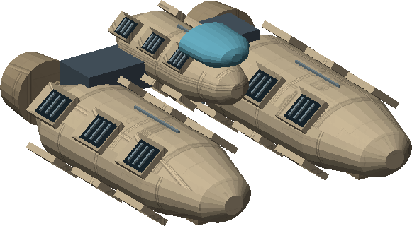

# C04 · The Borrowed Voice

[Illustrated story](../../INTENDED-GAME-STORY-WALKTHROUGH.md#the-borrowed-voice) · [Mission walkthrough checklist](../README.md)

Design walkthrough complete against source at `19a177e66093716928947f7246e0b664e4a6ad07`. Commissioning and current-save tests passed at the earlier exact source `d6fa8e7e3ca9c52b298cde347dd34ec8ccd37e1b`, session 88700. The nine later stages and the ordinary complete journey remain open. [Commissioning evidence](https://github.com/stephenlclarke/l337/blob/19a177e66093716928947f7246e0b664e4a6ad07/docs/COMPLETION-LEDGER.md#L8127)

## Commission and story

Rescue coordinator Sera Dain wants to stop false distress calls without making tenders ignore genuine casualties. Two empty calls and a genuine call appear to use the same rescue key. Renn's isolated verifier and Dispatcher Neris Sol's enrollment challenge expose a second operator, which a salvage syndicate uses to sell live rescue movements to ambushers. Sol has sheltered at Noserin. His safety and informed cooperation are separate from proving the duplicate account.

Use Station Contracts at the living Taledea main orbital in Galaxy 3. Retain five distinct native system observations, the real arrival, current owner and carrier, and a writable save. An ordinary civilian fit can accept without a purchased scanner, military fitting, combat score or previous campaign. Review opens on Back. Confirm creates only the original commission, with local receipt `borrowed-voice-accept`. It issues no physical beacon, stock or witness. The intended paid grouping is **Safe Passage**, with separate commercial entitlement and an independent free core clue route. [Board gate](https://github.com/stephenlclarke/l337/blob/19a177e66093716928947f7246e0b664e4a6ad07/Sources/L337Core/NativeBorrowedVoiceBoard.swift#L54), [Five-system proof](https://github.com/stephenlclarke/l337/blob/19a177e66093716928947f7246e0b664e4a6ad07/Sources/L337Core/NativeBorrowedVoiceTravelHistory.swift#L6), [Commission and writer](https://github.com/stephenlclarke/l337/blob/19a177e66093716928947f7246e0b664e4a6ad07/Sources/L337Core/NativeBorrowedVoiceCommission.swift#L20)

## Route and fit

| Galaxy 3 route in stage order | Nominal distance |
| --- | --- |
| Taledea G03-S020 → Ilasaeli G03-S137 | 2.066 LY |
| Ilasaeli → Noserin G03-S056 | 2.241 LY. Actual Renn loan, private refuge link and separate protected station reception. |
| Noserin → Taledea → Ilasaeli | 4.248 + 2.066 LY. Dain authorizes the selected operation. |
| Ilasaeli → Aiven G03-S129 → Ilasaeli | 1.827 LY each way. Renn receives the original verifier at Aiven. |
| Ilasaeli → Taledea | 2.066 LY. Final hearing and receiving. |

The largest local jump is 4.248 LY. A normal SH025 can cover the geometry with fuel. Follow actual fuel, range and station clearance. Galaxy 3 access from an earlier galaxy requires genuine galactic transfers and their consumed drive fittings. No proposed route or named station establishes a protected berth. [World catalogue](https://github.com/stephenlclarke/l337/blob/19a177e66093716928947f7246e0b664e4a6ad07/Sources/L337Core/Resources/OriginalWorlds/catalogue.json), [Jump and fuel](https://github.com/stephenlclarke/l337/blob/19a177e66093716928947f7246e0b664e4a6ad07/Sources/L337Core/FuelStorage.swift#L8), [Galactic transfer](https://github.com/stephenlclarke/l337/blob/19a177e66093716928947f7246e0b664e4a6ad07/Sources/L337Core/Game.swift#L6293), [Native station proof](https://github.com/stephenlclarke/l337/blob/19a177e66093716928947f7246e0b664e4a6ad07/Sources/L337Core/NativeStationServices.swift#L135)

A civilian player carrier needs one usable tonne after modules and ordinary freight for the original loaned **Renn Independent Verifier**. Its current item declaration is acquisition-only, with no mount requirement. The declaration grants no physical clock or signed record. The intended escort keeps Sol aboard his own original ship. The fallback capsule belongs to the rescue provider. It creates no player cabin requirement. Exact civilian measurement settings and verifier interface remain source inputs. [Loan item and custody](https://github.com/stephenlclarke/l337/blob/19a177e66093716928947f7246e0b664e4a6ad07/Sources/L337Core/NativeBorrowedVoiceVerifierDefinition.swift#L1)

**Sol's marked Harrier (SH026)** is the named original witness craft. Its fleet design provides one intrinsic operator, 18 t nominal hold, 8 LY reach and 12 LY tank. Sol, the protected launch, emergency capsule and reserve extraction are distinct native objects or operations. C01's one-pilot Harrier work is reusable engineering evidence. Its actors, care and authorizations remain scoped to C01. [Harrier configuration](https://github.com/stephenlclarke/l337/blob/19a177e66093716928947f7246e0b664e4a6ad07/Sources/L337Core/Resources/Ships/SH026.toml), [Harrier fleet fit](https://github.com/stephenlclarke/l337/blob/19a177e66093716928947f7246e0b664e4a6ad07/docs/fleet-design-v2/ships/SH026.toml), [Harrier reference image](../../assets/ships/SH026.png)

**Hyena (SH049)** is listed as a second story craft. The current original fleet file identifies a human pirate hull, pending native placement, with two native operators, 32 t nominal hold, 8 LY reach and a 12 LY tank. The authored stage text does not assign SH049 to the tug, decoy or observer. Resolve its exact role before issuing it. The capsule tug needs its own actual rescue fitting and route to the refuge. [Hyena configuration](https://github.com/stephenlclarke/l337/blob/19a177e66093716928947f7246e0b664e4a6ad07/Sources/L337Core/Resources/Ships/SH049.toml), [Hyena crew design](https://github.com/stephenlclarke/l337/blob/19a177e66093716928947f7246e0b664e4a6ad07/docs/fleet-design-v2/ships/SH049.toml)

The reference image is the authored SH049 art at `c70110b`, SHA-256 `7e2fd7265116b45127368d09ad3db5470a5ac4d57098bc00499459a4121a7990`. It describes the design and supplies no placement.

## Play the ten stages

| Stage | Player action and qualifying evidence |
| --- | --- |
| 1. `accept` | Confirm Dain's current living Taledea commission after verifying the native visit history. |
| 2. `verify-distress` | At Ilasaeli compare the two empty calls and occupied service beacon against actual cabin heat, escape telemetry and life signs. Retain all three signed observations. The genuine casualty is protected, and only the empty calls carry the second enrollment stamp. |
| 3. `collect-verifier` | At Noserin confirm Renn's handoff of the original independent one-tonne verifier. Renn holds it if there is no room. |
| 4. `meet-dispatcher` | Use Renn's isolated private terminal at Noserin. Obtain Sol's actual statement and enrollment challenge without revealing his refuge to the rescue network. |
| 5. `protect-dispatcher` | Escort Sol's same living Harrier from the refuge to a genuine protected Noserin berth. Confirm receiving before challenging the compromised account. |
| 6. `choose-operation` | At Taledea choose **Revoke the compromised key openly** or **Identify the observer with an empty decoy**. Record one operation. Neither choice exposes Sol's location or puts a real casualty in the decoy. |
| 7. `intercept-orders` | At Ilasaeli, open revocation requires the actual key revocation acknowledgement and frozen signed access audit. The quiet route requires the empty decoy arming and signed observer handshake from the passive receiver, then revocation. Only the chosen branch issues its targets. Neither capture nor destruction substitutes for the authenticated record. |
| 8. `audit-access` | At Aiven, Renn compares the same physical verifier clock and enrollment challenge. Return the original verifier with the signed access record. Keep unrelated patient records sealed. |
| 9. `restore-channels` | At Ilasaeli rekey both empty-call sources and the genuine service beacon individually. Verify each local test and actual clean routing for rescue tenders. The duplicate account can no longer issue calls. |
| 10. `close-case` | Dain verifies Sol's safety, authenticated hearing evidence, the selected redacted disclosure and genuine restored service. Settle 7,200 CR and `l337.unwritten-route/clue/voice-unclaimed-channel` once. Renn's anomalous older reply points to PLUGH and stays separate from the evidence against the operator. |

[Exact original stages and branch target list](https://github.com/stephenlclarke/l337/blob/19a177e66093716928947f7246e0b664e4a6ad07/Sources/L337Core/NativeBorrowedVoiceOriginalObjectives.swift#L10), [Branch records](https://github.com/stephenlclarke/l337/blob/19a177e66093716928947f7246e0b664e4a6ad07/Sources/L337Core/NativeBorrowedVoiceOriginalObjectives.swift#L115)

## Loss, continuation and owner requirements

The authored mission has no whole-case timer. Any armed local incident needs a previewed simulation-time budget and retained state. If the Harrier is disabled or destroyed, the actual station tug must recover the same tracked living capsule and return it to the refuge before a new extraction is offered. Record the original hull loss and real witness condition. The tug's arrival alone does not complete Sol's protected berth objective. A real casualty cannot be recreated. Preserve retained clues and completed original actions even when further work becomes unavailable. The intended core charter inquiry supplies the missing clue only and preserves the lost original or paid case outcome.

Cold Continue must retain the exact witness, original loan item and custody, signed evidence, branch targets, rekey receipts, losses and terminal settlement. Cancel or failed publication retains the prior state and stock. Verify both branches on separate careers, and a load after the witness rescue and again after the selected operation. Check stale review, full hold, missing original, incorrect target and genuine rescue recovery. Receiving replay never pays, issues another clue, resets legal status or restores lost actors.

- **G4 physical requirement.** Bind the original SH026 fit, live Sol and its real capsule path. Validate the protected Noserin berth and refuge geometry, compatible rescue tug/capsule recovery fit, and the original Ilasaeli beacon interaction and rekey envelopes. SH049 stays unassigned until its mission role is approved.
- **MC1 mission requirement, via Root and G1.** Keep the qualified commissioning boundary and implement the first missing post-commission producer at Ilasaeli. It needs two original false-call sources and one genuine occupied source, three independently proven casualty observations and the exact signed enrollment comparison. Later work needs finite Renn stock, real Sol authority, protected arrival/rescue, branch-specific evidence, Aiven intake and native rekey plus final settlement. Preserve the separate scopes for patient, witness and paid-campaign data.
- **Root source decisions.** Approve exact SH049 role, tug and protected reception source, civilian observation/countermeasure parameters, real verifier stock and signed evidence roles. The current manifest has no later producer. Product entitlement and the independent free C04 clue source remain separate.

The archived source is `docs/meridian/missions/C04.md` and `docs/meridian/missions/definitions/borrowed-voice.json` at `c70110b292077588a0855fb48127adfb1b611c9d`, definition SHA-256 `302542daa4a97fcf7bdf46329327e156171544a367ee4e19974c3ad46d0c62f8`. The native pack pins that exact definition and currently supplies the opening only. [Current pack](https://github.com/stephenlclarke/l337/blob/19a177e66093716928947f7246e0b664e4a6ad07/Sources/L337Core/Resources/ScriptPacks/l337-borrowed-voice/manifest.toml)
