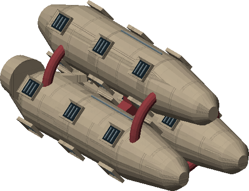

# C05 · The Shattered Wake

[Illustrated story](../../INTENDED-GAME-STORY-WALKTHROUGH.md#the-shattered-wake) · [Mission walkthrough checklist](../README.md)

Design walkthrough complete against `19a177e66093716928947f7246e0b664e4a6ad07`. The original opening is frozen separately at `a28901f74cad3edaf1d38af764903b5847d8d469`. Its shared joins and positive native commissioning remain open. The exact main has no executable original C05 pack. [Opening handoff](https://github.com/stephenlclarke/l337/blob/19a177e66093716928947f7246e0b664e4a6ad07/docs/COMPLETION-LEDGER.md#L7014)

## Offer, story and fit

At the living Loalaila main orbital in Galaxy 6, meet Controller Edda Rell after three genuine system observations. Review and Confirm the emergency commission with a writable save. No prior campaign or combat score is required. Acceptance grants no coupler, stock, rescue resources or time pressure. **Last Light** is the authored paid grouping and has its own entitlement. A separate core inquiry is intended to keep its clue available.

An old survey test reactivates the Aermiori mass driver. The spoil stream hits a fractured moonlet and sends heavy rocks and gravel towards Spindle Anchorage. Rell wants measurements and a viable evacuation plan. Jalen Orr distinguishes the physical trajectories and an older unexplained trace. Tug lead Mira Penn wants to protect a usable rescue corridor. The defence can save the Anchorage, but the story can continue after genuine station loss.

Normal flight, targeting and weapons are sufficient in the design. Reserve one free tonne after modules and trade cargo for the loaned coupler. A fitted, fueled SH025 is a route-planning option. Neither the records nor the clue occupy cargo space. The relief tender and supporting haulers carry the registered survivors. Their crew, berths and receiving limits are separate from the player fit. The only listed story hull is **SH061 Saiga**, an original two-operator 84 t design with 9 LY nominal hull reach and 13 LY tank. C05 does not pin which relief or reinforcement slot it occupies, its installed cabin count, or crew and mission hull identity. No existing C03 Saiga or its crew transfers into this mission. [SH061 original fit](https://github.com/stephenlclarke/l337/blob/19a177e66093716928947f7246e0b664e4a6ad07/docs/fleet-design-v2/ships/SH061.toml), [Runtime hull](https://github.com/stephenlclarke/l337/blob/19a177e66093716928947f7246e0b664e4a6ad07/Sources/L337Core/Resources/Ships/SH061.toml), [SH025 route fit](https://github.com/stephenlclarke/l337/blob/19a177e66093716928947f7246e0b664e4a6ad07/Sources/L337Core/Resources/Ships/SH025.toml#L194)

The Saiga image comes from the authored asset at `c70110b`, SHA-256 `093475e0e190e905e7860d718b9b19857099e42e1f6c55f90aacba6df1235f79`. Its shape supplies no actor placement.

## Geography and optional warnings

| Galaxy 6 route | Nominal geometry and purpose |
| --- | --- |
| Loalaila G06-S020 ↔ Aermiori G06-S059 | 2.615 LY each way. Spindle Anchorage is the impact station. Aermiori Shelter Dock is the separate local receiving station. |
| Aermiori → Loalaila → Iraeth G06-S163 | 2.615 + 4.297 LY. The Mining Cooperative may release up to two tugs. |
| Aermiori → Eriven G06-S212 → Reilieli G06-S103 | 5.085 + 3.562 LY. The Orbital Patrol may release up to three interceptors. |
| Aermiori → Siamaeth G06-S207 | 5.430 LY. Civil Relief may release up to two evacuation haulers. |

Check fuel at every departure. A trip into Galaxy 6 from an earlier galaxy needs actual galactic transfers and their consumed drive fittings. These geometrical routes do not qualify a real port or issue response stock. The local Spindle and Shelter Dock anchors, damage policy and post-loss service availability need separate approval. [World catalogue](https://github.com/stephenlclarke/l337/blob/19a177e66093716928947f7246e0b664e4a6ad07/Sources/L337Core/Resources/OriginalWorlds/catalogue.json), [Fuel and reach](https://github.com/stephenlclarke/l337/blob/19a177e66093716928947f7246e0b664e4a6ad07/Sources/L337Core/FuelStorage.swift#L8), [Actual arrival](https://github.com/stephenlclarke/l337/blob/19a177e66093716928947f7246e0b664e4a6ad07/Sources/L337Core/NativeStationServices.swift#L135)

After the survey, the signed zero-mass warning packet opens optional visits in any order. Warn any subset, or none. At each living main orbital, confirm one actual offer. Finite local stock can reduce or refuse the response. Record each decision, dispatch, travel and actual timely arrival. Revisits and loading cannot reroll or add another group. Tugs alter heavy paths, interceptors act on real fragments, and haulers carry actual registered people. Late visits share the already running passage clock.

## Play the eleven stages

| Stage | Player action and qualifying evidence |
| --- | --- |
| 1. `accept` | At Loalaila confirm Rell's original emergency commission. Review or Back has no effects. |
| 2. `survey-train` | At Aermiori scan the three distinct original outer watchers. Record actual trajectories, projected impact bands and the refuge port. Produce one signed warning packet. |
| 3. `collect-coupler` | Dock at the living Spindle Anchorage. Confirm Penn's actual 1 t coupler loan. The issuer holds it if the player's hold is full. |
| 4. `silence-driver` | Physically isolate the driver and record the real moonlet fracture boundary. Material already in flight remains in flight. |
| 5. `choose-defence` | Through the emergency radio, choose **Deflect the heavy bodies with tug anchors** or **Catch the gravel with a fragment screen**. The former leaves most gravel, the latter has finite capture and leaves heavy threats. |
| 6. `deploy-defence` | Synchronize the actual three anchors or align the actual three catchers for the selected branch. Confirm the final real installation and atomically transfer the same coupler. Display the warning, shield, impact, timer and rescue facts before the distinct readiness confirmation arms the passage. |
| 7. `hold-the-approach` | Redirect marked threats and keep the corridor open. The actual impacts, remaining shield and structure and the real population ledger determine the outcome. A distant interception needs changed paths, not just destruction. |
| 8. `escort-rescue` | Escort the actual relief tender, recovered survivors and incident record to Shelter Dock. Receive the same genuine people and record even when an affected section has no survivors. |
| 9. `deliver-relief-record` | At Loalaila, submit the actual relief manifest and recovered event record. Count individual receptions, losses and missing people. |
| 10. `complete-inquiry` | With Orr at Loalaila, compare the original trajectory, shutdown and defence records. The curved trace predates the driver and supplies no accusation that someone caused the disaster. |
| 11. `close-case` | Rell confirms the real relief and inquiry and applies the authoritative station outcome. Commit the fee, once-only receipt and `l337.unwritten-route/clue/wake-before-impact` together. |

## Passage clock, conservation and settlement

Preparation is untimed. Only explicit readiness confirmation starts **900 seconds** of simulation time. Docking, dialogs and leaving the system do not stop the passage. Explicit pause, background pause and system sleep freeze it. Save/load resumes the exact elapsed time, trajectories, impact queue, shield and integrity, population and response state. It never replays an impact. During arming register everyone eligible for evacuation, including those still at the station. Classify a destroyed station's evacuation only after real Shelter Dock accounting.

The authored starting budgets are 100 shield, 100 integrity and one shield unit per second of recharge. These are normalized load units. Physical conversion, response stocks, berth limits and shield launch threshold require runtime balancing. One primary body, six secondary bodies and eighty tracked or deterministically clustered fragments follow a fixed saved recipe. Ordinary single-ship weapons do not damage the station. Breaking a body conserves mass, momentum and the kinetic-energy budget. Retire the parent and count each legitimate collision once. Warn inside **35 km** because breakup can leave every child on a strike path. The ledger also preserves the existing less-than-five-percent collection rule for applicable physical debris. [Physical implementation leaves](https://github.com/stephenlclarke/l337/blob/19a177e66093716928947f7246e0b664e4a6ad07/docs/COMPLETION-LEDGER.md#L2230), [Existing asteroid contact implementation](https://github.com/stephenlclarke/l337/blob/19a177e66093716928947f7246e0b664e4a6ad07/Sources/L337Core/AsteroidDebrisContact.swift)

| Confirmed outcome after relief and inquiry | Total |
| --- | --- |
| Anchorage survived | 7,800 CR |
| Anchorage destroyed and every original registered evacuee safely received | 4,800 CR |
| Other station-loss outcome with qualifying relief and inquiry | 1,800 CR |

A station loss disables its real docks and services and persists in charts, wreckage and gossip. Shelter Dock and Loalaila still receive. A lost relief tender may be replaced only with actual finite stock and crew. Preserve safely received and genuinely lost people, and recover only reachable capsules and records. Environment damage, NPC intervention or leaving pays nothing on its own. No repeatable warning payment, kill credit or acquired hull. Verify cold Continue just before arming, mid-passage, after destruction or survival, after distinct receiving and after final settlement. The intended charter inquiry supplies the clue only when the original cannot finish.

- **G4 physical requirement.** Pin both original orbital stations and the actual collision-to-shield/integrity conversion, fixed body and fragment sources, both mitigation profiles and the real shelter corridor. Qualify the actual approved relief/response hulls and occupied fit. If Saiga is selected, require its real admitted geometry, crew, fitted accommodation, fuel and actual berth proof.
- **MC1 mission requirement, via Root and G1.** Preserve the frozen C05 opening and rebind its exact shared requirements first. Join three original watchers and the original signed packet before permitting warning, loan or arming. Then implement the physical passage and finite evacuation, real post-loss route, two mitigation branches and the authoritative three-way settlement.
- **Root source decisions.** Issue the current exact Spindle and Shelter Dock roles, population and response stock, launch threshold and physical-to-normalized conversion, fixed trajectory recipe, relief hull/crew placement and exact receiving authority. Geometry, prose, named stations and the frozen commission do not issue these facts.

The historical story and definition are `docs/meridian/missions/C05.md` and `docs/meridian/missions/definitions/shattered-wake.json` at `c70110b292077588a0855fb48127adfb1b611c9d`, definition SHA-256 `50a55d876d1edf40eab3f517ff97d30eaeb4d837f3d766d4312378f9ccf72c2b`. [Current work packet sequence](https://github.com/stephenlclarke/l337/blob/19a177e66093716928947f7246e0b664e4a6ad07/docs/COMPLETION-LEDGER.md#L2123)
