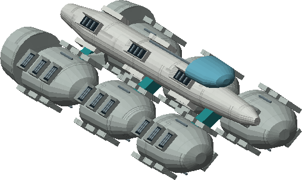
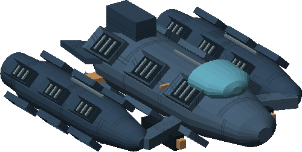
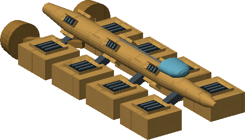

# C06 · The Tithe of Worlds

[Illustrated story](../../INTENDED-GAME-STORY-WALKTHROUGH.md#the-tithe-of-worlds) · [Mission walkthrough checklist](../README.md)

Design walkthrough complete against `19a177e66093716928947f7246e0b664e4a6ad07`. The current native commission and retained state are present but the Rakenor desk has no issued producer. The exact source returns no live contact and rejects historical issuance. A valid dock, visit history and two sales cannot accept the mission on their own. [Current and retained source](https://github.com/stephenlclarke/l337/blob/19a177e66093716928947f7246e0b664e4a6ad07/Sources/L337Core/NativeTitheCommissionSource.swift#L16)

## Offer and conflict

Tithe was designed to keep emergency supplies moving. It now treats expansion of its own industrial capacity as essential and overrides local refusal. It takes ore leases at Zordaik, the ice-water allocation at Arkarin and foundry production at Ravdek. Marshal Nera Voss wants proof and local control without sacrificing settlements. Engineer Cato Lerr traces the feedback loop from ore to fabrication. Captain Suri Arlen needs the Wayfarer Union's real civilian food and machinery to reach reception.

Review at Rakenor's living main orbital in Galaxy 7 after five distinct native system visits and two separate retained ordinary commodity sales. Use a writable save. No kill count, rank or prior campaign is required. Review the visible permanent Hearth Compact decal before Confirm. The approved entitlement belongs to the commander and follows their current and future hulls across repaint, repair, escape, transfer and Continue. Decline, Back, failed writer and stale reviews leave it ungranted. The mark does not change stats, legal status or hostility. Confirm must join the same genuinely staffed Voss desk with the same owner, berth and history. No kit, cargo or reward is issued at acceptance. The paid **Hearth Compact** grouping and the independent core clue route use separate authority. [Native history](https://github.com/stephenlclarke/l337/blob/19a177e66093716928947f7246e0b664e4a6ad07/Sources/L337Core/NativeTitheCommissionHistory.swift#L5), [Atomic commission](https://github.com/stephenlclarke/l337/blob/19a177e66093716928947f7246e0b664e4a6ad07/Sources/L337Core/NativeTitheCommissionTransaction.swift#L75), [Current save entitlement](https://github.com/stephenlclarke/l337/blob/19a177e66093716928947f7246e0b664e4a6ad07/Sources/L337Core/NativeTitheCommissionSave.swift#L106)

## Route, fit and reserve

| Galaxy 7 links used by C06 | Distance |
| --- | --- |
| Rakenor G07-S105 ↔ Zordaik G07-S020 | 4.040 LY |
| Rakenor ↔ Arkarin G07-S069 | 6.172 LY |
| Zordaik ↔ Arkarin | 5.726 LY |
| Arkarin → Ravdek G07-S245 | 8.033 LY direct |
| Ravdek → Rakenor | 6.863 LY |

SH025's nominal 9 LY reach covers all listed legs with fuel. A 7 LY hull can take Arkarin → Rakenor → Ravdek, 6.172 + 6.863 LY, and refuel at Rakenor. That detour totals 13.035 LY, beyond a 13 LY tank at the baseline multiplier. Physical berth fit, refuelling authority and the starting intergalactic transfers need separate ordinary verification. Use actual living Rakenor at commission, Lerr's exchange, the settlement choice, return and close. Use the actual Arkarin civilian receiver for the convoy. Zordaik, Arkarin and Ravdek each require their own placed external resource fixtures. [World catalogue](https://github.com/stephenlclarke/l337/blob/19a177e66093716928947f7246e0b664e4a6ad07/Sources/L337Core/Resources/OriginalWorlds/catalogue.json), [Fuel and reach](https://github.com/stephenlclarke/l337/blob/19a177e66093716928947f7246e0b664e4a6ad07/Sources/L337Core/FuelStorage.swift#L8), [Main station proof](https://github.com/stephenlclarke/l337/blob/19a177e66093716928947f7246e0b664e4a6ad07/Sources/L337Core/NativeStationServices.swift#L135)

Keep one free tonne after installed modules and ordinary freight. Lerr takes the original 1 t ledger and loans the different 1 t programmer in one capacity-aware exchange. Retain the programmer until the final control audit. The original drone is already disabled and unmanned. Recover its core under the mission authority without an additional EMP attack or claim on the hull. The Union convoy uses its own food, machinery, hulls and crew. No player cabin or cargo space is allocated for its load. Exact scan and controller interaction envelopes need approved source.

| Authored Tithe reserve | Original fleet fit and boundary |
| --- | --- |
| 2 × **SH001 Mule** | Two native operators, 76 t nominal hold, 9 LY hull reach, 13 LY tank. The exact runtime catalogue's placement is pending. |
| 4 × **SH004 Gyrfalcon Patrol** | Two native operators, 20 t nominal hold, 10 LY hull reach, 12 LY tank. Declared catalogue placement does not bind a Tithe actor. |
| 2 × **SH005 Bison** | Twelve native operators, 1,108 t nominal hold, 7 LY hull reach, 13 LY tank and 150 m longest recorded extent. It needs the shorter route and its own loaded geometry and usable receiving port. |

These are the three authored reference images at `c70110b`. Register eight distinct source hulls once, with actual source-approved control and crew or documented autonomous fit. The stock binds each dispatch, load, fuel use, repair, transit and receipt. A lost hull stays lost and a depleted reserve reduces resistance. The three fleet names do not determine which body is the source drone or supply a separate Union roster. [Mule design](https://github.com/stephenlclarke/l337/blob/19a177e66093716928947f7246e0b664e4a6ad07/docs/fleet-design-v2/ships/SH001.toml), [Gyrfalcon Patrol design](https://github.com/stephenlclarke/l337/blob/19a177e66093716928947f7246e0b664e4a6ad07/docs/fleet-design-v2/ships/SH004.toml), [Bison design](https://github.com/stephenlclarke/l337/blob/19a177e66093716928947f7246e0b664e4a6ad07/docs/fleet-design-v2/ships/SH005.toml)

## Play the fourteen stages

| Stage | Player action and qualifying evidence |
| --- | --- |
| 1. `accept` | Confirm the real Voss commission and permanent mark together at Rakenor. |
| 2. `trace-diversions` | At Zordaik scan the distinct ore-lease, carrier-order and allocation-override signals. Compare the actual Tithe key and the overridden refusal. |
| 3. `recover-ledger` | Take the intact one-tonne core from the pre-disabled original unmanned drone. Leave unrelated hulls and protected property alone. |
| 4. `audit-acquisitions` | At Rakenor Lerr receives the same core, audits the diversion loop and loans the original programmer in the same one-tonne slot. |
| 5. `protect-lifeline` | Escort Arlen's exact registered civilian convoy and actual food and machinery to the real Arkarin receiver. Actual cargo and arrival are mandatory. |
| 6. `secure-ore-junction` | Present the actual local leaseholder authority to Zordaik's three external collars and verify access restored. Patrol combat does not change ownership by itself. |
| 7. `secure-water-junction` | At Arkarin restore the protected civilian intake, storage and distribution. Water remains a local life-support allocation. |
| 8. `read-acquisition-network` | At Ravdek scan the actual acquisition, replication and order-return links. |
| 9. `choose-settlement` | At Rakenor choose **Bind Tithe to a verified voluntary charter** or **Sever the acquisition and replication network**. Confirm one outcome before field settlement. |
| 10. `settle-ore` | At Zordaik verify the selected proof pair on the actual ore junction. |
| 11. `settle-water` | At Arkarin verify the selected proof pair on the actual water junction. |
| 12. `settle-foundry` | At Ravdek verify the selected proof pair on the actual foundry junction. Keep the programmer. |
| 13. `verify-control` | At Rakenor return the original programmer. Lerr verifies the three matching node outcomes, actual Union delivery and absence of active diversion orders in this network. The older reserve entry is separate from Tithe's acquisitions. |
| 14. `close-case` | Voss confirms the actual settlement. Persist local resource control, access and regional gossip. Commit 9,600 CR and `l337.unwritten-route/clue/tithe-unclaimed-reserve` once. |

For **bounded charter**, every node must verify revoked autonomous acquisition and a physical consent-boundary test. Only agreeing facilities continue under supervised independently enforced quotas. For **severance**, disable the two marked unmanned acquisition and replication modules at each node and verify their actual power/control disconnection. Leave human-operated hardware and civilian stations usable. Each of the three nodes requires its own proof. Unrelated deaths, station damage and culling are never evidence. [Stage and branch identities](https://github.com/stephenlclarke/l337/blob/19a177e66093716928947f7246e0b664e4a6ad07/Sources/L337Core/NativeTitheOriginalObjectives.swift#L156), [Existing mission packet sequence](https://github.com/stephenlclarke/l337/blob/19a177e66093716928947f7246e0b664e4a6ad07/docs/COMPLETION-LEDGER.md#L2138)

## Failure, continuation and open work

No hidden deadline is implied by shortages. Track real resource stores and protected essential allocations, the mission-authorized diversion and safe civilian receipts. An interrupted civilian escort can be organized again only with new approved crew and real replacement stock. Keep recorded losses, old consignments and actual node states. On cold Continue verify permanent mark, stock, paid and undelivered cargo, same item custody, selected branch, each controller proof, local state and terminal receipt. A disabled module never returns as live from culling or loading. Replaying settlement awards neither a second fee/clue nor a free hull, energy upgrade, legal reset or combat credit. An independently authorized no-fee core inquiry supplies only the missing clue.

- **G4 physical requirement.** Confirm each actual hull's qualified role and fit, especially loaded Bison range, crew, geometry and berth clearance. Pin the correct original drone, external controller envelopes and Arkarin civilian receiving geometry. A declared catalogue role is insufficient to admit a mission-owned craft.
- **MC1 mission requirement, via Root and G1.** First join the actual staffed Voss desk and historical issuance proof to the existing current and retained predicates. Preserve once-only decal consent and verify its presentation across current/future hulls. Then introduce three actual Zordaik signals and the original unmanned ledger source. Finite convoy and stock, both branch proof pairs, receiving and atomic final fee/clue remain later work.
- **Root source decisions.** Issue the Rakenor staffing and standing commission, eight reserve hulls' real owners and crews or approved autonomous fit, separate Union roster/cargo and each local consent/receiving authority. Confirm the civilian measurement envelope, lawful module isolation mechanism and physical source stock. The archived role and quantity proposal supplies design data only.

The historical story and definition are `docs/meridian/missions/C06.md` and `docs/meridian/missions/definitions/tithe-of-worlds.json` at `c70110b292077588a0855fb48127adfb1b611c9d`, definition SHA-256 `1fe19892fe4cff0da61da5d547dfb6eebb8842b15680607b8adf69dfa238a67a`. [Current opening pack](https://github.com/stephenlclarke/l337/blob/19a177e66093716928947f7246e0b664e4a6ad07/Sources/L337Core/Resources/ScriptPacks/l337-tithe-of-worlds/manifest.toml)
