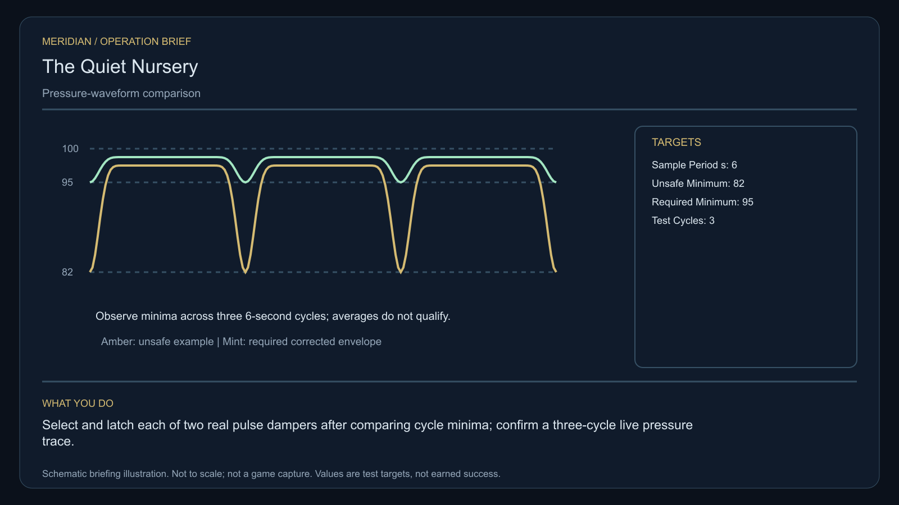

# C09 · The Quiet Nursery

[Illustrated story](../../INTENDED-GAME-STORY-WALKTHROUGH.md#the-quiet-nursery) · [Mission walkthrough checklist](../README.md)

Design walkthrough complete against `19a177e66093716928947f7246e0b664e4a6ad07`. The opening source is frozen at `313e70f687e38b930066c70f4036b35398412fa8`, outside executable main. Its shared integration and native acceptance remain open. The later physical and receiving sources are unissued. [Opening handoff](https://github.com/stephenlclarke/l337/blob/19a177e66093716928947f7246e0b664e4a6ad07/docs/COMPLETION-LEDGER.md#L7016)

## Offer and motivation

At Maran's living main orbital in Galaxy 1, review Physicist Anja Kest's notice after a genuine ordinary purchase or sale. Confirm against the actual contact, transaction and writable save. The review must show one tonne of free hold for a separate reference loan before departure. No previous campaign or combat-score gate. The commission issues no loan, stock, delegate or payment by itself. **Living Worlds** is the finished paid grouping. A separate free clue route preserves the original case.

The nursery roots are failing because the report averages away short pressure pulses from a shared ventilation controller. Kest needs the individual pressure minima. Custodian Tomas Veil protects the growers' original sealed reference and their right to choose. Rowan measures the actual waveforms, tests both dampers and waits for an authorized grower delegate at the real receiver. The player must prove the selected control works.

## Route and exact fit

| Galaxy 1 route | Distance and required authority |
| --- | --- |
| Maran G01-S003 → Naviven G01-S004 | 2.775 LY. Collect the original loan at Maran first. |
| Naviven → Larinar G01-S122 | 5.834 LY. Actual vent measurements precede the isolated cradles. |
| Larinar ↔ Lelaven G01-S179 | 3.316 LY each way for the player's approach to the genuine witness berth and return for the selected proof. |
| Larinar → Maran | 3.236 LY. Return to the original issuer for the audit and fee. |

All player links fit a nominal 7 LY ship with sufficient fuel. Refuel at an actual accessible orbital where needed. A source-owned tender needs its own departure origin, route, fuel and aperture proof. The specification names Lelaven reception but does not pin the tender's departure station. [World catalogue](https://github.com/stephenlclarke/l337/blob/19a177e66093716928947f7246e0b664e4a6ad07/Sources/L337Core/Resources/OriginalWorlds/catalogue.json), [Jump calculation](https://github.com/stephenlclarke/l337/blob/19a177e66093716928947f7246e0b664e4a6ad07/Sources/L337Core/FuelStorage.swift#L8), [Native station arrival](https://github.com/stephenlclarke/l337/blob/19a177e66093716928947f7246e0b664e4a6ad07/Sources/L337Core/NativeStationServices.swift#L135)

The player reserves **1 t** after fitted modules and freight for the original sealed reference. The external cradles and dampers remain source property. The player carries no passengers. SH001 Mule is an authored story hull with a nominal 76 t hold, two native operators and 9 LY reach, but no C09 role is issued for it. The witness profile explicitly binds an original **SH061 Saiga** tender with two operating crew and one living delegate, one fitted four-place Standard Cabin and its own finite fuel. The module costs 5 t and one equipment unit. This differs from any other mission's Saiga fit or people. Actual powered accommodation, crew consent, loading and geometry must qualify. [Mule fleet fit](https://github.com/stephenlclarke/l337/blob/19a177e66093716928947f7246e0b664e4a6ad07/docs/fleet-design-v2/ships/SH001.toml), [Saiga fleet fit](https://github.com/stephenlclarke/l337/blob/19a177e66093716928947f7246e0b664e4a6ad07/docs/fleet-design-v2/ships/SH061.toml), [Mule reference](../../assets/ships/SH001.png), [Saiga reference](../../assets/ships/SH061.png)

**Source conflict.** The historical work-ledger line describes an escort. The later reviewed gameplay profile explicitly sets `accompanimentRequired: false`. The tender travels independently after the survey and source permission, concurrently with the player's fieldwork. There is no stay-near timer. The same living crew and registered delegate still need actual departure, transit, doorway crossing and Lelaven receiving. Use the later authored profile. [Historical ledger line](https://github.com/stephenlclarke/l337/blob/19a177e66093716928947f7246e0b664e4a6ad07/docs/COMPLETION-LEDGER.md#L2185)

## Play the nine stages

| Stage | Player action and qualifying evidence |
| --- | --- |
| 1. `accept` | Confirm Kest's actual Maran commission after one genuine ordinary trade. |
| 2. `collect-reference` | At Maran accept the original one-tonne sealed reference into real protected hold. If space is unavailable, Kest retains it. |
| 3. `survey` | At Naviven take the three distinct pressure waveforms. Each has a six-second sample period and an individual minimum. Maintain 12 seconds of qualified dwell on the same target, front view, within 2°, unobstructed nearest surface hit 250–1,500 native units. Store the trace and minimum, not a period average. |
| 4. `field-work` | At Larinar compare the sealed onboard reference at both isolated cradles. Select and latch the two actual pulse dampers. Use 50–150 m surface clearance, at most 1 m/s relative speed and 2° aim. Require the profile's 20 seconds of qualified work and an actual passing functional test. All three cycles must have minima at least 95 on the normalized 0–100 scale. The authored unsafe minimum is 82. |
| 5. `independent-witness` | At Lelaven verify the independent tender's living receiving, exact crew and mandate-bound delegate. The player may observe its own trip. Opening an empty berth or displaying a manifest cannot supply arrival. |
| 6. `choose-settlement` | With the actually arrived delegate at Lelaven, choose **Give each nursery cell an independent air regulator** or **Establish a shared grower-controlled ventilation schedule**. |
| 7. `apply-settlement` | At Larinar run only the selected branch's physical and receiving proof. Independent dampers must both reject an external close order and maintain safe minima across all three cycles. The shared schedule must be grower-signed and pass all three cycles, and each local stop must halt the controller independently. |
| 8. `return-and-audit` | At Maran return the original loan. Validate the three measured traces, real living witness or legitimately authorized remedial outcome, and both exact selected branch receipts. |
| 9. `close-case` | Confirm independent audit and local settlement. Commit 4,600 CR and `l337.unwritten-route/clue/quiet-nursery-trace` once. |

The physical numbers above are authored project estimates awaiting play balancing. The pressure diagnosis has one fixed challenge per case. Wrong settings show measured feedback. A stationary player or Confirm without actual damping work cannot pass. Show four meaningful journal phases and combine co-located brief/loan or audit/payment reviews while preserving separate atomic receipts.

[Editable operation drawing](../../assets/missions/revisions/quiet-nursery-operation.svg)

## Failure, cold Continue and work ownership

There is no hidden deadline. Pause freezes active measurements. Interrupted or loaded unfinished dwell resets, while completed traces, work settings, witness state, mandate, branch and loan history persist. Reject mixed-branch or partial proofs. A lost loan invalidates its old serial before actual replacement. A named casualty persists. A real alternative witness requires independent source authority, and a separate no-fee charter inquiry grants only the missing clue. None of those routes can invent an original successful arrival.

Verify a cold Continue after the pressure measurements, after actual travel, after one branch proof and after settlement. Keep the same reference, ship, people, measured minima and receiving receipts. Retry must leave old losses intact. Replaying terminal receiving awards nothing.

- **G4 physical requirement.** Bind the actual Saiga departure and Lelaven receiving, two native operators and one protected delegate with real cabin and powered life support. Qualify both cradle work faces, sensor sightline, pressure inputs and local stop behavior. Record the actual contact and receiver geometry.
- **MC1 mission requirement, via Root and G1.** Rebind the frozen original opening, then implement one finite Maran loan and three actual Naviven pressure traces. Later preserve the independent witness schedule and two physical proof pairs. Replace any inherited mandatory escort assumption with the reviewed autonomous contract.
- **Root source decisions.** Issue Maran reference stock and authorizations, exact tender departure and consenting people, its receiving service, two actual cradle sources and local authority for either branch. The named actors, profile and schematic are source material for that review.

The archived story and definition are `docs/meridian/missions/C09.md` and `docs/meridian/missions/definitions/quiet-nursery.json` at `c70110b292077588a0855fb48127adfb1b611c9d`, definition SHA-256 `728e4ce3b41e76dadd7993953f205f8e1afeaa30414e1dca210b4712c8562c6b`. The controlling reviewed profile is `docs/meridian/missions/gameplay/campaign-profiles.json#/profiles/quiet-nursery`, SHA-256 `37fe5011de7bcc5874f6e6eef42151a712be4f69a3b9b23cd18cf660bd0dff0a`.
