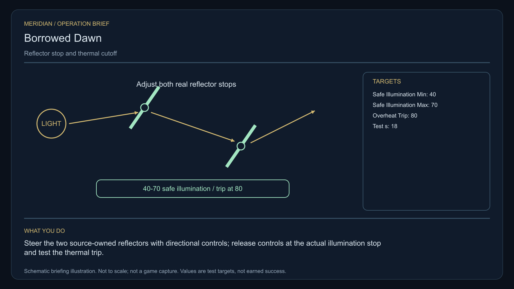

# C10 · Borrowed Dawn

[Illustrated story](../../INTENDED-GAME-STORY-WALKTHROUGH.md#borrowed-dawn) · [Mission walkthrough checklist](../README.md)

Design walkthrough complete against `19a177e66093716928947f7246e0b664e4a6ad07`. The original opening is frozen at `873c1b18f0d0ed9e5ff3e929fb54ddcacd4ca999`, outside executable main. Shared integration, actual commissioning and field work remain open. [Opening handoff](https://github.com/stephenlclarke/l337/blob/19a177e66093716928947f7246e0b664e4a6ad07/docs/COMPLETION-LEDGER.md#L7096)

## Offer and motivation

At Zannekor's living main orbital in Galaxy 2, review Controller Edda Rell's original notice after an ordinary trade. Confirm requires the genuine station arrival, retained trade and writable save. There is no score gate or prerequisite campaign. Before leaving, collect the separate original reference from Rell if one usable tonne remains after installed equipment and trade cargo. The finished paid grouping is **Open Harbours**. The free core clue route remains independent.

An expired reflector lease leaves its automatic parking sequence ready to chill one orbital home and overheat another. Rell wants proof and a lawful shared decision. Tug Lead Mira Penn needs the exact safe sweep and local thermal stop established for the crew. The player measures three occupied habitats, physically controls the two source-owned mirrors and verifies a local safety arrangement instead of treating lease paperwork as a repair.

## Route and fit

| Galaxy 2 route | Distance and service |
| --- | --- |
| Zannekor G02-S037 → Varratar G02-S224 | 1.841 LY. Collect the original loan at Zannekor, then observe the three real photometers. |
| Varratar → Durkaesh G02-S014 | 2.947 LY. The two actual actuator faces are here. |
| Durkaesh ↔ Vorvan G02-S033 | 3.701 LY each way for the player's route to the actual shadow-side receiving and back to the mirrors. |
| Durkaesh → Zannekor | 1.866 LY. Return the original reference and auditable proofs. |

All local legs fit nominal 7 LY reach with fuel. Actual arrival, fitted clearance and galactic transfers remain separate. The source-owned tender needs its own route, fuel and berthing proof. The profile names the Vorvan receiver and leaves the tender's departure input open. [Original world catalogue](https://github.com/stephenlclarke/l337/blob/19a177e66093716928947f7246e0b664e4a6ad07/Sources/L337Core/Resources/OriginalWorlds/catalogue.json), [Fuel and reach](https://github.com/stephenlclarke/l337/blob/19a177e66093716928947f7246e0b664e4a6ad07/Sources/L337Core/FuelStorage.swift#L8), [Real station arrival](https://github.com/stephenlclarke/l337/blob/19a177e66093716928947f7246e0b664e4a6ad07/Sources/L337Core/NativeStationServices.swift#L135)

The commander carries the original sealed **1 t** instrument through observation, work and settlement. External reflectors and actuator stops are source property. No player cabin is required. SH001 Mule, a two-operator 76 t design with 9 LY nominal reach, is listed in the story without a specific issued role. The witness profile specifies a **SH061 Saiga** with two operating crew, one mandate-bound delegate, one powered four-place Standard Cabin and finite fuel. The module costs 5 t and one equipment unit. The actual loaded fit and clearance require native qualification. [Mule design](https://github.com/stephenlclarke/l337/blob/19a177e66093716928947f7246e0b664e4a6ad07/docs/fleet-design-v2/ships/SH001.toml), [Saiga design](https://github.com/stephenlclarke/l337/blob/19a177e66093716928947f7246e0b664e4a6ad07/docs/fleet-design-v2/ships/SH061.toml), [Mule art](../../assets/ships/SH001.png), [Saiga art](../../assets/ships/SH061.png)

The historical ledger says to escort the mirror crew. The reviewed profile sets `accompanimentRequired: false`. Their source-owned journey starts after the survey and genuine permission and runs concurrently with the player's alignment. Require actual living arrival at Vorvan. [Historical task description](https://github.com/stephenlclarke/l337/blob/19a177e66093716928947f7246e0b664e4a6ad07/docs/COMPLETION-LEDGER.md#L2186)

## Play the nine stages

| Stage | Player action and qualifying evidence |
| --- | --- |
| 1. `accept` | Confirm the original Zannekor commission with the genuine trade and current berth. |
| 2. `collect-reference` | Before departure confirm the same original one-tonne optical reference into protected hold. |
| 3. `survey` | At Varratar observe each actual habitat photometer and the reflector sweep. Front view, within 2°, at 250–1,500 native surface units with an unobstructed hit. Retain 12 continuous qualified seconds per target. |
| 4. `field-work` | At Durkaesh use directional controls to steer the two source-owned reflectors. Release at each measured stop, latch both travel stops and run the commanded bounded sweep. The work envelope is 50–150 m, at most 1 m/s, within 2° and at least 20 qualified seconds. Require all three readings to stay at 40–70 for 18 seconds. The controlled 80-unit test must trip the shutter before renewed exposure. |
| 5. `independent-witness` | Verify the real original tender, crew and named delegate at the Vorvan shadow-side berth. The actual mandate and living arrival precede the decision. |
| 6. `choose-settlement` | At Vorvan choose **Give each habitat its own bounded reflector segment** or **Publish a joint illumination rota**. |
| 7. `apply-settlement` | At Durkaesh run the chosen independent evidence pair. Separate segments require both stops to reject an over-travel command and two actual owner limit receipts. The rota requires separate physical sweep intervals, a real shutter trip at 80 and its authentic receiving proof. |
| 8. `return-and-audit` | At Zannekor return the original instrument and verify the three optical readings, genuine witness and both exact selected branch receipts. |
| 9. `close-case` | Confirm the accepted local settlement and atomically commit 6,800 CR and `l337.unwritten-route/clue/borrowed-dawn-trace` once. |

These optical limits are authored project estimates awaiting play balancing. Three habitats are measured, while the separate-segment profile calls for two owner receiving records. Source approval needs to identify how those two authorities cover all three homes. Keep three photometers and both authorizations distinct. Confirm arms a real operation. Physical motion and a successful trip produce evidence. Separate temporary steering from the permanent limits and preserve the same case settings when repeating a failed test.

[Editable operation drawing](../../assets/missions/revisions/borrowed-dawn-operation.svg)

## Failure, continuation and source decisions

There is no hidden overall timer. Pause freezes active work. Load resets only unfinished survey dwell and preserves complete sweeps, stop settings, trip proof, original loan and witness history. Occlusion or leaving the work envelope withholds credit. A missing reference needs a genuinely reissued serial after invalidating the old one. An actual casualty persists. A separate authorized remedial witness or no-fee clue inquiry does not mark the original journey successful.

Verify both independent branch receipts, correct thermal stop and safe illumination, wrong-world/occluded and stale review refusal, real arrival, actual item return and once-only settlement. Cold Continue after original survey, branch choice and final receiving must preserve the same receipt identities without replaying shutter work or paying again. Use the optical alignment phase in the journal and combine co-located reviews without collapsing their atomic steps.

- **G4 physical requirement.** Qualify the two original actuator work faces, three illuminated habitats, real shutter and measured trip, loaded SH061, exact living delegate and Vorvan's shadow-side receiving.
- **MC1 mission requirement, via Root and G1.** Rebind the frozen opening, then implement the separate original loan and three photometers with real moving sweep. Preserve the independently traveling witness and both selected two-receipt branches. Do not reuse the old mandatory escort wording.
- **Root source decisions.** Approve the two owner authorities across three habitats, finite reference stock, tender departure and receiving staff, actual mandate and approved thermal/emitter placement. Keep the product and independent continuity authorities separate.

Historical story and definition are `docs/meridian/missions/C10.md` and `docs/meridian/missions/definitions/borrowed-dawn.json` at `c70110b292077588a0855fb48127adfb1b611c9d`, SHA-256 `71fd1b43f385f2dd44d7a809908dd3e58b1bceab2e3278c5d8bb18e22f47dc7c`. The controlling reviewed profile is `docs/meridian/missions/gameplay/campaign-profiles.json#/profiles/borrowed-dawn`, SHA-256 `37fe5011de7bcc5874f6e6eef42151a712be4f69a3b9b23cd18cf660bd0dff0a`.
