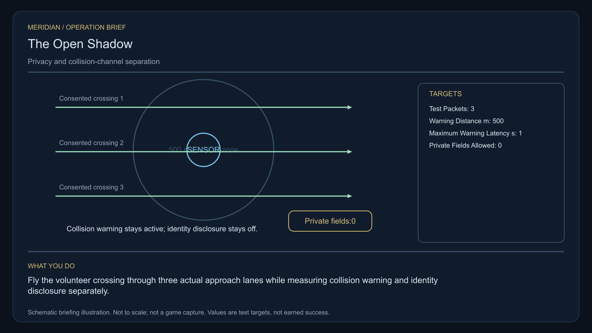

# C11 · The Open Shadow

[Illustrated story](../../INTENDED-GAME-STORY-WALKTHROUGH.md#the-open-shadow) · [Mission walkthrough checklist](../README.md)

Design walkthrough complete against `19a177e66093716928947f7246e0b664e4a6ad07`. The original commission is frozen at `e5ee22625a03c42609fb3311e50310bd68c81292`, outside executable main. Shared integration, consented fieldwork and native acceptance remain open. [Opening handoff](https://github.com/stephenlclarke/l337/blob/19a177e66093716928947f7246e0b664e4a6ad07/docs/COMPLETION-LEDGER.md#L7096)

## Offer and motivation

At Oralaora's living main orbital in Galaxy 3, review Agent Mara Vale's investigation after one genuine ordinary trade. Confirm against the actual contact, native arrival, retained trade and writable save. Preview the one-tonne instrument and collect it separately before departure. No score or prior mission gate. **Safe Passage** is the finished paid grouping. A separate core inquiry is intended to recover the clue without this contract's payment or result.

A rescue service update has accidentally coupled passenger privacy to collision warnings. Vale protects the witnesses while Relay Engineer Ivo Renn isolates the two channels. The volunteer trial must prove that every close approach still warns. Either final policy protects identities. They differ in whether identity data is withheld entirely from the public broadcast or held under witnessed private escrow.

## Route and fit

| Galaxy 3 route | Distance and service |
| --- | --- |
| Oralaora G03-S074 → Elavaeth G03-S173 | 2.592 LY. Original loan first, then three cooperative senders. |
| Elavaeth → Oravaessa G03-S052 | 3.808 LY. Two external couplers and three controlled traffic passes. |
| Oravaessa ↔ Maidea G03-S044 | 2.127 LY each way for the player's visit to the actual witness receiver and return for branch proof. |
| Oravaessa → Oralaora | 2.876 LY. Return the original reference for final audit. |

All player links fit nominal 7 LY reach with fuel. Actual galactic transfers, refuelling and berth geometry remain separate. The native witness route needs its own approved starting point, actual fuel and receiving. [World catalogue](https://github.com/stephenlclarke/l337/blob/19a177e66093716928947f7246e0b664e4a6ad07/Sources/L337Core/Resources/OriginalWorlds/catalogue.json), [Reach and fuel](https://github.com/stephenlclarke/l337/blob/19a177e66093716928947f7246e0b664e4a6ad07/Sources/L337Core/FuelStorage.swift#L8), [Native arrival](https://github.com/stephenlclarke/l337/blob/19a177e66093716928947f7246e0b664e4a6ad07/Sources/L337Core/NativeStationServices.swift#L135)

The original sealed receiver occupies **1 t** throughout, after fitted modules and ordinary freight. Player passenger requirement is zero. The authored SH001 Mule has two native operators, 76 t nominal hold and 9 LY hull reach. The witness profile calls for one actual **SH061 Saiga** with two operators, one mandate-bound delegate, one powered four-place Standard Cabin and its own finite fuel. The cabin consumes 5 t and one equipment unit. Neither specification determines who controls the local crossing participant or which hull is assigned to it. Those native roles require source approval. [Mule design](https://github.com/stephenlclarke/l337/blob/19a177e66093716928947f7246e0b664e4a6ad07/docs/fleet-design-v2/ships/SH001.toml), [Saiga design](https://github.com/stephenlclarke/l337/blob/19a177e66093716928947f7246e0b664e4a6ad07/docs/fleet-design-v2/ships/SH061.toml), [Mule art](../../assets/ships/SH001.png), [Saiga art](../../assets/ships/SH061.png)

**Separate field trial and witness travel.** The local volunteer crossing is a measured physical operation. The later reviewed witness profile sets `accompanimentRequired: false`. After the survey and permission, the source-owned witness travels independently while the player conducts the fieldwork. The earlier ledger and story's corridor guidance must not become a mandatory intersystem escort. Require the actual living Maidea arrival and mandate before the choice. [Historical field and journey wording](https://github.com/stephenlclarke/l337/blob/19a177e66093716928947f7246e0b664e4a6ad07/docs/COMPLETION-LEDGER.md#L2187)

## Play the nine stages

| Stage | Player action and qualifying evidence |
| --- | --- |
| 1. `accept` | Confirm the current Vale commission after the genuine trade. |
| 2. `collect-reference` | At Oralaora take the same original one-tonne receiver under the authorized loan. |
| 3. `survey` | At Elavaeth observe all three distinct cooperative calibration senders. Record collision warnings separately from private fields. The survey needs front view, 2° aim, 250–1,500 native surface units and 12 seconds of continuous unobstructed dwell per actual target. |
| 4. `field-work` | At Oravaessa connect the onboard reference receiver to both original external couplers, then fly the three actual volunteer approach lanes. Each pass must warn within **1 second at 500 m**, with **zero private fields** in the public payload. Use the 50–150 m, 1 m/s, 2° envelope where the actual coupler operation requires it. There is no generic work dwell. |
| 5. `independent-witness` | At Maidea verify the actual same living witness and crew and the original delegated mandate. A trial pass does not supply receiving. |
| 6. `choose-settlement` | With the arrived delegate choose **Publish anonymous collision telemetry** or **Use a witnessed identity escrow with a safety channel**. |
| 7. `apply-settlement` | At Oravaessa earn the selected physical and receiving proof. Anonymous policy needs all three warnings and no identity fields. The escrow policy retains identities only in the witnessed restricted channel and all three warnings remain continuously unfiltered. |
| 8. `return-and-audit` | At Oralaora return the actual original loan and verify ordered pass, privacy, living witness and both selected proofs. |
| 9. `close-case` | Confirm the independent case record and commit 7,400 CR plus `l337.unwritten-route/clue/open-shadow-trace` once. |

These are authored project estimates awaiting play balance. Keep one fixed ordered test per case. A hover, an elapsed generic countdown, a valid warning with leaked identity, or a private payload with suppressed warning must refuse. Journal the controlled traffic trial as the distinctive phase.

[Editable operation drawing](../../assets/missions/revisions/open-shadow-operation.svg)

## Failure, cold Continue and owners

Pause freezes active simulation. There is no overall deadline. Load resets unfinished survey dwell and preserves completed ordered measurements, consent, mandate, exact loan and private/public channel results. A genuine casualty or lost instrument persists. Require real remaining stock or remedial authority and keep original loss history. A separate no-fee inquiry earns only the missing clue. Verify cold Continue after individual passes, witness receiving, branch commit and terminal. Confirm twice must neither publish duplicate private evidence nor pay again.

- **G4 physical requirement.** Pin the three occupied traffic paths, real volunteer actor and its permitted controls, closest-approach geometry, two coupler faces, live warning trigger and loaded Saiga aperture at Maidea.
- **MC1 mission requirement, via Root and G1.** Rebind the frozen opening, then issue the original loan and cooperative senders. Implement an ordered real crossing, independently proved public safety and private field controls, distinct autonomous witness travel and branch-specific receiving. Refuse generic dwell as progress and protect participant identity through saved and reloaded outputs.
- **Root source decisions.** Issue the trial pilot/control and traffic identities, three safe lane paths, actual borrower, independent tender departure, real witness and Maidea authority, and the allowed escrow recipients. The project estimates specify timing, distance and payload size while those authorities remain unissued.

Historical story and data are `docs/meridian/missions/C11.md` and `docs/meridian/missions/definitions/open-shadow.json` at `c70110b292077588a0855fb48127adfb1b611c9d`, definition SHA-256 `96379e8bb6578901715a852078536da14bbe4a175d2165cdc7d91197eb4411d2`. The reviewed `docs/meridian/missions/gameplay/campaign-profiles.json#/profiles/open-shadow` has SHA-256 `37fe5011de7bcc5874f6e6eef42151a712be4f69a3b9b23cd18cf660bd0dff0a`.
