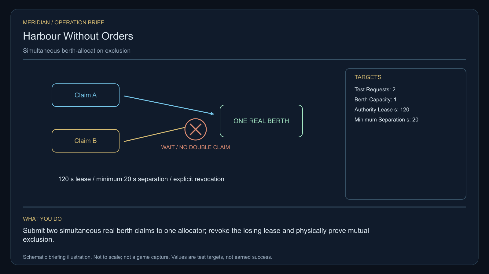

# C12 · Harbour Without Orders

[Illustrated story](../../INTENDED-GAME-STORY-WALKTHROUGH.md#harbour-without-orders) · [Mission walkthrough checklist](../README.md)

Design walkthrough complete against `19a177e66093716928947f7246e0b664e4a6ad07`. The original opening source is frozen at `85e2c3d6f98e1acee38b6ddce79318a68abade16`. The integration packet at `2996897cbf33fe421da00ecc47c6a3d6904fd772` is source-only against its older base and depends on typed-world equality support. Executable main has the clue registration, with original commissioning, physical stages and native acceptance still open. [Main clue and archive pin](https://github.com/stephenlclarke/l337/blob/19a177e66093716928947f7246e0b664e4a6ad07/Sources/L337Core/NativeCharterArchiveRegistryApproval.swift#L1236)

## Offer and motivation

Controller Edda Rell commissions the case from the working main orbital at Gallodor in Galaxy 4. Use the actual arrival, an ordinary completed purchase or sale, a writable commander save and explicit confirmation. No rank or prior campaign gate. Acceptance reserves no hold and issues no stock or signing authority. At the same issuer, collect the finite, serialled instrument separately. Rell retains it until the player confirms with **1 t free**. **Open Harbours** is the finished paid grouping. The independent core inquiry remains available without that purchase.

A disputed maintenance transfer left the affected harbour intact with three mutually invalid signatures. Approaches are refused without an attack. Rell seeks an accountable restoration of safe arrival. Marshal Nera Voss supports test limits that keep traffic safe while the principals settle who signs. Players stress a live single-berth allocator, receive the neutral witness and prove the chosen authority scheme under contention or expiry.

## Route and fit

| Galaxy 4 route | Distance and service |
| --- | --- |
| Gallodor G04-S111 → Ombolom G04-S092 | 1.925 LY. Collect the loan at Gallodor before surveying the real refusals. |
| Ombolom → Emdor G04-S145 | 4.430 LY. Test the allocator through both actual approach relays. |
| Emdor ↔ Emron G04-S048 | 7.990 LY each way for the player's visit to the witness receiver and return for branch proof. A nominal 7 LY hull can go via Gallodor, 4.112 + 4.601 LY, with fuel for both legs or a real refuel. |
| Emdor → Gallodor | 4.112 LY. Return the original instrument for independent audit. |

Distances are map geometry. Each jump still requires actual fitted reach and fuel, and each service requires a valid approach and berth. If the tender is dispatched from the survey system, Ombolom → Emron measures 6.211 LY. Its source berth, permission and itinerary still require issuance. [World catalogue](https://github.com/stephenlclarke/l337/blob/19a177e66093716928947f7246e0b664e4a6ad07/Sources/L337Core/Resources/OriginalWorlds/catalogue.json), [Reach and fuel](https://github.com/stephenlclarke/l337/blob/19a177e66093716928947f7246e0b664e4a6ad07/Sources/L337Core/FuelStorage.swift#L8), [Native arrival](https://github.com/stephenlclarke/l337/blob/19a177e66093716928947f7246e0b664e4a6ad07/Sources/L337Core/NativeStationServices.swift#L135)

The original instrument occupies **1 t** throughout the work, travel and choice. Player cabin requirement is zero. The authored SH001 Mule has two operators, 76 t nominal hold and 9 LY maximum hull jump. The story lists it without assigning it an exact native role. The witness profile requires an actual **SH061 Saiga** with two operators, one authorized delegate, one powered four-place Standard Cabin and its own finite fuel. The Saiga's design has 84 t hold, 22 equipment units, 9 LY hull jump and a 13 LY tank. Its cabin uses 5 t and one equipment unit, leaving nominal 79 t and 21 equipment units before other fits. Verify loaded geometry and power at the actual emergency berth. The Saiga collision-source issue identified in C03 also needs qualification here if the same capped resolver is used. [Mule design](https://github.com/stephenlclarke/l337/blob/19a177e66093716928947f7246e0b664e4a6ad07/docs/fleet-design-v2/ships/SH001.toml), [Saiga design](https://github.com/stephenlclarke/l337/blob/19a177e66093716928947f7246e0b664e4a6ad07/docs/fleet-design-v2/ships/SH061.toml), [Mule art](../../assets/ships/SH001.png), [Saiga art](../../assets/ships/SH061.png), [C03 hull admission finding](C03-HOLLOW-MANIFEST.md#route-and-ship-fit)

The source-owned witness starts its own journey after the survey and source permission, concurrently with Emdor work. The reviewed profile sets `accompanimentRequired: false`. The older escort wording describes a different obligation. Require actual Emron arrival with the same living delegate and authorized mandate before offering the choice. [Historical ledger wording](https://github.com/stephenlclarke/l337/blob/19a177e66093716928947f7246e0b664e4a6ad07/docs/COMPLETION-LEDGER.md#L2188)

## Play the nine stages

| Stage | Player action and qualifying evidence |
| --- | --- |
| 1. `accept` | Review and confirm Rell's commission while actually docked at Gallodor after the ordinary trade. Back changes nothing. |
| 2. `collect-reference` | At Gallodor confirm the one-tonne custody transaction. Match the exact original serial, owner and carrier. |
| 3. `survey` | At Ombolom read the three distinct real refusal signatures and compare with actual one-berth capacity. Each target requires front view, the nearest unobstructed mesh, 2° aim and 12 continuous seconds at 250–1,500 native surface units. Interrupted or loaded partial dwell resets. |
| 4. `field-work` | At Emdor arm both distinct external approach relays using the onboard instrument. Submit the two identified requests in the same allocator test. Exactly one holds the berth. The other waits **at least 20 simulation seconds**, consumes zero duplicate capacity and has its losing lease revoked. Prove the exclusion physically. The 50–150 m surface clearance, at most 1 m/s relative speed and at most 2° aim apply at the real relay interface. Elapsed hover time earns no work receipt. |
| 5. `independent-witness` | At Emron verify the identified Saiga's real transit, living emergency-berth reception and exact mandate. A previously completed arrival can be inspected after fieldwork. Disappearance near the station earns no credit. |
| 6. `choose-settlement` | At the actual receiver and with the arrived authorized delegation, confirm **Return authority to independent berth operators** or **Create a time-limited public harbour office**. Store the chosen branch once. |
| 7. `apply-settlement` | At Emdor prove the chosen branch physically and obtain its independent receiving proof. For `plan-a`, two distinct operator keys must resolve concurrent requests to one occupied berth without dual grant. For `plan-b`, the public authority lease expires at **120 simulation seconds** and revokes only its own test grant, preserving genuinely occupied berths. Proofs from different branches cannot combine. |
| 8. `return-and-audit` | At Gallodor return the original serial. The audit checks the actual refusal, contention, receiving and selected settlement receipts. Custody changes only on confirmed atomic transfer. |
| 9. `close-case` | Preserve the verified authority decision and original traffic records. Commit 7,600 CR via `l337.harbour-without-orders/final-payment` and clue `l337.unwritten-route/clue/harbour-without-orders-trace` once. |

The timing, scan and fitting envelopes are authored project values pending native play and balance. Journal the refusal, exclusion test, receiving and authority proof as the mission's four player-facing phases. The selected authority governs the restored approach policy. The oldest signed audit also records an empty central berth inside a curved boundary, the anomaly for the AI at Plugh.

[Editable operation drawing](../../assets/missions/revisions/harbour-without-orders-operation.svg)

## Failure, cold Continue and owners

There is no overall deadline. The allocator waits and the public lease use the simulation clock, which pauses with the game. Save the case's two request identities, occupancy and grant ownership, queue and test timestamps, committed observations, accepted choice, exact custody and actual witness/mandate. Cold Continue inside the 20-second wait or 120-second lease resumes the recorded test and remaining time without granting the berth twice or evicting real occupants. Persist completed proof and prevent replays across refusal, expiry, handoff and terminal. Retain genuine casualties and losses. A properly scoped remedial inquiry must have actual authority. The separate no-fee core inquiry can always earn only the same missing clue while preserving original loss, outcome and payment status. Verify cold Continue after arming, contention, expiry, witness receipt, settlement and terminal. A duplicate terminal or clue from the other route yields no second award.

- **G4 physical requirement.** Pin both relay faces and operational envelope, the two real controlled approach actors, allocator occupancy and exclusion geometry, witness departure and powered loaded Saiga arrival at Emron. Qualify the actual fuel and berth access.
- **MC1 mission requirement, via Root and G1.** Reconcile the frozen opening on the actual base and retain the separate finite loan. Bind three consented refusals, ordered relay arming, same-test contention, losing lease revocation, autonomous witness receiving, both branch proofs, custody and one terminal transaction. Exercise current-format cold load during contention and expiry. Refuse sequential clicks, menu choices and stale proofs as physical evidence.
- **Root source decisions.** Issue the actual Gallodor loan provider and serial, Ombolom refusal and berth sources, the Emdor allocator and named request owners, the source-authorized tie/priority rule and safe operating boundary, operator keys or public authority, and the witness mandate, fuel route and Emron receiver. The reviewed profile fixes the proof thresholds. It leaves those identities and permission decisions open.

Historical story and data are `docs/meridian/missions/C12.md` and `docs/meridian/missions/definitions/harbour-without-orders.json` at `c70110b292077588a0855fb48127adfb1b611c9d`, definition SHA-256 `5f0790b611519cccfae130a27e3b74440fd706107216c95c70e02e29fc57d667`. The reviewed `docs/meridian/missions/gameplay/campaign-profiles.json#/profiles/harbour-without-orders` has SHA-256 `37fe5011de7bcc5874f6e6eef42151a712be4f69a3b9b23cd18cf660bd0dff0a`.
