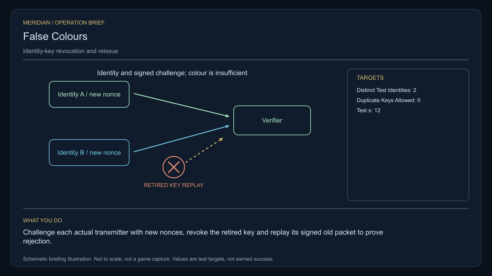

# C13 · False Colours

[Illustrated story](../../INTENDED-GAME-STORY-WALKTHROUGH.md#false-colours) · [Mission walkthrough checklist](../README.md)

Design walkthrough complete against `19a177e66093716928947f7246e0b664e4a6ad07`. Opening supplier `0279b893ae042c08387c3da0f26e436d91b5f20b` and integration packet `2ecdb0ec03dd383de352be42545b7d115b48c15a` are frozen outside executable main. The packet is source-only against its earlier typed-world base. Main contains the clue registration. Original commissioning, physical stages and native acceptance remain open. [Main clue and archive pin](https://github.com/stephenlclarke/l337/blob/19a177e66093716928947f7246e0b664e4a6ad07/Sources/L337Core/NativeCharterArchiveRegistryApproval.swift#L1126)

## Offer and motivation

Nia Toren commissions Rowan at the living Heroran main orbital in Galaxy 5 after one actual ordinary purchase or sale. Confirm from the actual berth with a writable commander save. No rank, earlier mission or free cargo required at acceptance. The original one-tonne comparator is a separate finite loan from Toren at the same orbital. Leave it with Toren until actual free hold and confirmed custody are available. **Truth for Sale** is the finished paid grouping. The no-fee core clue inquiry remains separately available.

A recycler issued duplicate keys. A lawful hauler now looks like a patrol ship, and the frightened militia has closed the freight corridor. Toren wants the original signing chain. Captain Tamsin Holt insists on preserving both physical witnesses and the hauler's pilot and cargo. Compare authenticated responses with the manufacturing seal, then protect the actual verification flight. The final choice corrects the records in public or through supervised replacement.

## Route and fit

| Galaxy 5 route | Distance and service |
| --- | --- |
| Heroran G05-S148 → Firerur G05-S049 | 2.207 LY. Collect the original comparator first. |
| Firerur → Norenul G05-S222 | 4.398 LY. Three cooperative repeaters precede the two-hull comparison. |
| Norenul ↔ Seluer G05-S200 | 4.925 LY each way. Outbound verification escort, then return for settlement proof. |
| Norenul → Heroran | 2.239 LY. Return the original instrument. |

Each leg fits nominal 7 LY reach. A 7 LY tank cannot complete either the Seluer round trip or Seluer → Norenul → Heroran without refuelling. Show actual fuel and services for both escort participants before launch and route the player's later refuelling independently. The design uses Norenul as the player rendezvous after comparator work. Actual hauler departure, safe dispatch permission, destination aperture and docking remain separate source requirements. [World catalogue](https://github.com/stephenlclarke/l337/blob/19a177e66093716928947f7246e0b664e4a6ad07/Sources/L337Core/Resources/OriginalWorlds/catalogue.json), [Reach and fuel](https://github.com/stephenlclarke/l337/blob/19a177e66093716928947f7246e0b664e4a6ad07/Sources/L337Core/FuelStorage.swift#L8), [Native arrival](https://github.com/stephenlclarke/l337/blob/19a177e66093716928947f7246e0b664e4a6ad07/Sources/L337Core/NativeStationServices.swift#L135)

The player needs 1 t of free hold for the reserved loan, zero passenger places and a functioning actual comparator interface. SH001 Mule is listed in the story without an exact issued role. It has two operating places, 76 t nominal hold and 9 LY hull reach. The witness profile calls for an actual **SH061 Saiga** with two operators, one authorized delegate, a powered four-place Standard Cabin and finite fuel. The Saiga design has 84 t hold, 22 equipment units, 9 LY jump reach and a 13 LY tank. The cabin consumes 5 t and one equipment unit. Qualify power, native collision geometry and the loaded fit with the actual manifest before assigning the Seluer berth. The 79 t left after the cabin is a nominal upper bound before other fit and freight. The hauler's freight remains in its custody. Its actual manifest and the second seal-test hull's class remain unissued. [Mule design](https://github.com/stephenlclarke/l337/blob/19a177e66093716928947f7246e0b664e4a6ad07/docs/fleet-design-v2/ships/SH001.toml), [Saiga design](https://github.com/stephenlclarke/l337/blob/19a177e66093716928947f7246e0b664e4a6ad07/docs/fleet-design-v2/ships/SH061.toml), [Mule art](../../assets/ships/SH001.png), [Saiga art](../../assets/ships/SH061.png), [C03 hull admission finding](C03-HOLLOW-MANIFEST.md#route-and-ship-fit)

## Play the nine stages

| Stage | Player action and qualifying evidence |
| --- | --- |
| 1. `accept` | Confirm Toren's reviewed offer at actual Heroran dock. Accepting creates the case only. |
| 2. `collect-reference` | Confirm the exact serialled comparator loan at Heroran with one available tonne. |
| 3. `survey` | Read three distinct cooperative repeaters at Firerur and match the signed issuing chain. Use front view, nearest unobstructed mesh, 2° aim and 12 continuous seconds per target at 250–1,500 native surface units. Scanner colour has no evidentiary authority. |
| 4. `field-work` | At Norenul present both duplicate key instances to the onboard comparator and read the independent manufacturing trace on two separately identified hulls. Send each transmitter a fresh nonce and verify its signed reply against the physically identified source. Budget 20 seconds of qualified work for each target as a project interpretation of the minimum. Require 50–150 m surface clearance, no more than 1 m/s relative speed and 2° aim. Unqualified work pauses. The functional comparison and both targets must pass. |
| 5. `independent-witness` | This mission requires accompaniment. Join the actual consented departure and protect the accused hauler, pilot and cargo through the real passage to Seluer. Require native receipt at the independent berth for the same living party and signed mandate. No proximity timer, phantom escort or substitute hull qualifies. |
| 6. `choose-settlement` | At Seluer with the arrived authorized delegation, confirm **Publish a simultaneous revocation and safe-conduct notice** or **Reissue both keys under independent supervision**. Back leaves the choice open. |
| 7. `apply-settlement` | At Norenul require the selected branch's physical and independent receiving proof. For `plan-a`, revoke both old key records together and obtain actual militia acknowledgement for both safe-conduct notices. For `plan-b`, issue two distinct new identities with zero duplicate keys and prove rejection when replaying each retired key's signed old packet in the 12-second test. Verify the retired-key ledger independently. Both proofs must be from the same branch. |
| 8. `return-and-audit` | At Heroran return the original comparator and audit the chain, physical observations, escort reception and both selected proofs. |
| 9. `close-case` | Keep the verified identity settlement and original issue records. Commit 6,200 CR via `l337.false-colours/final-payment` and `l337.unwritten-route/clue/false-colours-trace` once. The clue is the curved mark in an older seal layer absent from the issue records. |

**Sequence and authorization.** The approved objective puts examination before the escort and public key changes after the Seluer decision. Interpret the operation brief's revocation and replay as branch verification after choice. Keep both live keys intact during the cooperative comparison. For the earlier verification flight, the project design calls for a narrowly scoped transit authorization issued after fieldwork by the actual source and corridor authority. It permits the escort to reach independent examination while the general corridor remains closed. It cannot satisfy either final safe-conduct or receiving proof. Root needs to issue the actual grant and its limits.

The scan, comparator and replay values are authored estimates awaiting native balance. Give the player the competing signatures, independent seal and rejected replay as observable feedback. Contact dialogue or scanning colour alone earns no evidence. No EMP, salvage, attack or unrelated clearance is required. Journal the comparison and actual escort as distinct player activities.

[Editable operation drawing](../../assets/missions/revisions/false-colours-operation.svg)

## Failure, cold Continue and owners

No overall deadline. Pause freezes active test and travel clocks. Cold Continue discards unfinished survey dwell and restores committed readings, completed qualified work, the actual reference custody, case-bound challenges, verified responses and the escort's real route, fuel, manifest and arrival. Preserve the chosen branch, revocation/reissue operations and simulation-time replay-test progress. A delayed response to an old or wrong challenge earns no new receipt. Test save and cold Continue before and after the escort berth receipt, midway through replay and after return and terminal. A genuine loss remains in history and cannot create a replacement warrant, living witness or escort arrival. Use issued remedial authority if available. The separate no-fee core inquiry can always earn only the same missing clue, without the fee, original outcome or paid campaign credit.

- **G4 physical requirement.** Pin the three repeaters and two distinct native transmitter hulls and comparator faces. Qualify powered loaded Saiga geometry, physical operating envelope, permitted launch and route, fuel, custody and actual Seluer approach and receiver.
- **MC1 mission requirement, via Root and G1.** Rebind the frozen opening and issue the separate loan. Bind fresh nonces and physical seals to actual entities, explicit accompanied transit, genuine docking and receiving, an atomic simultaneous revocation or distinct issue plus rejected replay, both proofs and one terminal transaction. Verify substituted hull, cloned key, expired authority, blocked corridor, forged acknowledgement and cold-load replays refuse safely.
- **Root source decisions.** Issue the original seal/comparator, signing chain and owners, both key-bearing hulls, the legitimate hauler, operators, cargo, delegation and independent receiver. Confirm who authorizes the narrowly scoped flight, who signs both plan-A notices, who acknowledges them and who signs plan-B issue and retired-key records. The specification establishes the evidence and ordering. Those authorities remain unissued.

Historical story and data are `docs/meridian/missions/C13.md` and `docs/meridian/missions/definitions/false-colours.json` at `c70110b292077588a0855fb48127adfb1b611c9d`, definition SHA-256 `4a8f144011e8611f77cc82ff7019faf4a3a275b3b21c93aea5d023dc17f9b4db`. The reviewed `docs/meridian/missions/gameplay/campaign-profiles.json#/profiles/false-colours` has SHA-256 `37fe5011de7bcc5874f6e6eef42151a712be4f69a3b9b23cd18cf660bd0dff0a`. [Original comparator and escort wording](https://github.com/stephenlclarke/l337/blob/19a177e66093716928947f7246e0b664e4a6ad07/docs/COMPLETION-LEDGER.md#L2189)
