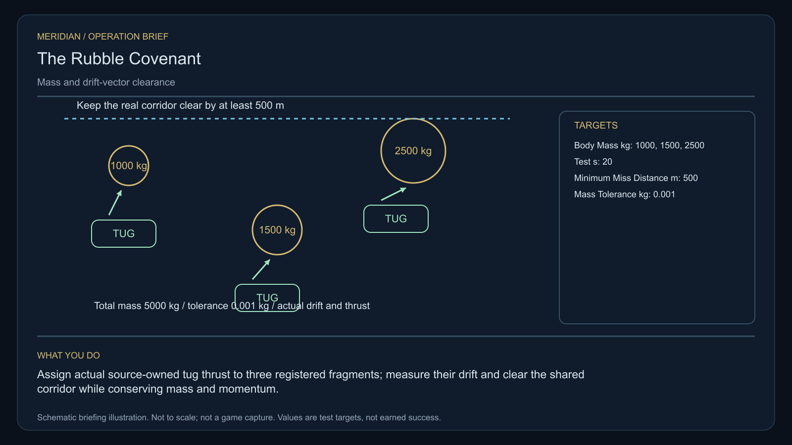

# C14 · The Rubble Covenant

[Illustrated story](../../INTENDED-GAME-STORY-WALKTHROUGH.md#the-rubble-covenant) · [Mission walkthrough checklist](../README.md)

Design walkthrough complete against `19a177e66093716928947f7246e0b664e4a6ad07`. Opening supplier `59822ea5a01afa818f455fd43f7c8ccd4c4c0d7f` and source-only integration `2c13696a8f01cdcd60c4734b1f004d0a7a04829d` are frozen against earlier bases. Main contains the clue registration. Original commissioning, physical stages and native acceptance remain open. [Main clue and archive pin](https://github.com/stephenlclarke/l337/blob/19a177e66093716928947f7246e0b664e4a6ad07/Sources/L337Core/NativeCharterArchiveRegistryApproval.swift#L1588)

## Offer and motivation

Geologist Jalen Orr commissions the case at Leiven's living main orbital in Galaxy 6 after one actual ordinary trade. Require actual arrival, a writable save and confirmation. No score, prior mission or spare hold at acceptance. The original serialled one-tonne calibration loan is collected separately at the same issuer with an available tonne. **The Hearth Compact** is the finished paid grouping. The free core clue inquiry remains separately available.

A ring-mining cooperative wants safe passage through a debris corridor. Rival insurers treat unclaimed rocks as somebody else's property, and operators cannot act without a defensible mass and ownership record. Orr establishes both. Tug Lead Mira Penn gives the bounded clearance task and requires a living survey crew to verify the corridor before it can be relied on. The final choice assigns future clearance through the cooperative or bonds individual salvage sections.

## Route and fit

| Galaxy 6 route | Distance and service |
| --- | --- |
| Leiven G06-S185 → Noaraena G06-S138 | 1.908 LY. Collect the original instrument at Leiven before the three-body survey. |
| Noaraena → Irasaori G06-S010 | 4.669 LY. Match the clearance record and control actual tugs. |
| Irasaori ↔ Loaliel G06-S071 | 4.613 LY each way for the player's witness and settlement visit. The same pair is a candidate witness route if dispatched from Irasaori. |
| Irasaori → Leiven | 3.085 LY. Return the exact original instrument for audit. |

All direct jumps fit nominal 7 LY reach. Refuel along the way on a 7 LY tank. In particular, Loaliel → Irasaori → Leiven totals 7.698 LY. Confirm the actual tender origin, corridor approach, checkpoint permissions, jump fuel and receiving. Noaraena → Loaliel measures 5.651 LY and would bypass a corridor located at Irasaori. Direct arrival by itself cannot prove the mission corridor pass. [World catalogue](https://github.com/stephenlclarke/l337/blob/19a177e66093716928947f7246e0b664e4a6ad07/Sources/L337Core/Resources/OriginalWorlds/catalogue.json), [Reach and fuel](https://github.com/stephenlclarke/l337/blob/19a177e66093716928947f7246e0b664e4a6ad07/Sources/L337Core/FuelStorage.swift#L8), [Native arrival](https://github.com/stephenlclarke/l337/blob/19a177e66093716928947f7246e0b664e4a6ad07/Sources/L337Core/NativeStationServices.swift#L135)

The player reserves 1 t for the original instrument and zero passenger places. Tug anchors remain under their source's custody. The story lists SH001 Mule, with two operators, 76 t nominal hold and 9 LY hull reach, without issuing it a tug role. The source-owned witness is an actual **SH061 Saiga** with two operators, one mandate-bound delegate, one powered four-place Standard Cabin and finite fuel. The Saiga has 84 t nominal hold, 22 equipment units, 9 LY hull jump and a 13 LY tank. The cabin uses 5 t and one equipment unit. Qualify loaded mass, power and the Loaliel aperture. The C03 Saiga collision limit issue applies if this uses the same resolver. Tug ratings, stock, attachment interfaces, controls and duty cycle remain to be issued. [Mule design](https://github.com/stephenlclarke/l337/blob/19a177e66093716928947f7246e0b664e4a6ad07/docs/fleet-design-v2/ships/SH001.toml), [Saiga design](https://github.com/stephenlclarke/l337/blob/19a177e66093716928947f7246e0b664e4a6ad07/docs/fleet-design-v2/ships/SH061.toml), [Mule art](../../assets/ships/SH001.png), [Saiga art](../../assets/ships/SH061.png), [C03 hull admission finding](C03-HOLLOW-MANIFEST.md#route-and-ship-fit)

## Play the nine stages

| Stage | Player action and qualifying evidence |
| --- | --- |
| 1. `accept` | Confirm Orr's reviewed commission at the actual Leiven orbital after a genuine trade. |
| 2. `collect-reference` | Accept the exact protected one-tonne calibration instrument at Leiven with free hold and committed custody. |
| 3. `survey` | At Noaraena identify the three actual registered survey bodies, measure mass and velocity vectors and preserve their signed provenance. Require 12 continuous seconds per target at 250–1,500 native surface units, front view, unobstructed nearest mesh and 2° aim. A reading authorizes no movement. |
| 4. `field-work` | At Irasaori register the local work bodies and assign bounded source-owned thrust. Attach the two issued anchors to the two actual trajectories that need correction. Confirm the third body's measured drift and actual tug disposition. Balance 1,000 + 1,500 + 2,500 kg against remaining bodies plus material actually received, within 0.001 kg. Account for changes in momentum through applied thrust and transfers. Require predicted and measured clearance of at least 500 m during the 20-second test. For actual anchor handling, use 50–150 m surface clearance, at most 1 m/s and at most 2° aim. A timer while merely hovering earns no proof. |
| 5. `independent-witness` | At Loaliel confirm the same living survey tender, actual clearance-corridor pass, native doorway and receiving authorized by the issuer, and the signed mandate. The source-owned tender may depart independently after survey and consent but must hold outside the physical corridor until measured clearance authorizes entry. |
| 6. `choose-settlement` | With the arrived authorized delegates at the actual Loaliel receiver, select **Pool the clearance work under the cooperative** or **Bond individual salvage sections**. |
| 7. `apply-settlement` | At Irasaori earn physical and receiving proof for one branch. For `plan-a`, verify the cooperative mass ledger and perform a witnessed tug release that preserves measured clearance. For `plan-b`, verify the boundaries of distinct bonded sections, reject an overlapping claim and fly an actual safe exclusion-zone test pass. |
| 8. `return-and-audit` | Return the original loan at Leiven. Audit provenance, actual corridor passage, the two chosen proofs and source custody. |
| 9. `close-case` | Preserve the new ownership charter and original records. Commit 6,600 CR via `l337.rubble-covenant/final-payment` and `l337.unwritten-route/clue/rubble-covenant-trace` once. The clue is the old trajectory that bends around an empty centre. |

The reviewed brief calls for three fragments and depicts three tug assignments. The exact stage and opening packet require two installed anchors and two changed trajectories. The design uses three registered local work bodies, two player attachments and a third source tug already attached to the remaining body, with its independently recorded hold assignment. Root must approve how the third assignment is physically supplied. Noaraena's three survey identities and Irasaori's local work bodies require an issued cross-system provenance record. A scan alone cannot move the same identity across systems. The project targets need play balance. G4 must pin the 500 m measurement against the actual corridor and moving-body envelopes before native qualification.

The later profile has `accompanimentRequired: false`; the historical ledger calls it an escort. The living witness still needs the real clearance-corridor pass, including a safety hold or refusal if the test fails. A lawful salvage beam may assist only with actual consent, anchor, load and clearance evidence. The source tug path is sufficient. Cutting, EMP, rock destruction or charter claims supply no ship purchase right and no automatic clearance. [Historical ledger wording](https://github.com/stephenlclarke/l337/blob/19a177e66093716928947f7246e0b664e4a6ad07/docs/COMPLETION-LEDGER.md#L2190)

[Editable operation drawing](../../assets/missions/revisions/rubble-covenant-operation.svg)

## Failure, cold Continue and owners

There is no overall deadline. Persist body identities, lineage, mass, trajectory, actual thrust and load, anchor state, time and result of the clearance test, ownership and receipts. Pause freezes active simulation time. Save records the current simulation state and remaining test time. Cold Continue drops unfinished scan dwell and resumes the same bodies, attachments, source resources, pending test and tender route without adding thrust or duplicating a fragment. Revalidate clearance against the current moving geometry before release or entry. Test Continue during thrust and clearance, during the tender's hold, after actual arrival and after terminal. Retain genuine loss and revoked access. Separately scoped remedial authority may continue only through a real safe route. The no-fee core inquiry can always earn the same missing clue while preserving original failure, payment and campaign credit.

- **G4 physical requirement.** Pin both systems' body identities and measured state, two anchor faces and actual bounded tug actors, third assignment, thrust, power and swept clearance geometry. Qualify loaded Saiga, real corridor hold and pass, fuel and Loaliel berth. Confirm the test duration and geometric miss reference against the live simulation.
- **MC1 mission requirement, via Root and G1.** Rebind the frozen opening, issue exact serial custody and verify body lineage, both attachments, thrust and mass/momentum ledger. Require true independently travelling witness passage and receiving. Implement distinct charter branches and one terminal transaction. Refuse duplicated fragments, overlapping claim, forged corridor event, scan-only clearance and expiry or save replays.
- **Root source decisions.** Issue Orr's actual loan, survey and clearance body owners, cross-system provenance, both anchors, the third tug disposition and permissions, corridor geometry, operator consent and branch signing/receiving authorities. Issue the tender's holding approach, actual departure, finite fuel, survey mandate and Loaliel receiver before native enablement.

Historical story and data are `docs/meridian/missions/C14.md` and `docs/meridian/missions/definitions/rubble-covenant.json` at `c70110b292077588a0855fb48127adfb1b611c9d`, definition SHA-256 `969316d8421735c4589e75a69a8bc5e3c3a0eaa0f44ce28c2ce249a88cf0f559`. The reviewed `docs/meridian/missions/gameplay/campaign-profiles.json#/profiles/rubble-covenant` has SHA-256 `37fe5011de7bcc5874f6e6eef42151a712be4f69a3b9b23cd18cf660bd0dff0a`.
