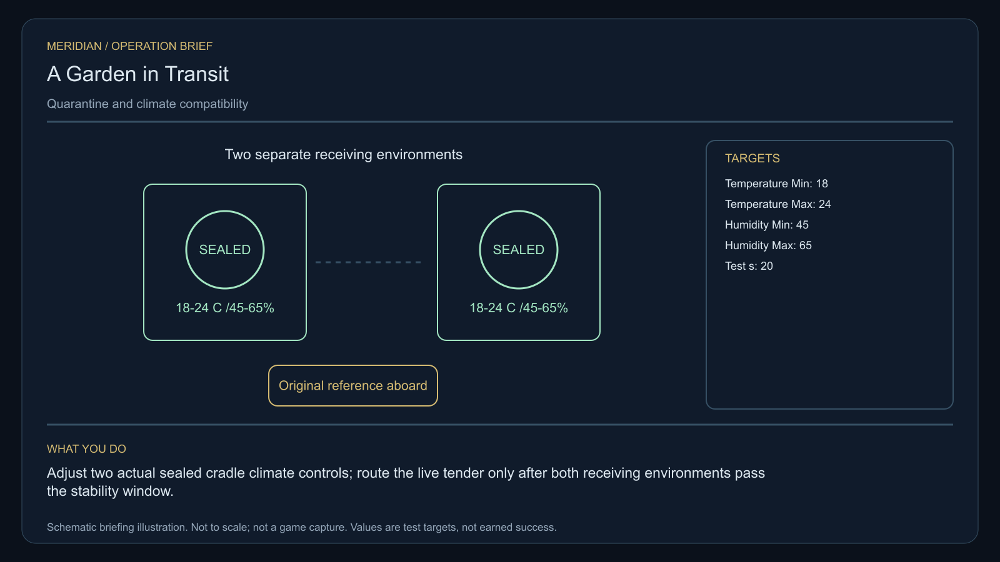

# C15 · A Garden in Transit

[Illustrated story](../../INTENDED-GAME-STORY-WALKTHROUGH.md#a-garden-in-transit) · [Mission walkthrough checklist](../README.md)

Design walkthrough complete against `19a177e66093716928947f7246e0b664e4a6ad07`. Opening supplier `fd007241dd953da32453b68dc1492cfbc6aa3416` and source-only integration `b09bc94b382075228f6c0dee300d7317b906df23` are frozen outside executable main. Main contains the clue registration. Original commissioning, physical stages and native acceptance remain open. [Main clue and archive pin](https://github.com/stephenlclarke/l337/blob/19a177e66093716928947f7246e0b664e4a6ad07/Sources/L337Core/NativeCharterArchiveRegistryApproval.swift#L1170)

## Offer and motivation

Custodian Tomas Veil commissions Rowan at Kurenash's living main orbital in Galaxy 7 after one actual ordinary purchase or sale. Confirm from the actual berth with a writable save. No rank or prior mission gate. Acceptance leaves the finite sealed sampler with Veil. Confirm a separate custody transfer at Kurenash with **1 t free** before departure. **Living Worlds** is the finished paid grouping. A free independent core inquiry supplies the clue when the original case or paid product is unavailable.

A seed archive's orbital lease is ending. Two destinations want the same collection, while the growers want its living material protected and accounted for. Veil makes the archive's consent and physical provenance part of the inquiry. Captain Suri Arlen insists that the test capsules return to their actual owners. The player calibrates two real environments and escorts the actual tender under quarantine before choosing distributed custody or a shared orbital archive.

## Route and fit

| Galaxy 7 route | Distance and service |
| --- | --- |
| Kurenash G07-S222 → Zorgadek G07-S064 | 2.304 LY. Collect the exact original sampler before leaving Kurenash. |
| Zorgadek → Vektaor G07-S065 | 5.171 LY. Read three consented environments before working on the two isolated test cradles. |
| Vektaor ↔ Drelor G07-S238 | 4.779 LY each way for a Vektaor escort rendezvous and the player's return for branch proof. |
| Vektaor → Kurenash | 2.868 LY. Return the original sampler after branch proof. |

Each leg fits nominal 7 LY reach. On the listed route every consecutive pair of jumps exceeds a 7 LY tank. Refuel at Zorgadek, Vektaor before departure, Drelor and Vektaor on the return, or use a separately verified route or larger tank. Publish actual station service access and the required fuel in the departure review. Zorgadek → Drelor measures 3.576 LY and cannot replace Vektaor's tests or the authorized rendezvous. The exact source departure and possible intermediate refuelling require issuance for the tender and the player separately. [World catalogue](https://github.com/stephenlclarke/l337/blob/19a177e66093716928947f7246e0b664e4a6ad07/Sources/L337Core/Resources/OriginalWorlds/catalogue.json), [Reach and fuel](https://github.com/stephenlclarke/l337/blob/19a177e66093716928947f7246e0b664e4a6ad07/Sources/L337Core/FuelStorage.swift#L8), [Native arrival](https://github.com/stephenlclarke/l337/blob/19a177e66093716928947f7246e0b664e4a6ad07/Sources/L337Core/NativeStationServices.swift#L135)

The player carries the original 1 t sampler and needs zero passenger places. The project lists SH001 Mule, with two operating places, 76 t nominal hold and 9 LY hull reach, without issuing a specific role. The escort profile uses one source-owned **SH061 Saiga**, two native operators, one mandate-bound delegate in a powered four-place Standard Cabin and finite fuel. The design gives the Saiga 84 t nominal hold, 22 equipment units, a 9 LY hull jump and a 13 LY tank. The cabin costs 5 t and one equipment unit. The nominal 79 t remaining must also cover the actual powered containment hardware, archive mass and other fit. Issue the sealed collection manifest, actual custodians, refrigeration or climate power demand and emergency operating reserve before checking loaded geometry and the Drelor quarantine aperture. Crew and delegate places alone cannot qualify living freight. [Mule design](https://github.com/stephenlclarke/l337/blob/19a177e66093716928947f7246e0b664e4a6ad07/docs/fleet-design-v2/ships/SH001.toml), [Saiga design](https://github.com/stephenlclarke/l337/blob/19a177e66093716928947f7246e0b664e4a6ad07/docs/fleet-design-v2/ships/SH061.toml), [Mule art](../../assets/ships/SH001.png), [Saiga art](../../assets/ships/SH061.png), [C03 hull admission finding](C03-HOLLOW-MANIFEST.md#route-and-ship-fit)

## Play the nine stages

| Stage | Player action and qualifying evidence |
| --- | --- |
| 1. `accept` | Confirm Veil's commission at the actual Kurenash orbital after a genuine ordinary trade. |
| 2. `collect-reference` | Take the one-tonne original sealed sampler by exact serial and confirmed custody. Back, insufficient hold or a stale quote leaves it with Veil. |
| 3. `survey` | At Zorgadek observe three real receiving cradles under the current archive consent token. Record conditions and provenance. Use front view, nearest unobstructed surface, 2° aim and 12 continuous seconds per target at 250–1,500 native surface units. |
| 4. `field-work` | At Vektaor connect the onboard sampler to each of the two isolated climate interfaces. Adjust actual heat and humidity controls while the cradles stay sealed. Qualify real work within 50–150 m, at most 1 m/s and 2° aim, with the profile's 20-second minimum. Prove both powered cradles remain at **18–24 °C and 45–65% relative humidity for 20 continuous simulation seconds**. A threshold breach restarts the stability window. The test consumes no seeds or reference culture. Reconcile any test capsule with its original owner. |
| 5. `independent-witness` | After both cradles pass, join the real authorized seed-tender departure and protect the same identified hull, crew, delegate and sealed collection until actual Drelor quarantine receiving. The custodians remain aboard until the receiver confirms the actual collection. Proximity or a substituted cargo list earns no credit. |
| 6. `choose-settlement` | At Drelor's actual receiver, with the arrived mandate-bound delegation, choose **Create distributed seed custody** or **Establish a shared orbital archive**. Back leaves both unselected. |
| 7. `apply-settlement` | At Vektaor require the selected physical and receiving proof. For `plan-a`, both distinct receiving cradles pass and the source signs the actual division. Record each existing lot once under its real receiving custodian. For `plan-b`, the shared quarantine lock refuses an unapproved opening and both joint custodians acknowledge approved access while containment stays closed. |
| 8. `return-and-audit` | At Kurenash return the exact original sampler. Audit test stock return, the same living reception and both selected settlement proofs. |
| 9. `close-case` | Preserve the chosen charter and issue 6,100 CR through `l337.garden-in-transit/final-payment` with `l337.unwritten-route/clue/garden-in-transit-trace` once. The old catalogue records a circular season boundary without any named climate or world. |

The artwork clarifies the climate units. The project design uses one simultaneous stable window after both controls are armed. Qualified handling and native climate stability are separate checks. G4 and MC1 must verify how the actual sampler interface maintains both readings as the player moves between cradles. Esc, the mere passage of time and a successful reading from only one cradle cannot release the tender.

**Quarantine versus final custody.** Drelor is the provisional receiving station and choice location. Vektaor is the authored application and evidence checkpoint. Use actual source-issued receivers, authorization and physical transfer for any destination change after the decision. A Vektaor confirmation cannot move live stock from Drelor or mint replacement lots. The exact final sites and custody transports require issuance. The existing mission does not require the player to carry the seed collection, use EMP or operate a salvage module.

[Editable operation drawing](../../assets/missions/revisions/garden-in-transit-operation.svg)

## Failure, cold Continue and owners

The lease explains the move. There is no overall offer or preparation timer. Pause freezes active simulation. Save the original serial, capsule custody, consent scope, both cradle settings and measured state, qualified progress, stability window, escort identities, manifest, power, fuel, branch and receipts. Unfinished survey dwell resets on load. Resume the native stability window only while both authoritative cradle states remain qualified. Save/load cannot complete a test, bypass a power loss, multiply an archive lot or unlock containment. Exercise cold Continue during calibration and transit, before and after quarantine receiving, during branch transfer or lock verification and after terminal. Actual losses persist. If the original case fails, the free core inquiry can always award the missing clue only. It does not confer the case fee, lost stock, original outcome or paid campaign credit.

- **G4 physical requirement.** Pin three survey faces, two powered isolated cradles, their actual controls, telemetry and both interfaces. Qualify loaded Saiga power, containment and fuel, the route, Drelor aperture, quarantine hardware and real branch receivers.
- **MC1 mission requirement, via Root and G1.** Reconcile the frozen opening and bind finite original custody, consented readings, both simultaneous climate measurements, a source-authorized actual escort, exact quarantine receipt, chosen branch and one terminal transaction. Reject a single passing cradle, forged authority, duplicate stock or unapproved opening. Preserve all custody and clocks through cold Continue.
- **Root source decisions.** Issue Veil's sampler, consent and test capsule owners, actual cradle and control identities, departure authority, tender manifest and powered containment. Identify the agreed Drelor receiver, final archive destinations, transporter and custody signers for the actual split or joint quarantine access. The documented climate values and rendezvous plan are project design. Live capacity and permission require separate evidence.

Historical story and data are `docs/meridian/missions/C15.md` and `docs/meridian/missions/definitions/garden-in-transit.json` at `c70110b292077588a0855fb48127adfb1b611c9d`, definition SHA-256 `455def33ff05273c8a9b0133f81c53f5367721bf724f9efe9c09ae313fc2ddab`. The reviewed `docs/meridian/missions/gameplay/campaign-profiles.json#/profiles/garden-in-transit` has SHA-256 `37fe5011de7bcc5874f6e6eef42151a712be4f69a3b9b23cd18cf660bd0dff0a`. [Original escort and custody wording](https://github.com/stephenlclarke/l337/blob/19a177e66093716928947f7246e0b664e4a6ad07/docs/COMPLETION-LEDGER.md#L2191)
