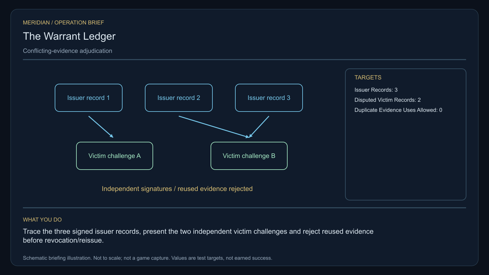

# C16 · The Warrant Ledger

[Illustrated story](../../INTENDED-GAME-STORY-WALKTHROUGH.md#the-warrant-ledger) · [Mission walkthrough checklist](../README.md)

Design walkthrough complete against `19a177e66093716928947f7246e0b664e4a6ad07`. Opening supplier `fba929cdc2298c38650f93d009cfb1f50fbdf16c` and source-only integration `e4919630d207275e5ee64fe8962c8220fc3228fb` are frozen outside executable main. Main contains the clue registration. Original commissioning, physical stages and native acceptance remain open. [Main clue and archive pin](https://github.com/stephenlclarke/l337/blob/19a177e66093716928947f7246e0b664e4a6ad07/Sources/L337Core/NativeCharterArchiveRegistryApproval.swift#L1874)

## Offer and motivation

At the living Iaririn main orbital in Galaxy 8, Marshal Nera Voss commissions the audit after one genuine ordinary purchase or sale. Require actual arrival, a writable save and explicit Confirm. No rank or prior case gate. Acceptance issues no evidence or instrument. Voss retains the original finite, serialled one-tonne loan until a separate confirmation with spare hold at Iaririn. **Truth for Sale** is the finished paid grouping. The free core inquiry remains available independently.

Bounty issuers reused the same casualty evidence to issue conflicting warrants. One convoy carries an armed suspect and two wrongly listed witnesses. Voss needs the valid case separated from duplicated claims. Nia Toren traces issue dates and preserves testimony under its original consent restrictions. The player resolves the physical evidence, receives the actual witness tender and chooses a public correction or private restitution. The suspect's independently established case retains its actual legal status.

## Route and fit

| Galaxy 8 route | Distance and service |
| --- | --- |
| Iaririn G08-S003 → Faera G08-S148 | 2.319 LY. Collect the original reference before the three issuer observations. |
| Faera → Neraen G08-S187 | 3.186 LY. Compare two challenged records with the real incident seal. |
| Neraen ↔ Lorion G08-S137 | 5.736 LY each way for the player's visit to the actual protected receiver and return for proof. |
| Neraen → Iaririn | 2.602 LY. Return the original instrument. |

Each direct jump fits nominal 7 LY reach. On a 7 LY tank, refuel at Neraen before leaving for Lorion, at Lorion and again at Neraen on the return. An independent Faera → Lorion tender leg measures 3.023 LY if the source approves Faera departure and protected arrival. Fuel, protected berth and actual itinerary remain separate qualification. [World catalogue](https://github.com/stephenlclarke/l337/blob/19a177e66093716928947f7246e0b664e4a6ad07/Sources/L337Core/Resources/OriginalWorlds/catalogue.json), [Reach and fuel](https://github.com/stephenlclarke/l337/blob/19a177e66093716928947f7246e0b664e4a6ad07/Sources/L337Core/FuelStorage.swift#L8), [Native arrival](https://github.com/stephenlclarke/l337/blob/19a177e66093716928947f7246e0b664e4a6ad07/Sources/L337Core/NativeStationServices.swift#L135)

The player reserves 1 t of hold and needs zero passenger places. The story lists SH001 Mule, with two operating places, 76 t nominal hold and 9 LY hull reach, without assigning it an exact native role. The actual **SH061 Saiga** tender needs two operators, one mandate-bound delegate, one powered four-place Standard Cabin and finite fuel. Its design has 84 t hold, 22 equipment units, 9 LY jump reach and a 13 LY tank. The cabin uses 5 t and one equipment unit. Reserve capacity by actual person: two witnesses plus a separate delegate use three places if all ride the tender. If one witness holds the mandate, account for that person once. If the second witness arrives separately, require that person's own authorized presence or sealed evidence path. Source must issue the manifest and identify which testimony and arrivals each branch needs. Cabin arithmetic alone does not qualify actual transport. [Mule design](https://github.com/stephenlclarke/l337/blob/19a177e66093716928947f7246e0b664e4a6ad07/docs/fleet-design-v2/ships/SH001.toml), [Saiga design](https://github.com/stephenlclarke/l337/blob/19a177e66093716928947f7246e0b664e4a6ad07/docs/fleet-design-v2/ships/SH061.toml), [Mule art](../../assets/ships/SH001.png), [Saiga art](../../assets/ships/SH061.png), [C03 hull admission finding](C03-HOLLOW-MANIFEST.md#route-and-ship-fit)

The later reviewed profile has `accompanimentRequired: false`. The tender travels independently after survey and source permission while Rowan examines records at Neraen. The older escort wording does not gate progress. Its real protected receipt and arriving mandate gate the Lorion choice. Protected access to the hearing is an issued temporary scope distinct from the public branch's final safe-conduct register. [Historical ledger wording](https://github.com/stephenlclarke/l337/blob/19a177e66093716928947f7246e0b664e4a6ad07/docs/COMPLETION-LEDGER.md#L2192)

## Play the nine stages

| Stage | Player action and qualifying evidence |
| --- | --- |
| 1. `accept` | At actual Iaririn dock, confirm the reviewed Voss commission after an ordinary trade. |
| 2. `collect-reference` | Accept the exact original one-tonne verifier in a separate confirmed custody transaction at Iaririn. |
| 3. `survey` | At Faera read three actual issuer-signed warrant records and compare their evidence references. Use front view, unobstructed nearest mesh, 2° aim and 12 continuous seconds at 250–1,500 native surface units per target. The published reward supplies no warrant proof. |
| 4. `field-work` | At Neraen use the independent coupler and original incident seal to present both actual victim challenges. Compare issuer, incident identity and date. Retain both signed conflicting statements under their original consent. Count each incident once and reject every attempted duplicate use. Both actual targets and the functional reconciliation must qualify. Physical work needs 50–150 m surface clearance, at most 1 m/s, at most 2° aim and the authored 20-second qualified minimum. Neither wrongly listed witness becomes hostile by appearing in the record. |
| 5. `independent-witness` | At Lorion verify the actual tender, same living witness party and authority at the protected hearing berth. Receiver and tender identities must agree with the issued manifest. |
| 6. `choose-settlement` | At the real receiver choose **Publish corrected warrants simultaneously** or **Use protected restitution hearings** with the arrived delegation. Preview each branch's actual authority and funded availability before confirmation. |
| 7. `apply-settlement` | At Neraen require physical and receiving proof for the selected branch. For `plan-a`, stage the correction together, collect both affected issuers' revocation acknowledgements, then accept the actual witness safe-conduct register. For `plan-b`, receive both original records under seal and match each actual funded debit to its recipient credit. Every compensation claim and evidence use can settle only once. |
| 8. `return-and-audit` | At Iaririn return the exact original loan and audit both challenges, protected arrival, consent restrictions and the two selected proofs. |
| 9. `close-case` | Preserve the corrected case and original evidence. Commit 8,200 CR via `l337.warrant-ledger/final-payment` and `l337.unwritten-route/clue/warrant-ledger-trace` once. The jurisdiction mark names neither person nor issuing world. |

Three issuer-signed records are examined. The public branch requires acknowledgements from the two affected revoking authorities identified by the case. The third observed record alone does not establish a third revocation. The source must distinguish all three records, the two competing warrant claims, the valid suspect record and the protected witnesses. Show the player how issue dates and the independent seal expose duplicate casualty attribution while keeping private testimony restricted.

For protected restitution, the authoring design uses case-scoped funded transactions with unique debit and credit pairs. The payer, eligible recipients and exact funded amounts remain source decisions. The player's terminal fee is separate. A review or cancelled choice creates no transfer. Neraen verifies actual sealed hearing and custody receipts. A local dialog cannot impersonate Lorion's protected receiver or manufacture a testimony. The selected resolution changes only this case's warrants and remedy. Combat kills, weapons, EMP and salvage are unnecessary for the evidence path.

[Editable operation drawing](../../assets/missions/revisions/warrant-ledger-operation.svg)

## Failure, cold Continue and owners

No overall deadline. Pause freezes active simulation. Cold Continue resets unfinished survey dwell and restores the original loan, signed records, distinct incident identities and consent, tender's real manifest and route, branch, register and funded receipt pairs. Keep private testimony out of any public projection after reload. Test saves after each challenge, protected arrival, partial issuer acknowledgement, partial compensation and terminal. After failure or casualty keep the original outcome. The separate no-fee core inquiry can always award only the missing clue. It cannot supply an original witness, clear unrelated warrants, credit the paid campaign or pay the case fee.

- **G4 physical requirement.** Pin three consented beacons, actual incident seal and both comparison interfaces. Qualify loaded Saiga cabin, people, finite fuel, protected route and actual Lorion aperture.
- **MC1 mission requirement, via Root and G1.** Rebind the frozen opening and custody, then reconcile three records and two signed challenges with one incident identity and zero duplicate use. Require independent actual living receipt, separate selected public or sealed restitution proof and one terminal transaction. Test forged consent, unrelated case, public disclosure, missing issuer acknowledgement, unfunded credit and replayed debit through Continue.
- **Root source decisions.** Issue the loan, warrant issuer and physical record identities, evidence custodian, consent and actual case subjects. Confirm which witnesses travel, the mandate, hearing berth and restricted access. Issue both revocation authorities, scope of safe conduct, actual hearing and custody authority, funded restitution payer, recipients and sums.

Historical story and data are `docs/meridian/missions/C16.md` and `docs/meridian/missions/definitions/warrant-ledger.json` at `c70110b292077588a0855fb48127adfb1b611c9d`, definition SHA-256 `16b225e3565f7eefb6f0297bfaf2c68831ccda7d05a48de40e501c991b360dcc`. The reviewed `docs/meridian/missions/gameplay/campaign-profiles.json#/profiles/warrant-ledger` has SHA-256 `37fe5011de7bcc5874f6e6eef42151a712be4f69a3b9b23cd18cf660bd0dff0a`.
