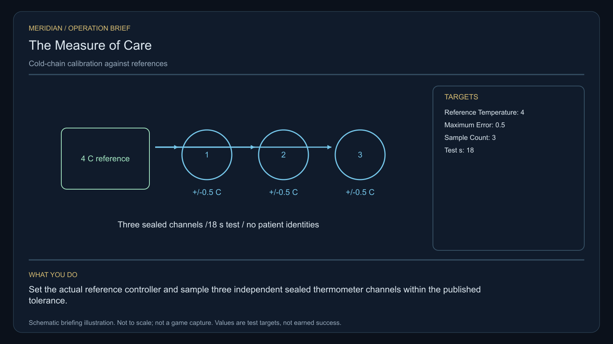

# C17 · The Measure of Care

[Illustrated story](../../INTENDED-GAME-STORY-WALKTHROUGH.md#the-measure-of-care) · [Mission walkthrough checklist](../README.md)

Design walkthrough complete against `19a177e66093716928947f7246e0b664e4a6ad07`. Opening supplier `f38a264866296f801cf339fdf59699264a7da05f` and source-only integration `ba54d40fd9de72baf18acebecd145270b29e49d7` are frozen outside executable main. Main contains the clue registration. Original commissioning, physical stages and native acceptance remain open. [Main clue and archive pin](https://github.com/stephenlclarke/l337/blob/19a177e66093716928947f7246e0b664e4a6ad07/Sources/L337Core/NativeCharterArchiveRegistryApproval.swift#L1390)

## Offer and motivation

Physicist Anja Kest commissions Rowan at Veron's living main orbital in Galaxy 1 after one ordinary purchase or sale. Require actual docking, a writable save and explicit Confirm. No rank or prior case gate. Acceptance reserves no cargo. Kest retains the finite, sealed one-tonne reference until a separate confirmed transfer at Veron with one free tonne. **Living Worlds** is the finished paid grouping. The independent no-fee core inquiry remains available.

Two orbital clinics report contradictory storage readings for the same treatment. Kest suspects that calibration has created an apparent shortage. Coordinator Sera Dain seeks equipment history and consented evidence while protecting patient identities. The player adjusts the instruments' measurement offsets and verifies them against a sealed independent reference. Unlike C15's climate controls, C17 tests measurement accuracy. It introduces no real treatment specification and offers neither medical cargo sales nor a shortcut through patient records.

## Route and fit

| Galaxy 1 route | Distance and service |
| --- | --- |
| Veron G01-S041 → Almadan G01-S022 | 2.591 LY. Collect Kest's original instrument before the monitor survey. |
| Almadan → Envesen G01-S136 | 5.607 LY. Read three monitors before the two cradle tests. |
| Envesen ↔ Betaven G01-S071 | 2.437 LY each way for the player's visit to the living receiver and return for branch proof. |
| Envesen → Veron | 6.563 LY. Return the original sealed reference. |

Every direct jump fits nominal 7 LY reach. On the listed route with a 7 LY tank, refuel at Almadan and at Envesen on both visits. The Betaven round trip totals **4.874 LY** before refuelling at Envesen for the final 6.563 LY. The catalogue gives 2.4368197820109714 LY per leg. Double the unrounded leg before rounding the total. Almadan → Betaven is a candidate 6.854 LY independent tender leg if issued. The departure desk must check the true hull, fuel, power and authorized services for each craft. [World catalogue](https://github.com/stephenlclarke/l337/blob/19a177e66093716928947f7246e0b664e4a6ad07/Sources/L337Core/Resources/OriginalWorlds/catalogue.json), [Reach and fuel](https://github.com/stephenlclarke/l337/blob/19a177e66093716928947f7246e0b664e4a6ad07/Sources/L337Core/FuelStorage.swift#L8), [Native arrival](https://github.com/stephenlclarke/l337/blob/19a177e66093716928947f7246e0b664e4a6ad07/Sources/L337Core/NativeStationServices.swift#L135)

The player carries the exact 1 t sealed reference, needs zero passenger places and must operate its actual power and interface. SH001 Mule is listed without an exact role. Its design has two operating places, 76 t nominal hold and 9 LY hull reach. The witness profile uses an actual **SH061 Saiga** with two operators, a mandate-bound delegate, a powered four-place Standard Cabin and finite fuel. The design has 84 t hold, 22 equipment units, 9 LY hull reach and a 13 LY tank. The cabin uses 5 t and one equipment unit. Count actual travelling technicians separately if the clinic crew includes people other than the operators and delegate. Qualify power, loaded geometry and actual access to Betaven's independent test berth. [Mule design](https://github.com/stephenlclarke/l337/blob/19a177e66093716928947f7246e0b664e4a6ad07/docs/fleet-design-v2/ships/SH001.toml), [Saiga design](https://github.com/stephenlclarke/l337/blob/19a177e66093716928947f7246e0b664e4a6ad07/docs/fleet-design-v2/ships/SH061.toml), [Mule art](../../assets/ships/SH001.png), [Saiga art](../../assets/ships/SH061.png), [C03 hull admission finding](C03-HOLLOW-MANIFEST.md#route-and-ship-fit)

The reviewed profile sets `accompanimentRequired: false`. After survey and source permission, the clinic tender travels independently while the player calibrates the cradles. The older escort wording does not apply. The choice requires actual living Betaven receiving and the arrived mandate. [Historical ledger wording](https://github.com/stephenlclarke/l337/blob/19a177e66093716928947f7246e0b664e4a6ad07/docs/COMPLETION-LEDGER.md#L2193)

## Play the nine stages

| Stage | Player action and qualifying evidence |
| --- | --- |
| 1. `accept` | Confirm Kest's commission at the actual Veron main orbital after the trade. |
| 2. `collect-reference` | Confirm protected custody of the same original serialled one-tonne sealed reference at Veron. Record its initial condition. |
| 3. `survey` | At Almadan read three actual signed refrigeration monitors within the consent scope. Preserve equipment history with no patient identities. For each distinct target use front view, unobstructed nearest mesh, 2° aim and 12 continuous seconds at 250–1,500 native surface units. |
| 4. `field-work` | At Envesen use the onboard sealed reference at both external cradle interfaces. Adjust the actual offsets and sample three independent sealed thermometer channels per cradle. Work needs the profile's 20-second qualified minimum, 50–150 m surface clearance, at most 1 m/s and at most 2° aim. Run the separate **18-second** functional test and require all three final readings at each cradle within **0.5 °C of 4 °C**. Keep the raw measurements, offsets, capsule identity and exposure history. |
| 5. `independent-witness` | At Betaven verify the independently travelling, actually docked clinic tender, the identified living service crew and the original mandate at the real receiving clinic. |
| 6. `choose-settlement` | With the arrived authorized delegation at Betaven, confirm **Keep independent clinic calibration references** or **Establish a shared clinical calibration service**. |
| 7. `apply-settlement` | At Envesen require the selected physical and receiving proof. For `plan-a`, verify each clinic's distinct measured reference and its acknowledged actual custody. For `plan-b`, verify the shared service boundary and separately exercise each clinic's actual stop authority. Both tests preserve the sealed sample history. |
| 8. `return-and-audit` | At Veron return the original sealed reference. Audit readings, actual living reception, condition and both selected proofs without exposing patient data. |
| 9. `close-case` | Preserve the original readings and the verified service charter. Commit 5,900 CR through `l337.measure-of-care/final-payment` and `l337.unwritten-route/clue/measure-of-care-trace` once. The clue is the stable curved boundary recorded without a thermal source. |

Use a separate physical test for each cradle after fitting and adjustment. The design keeps the 20-second qualified work requirement separate from the 18-second test. For shared service, rearm an authorized test run between the two independent stop attempts so a pre-stopped service cannot count twice. These are project design decisions pending native balancing. The displayed limits calibrate game instruments. Sample viability and power-loss effects need their own source values. Changing an offset cannot restore a spoiled capsule or overwrite raw exposure history.

[Editable operation drawing](../../assets/missions/revisions/measure-of-care-operation.svg)

## Failure, cold Continue and owners

No overall deadline. Pause freezes active simulation. Preserve exact seal and custody, sample condition and immutable exposure, authorized equipment records, actual offsets, independent test channels, qualified progress, selected branch and signed receipt state. Reset unfinished survey dwell on load. Resume test time only against the same actual still-qualified physical state. Exercise cold Continue during calibration, after a temperature excursion, at actual witness reception, between clinic stop tests and after terminal. A duplicate reading, reassigned serial or expired consent supplies no receipt. Retain original damage, spoilage and casualties. The separate free core inquiry can always award only the missing clue, preserving the original case outcome and fee.

- **G4 physical requirement.** Pin both powered calibration faces, three monitor surfaces, actual sealed independent channel readings and reference/sample power and condition. Qualify actual Saiga crew, finite fuel and Betaven receiving.
- **MC1 mission requirement, via Root and G1.** Rebind the frozen opening and custody. Enforce consent-filtered signed readings, independent work and test time, all six actual channel results and private exposure history. Require actual independent living receiving and both selected branch proofs. Refuse cloned channels or capsule, post-load exposure erasure, unrelated kill and duplicated stop receipts.
- **Root source decisions.** Issue exact reference serial and permitted condition envelope, real clinics and monitor owners, test/cradle and controller authorities, the independent stop scopes and acknowledged custody desks. Issue the actual crew, mandate, tender route and Betaven berth before enabling the branch.

Historical story and data are `docs/meridian/missions/C17.md` and `docs/meridian/missions/definitions/measure-of-care.json` at `c70110b292077588a0855fb48127adfb1b611c9d`, definition SHA-256 `a11a2939995a20c5e2a97ba25b56887e06a8aa231b1d81aefd8eab039b75d004`. The reviewed `docs/meridian/missions/gameplay/campaign-profiles.json#/profiles/measure-of-care` has SHA-256 `37fe5011de7bcc5874f6e6eef42151a712be4f69a3b9b23cd18cf660bd0dff0a`.
