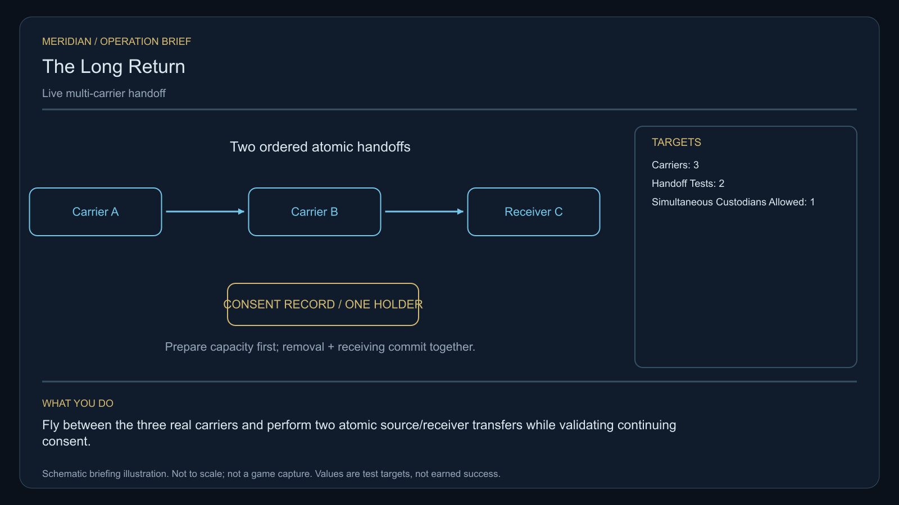

# C18 · The Long Return

[Illustrated story](../../INTENDED-GAME-STORY-WALKTHROUGH.md#the-long-return) · [Mission walkthrough checklist](../README.md)

Design walkthrough complete against `19a177e66093716928947f7246e0b664e4a6ad07`. Opening supplier `8074cfae6ca08f0abc1246bc7570091408f5ed4e` and source-only integration `2b97e937ad869682fb62f3c2d8b92f4c20c45931` are frozen outside executable main. Main contains the clue registration. Original commissioning, physical stages and native acceptance remain open. [Main clue and archive pin](https://github.com/stephenlclarke/l337/blob/19a177e66093716928947f7246e0b664e4a6ad07/Sources/L337Core/NativeCharterArchiveRegistryApproval.swift#L1346)

## Offer and motivation

Coordinator Sera Dain commissions Rowan at the living Zankakor main orbital in Galaxy 2 after one genuine ordinary purchase or sale. Require actual arrival, a writable save and confirmation. No score or prior campaign gate. Acceptance starts the case. Dain keeps the exact finite one-tonne receiver instrument until the separate confirmed loan at Zankakor with one free tonne. **The Wayfarer Union** is the finished paid grouping. The no-fee core inquiry remains independently available.

A dispersed maintenance crew wants to go home. Three carriers have incomplete accounts of an earlier missed rendezvous. Captain Orin Sorel wants the original timestamps reconciled against the actual people received. Dain asks the player to rehearse two handoffs without putting passengers at risk, then escort the consenting reunion tender. The crew retains the right to decide where to go and withdraw consent.

## Route and fit

| Galaxy 2 route | Distance and service |
| --- | --- |
| Zankakor G02-S080 → Darvan G02-S127 | 2.153 LY. Collect the original instrument before reading three carrier records. |
| Darvan → Halridor G02-S001 | 3.258 LY. Fly between the three local carrier actors and complete both neutral test transfers. |
| Halridor ↔ Elaris G02-S118 | 7.275 LY each way. The shared candidate for nominal 7 LY reach is via Zankakor, 3.244 + 4.148 LY outbound. A 7 LY tank also needs refuelling there. |
| Halridor → Zankakor | 3.244 LY. Return the exact loan. |

The escort departure, any intermediate refuelling and agreed arrival must be valid for both craft. The Saiga's nominal 9 LY reach permits the direct geometry if fitted and fuelled. Preview an actual common plan and obtain source consent before launching. A player taking the Zankakor detour while the tender jumps directly does not meet the accompanied journey requirement. Darvan → Elaris measures 4.620 LY and does not supply the Halridor test or a valid escort by itself. [World catalogue](https://github.com/stephenlclarke/l337/blob/19a177e66093716928947f7246e0b664e4a6ad07/Sources/L337Core/Resources/OriginalWorlds/catalogue.json), [Reach and fuel](https://github.com/stephenlclarke/l337/blob/19a177e66093716928947f7246e0b664e4a6ad07/Sources/L337Core/FuelStorage.swift#L8), [Native arrival](https://github.com/stephenlclarke/l337/blob/19a177e66093716928947f7246e0b664e4a6ad07/Sources/L337Core/NativeStationServices.swift#L135)

The player carries the 1 t receiver instrument and needs zero passenger cabins. SH001 Mule appears in the story list with two operating places, 76 t nominal hold and 9 LY hull reach. Neither an exact Mule assignment nor the other carrier hulls is issued. The profile uses an actual **SH061 Saiga** with two native operators, one mandate-bound delegate and one powered four-place Standard Cabin. The Saiga's design has 84 t nominal hold, 22 equipment units, 9 LY hull reach and a 13 LY tank. The cabin uses 5 t and one equipment unit. At most three additional passengers can accompany a separate delegate in that fit. Issue the actual consenting reunion roster before promising capacity. A larger roster requires separately verified powered fittings or an authorized multi-carrier plan. Crew, cabins, physical custody, fuel and loaded aperture all need actual native qualification. [Mule design](https://github.com/stephenlclarke/l337/blob/19a177e66093716928947f7246e0b664e4a6ad07/docs/fleet-design-v2/ships/SH001.toml), [Saiga design](https://github.com/stephenlclarke/l337/blob/19a177e66093716928947f7246e0b664e4a6ad07/docs/fleet-design-v2/ships/SH061.toml), [Mule art](../../assets/ships/SH001.png), [Saiga art](../../assets/ships/SH061.png), [C03 hull admission finding](C03-HOLLOW-MANIFEST.md#route-and-ship-fit)

## Play the nine stages

| Stage | Player action and qualifying evidence |
| --- | --- |
| 1. `accept` | Confirm Dain's reviewed case at actual Zankakor dock after the ordinary trade. |
| 2. `collect-reference` | Confirm protected custody of the exact original one-tonne receiver instrument at Zankakor. |
| 3. `survey` | At Darvan read three distinct signed, consented rendezvous records. Preserve the original clock and named-party custody of each. Use front view, nearest unobstructed mesh, 2° aim and 12 seconds of continuous dwell per target at 250–1,500 native surface units. |
| 4. `field-work` | At Halridor fly between the three actual carriers and complete two ordered neutral transfers, A to B then B to C. For each test, the identified receiver first confirms capacity and readiness. Release and receiving then commit together, with one responsible custodian throughout. Test only with non-passenger test records or instruments. Use the 50–150 m, 1 m/s and 2° envelope where the actual transfer interface needs it. Hovering earns no credit. |
| 5. `independent-witness` | Join the actual authorized reunion tender departure after both tests. Accompany the same hull and willing people along the fuel-paid route, including any agreed intermediate stop. Require their actual living reception at the issued Elaris berth. A replacement hull or marker cannot restore the departed group. |
| 6. `choose-settlement` | At Elaris with actual arrived delegates, choose **Use a witnessed shared return handoff** or **Give the reunion tender a direct return corridor**. Revalidate consent before committing the choice. |
| 7. `apply-settlement` | At Halridor verify both branch proofs. For `plan-a`, two actual carrier signatures must bind the same consenting group and actual receiving berth, with genuine group reception. For `plan-b`, require a corridor grant naming the actual tender and actual home-berth acknowledgement of the same living group under the grant. Earlier provisional arrival alone cannot satisfy final branch authority. |
| 8. `return-and-audit` | Return the exact serial at Zankakor. Audit both tests, consent, live Elaris reception and the two chosen proofs. |
| 9. `close-case` | Preserve the completed agreement and original records. Commit 7,800 CR through `l337.long-return/final-payment` and `l337.unwritten-route/clue/long-return-trace` once. The oldest rendezvous reserves a curved empty space with no passenger, mass or destination. |

The receiving acknowledgement during preparation is consent and readiness. The transfer's commit changes the single responsible holder atomically. Withdrawal, stale authority or full capacity leaves the original holder recorded. The ordered A → B → C test is the project interpretation shown by the authored schematic. It rehearses custody without exposing passengers. A live branch still requires actual receiving under its issued agreement. Elaris is the provisional choice berth. The final home berth, any follow-on route and authorized physical transport must be issued separately. Confirmation at Halridor audits actual receipts. It cannot create the final arrival. The ledger identifies native transit, docking/receiving and formation/rejoin as distinct dependencies. [Ledger carrier dependencies](https://github.com/stephenlclarke/l337/blob/19a177e66093716928947f7246e0b664e4a6ad07/docs/COMPLETION-LEDGER.md#L1789)

[Editable operation drawing](../../assets/missions/revisions/long-return-operation.svg)

## Failure, cold Continue and owners

No overall deadline. Pause freezes active simulation. Cold Continue resets unfinished survey dwell and restores the exact loan, three original records, consent, prepared transfer and current custodian, real tender/manifest/fuel and branch proofs. Revalidate preparation before a pending commit. Save between preparation and commit, between handoffs, at intermediate escort refuel, after receiving and after terminal. Verify withdrawal, full receiver or load does not lose a person, duplicate a custody record or replay a payment. Retain casualties and actual withdrawal. A permitted remedial path needs real authority and surviving people. The no-fee core inquiry always provides only the missing clue if the original becomes unavailable.

- **G4 physical requirement.** Pin three actual carriers and interfaces, both neutral test payloads and relative-approach envelope, finite fitted tender and actual Elaris and home receivers. Qualify both ships' shared route, intermediate services, fuel, physical rejoin and loaded berth geometry.
- **MC1 mission requirement, via Root and G1.** Reconcile the frozen opening. Bind distinct carrier identities, the original loan, three consented records, two prepared and atomic custody transitions, actual escort, real branch receipt and terminal. Refuse replay, partial release, late withdrawal, duplicate holders and borrowed receiving.
- **Root source decisions.** Issue Dain's serial and actual consent/custody scope, all three carriers and equipment owners, both test authorities, tender operators, delegation, consenting group and actual capacity. Issue a common route with intermediate service permission, Elaris reception, both shared signers or direct corridor issuer, and the actual final receiver and home berth.

Historical story and data are `docs/meridian/missions/C18.md` and `docs/meridian/missions/definitions/long-return.json` at `c70110b292077588a0855fb48127adfb1b611c9d`, definition SHA-256 `3e1decc3b4982885c539b6a07c6b8b7a1dea71a57f0fe54e6257258cd9e84019`. The reviewed `docs/meridian/missions/gameplay/campaign-profiles.json#/profiles/long-return` has SHA-256 `37fe5011de7bcc5874f6e6eef42151a712be4f69a3b9b23cd18cf660bd0dff0a`.
