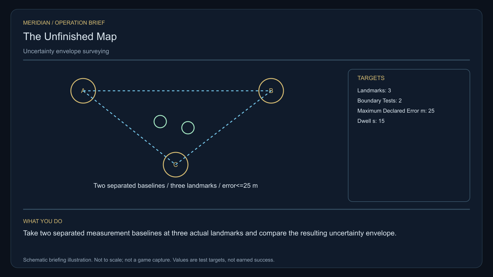

# C19 · The Unfinished Map

[Illustrated story](../../INTENDED-GAME-STORY-WALKTHROUGH.md#the-unfinished-map) · [Mission walkthrough checklist](../README.md)

Design walkthrough complete against `19a177e66093716928947f7246e0b664e4a6ad07`. Opening supplier `67e20ff106935848edd47eddda9cd4b2ab7cb0b0` and source-only integration `64acbc87cb0a0e67a4ed003eb5fa7e13a2f5f17f` are frozen outside executable main. Main contains the clue registration. Original commissioning, physical stages and native acceptance remain open. [Main clue and archive pin](https://github.com/stephenlclarke/l337/blob/19a177e66093716928947f7246e0b664e4a6ad07/Sources/L337Core/NativeCharterArchiveRegistryApproval.swift#L1852)

## Offer and motivation

Agent Mara Vale commissions Rowan at the living Sareith main orbital in Galaxy 3 after one actual ordinary purchase or sale. Require actual arrival, a writable save and explicit confirmation. No rank or prior mission gate. The separate pre-departure pickup at Sareith requires 1 t free and committed custody of the original survey register. **Beyond the Map** is the finished paid grouping. The free core clue inquiry remains independently available.

A deceased surveyor's unfinished archive is being sold as safe-navigation data. Geologist Jalen Orr wants the records' honest blanks preserved. Vale wants only authorized copies, real physical measurements and the custodian's original rights register. The player flies two geometrically distinct observation stations and measures uncertainty before helping decide what can be published. Unmeasured cells remain explicitly unknown under either outcome.

## Route and fit

| Galaxy 3 route | Distance and service |
| --- | --- |
| Sareith G03-S114 → Iosaira G03-S179 | 2.037 LY. Collect the original loan first. |
| Iosaira → Sanaena G03-S164 | 3.065 LY. Retrieve three dated archive records before taking local baselines. |
| Sanaena ↔ Naleara G03-S077 | 5.453 LY each way for the player's visit to the publication receiver and return for branch proof. |
| Sanaena → Sareith | 2.804 LY. Return the exact original survey register. |

All direct jumps fit nominal 7 LY reach. On a 7 LY tank, plan refuelling at Sanaena before Naleara, at Naleara and at Sanaena on the return. Iosaira → Naleara measures 2.426 LY if the independent custodian tender is authorized to depart from Iosaira. The actual departure, receiver and finite fuel must be qualified independently. [World catalogue](https://github.com/stephenlclarke/l337/blob/19a177e66093716928947f7246e0b664e4a6ad07/Sources/L337Core/Resources/OriginalWorlds/catalogue.json), [Reach and fuel](https://github.com/stephenlclarke/l337/blob/19a177e66093716928947f7246e0b664e4a6ad07/Sources/L337Core/FuelStorage.swift#L8), [Native arrival](https://github.com/stephenlclarke/l337/blob/19a177e66093716928947f7246e0b664e4a6ad07/Sources/L337Core/NativeStationServices.swift#L135)

The player reserves 1 t for the original instrument, needs zero passenger berths and must actually support its survey interface. The listed SH001 Mule has two operating places, 76 t nominal hold and 9 LY hull reach. Its exact role is unissued. The profile requires an actual source-owned **SH061 Saiga** with two operators, one mandate-bound custodian, a powered four-place Standard Cabin and finite fuel. Its design has 84 t hold, 22 equipment units, 9 LY hull reach and a 13 LY tank. The cabin uses 5 t and one equipment unit. The real custodian carries the original rights register. Qualify the actual tender and loaded Naleara approach with its manifest and permission. [Mule design](https://github.com/stephenlclarke/l337/blob/19a177e66093716928947f7246e0b664e4a6ad07/docs/fleet-design-v2/ships/SH001.toml), [Saiga design](https://github.com/stephenlclarke/l337/blob/19a177e66093716928947f7246e0b664e4a6ad07/docs/fleet-design-v2/ships/SH061.toml), [Mule art](../../assets/ships/SH001.png), [Saiga art](../../assets/ships/SH061.png), [C03 hull admission finding](C03-HOLLOW-MANIFEST.md#route-and-ship-fit)

The reviewed profile sets `accompanimentRequired: false`. The custodian travels independently after survey and source permission while Rowan measures the boundary. The older escort instruction does not gate progress. Require actual living reception and signed rights before the publication choice. [Historical ledger wording](https://github.com/stephenlclarke/l337/blob/19a177e66093716928947f7246e0b664e4a6ad07/docs/COMPLETION-LEDGER.md#L2195)

## Play the nine stages

| Stage | Player action and qualifying evidence |
| --- | --- |
| 1. `accept` | Confirm Vale's reviewed offer at the actual Sareith dock after the ordinary trade. |
| 2. `collect-reference` | Confirm the original finite one-tonne survey register under its exact custody at Sareith. |
| 3. `survey` | At Iosaira receive authorized copies from three distinct visible boundary relays. Keep date, frame, original provenance and unknown coverage. Use front view, unobstructed nearest mesh, 2° aim and 12 continuous seconds per target at 250–1,500 native surface units. |
| 4. `field-work` | At Sanaena take two geometrically separated measurement baselines against three actual landmarks. Use the original instrument to measure each actual boundary point for **15 qualified seconds**. Compute and retain the actual uncertainty radius for each, both at most **25 m**, and compare with the archived frame. Use 50–150 m surface clearance, at most 1 m/s and at most 2° aim where the physical interface requires it. Waiting near one point, repeated geometry or treating unknown coordinates as observations earns no receipt. |
| 5. `independent-witness` | At Naleara verify the actual living custodian and original rights register aboard the identified tender received at the publication berth. |
| 6. `choose-settlement` | At the actual receiver, with the arrived authorized delegation, confirm **Publish a bounded atlas with explicit gaps** or **Preserve a witnessed research archive**. |
| 7. `apply-settlement` | At Sanaena require both branch proofs. For `plan-a`, verify a published measured uncertainty layer with explicit unknown cells and signed public-use permission. For `plan-b`, verify actual restricted archive receiving and a public notice limited to independently measured hazards. |
| 8. `return-and-audit` | At Sareith return the exact original register. Audit both measurement proofs, actual custodian rights and both selected branch proofs. |
| 9. `close-case` | Preserve the archive and measured coverage. Commit 6,900 CR through `l337.unfinished-map/final-payment` and `l337.unwritten-route/clue/unfinished-map-trace` once. The untouched margin has an inward arc outside every surveyed coordinate frame. |

The operation needs two distinct physical observation setups and usable landmark geometry. The project interpretation uses both local measurement points as observation setups and carries frame, time, raw readings and uncertainty into the atlas. G4 must pin actual separation, landmark geometry and the reproducible error calculation. Only passing measurements fill covered cells. Routes through explicit unknowns must carry the uncertainty warning and cannot acquire automatic safe-route status. The witness rights register permits only the selected disclosure scope. A copy without provenance cannot grant consent, and the deceased surveyor cannot be supplied as a replacement witness.

[Editable operation drawing](../../assets/missions/revisions/unfinished-map-operation.svg)

## Failure, cold Continue and owners

No overall deadline. Pause freezes active simulation. Reset unfinished survey dwell on load. Restore original rights and custody, completed measurements, raw samples, frame and uncertainty, provenance, actual tender route and chosen branch. Retain qualified partial boundary work only if the same identified observation and calibrated geometry still hold. A stale frame, copied points, over-tolerance result or invalid permission refuses with its actual reason. Exercise cold Continue between baselines, at actual receiving, after publication proof and after terminal. Genuine loss remains recorded. The free core inquiry always awards only the missing clue if the original becomes unavailable, independently of archive custody or fee.

- **G4 physical requirement.** Pin three archive relay surfaces, three distinct local landmarks, both survey positions, usable line of sight and independent geometry. Qualify the actual uncertainty calculation and loaded Saiga at the issued Naleara aperture.
- **MC1 mission requirement, via Root and G1.** Rebind the frozen opening and exact loan. Enforce signed dated provenance, qualified triangulation, the 25 m threshold, preserved unknowns and living independent arrival. Keep public and restricted evidence scoped through Continue and commit the two selected receipts and terminal once.
- **Root source decisions.** Issue actual receivers, archive custody and use rights, the original instrument, local reference frame and known landmarks. Issue actual custodian/mandate, tender departure, finite fuel and publication berth. Name the restricted and public receivers and the scope of the public hazard notice.

Historical story and data are `docs/meridian/missions/C19.md` and `docs/meridian/missions/definitions/unfinished-map.json` at `c70110b292077588a0855fb48127adfb1b611c9d`, definition SHA-256 `453551f24efbc6a3ad54bd7904cb7e6007d317f73481e4364aff93ed0b934862`. The reviewed `docs/meridian/missions/gameplay/campaign-profiles.json#/profiles/unfinished-map` has SHA-256 `37fe5011de7bcc5874f6e6eef42151a712be4f69a3b9b23cd18cf660bd0dff0a`.
