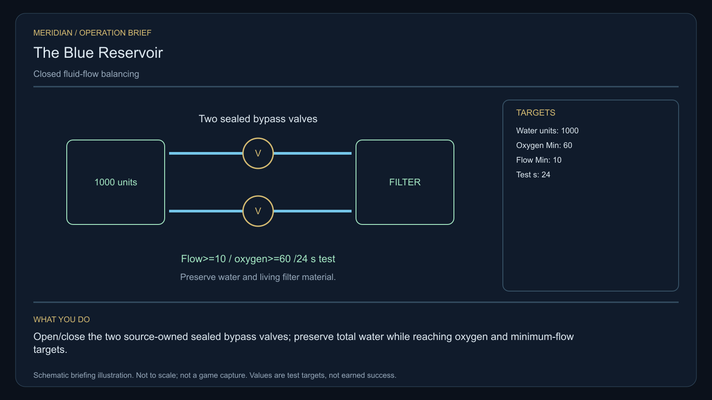

# C20 · The Blue Reservoir

[Illustrated story](../../INTENDED-GAME-STORY-WALKTHROUGH.md#the-blue-reservoir) · [Mission walkthrough checklist](../README.md)

Design walkthrough complete against `19a177e66093716928947f7246e0b664e4a6ad07`. Opening supplier `121f912503eaaf6d0b70722079360802f78a0191` and source-only integration `d7cbdba5013336caced7bda61e4be8f5fa08b372` are frozen outside executable main. Main contains the clue registration. Original commissioning, physical stages and native acceptance remain open. [Main clue and archive pin](https://github.com/stephenlclarke/l337/blob/19a177e66093716928947f7246e0b664e4a6ad07/Sources/L337Core/NativeCharterArchiveRegistryApproval.swift#L686)

## Offer and motivation

Engineer Cato Lerr commissions Rowan at Bornolom's living main orbital in Galaxy 4 after a genuine ordinary trade. Confirm from the actual berth with a writable save. No rank or prior case gate. Accepting issues no reference or valve permission. Separately take Lerr's exact finite one-tonne reference at Bornolom when one tonne is free. **Living Worlds** is the finished paid grouping. A separate no-fee core inquiry remains available.

The water commons loses dissolved oxygen despite clean intakes. A new pump has trapped part of the living filter behind a one-way lease boundary. Lerr wants proof from the actual loop. Custodian Tomas Veil insists that the living material stay contained and preserve its original ownership and consent. The player adjusts flow with two sealed bypasses. The result supports distributed living filter custody or a jointly governed reservoir.

## Route and fit

| Galaxy 4 route | Distance and service |
| --- | --- |
| Bornolom G04-S151 → Galton G04-S147 | 2.131 LY. Collect the original reference before three actual meter readings. |
| Galton → Bornalan G04-S054 | 4.196 LY. Test the two local sealed bypass locks. |
| Bornalan ↔ Dorbogan G04-S150 | 5.224 LY each way for the player's visit to the laboratory and return for branch proof. |
| Bornalan → Bornolom | 2.633 LY. Return the exact reference after verification. |

All direct jumps fit nominal 7 LY reach. On a 7 LY tank plan refuelling at Bornalan, Dorbogan and Bornalan on the return. If the independent tender is authorized to depart from Galton, its direct Dorbogan leg measures 3.164 LY. The actual dispatch and receiving route must be issued and independently fuel-qualified. [World catalogue](https://github.com/stephenlclarke/l337/blob/19a177e66093716928947f7246e0b664e4a6ad07/Sources/L337Core/Resources/OriginalWorlds/catalogue.json), [Reach and fuel](https://github.com/stephenlclarke/l337/blob/19a177e66093716928947f7246e0b664e4a6ad07/Sources/L337Core/FuelStorage.swift#L8), [Native arrival](https://github.com/stephenlclarke/l337/blob/19a177e66093716928947f7246e0b664e4a6ad07/Sources/L337Core/NativeStationServices.swift#L135)

The player reserves 1 t, needs zero passenger places and uses the original onboard reference with compatible valve controls. The listed SH001 Mule has two operators, 76 t nominal hold and 9 LY hull reach. No exact role has been issued. The witness profile uses one actual **SH061 Saiga**, two native operators, one mandate-bound delegate, one powered four-place Standard Cabin and finite fuel. The design has 84 t hold, 22 equipment units, 9 LY hull jump and a 13 LY tank. The cabin uses 5 t and one equipment unit. Confirm the actual inspection crew and loaded aperture. The source retains its water, plant material and bypass fixtures. Actual transfer hardware and cargo fit must be qualified separately if a selected branch moves living stock. [Mule design](https://github.com/stephenlclarke/l337/blob/19a177e66093716928947f7246e0b664e4a6ad07/docs/fleet-design-v2/ships/SH001.toml), [Saiga design](https://github.com/stephenlclarke/l337/blob/19a177e66093716928947f7246e0b664e4a6ad07/docs/fleet-design-v2/ships/SH061.toml), [Mule art](../../assets/ships/SH001.png), [Saiga art](../../assets/ships/SH061.png), [C03 hull admission finding](C03-HOLLOW-MANIFEST.md#route-and-ship-fit)

The reviewed profile sets `accompanimentRequired: false`. The tender travels independently after survey and consent while Rowan works the locks. The older escort wording does not gate progress. The actual laboratory receives the living party and mandate, and the inspection operators must observe the actual flow before endorsing it. An early docking can be recorded while observation remains pending. [Historical ledger wording](https://github.com/stephenlclarke/l337/blob/19a177e66093716928947f7246e0b664e4a6ad07/docs/COMPLETION-LEDGER.md#L2196)

## Play the nine stages

| Stage | Player action and qualifying evidence |
| --- | --- |
| 1. `accept` | Confirm Lerr's reviewed commission while actually docked at Bornolom after the trade. |
| 2. `collect-reference` | Confirm the exact original one-tonne instrument under serial custody at Bornolom. |
| 3. `survey` | At Galton read three actual inlet, oxygen and return meters under the issued observation scope. Use front view, unobstructed nearest mesh, 2° aim, 250–1,500 native surface units and 12 continuous seconds per target. |
| 4. `field-work` | At Bornalan operate both distinct sealed locks within actual containment and permission. Qualify physical work within 50–150 m, at most 1 m/s and at most 2° aim, with the 20-second minimum. In a separate **24-second** simulation window retain **1,000 water units**, return flow **at least 10** and oxygen **at least 60**. Keep the same living filter contained and account for all fluid. A threshold breach invalidates the continuous window. |
| 5. `independent-witness` | At Dorbogan verify the actual independently travelling inspection tender, living operators and mandate, plus the operators' actual flow observation before endorsement. |
| 6. `choose-settlement` | At the actual laboratory with the arrived authorized delegates, choose **Distribute the living filter among independent cradles** or **Create a jointly supervised reservoir**. |
| 7. `apply-settlement` | At Bornalan earn both selected proofs. For `plan-a`, require both actual consented containment receipts, preserved total water and a passing measured return flow from each cradle. For `plan-b`, prove that the common controller rejects an over-capacity command, then exercise each local stop in a separately armed test and require safe bounded closure. |
| 8. `return-and-audit` | Return the exact original loan at Bornolom. Reconcile meter provenance, flow and containment, actual laboratory receiving and both branch proofs. |
| 9. `close-case` | Preserve the verified governance decision and original records. Commit 7,300 CR via `l337.blue-reservoir/final-payment` and `l337.unwritten-route/clue/blue-reservoir-trace` once. The anomaly is an inward curve traced through a dry channel. |

The numbers are authored mission units awaiting native play balance. Retain reservoir state across both valve adjustments. Qualify the 24-second window only from measured native flow, oxygen and stock. Do not infer oxygen from inlet cleanliness. Galton's actual metering, Bornalan's actual bypasses and Dorbogan's observed result require signed source links to the same case. The project uses a live, authorized telemetry receipt for the inspection team if they observe from a different station. G4 and Root must issue the actual devices, calibration, provenance and observation route. A portable screenshot or copying a world fixture cannot supply the proof.

For a distributed ending, preserve actual culture lineage and volumes without duplicating stock. For the common ending, stopping the bypass must leave the living filter safely contained. Issue the real capacity ceiling, stop permissions, viability and damage effects separately. The current case has no EMP, destruction or salvage prerequisite.

[Editable operation drawing](../../assets/missions/revisions/blue-reservoir-operation.svg)

## Failure, cold Continue and owners

No overall deadline. Pause freezes active simulation. Preserve exact loan, meter identities, valve settings, water ledger, living filter identity and condition, authorized telemetry, current test state, consent, tender reception and branch receipts. Cold Continue resets unfinished survey dwell. Resume the live functional window only from the same still-qualified authoritative physical state. Test load during each bypass action, between measurement and observer endorsement, during custody and after terminal. Genuine leakage, loss or authority revocation remains recorded. The separate free core inquiry can always earn only the missing clue if the original is unavailable.

- **G4 physical requirement.** Pin three real meter surfaces, two valve faces, closed-flow state and native oxygen/flow/volume readouts. Qualify containment, shutdown behavior, real branch fixtures and powered loaded Saiga receiving at Dorbogan.
- **MC1 mission requirement, via Root and G1.** Bind original custody and consent, separate physical work from native 24-second closed-loop test, authorize the living inspector's actual receiving and observation, and commit only the selected containment or joint-control proof and one terminal. Refuse a leak, stale telemetry, forged endpoint, duplicated culture or unsafe reopen through Continue.
- **Root source decisions.** Issue Lerr's serial, exact devices and cross-system topology/provenance, actual permission and containment owners, inspection manifest and laboratory berth, measurement access, living-filter custody/receivers or both common stop authorities and physical safety limits.

Historical story and data are `docs/meridian/missions/C20.md` and `docs/meridian/missions/definitions/blue-reservoir.json` at `c70110b292077588a0855fb48127adfb1b611c9d`, definition SHA-256 `e4855e11a8b2bca689d9e7b7a09c5bbbc62e00004da4965bf57371bc44a7c767`. The reviewed `docs/meridian/missions/gameplay/campaign-profiles.json#/profiles/blue-reservoir` has SHA-256 `37fe5011de7bcc5874f6e6eef42151a712be4f69a3b9b23cd18cf660bd0dff0a`.
