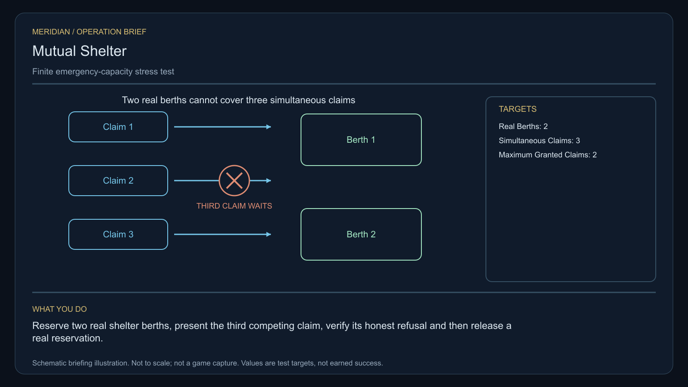

# C21 · Mutual Shelter

[Illustrated story](../../INTENDED-GAME-STORY-WALKTHROUGH.md#mutual-shelter) · [Mission walkthrough checklist](../README.md)

Design walkthrough complete against `19a177e66093716928947f7246e0b664e4a6ad07`. Opening supplier `dc315264264122e2ca23b91a42e0d30fff426224` and source-only integration `27335f06767b9cc12199268bc05ab82147734ead` are frozen outside executable main. Main contains the clue registration. Original commissioning, physical stages and native acceptance remain open. [Main clue and archive pin](https://github.com/stephenlclarke/l337/blob/19a177e66093716928947f7246e0b664e4a6ad07/Sources/L337Core/NativeCharterArchiveRegistryApproval.swift#L1434)

## Offer and motivation

Nia Toren commissions Rowan at Ashoes's living main orbital in Galaxy 5 after one actual ordinary trade. Require actual arrival, writable save and Confirm. No score or prior mission gate. Acceptance supplies no shelter authority or stock. Collect Toren's original finite one-tonne measuring loan separately at Ashoes when one tonne is free. **Open Harbours** is the finished paid grouping. The independent no-fee core inquiry remains available.

A repair mutual insured more shelter than its docks can fit. A legal claim on a disabled cooperative hauler exposes the shortage. Toren wants real berth capacities. Captain Suri Arlen protects the crew and its title during repairs and the hearing. The player tests a capacity limit across two real berths, then chooses how to fund and enforce shelter. The capacity trial tests pooled obligations and live occupancy. C12 instead tests which authority may grant a single berth.

## Route and fit

| Galaxy 5 route | Distance and service |
| --- | --- |
| Ashoes G05-S188 → Voron G05-S003 | 3.482 LY. Collect the exact reference before observing the claim registers. |
| Voron → Ranues G05-S154 | 5.555 LY. Reserve and stress two actual test berths. |
| Ranues ↔ Peloen G05-S107 | 4.495 LY each way for the player's visit to the repair receiver and return for branch proof. |
| Ranues → Ashoes | 3.581 LY. Return the original instrument. |

Each player jump fits nominal 7 LY reach. Each consecutive pair exceeds a 7 LY tank, so arrange actual refuelling at Voron, Ranues, Peloen and Ranues on the return. Voron → Peloen is 7.826 LY and is neither the authored player route nor evidence that the disabled hauler can jump. The witness needs its own issued physical transit plan and repaired or towed receiving. [World catalogue](https://github.com/stephenlclarke/l337/blob/19a177e66093716928947f7246e0b664e4a6ad07/Sources/L337Core/Resources/OriginalWorlds/catalogue.json), [Reach and fuel](https://github.com/stephenlclarke/l337/blob/19a177e66093716928947f7246e0b664e4a6ad07/Sources/L337Core/FuelStorage.swift#L8), [Native arrival](https://github.com/stephenlclarke/l337/blob/19a177e66093716928947f7246e0b664e4a6ad07/Sources/L337Core/NativeStationServices.swift#L135)

The player carries 1 t and needs zero passenger places. SH001 Mule is listed with two operators, 76 t nominal hold and 9 LY hull reach. No exact role is issued. The profile assigns an actual **SH061 Saiga**, two native operators, one mandate-bound delegate, one powered four-place Standard Cabin and finite fuel. Its design has 84 t hold, 22 equipment units, 9 LY hull reach and a 13 LY tank. The cabin uses 5 t and one equipment unit. Assign the disabled hauler, crew and delegate by actual identity. Verify their life-support reserve and loaded approach separately. If a tug is used, qualify relative control, actual thrust and load, docking clearance and the complete combination. Fit estimates alone cannot admit a disabled hull. [Mule design](https://github.com/stephenlclarke/l337/blob/19a177e66093716928947f7246e0b664e4a6ad07/docs/fleet-design-v2/ships/SH001.toml), [Saiga design](https://github.com/stephenlclarke/l337/blob/19a177e66093716928947f7246e0b664e4a6ad07/docs/fleet-design-v2/ships/SH061.toml), [Mule art](../../assets/ships/SH001.png), [Saiga art](../../assets/ships/SH061.png), [C03 hull admission finding](C03-HOLLOW-MANIFEST.md#route-and-ship-fit)

The reviewed profile sets `accompanimentRequired: false`. The original hauler's real crew and authorized receiving remain mandatory. The project proposes an independent source-owned tow from a safe local position in the Peloen system after survey and consent while Rowan works at Ranues. Root must issue the actual origin and tow provider. If the source places the hauler in another system, it needs a qualified transport or a real repair that restores safe jump ability first. A disabled hull cannot be assumed to self-propel, and the old escort text does not justify forcing a player capture or tow. [Historical ledger wording](https://github.com/stephenlclarke/l337/blob/19a177e66093716928947f7246e0b664e4a6ad07/docs/COMPLETION-LEDGER.md#L2197)

## Play the nine stages

| Stage | Player action and qualifying evidence |
| --- | --- |
| 1. `accept` | Confirm Toren's commission at the actual Ashoes main orbital after a genuine ordinary trade. |
| 2. `collect-reference` | Confirm custody of the finite original one-tonne shelter reference at Ashoes by exact serial. |
| 3. `survey` | At Voron observe three actual claim registers against the independently measured two-berth capacity and fit. Use front view, unobstructed nearest mesh, 2° aim and 12 continuous seconds at 250–1,500 native surface units per target. |
| 4. `field-work` | At Ranues use the two actual interfaces. Reserve two genuine berths, present a third live test claim while both grants still exist and verify an honest refusal for capacity. Then release one actual test reservation without evicting an occupant or releasing a third party's allocation. Apply 50–150 m clearance, at most 1 m/s and at most 2° aim at a physical interface. No generic dwell qualifies. |
| 5. `independent-witness` | At Peloen verify the original claimed hauler, its same living crew, signed mandate and actual native repair reception. Check the actual travel and repair/tow custody, preserving title. |
| 6. `choose-settlement` | At the verified receiver with arrived authorized delegates, choose **Pool member-funded emergency capacity** or **Bond independent shelter obligations**. |
| 7. `apply-settlement` | At Ranues require both branch proofs. For `plan-a`, verify that the actual pooled reserve covers both real grants and a member withdrawal cannot consume an occupied allocation. For `plan-b`, both independent providers show actually funded berth bonds and the original hauler completes a consented receiving drill. The provisional repair receipt alone cannot prove the selected drill. |
| 8. `return-and-audit` | At Ashoes return the exact loan. Audit measured capacity, genuine refusal and release, living hauler reception, preserved title and both chosen proofs. |
| 9. `close-case` | Preserve the funded shelter settlement and original records. Commit 7,100 CR via `l337.mutual-shelter/final-payment` and `l337.unwritten-route/clue/mutual-shelter-trace` once. The oldest ledger reserves an inward-shaped volume for no hull or creditor. |

All three claims must coexist in the same capacity test. At most two grants may exist. The test releases only its own reservation after recording the refusal. Confirm the physical berth fit and provenance between Voron's actual registry and Ranues's devices. The legal salvage claim is case context. No acquisition, EMP or cutting qualifies. Beam use requires explicit owner tow permission after occupant safety, and it preserves title. Source-owned services make player salvage equipment optional. For both endings, bind the funding or bond to real capacity and separate it from the player's terminal fee.

[Editable operation drawing](../../assets/missions/revisions/mutual-shelter-operation.svg)

## Failure, cold Continue and owners

No overall deadline. Pause freezes simulation. Save both berth identities and occupancy, all three claim IDs, exact grants/refusal/release, protected loan, original hauler's condition and title, tow authority and receiving, branch and funded proofs. Cold Continue resets unfinished survey dwell and restores the exact reservations and native travel or tow. A load cannot sell a third slot, displace an occupied berth, replay a release or convert a tow into ownership. Exercise Continue with two open grants, after refusal, during tow, after repair reception, during branch proof and after terminal. Genuine losses remain recorded. The independent free core inquiry always earns only the missing clue if the original becomes unavailable.

- **G4 physical requirement.** Pin three real registers, both actual berth capacities and occupancy envelopes, native reservation interfaces and original disabled/loaded Saiga. Qualify actual repair approach, source tow or transport, crew safety and both bonded providers' physical receiving drill.
- **MC1 mission requirement, via Root and G1.** Rebind the frozen opening. Require separate original loan, two live grants plus third refusal and controlled release, preserved title and actual living reception. Implement funded pooled withdrawal guard or two funded bonds plus genuine drill, distinct selected proofs and one terminal.
- **Root source decisions.** Issue original loan, actual claimants and capacity owners, provider permissions and controlled trial fixtures, disabled condition and actual crew/title/claim, permitted tow or repair origin and Peloen receiver. Issue the funded reserve, withdrawal limits or real bonds and consent for the drill.

Historical story and data are `docs/meridian/missions/C21.md` and `docs/meridian/missions/definitions/mutual-shelter.json` at `c70110b292077588a0855fb48127adfb1b611c9d`, definition SHA-256 `f19d6a6a811da621daebf0b77491ae7679a41a151985fa426697bfffdb059be6`. The reviewed `docs/meridian/missions/gameplay/campaign-profiles.json#/profiles/mutual-shelter` has SHA-256 `37fe5011de7bcc5874f6e6eef42151a712be4f69a3b9b23cd18cf660bd0dff0a`.
