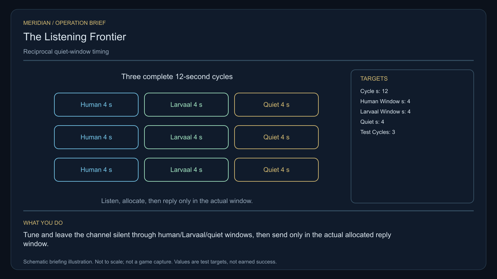

# C22 · The Listening Frontier

[Illustrated story](../../INTENDED-GAME-STORY-WALKTHROUGH.md#the-listening-frontier) · [Mission walkthrough checklist](../README.md)

Design walkthrough complete against `19a177e66093716928947f7246e0b664e4a6ad07`. Opening supplier `bc0557abb6952739cafe82e71c5364a4a118665d` and source-only integration `88321f4a3d6102ea15e7b3aac832258ccee4a9f9` are frozen outside executable main. Main contains the clue registration. Original commissioning, physical stages and native acceptance remain open. [Main clue and archive pin](https://github.com/stephenlclarke/l337/blob/19a177e66093716928947f7246e0b664e4a6ad07/Sources/L337Core/NativeCharterArchiveRegistryApproval.swift#L1324)

## Offer and motivation

Captain Tamsin Holt commissions Rowan at Lailaven's living main orbital in Galaxy 6 after one ordinary purchase or sale. Require actual docking, a writable save and Confirm. No score or prior campaign gate. Accepting supplies no transceiver, listener authority or loan. Confirm the exact finite one-tonne passive reference separately at Lailaven with one tonne free. **Voices in the Static** is the finished paid grouping. The independent no-fee core inquiry remains available.

Human survey bursts are narrowing a Larvaal migration crossing. Both groups have mistaken collisions for attacks. Holt wants reliable identification of real signals and a living neutral witness. Agent Mara Vale wants the schedules to leave the counterpart room to answer. Rowan calibrates a reciprocal timing test with two emitters and protects the quiet interval. The selected resolution gives both groups independent quiet windows or an explicitly bounded common relay.

## Route and fit

| Galaxy 6 route | Distance and service |
| --- | --- |
| Lailaven G06-S225 → Eriara G06-S015 | 2.380 LY. Collect Holt's original reference before the passive listener survey. |
| Eriara → Leimaeli G06-S254 | 5.443 LY. Observe three actual listeners before calibrating the two emitters. |
| Leimaeli ↔ Saesiara G06-S120 | 6.206 LY each way for the player's visit to the protected receiver and return for branch proof. |
| Leimaeli → Lailaven | 3.205 LY. Return the original passive reference. |

All listed jumps fit nominal 7 LY reach. Each consecutive pair exceeds a 7 LY tank. Refuel at Eriara, Leimaeli, Saesiara and Leimaeli on the return, subject to actual station access. Eriara → Saesiara measures 3.766 LY if the independent tender is authorized to depart from Eriara. Its source berth, fuel and permitted quiet transit need their own verification. [World catalogue](https://github.com/stephenlclarke/l337/blob/19a177e66093716928947f7246e0b664e4a6ad07/Sources/L337Core/Resources/OriginalWorlds/catalogue.json), [Reach and fuel](https://github.com/stephenlclarke/l337/blob/19a177e66093716928947f7246e0b664e4a6ad07/Sources/L337Core/FuelStorage.swift#L8), [Native arrival](https://github.com/stephenlclarke/l337/blob/19a177e66093716928947f7246e0b664e4a6ad07/Sources/L337Core/NativeStationServices.swift#L135)

The player reserves 1 t and needs zero passenger places. The passive reference must actually interoperate with the source-owned test controls. SH001 Mule has two operators, 76 t nominal hold and 9 LY hull reach. The story lists it without an exact role. The neutral tender is an actual **SH061 Saiga**, two operators, one authorized delegate, a powered four-place Standard Cabin and finite fuel. The design has 84 t hold, 22 equipment units, 9 LY jump reach and a 13 LY tank. The cabin uses 5 t and one equipment unit. Qualify loaded fit and protected Saesiara access. Main has Larvaal physical fleet registrations. They do not assign a class, live identity or permission to this mission's counterpart. [Mule design](https://github.com/stephenlclarke/l337/blob/19a177e66093716928947f7246e0b664e4a6ad07/docs/fleet-design-v2/ships/SH001.toml), [Saiga design](https://github.com/stephenlclarke/l337/blob/19a177e66093716928947f7246e0b664e4a6ad07/docs/fleet-design-v2/ships/SH061.toml), [Larvaal physical registrations](https://github.com/stephenlclarke/l337/blob/19a177e66093716928947f7246e0b664e4a6ad07/Sources/L337Core/OriginalFleetLarvaalPhysicalRegistrations.swift), [Mule art](../../assets/ships/SH001.png), [Saiga art](../../assets/ships/SH061.png)

The reviewed profile sets `accompanimentRequired: false`. The neutral tender travels independently after survey and consent while Rowan calibrates the emitters. The older escort wording does not gate progress. Require actual living reception and signed mandate before choosing. [Historical ledger wording](https://github.com/stephenlclarke/l337/blob/19a177e66093716928947f7246e0b664e4a6ad07/docs/COMPLETION-LEDGER.md#L2198)

## Play the nine stages

| Stage | Player action and qualifying evidence |
| --- | --- |
| 1. `accept` | Confirm Holt's commission at actual Lailaven dock after a genuine ordinary trade. |
| 2. `collect-reference` | Take the exact original finite one-tonne passive reference by confirmed serial custody at Lailaven. |
| 3. `survey` | At Eriara observe three distinct consenting human/Larvaal boundary listeners. Keep weapon signatures separate from survey bursts. Use front view, nearest unobstructed mesh, 2° aim and 12 continuous seconds per target at 250–1,500 native surface units. Keep the channel passive and never rebroadcast a migration pulse. |
| 4. `field-work` | At Leimaeli calibrate both actual emitters against the onboard passive reference. Qualified physical work needs 50–150 m surface clearance, at most 1 m/s and 2° aim with the 20-second work minimum. Then measure **three 12-second cycles** with **4 seconds human, 4 seconds Larvaal and 4 seconds quiet**, without overlap. Real counterpart replies identify their senders. Rowan can transmit only in the actual allocated reply window. |
| 5. `independent-witness` | At Saesiara confirm protected native reception of the same living neutral party and actual signed delegation. |
| 6. `choose-settlement` | At the actual protected receiver, with the arrived authorized delegates, choose **Publish independent quiet windows** or **Establish a jointly witnessed migration relay**. |
| 7. `apply-settlement` | At Leimaeli require both proofs for the selected branch. For `plan-a`, exercise real independent human withdrawal and obtain the distinct Larvaal listener's signed acknowledgement of the revised window. For `plan-b`, verify the full 12-second limit and receive independent real replies from both participants for their separate permissions. |
| 8. `return-and-audit` | At Lailaven return the exact reference. Audit timing, actual receiving and both chosen branch proofs. |
| 9. `close-case` | Preserve the chosen migration agreement and original traces. Commit 9,100 CR through `l337.listening-frontier/final-payment` and `l337.unwritten-route/clue/listening-frontier-trace` once. The clue is a curved phase trace from outside both bands. |

Use one case-bound simulation clock for the full 36 seconds of valid test cycles. As a project design, reserve the player's reply inside an actual authorized human allocation within the existing four seconds. That leaves the Larvaal allocation and the full four seconds of silence intact. Source must issue the actual timing, counterpart roles and reply permissions. A collision, schedule overlap, wrong sender or quiet-window transmission cannot qualify. A passive observation, authorized test reply and migration pulse are distinct operations. Protect real transit and consent. No kill, salvage, forced attack or faction-wide permission supplies either proof.

[Editable operation drawing](../../assets/missions/revisions/listening-frontier-operation.svg)

## Failure, cold Continue and owners

No overall deadline. Pause freezes the simulation clock. Persist the exact loan, consent, emitter settings, clock and phase, actual sender-bound replies, independent tender, arrival and branch. Cold Continue drops unfinished survey dwell and resumes the active cycle only against the same authoritative endpoints and permission. An interrupted or overlapped test cannot acquire a receipt from wall time. Test load during quiet, between cycles, before a reply, at witness receiving, during branch and at terminal. Retain genuine loss. The free independent core inquiry always awards only the same missing clue if the original case becomes unavailable.

- **G4 physical requirement.** Pin three actual listener surfaces and signal origins, two source emitter controls and actual unoccluded operating envelopes. Qualify the real counterpart geometry, protected route and loaded Saiga receiving at Saesiara.
- **MC1 mission requirement, via Root and G1.** Bind exact loan, passive consent and actual signal identity, both calibrations, three bounded simulation cycles and two lawful counterpart authorities. Require independent living receipt, chosen withdrawal/acknowledgement or full bounded relay proof, and one terminal transaction. Refuse out-of-window speech, wrong origin and saved replay.
- **Root source decisions.** Issue the exact loan and three listener identities, lawful human and Larvaal roles, emitter sources, allowed reply allocation, actual tender, fuel and receiving, and each side's distinct withdrawal or relay authority.

Historical story and data are `docs/meridian/missions/C22.md` and `docs/meridian/missions/definitions/listening-frontier.json` at `c70110b292077588a0855fb48127adfb1b611c9d`, definition SHA-256 `d321b0c06d7b0213adc827e1cd727cb1f9064c8ab01b0032f4d6cb91a6027570`. The reviewed `docs/meridian/missions/gameplay/campaign-profiles.json#/profiles/listening-frontier` has SHA-256 `37fe5011de7bcc5874f6e6eef42151a712be4f69a3b9b23cd18cf660bd0dff0a`.
