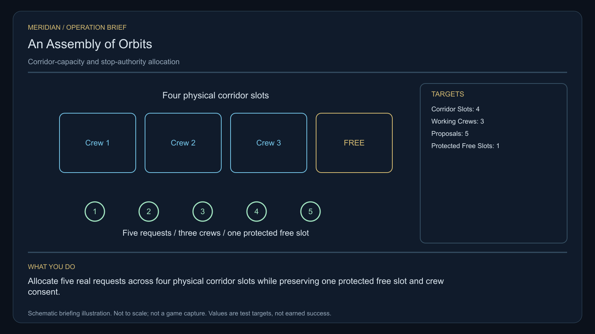

# C23 · An Assembly of Orbits

[Illustrated story](../../INTENDED-GAME-STORY-WALKTHROUGH.md#an-assembly-of-orbits) · [Mission walkthrough checklist](../README.md)

Design walkthrough complete against `19a177e66093716928947f7246e0b664e4a6ad07`. Main contains the original commission, separate one-tonne reference pickup, surface calibration and a two-sided planning editor. The native save validator accepts only commissioning and pickup receipts. The gallery identifies Darik's missing source and consent. Native fieldwork, witness, settlement, return and terminal acceptance remain open. [Opening source](https://github.com/stephenlclarke/l337/blob/19a177e66093716928947f7246e0b664e4a6ad07/Sources/L337Core/NativeAssemblyOfOrbitsDefinition.swift#L3), [Native receipt boundary](https://github.com/stephenlclarke/l337/blob/19a177e66093716928947f7246e0b664e4a6ad07/Sources/L337Core/NativeAssemblyOfOrbitsSave.swift#L21), [Gallery](https://github.com/stephenlclarke/l337/blob/19a177e66093716928947f7246e0b664e4a6ad07/Sources/L337Core/NativeAssemblyOfOrbitsGallery.swift#L31)

## Offer and motivation

Marshal Nera Voss commissions Rowan at Irkenan's living main orbital in Galaxy 7 after a genuine ordinary purchase or sale. Require actual docking, writable save and Confirm. No rank or previous campaign gate. Accepting starts the case. Voss keeps the same finite one-tonne instrument until a separate confirmed pickup with one tonne free at Irkenan. The current implementation issues it as carried acquisition-only equipment, not a shop item or fitted module. **Open Harbours** is the finished paid grouping. The free core inquiry remains independently available. [Board conditions](https://github.com/stephenlclarke/l337/blob/19a177e66093716928947f7246e0b664e4a6ad07/Sources/L337Core/NativeAssemblyOfOrbitsBoard.swift#L73), [Original loan](https://github.com/stephenlclarke/l337/blob/19a177e66093716928947f7246e0b664e4a6ad07/Sources/L337Core/NativeAssemblyReferenceDefinition.swift#L3)

Orbital homes share one corridor during maintenance season. Property shares are counted in the old voting register while the crews who operate the corridor are missing. Voss verifies actual occupants and work. Coordinator Sera Dain wants all groups to see the same finite limits before making a choice. The player schedules real movement, keeps emergency capacity free and gives the arrived delegates evidence for a rotation or bounded public representation.

## Route and fit

| Galaxy 7 route | Distance and service |
| --- | --- |
| Irkenan G07-S007 → Darik G07-S043 | 2.945 LY. Collect the original loan before observing three consented registers. |
| Darik → Brekudek G07-S032 | 3.663 LY. Read actual use before the port and starboard capacity tests. |
| Brekudek ↔ Kagakon G07-S148 | 4.675 LY each way for the player's assembly and return for branch proof. |
| Brekudek → Irkenan | 3.286 LY. Return the exact instrument. |

Each direct jump fits nominal 7 LY reach. On a 7 LY tank, leave Irkenan full and refuel at Brekudek, Kagakon and Brekudek again. Darik → Kagakon measures 6.181 LY if the independent tender is authorized to leave Darik. Its actual departure, fuel and neutral berth need independent qualification. [World catalogue](https://github.com/stephenlclarke/l337/blob/19a177e66093716928947f7246e0b664e4a6ad07/Sources/L337Core/Resources/OriginalWorlds/catalogue.json), [Reach and fuel](https://github.com/stephenlclarke/l337/blob/19a177e66093716928947f7246e0b664e4a6ad07/Sources/L337Core/FuelStorage.swift#L8), [Native arrival](https://github.com/stephenlclarke/l337/blob/19a177e66093716928947f7246e0b664e4a6ad07/Sources/L337Core/NativeStationServices.swift#L135)

The player carries 1 t and needs zero passenger places. The story lists SH001 Mule with two operators, 76 t nominal hold and 9 LY hull reach. It has no issued crew movement role. The witness profile assigns one actual **SH061 Saiga**, two native operators, one mandate-bound delegate, one powered four-place Standard Cabin and finite fuel. Its design has 84 t hold, 22 equipment units, 9 LY hull reach and a 13 LY tank. The cabin costs 5 t and one equipment unit. If more delegates must physically attend, count the issued people and their actual transport. The three working crews are separate from the tender manifest. Their presence, consent and movement rights must be proved separately. [Mule design](https://github.com/stephenlclarke/l337/blob/19a177e66093716928947f7246e0b664e4a6ad07/docs/fleet-design-v2/ships/SH001.toml), [Saiga design](https://github.com/stephenlclarke/l337/blob/19a177e66093716928947f7246e0b664e4a6ad07/docs/fleet-design-v2/ships/SH061.toml), [Mule art](../../assets/ships/SH001.png), [Saiga art](../../assets/ships/SH061.png), [C03 hull admission finding](C03-HOLLOW-MANIFEST.md#route-and-ship-fit)

The reviewed profile sets `accompanimentRequired: false`. The source-owned tender travels independently after survey and permission while Rowan runs the tests. The older escort wording does not gate progress. Require actual living neutral reception and scope at Kagakon before opening the choice. [Historical ledger wording](https://github.com/stephenlclarke/l337/blob/19a177e66093716928947f7246e0b664e4a6ad07/docs/COMPLETION-LEDGER.md#L2199)

## Play the nine stages

| Stage | Player action and qualifying evidence |
| --- | --- |
| 1. `accept` | Confirm Voss's original commission while actually docked at Irkenan after the genuine trade. |
| 2. `collect-reference` | Confirm the finite original one-tonne instrument under exact serial custody at Irkenan. |
| 3. `survey` | At Darik compare three actual consented occupancy/work registers with real corridor use. Use front view, nearest unobstructed mesh, 2° aim and 12 continuous seconds per target at 250–1,500 native surface units. Calibration on an unrelated body earns no reading. |
| 4. `field-work` | At Brekudek run two independent physical capacity tests through the port and starboard interfaces. Account for all five named proposals in each trial as allocated or waiting. At most three working movements, with one per slot and one per crew. Keep the protected fourth slot free. Require actual original crews, movements and consent. Use 50–150 m, at most 1 m/s and 2° aim where the interface requires it. A saved valid plan alone earns no work receipt. |
| 5. `independent-witness` | At Kagakon confirm the same real independently travelling tender, actual living delegates and their original mandates at the neutral assembly berth. |
| 6. `choose-settlement` | With actual arrived delegates, confirm **Rotate corridor stewardship among working crews** or **Use bounded public berth representation**. |
| 7. `apply-settlement` | At Brekudek obtain both selected proofs. For `plan-a`, name all three actual working crews in the rota and prove each can stop only its assigned movement. For `plan-b`, verify the public register refuses the fifth capacity claim and preserves the protected free slot. Require actual receiving proof for the chosen scope. |
| 8. `return-and-audit` | At Irkenan return the exact original instrument. Audit the real registers, both tests, living receiving and selected proof pair. |
| 9. `close-case` | Preserve the chosen charter and original records. Commit 7,700 CR through `l337.assembly-of-orbits/final-payment` and `l337.unwritten-route/clue/assembly-of-orbits-trace` once. The old assembly diagram contains a curved boundary around an empty central seat. |

The current editor stores distinct port and starboard proposals with a bound writer. It uses model proposal and team labels. It can report missing decisions, shared slots, shared crews and use of the protected slot. The survey optics can calibrate on a real unrelated body. Both tools are preparatory. Neither supplies actual register provenance, consents, movement authority or a physical test receipt. Reuse those interfaces for the future live join. Bind model positions to issued actual identities explicitly and reject silent promotion of saved drafts. [Model labels](https://github.com/stephenlclarke/l337/blob/19a177e66093716928947f7246e0b664e4a6ad07/Sources/L337Core/NativeAssemblyCapacityEditor.swift#L32), [Saved proposal scope](https://github.com/stephenlclarke/l337/blob/19a177e66093716928947f7246e0b664e4a6ad07/Sources/L337Core/NativeAssemblyCapacityConsole.swift#L61), [Calibration scope](https://github.com/stephenlclarke/l337/blob/19a177e66093716928947f7246e0b664e4a6ad07/Sources/L337Core/NativeAssemblySurveyOptics.swift#L99)

As a project test design, prove normal allocation on one side and capacity after a consent withdrawal or blocked working slot on the other, with actual authorized movements and independent receipts. Revalidate at dispatch. Show waiting decisions and refuse overcommit or use of the protected slot. A reserve count is never authority to move real crews. Exact case actors, timing, slot geometry and the second scenario require source issuance. This case involves no required combat, EMP or salvage.

[Editable operation drawing](../../assets/missions/revisions/assembly-of-orbits-operation.svg)

## Failure, cold Continue and owners

No overall deadline. Pause freezes simulation. Preserve exact custody, saved drafts as drafts, committed observations, actual live capacity and consent, occupancy and case-bound movement results. Reset unfinished survey dwell. Test Continue after pickup, with edited drafts on both sides, between physical trials, after real arrival, during a stop exercise and after terminal. Confirm saves cannot manufacture a live receipt, overbook or stop another crew. Preserve genuine loss, exhausted capacity and withdrawn consent. The separate free core inquiry can always earn only the missing clue if the original becomes unavailable.

- **G4 physical requirement.** Pin real Darik register meshes, physical slot and reserve geometry, actual crews and both distinct Brekudek interfaces. Qualify live movement, stop behavior, exact Saiga loading and Kagakon receiver.
- **MC1 mission requirement, via Root and G1.** Preserve existing strict opening, bound writer, model assessment and actual optics. Add authoritative survey and explicit draft-to-live binding, two real capacity producers and independent native tender/settlement proof. Extend native save/gallery guards with exact later receipts, actual progress, tested cold Continue and one terminal.
- **Root source decisions.** Issue the three actual register owners and consent, named proposals and movements, physical corridor and protectable reserve, test actors and independent scenarios, actual tender/delegates/receiving, and stop and publication authorities for the selected charter.

Historical story and data are `docs/meridian/missions/C23.md` and `docs/meridian/missions/definitions/assembly-of-orbits.json` at `c70110b292077588a0855fb48127adfb1b611c9d`, definition SHA-256 `7ffa8831f6a912e6c30d43453624c4bfb66f4cd0cedd8e76df8259c7d73cf514`. The reviewed `docs/meridian/missions/gameplay/campaign-profiles.json#/profiles/assembly-of-orbits` has SHA-256 `37fe5011de7bcc5874f6e6eef42151a712be4f69a3b9b23cd18cf660bd0dff0a`.
