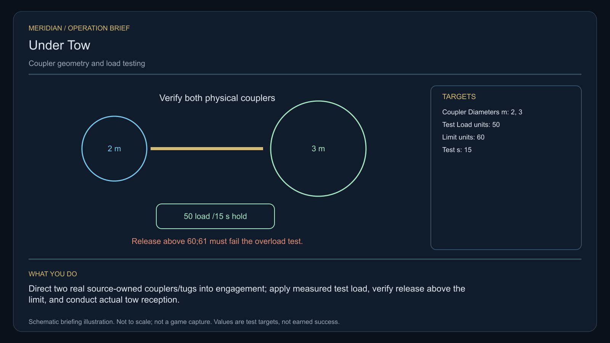

# C24 · Under Tow

[Illustrated story](../../INTENDED-GAME-STORY-WALKTHROUGH.md#under-tow) · [Mission walkthrough checklist](../README.md)

Design walkthrough complete against `19a177e66093716928947f7246e0b664e4a6ad07`. Main contains the original commission, separate one-tonne pickup, protected custody and a read-only gallery. The strict save prefix accepts only commissioning and pickup. The gallery identifies the missing Allion collars and signed limits. Later native physical stages and full acceptance remain open. [Native save boundary](https://github.com/stephenlclarke/l337/blob/19a177e66093716928947f7246e0b664e4a6ad07/Sources/L337Core/NativeUnderTowSave.swift#L20), [Gallery](https://github.com/stephenlclarke/l337/blob/19a177e66093716928947f7246e0b664e4a6ad07/Sources/L337Core/NativeUnderTowGallery.swift#L39)

## Offer and motivation

Tug Lead Mira Penn commissions Rowan at Luera's living main orbital in Galaxy 8 after one genuine ordinary trade. Require actual arrival, a writable save and confirmation. No score or prior campaign gate. Penn keeps the finite original service reference until separate confirmed pickup at Luera with **1 t free**. **Last Light** is the finished paid grouping. A no-fee core inquiry can recover the same source clue independently. [Board](https://github.com/stephenlclarke/l337/blob/19a177e66093716928947f7246e0b664e4a6ad07/Sources/L337Core/NativeUnderTowBoard.swift#L73)

The emergency network standardized its forms while incompatible physical collars remained in service. Its first tug cannot safely take a stranded work tender. Penn wants actual fit and load limits. Coordinator Sera Dain insists that the rig be tested with empty cradles. The player matches the two physical couplers, verifies safe overload protection and escorts the original tender to an actual compatible receiver before deciding how the rescue network should operate.

## Route and fit

| Galaxy 8 route | Distance and service |
| --- | --- |
| Luera G08-S045 → Allion G08-S123 | 1.800 LY. Collect the original reference before the three collar surveys. |
| Allion → Ealaera G08-S220 | 3.894 LY. Compare the issued collar measurements and work at the actual test rig. |
| Ealaera ↔ Rivain G08-S255 | 2.231 LY each way for the player's rescue rendezvous and return for branch proof. |
| Ealaera → Luera | 2.236 LY. Return the exact original reference. |

All direct jumps fit nominal 7 LY reach. With a full 7 LY tank at Luera, refuel at Ealaera before the rescue leg. The three remaining listed jumps total about 6.698 LY from there, before any additional fuel cost. Allion → Rivain is 4.103 LY but bypasses the Ealaera tests. The player route and actual rescue route are separate. The project proposes the original stranded tender starts locally in the Rivain system. This allows a real escorted tow to the berth without granting a disabled craft jump ability. If an issued route starts elsewhere, prove repaired drive and finite fuel or a separately qualified native transport for that exact tender, then actual tow or receiving at Rivain. The source must issue the origin and ability. [World catalogue](https://github.com/stephenlclarke/l337/blob/19a177e66093716928947f7246e0b664e4a6ad07/Sources/L337Core/Resources/OriginalWorlds/catalogue.json), [Reach and fuel](https://github.com/stephenlclarke/l337/blob/19a177e66093716928947f7246e0b664e4a6ad07/Sources/L337Core/FuelStorage.swift#L8), [Native arrival](https://github.com/stephenlclarke/l337/blob/19a177e66093716928947f7246e0b664e4a6ad07/Sources/L337Core/NativeStationServices.swift#L135)

The player needs one free tonne for the exact service reference and zero passenger places. SH001 Mule has two operators, 76 t nominal hold and 9 LY hull reach. The story lists it without issuing a native tug or specialist role. The rescued tender profile uses an actual **SH061 Saiga** with two native operators, one mandate-bound delegate, one powered four-place Standard Cabin and finite fuel. The design has 84 t hold, 22 equipment units, 9 LY hull reach and a 13 LY tank. The cabin consumes 5 t and one equipment unit. Qualify actual living occupants, condition, power, fitted collar and mass, plus tug limits and the aperture for the whole operation. The design's values cannot establish live tow load or licensed movement. [Mule design](https://github.com/stephenlclarke/l337/blob/19a177e66093716928947f7246e0b664e4a6ad07/docs/fleet-design-v2/ships/SH001.toml), [Saiga design](https://github.com/stephenlclarke/l337/blob/19a177e66093716928947f7246e0b664e4a6ad07/docs/fleet-design-v2/ships/SH061.toml), [Mule art](../../assets/ships/SH001.png), [Saiga art](../../assets/ships/SH061.png), [C03 hull admission finding](C03-HOLLOW-MANIFEST.md#route-and-ship-fit)

## Play the nine stages

| Stage | Player action and qualifying evidence |
| --- | --- |
| 1. `accept` | Confirm Penn's reviewed commission at actual Luera dock after the ordinary trade. |
| 2. `collect-reference` | At Luera confirm custody of the original one-tonne service reference under its exact serial. |
| 3. `survey` | At Allion read three actual collar geometries and signed independent load limits. Use front view, unobstructed nearest mesh, 2° aim and 12 continuous seconds per target at 250–1,500 native surface units. |
| 4. `field-work` | At Ealaera use the source-owned rig and empty cradles. Pair **2 m to 2 m** and **3 m to 3 m**. Mismatched geometry refuses engagement. Each pair holds **50 load units for 15 simulation seconds**. Its declared ceiling is **60**. A **61-unit** request must refuse or trigger safe test-rig release without applying unsafe load to an occupied tender. Qualify physical work separately using the 20-second work minimum, 50–150 m, at most 1 m/s and 2° aim where needed. Both actual test receipts are required. |
| 5. `independent-witness` | After both tests and source consent, join the actual rescue movement. Escort the same occupied tender to the compatible Rivain berth and verify its living reception. Match hull, crew, actual interface, departure and towing/repair authority. |
| 6. `choose-settlement` | With the arrived authorized delegates at Rivain, confirm **Accredit interoperable local rescue pairs** or **Establish a shared specialist rescue tender**. |
| 7. `apply-settlement` | At Ealaera require both selected proofs. For `plan-a`, confirm both local pairs' actual tests and the crew reception drill bound to the original rescued tender and compatible receiving. For `plan-b`, verify specialist dispatch limits and actual ability to mate to the original tender, with the receiving station's signed acknowledgement of the declared load envelope. |
| 8. `return-and-audit` | Return the original loan at Luera. Audit both test rigs, actual escort and reception, and both branch proofs. |
| 9. `close-case` | Preserve the verified rescue agreement and original evidence. Commit 8,300 CR via `l337.under-tow/final-payment` and `l337.unwritten-route/clue/under-tow-trace` once. The old calibration defines an inward-curved contact surface with no compatible registered vessel. |

The approved profile requires accompaniment and actual arrival. Keep test load separate from safe live load. The operation values are fictional project targets pending real geometry, native calibration and play balance. A rescue tug acts under explicit owner authority and occupant safety. Optional fitted beam assistance is limited to consented motion inside the real load envelope. No capture, EMP, automatic cutter, ownership transfer or blueprint qualifies. Provide the source-owned tow so the player needs no purchased beam. Before the choice, bind actual receiving to the original movement. Later accreditation or dispatch approval still needs its own authority and evidence.

[Editable operation drawing](../../assets/missions/revisions/under-tow-operation.svg)

## Failure, cold Continue and owners

No overall deadline. Pause freezes active simulation. Save original custody, signed collar measurements, both tested pair identities, engagement, load and time, live tow actors and condition, real departure/route and receiving, choice and branch receipts. Cold Continue resets unfinished survey dwell. Resume an armed load test only from the same actual valid engagement. Retest if the rig has released or changed. Exercise Continue during each load hold, after overload refusal, during live rescue and after branch and terminal. Preserve an unsafe detach, real casualty or genuine loss in original history. The no-fee core inquiry can always award only the missing clue when the original becomes unavailable.

- **G4 physical requirement.** Pin all three source collars and signed loads, two source-owned rig pairs, controlled overload response, real loaded Saiga and source tug/transport, actual Rivain aperture and branch interfaces. Prove finite life support, thrust, breakaway and loaded approach.
- **MC1 mission requirement, via Root and G1.** Preserve the current board, native save and gallery. Bind consented observations, separate physical and functional tests, protected actual escort and same living receiver, selected accreditation or specialist proof and terminal. Extend native save/gallery past pickup and test broken joints, wrong hull, over-limit command and saved replays.
- **Root source decisions.** Issue exact collar and rig stock and owners, live safe-load and dispatch limits, actual tender origin, crew and consent, source tug and rescue route, Rivain berth and reception, both local providers or specialist and final signers.

Historical story and data are `docs/meridian/missions/C24.md` and `docs/meridian/missions/definitions/under-tow.json` at `c70110b292077588a0855fb48127adfb1b611c9d`, definition SHA-256 `b5dac526f44b1599b66400a47e4bbf0a5e38f4b0c9cd9fa8431992bab75a9cb2`. The reviewed `docs/meridian/missions/gameplay/campaign-profiles.json#/profiles/under-tow` has SHA-256 `37fe5011de7bcc5874f6e6eef42151a712be4f69a3b9b23cd18cf660bd0dff0a`.
