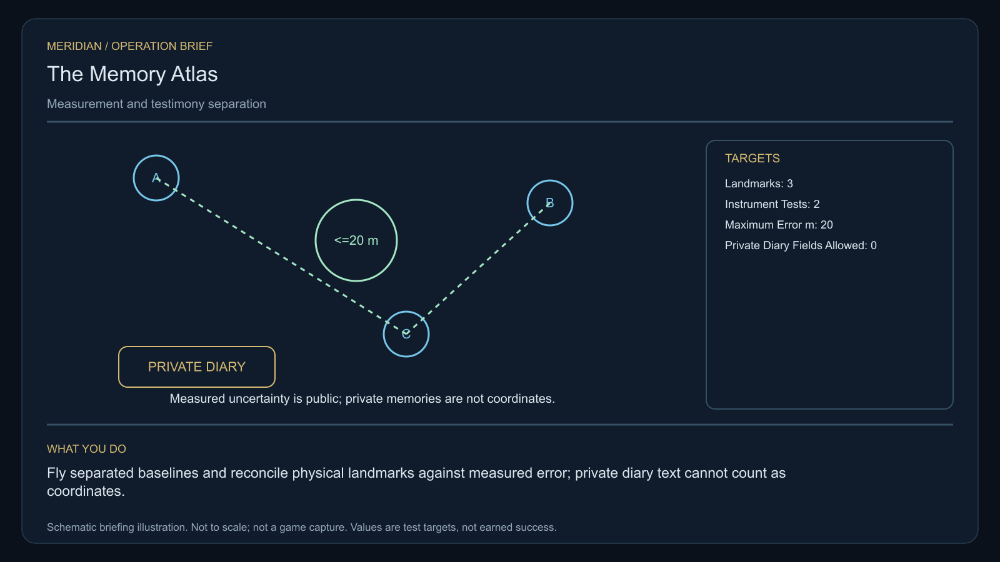

# C25 · The Memory Atlas

[Illustrated story](../../INTENDED-GAME-STORY-WALKTHROUGH.md#the-memory-atlas) · [Mission walkthrough checklist](../README.md)

Design walkthrough complete against `19a177e66093716928947f7246e0b664e4a6ad07`. Main contains the original commission, finite Watcher pickup, a read-only gallery and a finite-pupil calculation. Its save prefix accepts only commissioning and pickup. The gallery still lacks the actual Nedasen landmarks and measurements. The raw optical actor continuation at `5aa1d82fe17fbb0c6080b73766282f3cae17bd9f` is an off-main source packet. Neither the calculation nor raw exposure qualifies any mission reading. Native fieldwork and full acceptance remain open. [Save prefix](https://github.com/stephenlclarke/l337/blob/19a177e66093716928947f7246e0b664e4a6ad07/Sources/L337Core/NativeMemoryAtlasSave.swift#L21), [Gallery](https://github.com/stephenlclarke/l337/blob/19a177e66093716928947f7246e0b664e4a6ad07/Sources/L337Core/NativeMemoryAtlasGallery.swift#L44), [Pupil calculation boundary](https://github.com/stephenlclarke/l337/blob/19a177e66093716928947f7246e0b664e4a6ad07/Sources/L337Core/NativeMemoryAtlasFinitePupilReference.swift#L4)

## Offer and motivation

Agent Mara Vale commissions Rowan at Reris's living main orbital in Galaxy 1 after one ordinary purchase or sale. Confirm from the actual berth with a writable save. No score or prior campaign gate. Separately collect the finite original one-tonne Atlas Reference Watcher from Vale's actual station service when one tonne is free. **Beyond the Map** is the finished paid grouping. The independent free core inquiry remains available. [Exact watcher source](https://github.com/stephenlclarke/l337/blob/19a177e66093716928947f7246e0b664e4a6ad07/Sources/L337Core/NativeMemoryAtlasWatcherSource.swift#L3)

A publisher has sold travel recollections as exact instrument readings. Geologist Jalen Orr needs verified approach data. Vale protects both the measurement uncertainty and each contributor's consent. The player flies separated physical measurements and reconciles both instruments to the original Watcher. The final choice either publishes explicitly labelled testimony within its agreed scope or keeps private diaries with their custodians and publishes only measured hazards.

## Route and fit

| Galaxy 1 route | Distance and service |
| --- | --- |
| Reris G01-S080 → Nedasen G01-S130 | 2.187 LY. Collect the original Watcher before observing the three landmarks. |
| Nedasen → Cemalis G01-S008 | 1.865 LY. Compare both actual instruments after surveying. |
| Cemalis ↔ Ledanor G01-S174 | 6.097 LY each way for the player's visit to the archive receiver and return for branch proof. |
| Cemalis → Reris | 2.875 LY. Return the exact original Watcher. |

All direct jumps fit nominal 7 LY reach. With a full 7 LY tank at Reris, refuel at Cemalis before Ledanor, at Ledanor and at Cemalis again. Nedasen → Ledanor measures 5.300 LY if an independent departure is authorized there. Qualify actual departure, fuel, access and receiving separately. [World catalogue](https://github.com/stephenlclarke/l337/blob/19a177e66093716928947f7246e0b664e4a6ad07/Sources/L337Core/Resources/OriginalWorlds/catalogue.json), [Reach and fuel](https://github.com/stephenlclarke/l337/blob/19a177e66093716928947f7246e0b664e4a6ad07/Sources/L337Core/FuelStorage.swift#L8), [Native arrival](https://github.com/stephenlclarke/l337/blob/19a177e66093716928947f7246e0b664e4a6ad07/Sources/L337Core/NativeStationServices.swift#L135)

The player needs 1 t for the original carried Watcher and zero passenger places. Its current custody establishes source and serial. Real measurement still requires a calibrated optical input, scale and readout. The off-main raw diagnostic uses a paid targeting core because its existing query does. The final mission needs an explicitly advertised compatible targeting or loaned sensor path. No paid module requirement has been adopted. SH001 Mule is listed with two operators, 76 t nominal hold and 9 LY hull reach, without an exact issued role. The custodian's tender is an actual **SH061 Saiga**, two native operators, one mandate-bound delegate, a powered four-place Standard Cabin and finite fuel. Its design has 84 t hold, 22 equipment units, a 9 LY hull jump and 13 LY tank. The cabin uses 5 t and one equipment unit. Verify the actual archive custody and loaded Ledanor approach. [Mule design](https://github.com/stephenlclarke/l337/blob/19a177e66093716928947f7246e0b664e4a6ad07/docs/fleet-design-v2/ships/SH001.toml), [Saiga design](https://github.com/stephenlclarke/l337/blob/19a177e66093716928947f7246e0b664e4a6ad07/docs/fleet-design-v2/ships/SH061.toml), [Mule art](../../assets/ships/SH001.png), [Saiga art](../../assets/ships/SH061.png)

The reviewed profile sets `accompanimentRequired: false`. The consenting custodian travels independently after survey and permission while Rowan works in Cemalis. The older escort wording does not gate progress. The choice needs the actual living custodian, mandate and authorized Ledanor receiving. [Historical ledger wording](https://github.com/stephenlclarke/l337/blob/19a177e66093716928947f7246e0b664e4a6ad07/docs/COMPLETION-LEDGER.md#L2201)

## Play the nine stages

| Stage | Player action and qualifying evidence |
| --- | --- |
| 1. `accept` | Confirm Vale's reviewed offer while actually docked at Reris after the genuine trade. |
| 2. `collect-reference` | Confirm the original one-tonne Watcher under exact serial custody at Reris. |
| 3. `survey` | At Nedasen observe three actual independent orbital landmarks. Each needs front view, nearest unobstructed mesh, 2° aim and 12 continuous seconds at 250–1,500 native surface units. Preserve actual frame and provenance. Diary text supplies no coordinate. |
| 4. `field-work` | At Cemalis fly separated baselines and compare two distinct actual instruments with the original Watcher. Retain each signed measurement and frame, calibration and actual error. Each must measure **20 m error or less** independently. Apply 50–150 m surface clearance, at most 1 m/s and 2° aim only for the qualifying interface. A raw exposure, hover or copied answer cannot qualify. |
| 5. `independent-witness` | At Ledanor confirm native receiving of the actual independently travelling tender, living custodian and authorized diary mandate. |
| 6. `choose-settlement` | At the actual receiving berth, with the arrived authorized delegates, confirm **Publish a separated evidence-and-memory atlas** or **Keep the diaries with their custodians**. |
| 7. `apply-settlement` | At Cemalis require both selected proofs. For `plan-a`, keep measurements and testimony labelled separately and require each actual contributor's permission for the exact published excerpt. For `plan-b`, require actual restricted custody with the named custodian and a public layer of independently measured hazards with **zero private diary fields**. |
| 8. `return-and-audit` | At Reris return the exact original Watcher. Audit both measurements, actual living receiving, disclosure scope and selected proof pair. |
| 9. `close-case` | Preserve the verified outcome, rights and original records. Commit 7,200 CR through `l337.memory-atlas/final-payment` and `l337.unwritten-route/clue/memory-atlas-trace` once. Three unrelated diaries recorded the same inward curve around a place none of their authors visited. |

Keep the five physical sources separate from diary authorship and from the Watcher. The original project requires three actual native landmark admissions and two independently calibrated instruments. The 20 m result needs approved native-to-metre conversion, reference truth, sensor coupling, independent trajectories and known error bounds. Diagnostic ray acquisition and exposed finite-pupil math are separable inputs. Raw exposure state is transient. The design stores only qualified readings with actual sources and consent. Consent to one excerpt cannot disclose other passages or override a contributor's refusal.

[Editable operation drawing](../../assets/missions/revisions/memory-atlas-operation.svg)

## Failure, cold Continue and owners

No overall deadline. Pause freezes simulation. Cold Continue drops unfinished survey dwell and invalidates raw diagnostic exposure. Preserve exact custody, three completed qualified readings, both accepted error results, source and calibration IDs, living reception, rights and selected proofs. Pending writer failure may retry a genuinely qualified receipt against current authority. It cannot manufacture one. Exercise Continue after the original pickup, between both baselines, after receiving, after denied disclosure and after terminal. Preserve genuine loss or revoked consent. The independent free core inquiry can always earn only the missing clue if the original becomes unavailable.

- **G4 physical requirement.** Issue and qualify five original actors at Nedasen and Cemalis, actual geometry and safe placement, calibrated Watcher/instrument optical path, SI error provenance, and loaded Saiga at actual Ledanor receiving. The physical decision packet is pinned at `aebb0b1bcfba439c326e9748a31372faaa314a0f`.
- **MC1 mission requirement, via Root and G1.** Preserve the integrated finite watcher source. Integrate actual actor frame hooks only through G1. Require exact qualified source-bound measurements, independently living receipt, distinct disclosure proofs and one terminal. Scope current-format save and gallery progress to actual published receipts and protect private content through Continue.
- **Root source decisions.** Issue actual three landmark and two instrument owners and identifiers, trusted scale/calibration, authorized sensor fitting, consent and telemetry. Issue actual tender and custodian, finite fuel, archive receiver, contributor permissions and the exact public or restricted publication scope.

Historical story and data are `docs/meridian/missions/C25.md` and `docs/meridian/missions/definitions/memory-atlas.json` at `c70110b292077588a0855fb48127adfb1b611c9d`, definition SHA-256 `376678f1e4ca646d299e2205739e74f81f02b525a6a2f187db0ce9893218a7d6`. The reviewed `docs/meridian/missions/gameplay/campaign-profiles.json#/profiles/memory-atlas` has SHA-256 `37fe5011de7bcc5874f6e6eef42151a712be4f69a3b9b23cd18cf660bd0dff0a`.
