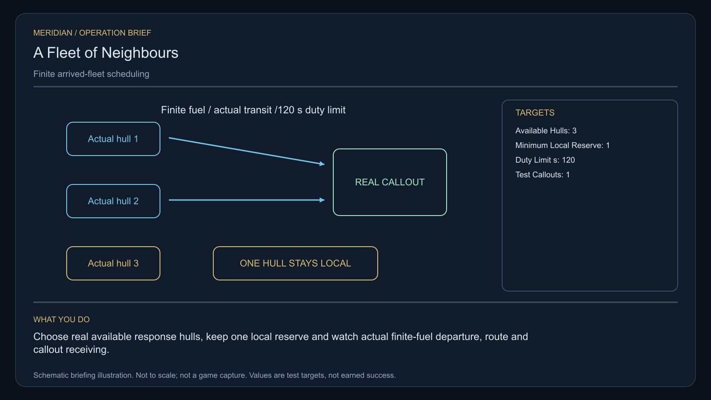

# C26 · A Fleet of Neighbours

[Illustrated story](../../INTENDED-GAME-STORY-WALKTHROUGH.md#a-fleet-of-neighbours) · [Mission walkthrough checklist](../README.md)

Design walkthrough complete against `19a177e66093716928947f7246e0b664e4a6ad07`. Opening supplier `5b43c25a5d47b112896cb2ea91129285277eaa85` and source-only integration `2e6e713304a84ff67d360a084e3d77dde9826728` remain outside executable main. Main contains clue registration. Original commissioning, physical stages and native acceptance remain open. [Main clue and archive pin](https://github.com/stephenlclarke/l337/blob/19a177e66093716928947f7246e0b664e4a6ad07/Sources/L337Core/NativeCharterArchiveRegistryApproval.swift#L1148)

## Offer and motivation

Marshal Nera Voss commissions Rowan at the living Morvasen main orbital in Galaxy 2 after one actual ordinary trade. Require actual arrival, a writable save and Confirm. No score or prior campaign gate. Voss retains the original finite one-tonne dispatch beacon until separate confirmation at Morvasen with one tonne free. **The Hearth Compact** is the finished paid grouping. The independent no-fee core inquiry remains available.

Pirates have closed a relief corridor. Three settlements offer protection ships, but the same escort window is contested and the ships, people and fuel are finite. Captain Suri Arlen wants actual hull commitments and honest arrival records. Voss keeps repair and defence evidence separate. The player repairs two relays, watches the offered ships' actual journeys, then escorts the dispatch tender and chooses a rota or local reserve policy.

## Route and fit

| Galaxy 2 route | Distance and service |
| --- | --- |
| Morvasen G02-S117 → Vornetor G02-S111 | 2.048 LY. Collect the original beacon before surveying three actual commitments. |
| Vornetor → Talnevan G02-S227 | 1.811 LY. Verify manifests before physical relay work and arrival tests. |
| Talnevan ↔ Arvek G02-S073 | 7.421 LY each way. For nominal 7 LY reach use Morvasen, 3.290 + 4.134 LY outbound, with real refuelling for a 7 LY tank. |
| Talnevan → Morvasen | 3.290 LY. Return the original beacon. |

The player's tender route must be common if the issued rendezvous is Talnevan. A nominally 9 LY Saiga could make the direct jump if fuelled, but it cannot go direct while the 7 LY escort detours. Vornetor → Arvek measures 5.956 LY and is only a candidate if the actual rendezvous and completed repairs allow that departure. Qualify each allied hull's own route, finite fuel, fitted reach and authorized receiving independently. [World catalogue](https://github.com/stephenlclarke/l337/blob/19a177e66093716928947f7246e0b664e4a6ad07/Sources/L337Core/Resources/OriginalWorlds/catalogue.json), [Reach and fuel](https://github.com/stephenlclarke/l337/blob/19a177e66093716928947f7246e0b664e4a6ad07/Sources/L337Core/FuelStorage.swift#L8), [Native arrival](https://github.com/stephenlclarke/l337/blob/19a177e66093716928947f7246e0b664e4a6ad07/Sources/L337Core/NativeStationServices.swift#L135)

The player carries 1 t and needs zero passenger places. SH001 Mule is listed with two operating places, 76 t nominal hold and 9 LY hull reach, with no exact relief assignment. The civilian dispatch tender is an actual **SH061 Saiga**, two native operators, one mandate-bound delegate, one powered four-place Standard Cabin and finite fuel. Its design has 84 t hold, 22 equipment units, 9 LY jump reach and a 13 LY tank. The cabin consumes 5 t and one equipment unit. Qualify actual loaded fit and Arvek aperture. The civilian tender is separate from the three protection hulls. Issue each relief hull's actual class, crew, duty, hardware and source stock before promising any reserve. [Mule design](https://github.com/stephenlclarke/l337/blob/19a177e66093716928947f7246e0b664e4a6ad07/docs/fleet-design-v2/ships/SH001.toml), [Saiga design](https://github.com/stephenlclarke/l337/blob/19a177e66093716928947f7246e0b664e4a6ad07/docs/fleet-design-v2/ships/SH061.toml), [Mule art](../../assets/ships/SH001.png), [Saiga art](../../assets/ships/SH061.png)

## Play the nine stages

| Stage | Player action and qualifying evidence |
| --- | --- |
| 1. `accept` | Confirm Voss's commission at the actual Morvasen orbital after the ordinary trade. |
| 2. `collect-reference` | Accept the original serialled one-tonne dispatch beacon at Morvasen. |
| 3. `survey` | At Vornetor verify three distinct actual offered hull manifests, living consented crews, finite fuel and departure commitments. Use front view, nearest unobstructed mesh, 2° aim and 12 continuous seconds per target at 250–1,500 native surface units. |
| 4. `field-work` | At Talnevan repair both actual external relief relays under source permission and verify calibrated functional output. Observe the offered ships' actual native routes and outcomes. Only living, genuinely arrived hulls can enter a duty pool. Apply 50–150 m clearance, at most 1 m/s and at most 2° aim at the repair interface. Hovering or a pirate kill earns no repair proof. |
| 5. `independent-witness` | After the relay and source gates, join the actual civilian dispatch tender. Accompany the same identified people and hull along the real authorized route until actual Arvek relief receiving. Keep genuine losses recorded. |
| 6. `choose-settlement` | With arrived authorized delegates at the actual Arvek receiver, choose **Rotate arrived protection ships across settlements** or **Retain local reserve pairs with mutual callouts**. Preview real eligible strength and reserve capacity. |
| 7. `apply-settlement` | At Talnevan obtain both proofs for the selected branch. For `plan-a`, schedule only eligible arrived hulls and end each duty by **120 simulation seconds** or the crew's earlier consent limit. For `plan-b`, protect the real local reserves and perform **one** actual cross-settlement callout with native departure, finite fuel, transit and receiving. |
| 8. `return-and-audit` | Return the exact loan at Morvasen and audit relay results, recorded arrivals or losses, same tender receiving and both branch proofs. |
| 9. `close-case` | Preserve the verified protection plan and original records. Commit 9,400 CR via `l337.fleet-of-neighbours/final-payment` and `l337.unwritten-route/clue/fleet-of-neighbours-trace` once. The oldest diagram curves around an unassigned central formation slot. |

The project roster has three offered protection hulls. A duty begins only with actual authorized service. A loss or expired duty removes that hull from availability. The profile's reserve minimum is one actual local ship and the older branch text calls for both local reserves. Use one eligible reserve at each of two source-issued reserve points and a distinct responding hull for the one callout as the project trial. Root must issue the actual points and roster. Insufficient live hulls cannot pass this trial. Actual alternate or remedial authority remains separate. No respawn, abstract protection point or counted kill can replace a lost hull or receipt. [Earlier branch wording](https://github.com/stephenlclarke/l337/blob/19a177e66093716928947f7246e0b664e4a6ad07/docs/COMPLETION-LEDGER.md#L2202), [Ledger transit dependencies](https://github.com/stephenlclarke/l337/blob/19a177e66093716928947f7246e0b664e4a6ad07/docs/COMPLETION-LEDGER.md#L1789)

[Editable operation drawing](../../assets/missions/revisions/fleet-of-neighbours-operation.svg)

## Failure, cold Continue and owners

No overall deadline. Pause freezes active simulation. Save the original beacon, three source manifests, actual relay condition, departures, fuel, occupied duty/reserve, living crew, duty clock and callout state, actual civilian tender receiving and branch proof. Cold Continue resets unfinished survey dwell and preserves losses and eligible resources. Verify load during each repair, allied route, refuel, actual escort, 120-second duty and callout. A load cannot renew duty, recreate a lost ship or replay a receipt. The no-fee core inquiry can always award only the same missing clue if the original becomes unavailable.

- **G4 physical requirement.** Pin two actual relay faces and repair output, three real protection hulls and finite fits, physical reserve and callout routes, civilian Saiga and shared escort route. Qualify actual Arvek and branch receiving, fuel and formation/rejoin.
- **MC1 mission requirement, via Root and G1.** Rebind the frozen opening and custody, then require actual repairs and route outcomes, live finite protection pools, actual escorted dispatch receiving, distinct chosen branch proofs and one terminal. Test destroyed/expired assets, double assignment, borrowed reception and cold-load expiry.
- **Root source decisions.** Issue Voss's serial, physical relay and repair stock, consented hull manifests, actual escorts and their origins, common itinerary/refuel authority, civilian tender and Arvek berth, duty signers, the two reserve points and actual callout provider and receiver.

Historical story and data are `docs/meridian/missions/C26.md` and `docs/meridian/missions/definitions/fleet-of-neighbours.json` at `c70110b292077588a0855fb48127adfb1b611c9d`, definition SHA-256 `18829ed037b93166312d33b67652ceea447dbc427e549b50c47dd9bed9e8d479`. The reviewed `docs/meridian/missions/gameplay/campaign-profiles.json#/profiles/fleet-of-neighbours` has SHA-256 `37fe5011de7bcc5874f6e6eef42151a712be4f69a3b9b23cd18cf660bd0dff0a`.
