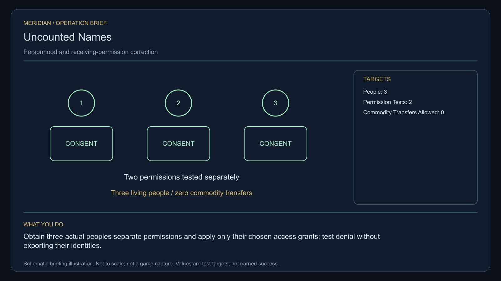

# C27 · Uncounted Names

[Illustrated story](../../INTENDED-GAME-STORY-WALKTHROUGH.md#uncounted-names) · [Mission walkthrough checklist](../README.md)

Design walkthrough complete against `19a177e66093716928947f7246e0b664e4a6ad07`. Opening supplier `0bf514362de8da254ff75f3ea6f4d9505bbfad0a` and source-only integration `663b4b82c54f00df8676c703b2e7b7ec9229a8d3` remain outside executable main. Main contains the clue registration. Original commissioning, physical stages and native acceptance remain open. [Main clue and archive pin](https://github.com/stephenlclarke/l337/blob/19a177e66093716928947f7246e0b664e4a6ad07/Sources/L337Core/NativeCharterArchiveRegistryApproval.swift#L1808)

## Offer and motivation

Coordinator Sera Dain commissions Rowan at Oranisil's living main orbital in Galaxy 3 after one ordinary purchase or sale. Require actual arrival, writable save and confirmation. No rank or prior case gate. Accepting creates the case. Dain keeps the finite original one-tonne consent verifier until separate pickup at Oranisil with one tonne free. **The Wayfarer Union** is the finished paid grouping. The independent free core inquiry remains available.

A dock automation system classified three displaced workers as transferable equipment because their records used equipment forms. Dain asks each person what may be used and where they want to go. Nia Toren preserves the original manifest as evidence and removes its ability to authorize a transfer. The player validates the workers' separate permissions, corrects real receiver access and supports a private correction or a wider form repair without publishing private identities.

## Route and fit

| Galaxy 3 route | Distance and service |
| --- | --- |
| Oranisil G03-S154 → Lyraven G03-S193 | 2.506 LY. Collect the original verifier before observing three actual identities. |
| Lyraven → Sialasil G03-S190 | 3.665 LY. Verify actual permissions before testing both receivers. |
| Sialasil ↔ Aenisil G03-S117 | 2.809 LY each way for the player's visit to the chosen receiver and return for branch proof. |
| Sialasil → Oranisil | 2.773 LY. Return the original verifier. |

All direct jumps fit nominal 7 LY reach. With a full 7 LY tank at Oranisil, refuel at Sialasil before Aenisil and at Sialasil on the return. Lyraven → Aenisil measures 5.135 LY if the source issues that independent tender departure. Verify the actual safe berth and person-receiving authority before the tender leaves or commits to an approach. [World catalogue](https://github.com/stephenlclarke/l337/blob/19a177e66093716928947f7246e0b664e4a6ad07/Sources/L337Core/Resources/OriginalWorlds/catalogue.json), [Reach and fuel](https://github.com/stephenlclarke/l337/blob/19a177e66093716928947f7246e0b664e4a6ad07/Sources/L337Core/FuelStorage.swift#L8), [Native arrival](https://github.com/stephenlclarke/l337/blob/19a177e66093716928947f7246e0b664e4a6ad07/Sources/L337Core/NativeStationServices.swift#L135)

The player needs 1 t for the verifier and zero passenger places. The source-owned **SH061 Saiga** needs two actual operators, a mandate-bound delegate, a powered four-place Standard Cabin and finite fuel. All three workers plus a separate delegate exactly fill the four places if they travel aboard together. Count a worker who also holds the mandate once. The design has 84 t hold, 22 equipment units, a 9 LY hull jump and a 13 LY tank. The cabin consumes 5 t and one equipment unit. Verify all actual people, powered capacity and the Aenisil approach before flight. SH001 Mule has two operators, 76 t nominal hold and 9 LY reach, with no exact issued role. The workers are living native person records and occupy their real places. They never enter hold or commodity stock. [Mule design](https://github.com/stephenlclarke/l337/blob/19a177e66093716928947f7246e0b664e4a6ad07/docs/fleet-design-v2/ships/SH001.toml), [Saiga design](https://github.com/stephenlclarke/l337/blob/19a177e66093716928947f7246e0b664e4a6ad07/docs/fleet-design-v2/ships/SH061.toml), [Mule art](../../assets/ships/SH001.png), [Saiga art](../../assets/ships/SH061.png)

The reviewed profile sets `accompanimentRequired: false`. The workers' tender travels independently after survey and consent. If the person-receiving permissions are still being corrected, its issued safe holding or provisional docking authority must keep the party protected until actual person-receiving is allowed. The old escort wording does not gate progress. Aenisil choice requires actual living reception and the arrived mandate. [Historical ledger wording](https://github.com/stephenlclarke/l337/blob/19a177e66093716928947f7246e0b664e4a6ad07/docs/COMPLETION-LEDGER.md#L2203)

## Play the nine stages

| Stage | Player action and qualifying evidence |
| --- | --- |
| 1. `accept` | Confirm Dain's commission at actual Oranisil dock after the genuine trade. |
| 2. `collect-reference` | Confirm the exact serialled one-tonne original verifier under protected custody at Oranisil. |
| 3. `survey` | At Lyraven obtain separate actual permission from each of the three people and observe each native identity receipt. Redact private names in public projections. Use front view, nearest unobstructed mesh, 2° aim and 12 continuous seconds per target at 250–1,500 native surface units. |
| 4. `field-work` | At Sialasil use the independent verifier at both actual receiver interfaces. Apply only grants selected by the affected person. Test actual allowed access and actual refusal without exporting identities. Qualify the authored 20-second work minimum at 50–150 m, at most 1 m/s and at most 2° aim. Three people remain living records. No sale, commodity transfer or duplicated berth place can pass. |
| 5. `independent-witness` | At Aenisil verify the same original independently travelling tender, all required living consenting people, exact chosen receiver and actual mandate. Count real passenger receiving rather than cargo. |
| 6. `choose-settlement` | At the actual Aenisil receiver with the arrived authorized delegation, choose **Repair individual records under protected custody** or **Publish a systematic register repair**. |
| 7. `apply-settlement` | At Sialasil require both proofs for the chosen branch. For `plan-a`, each person acknowledges their protected correction and the receiver validates the new authority. For `plan-b`, publish an anonymised audit and prove the corrected form refuses an equipment-only transfer for every registered person. |
| 8. `return-and-audit` | Return the exact original verifier to Oranisil. Audit both native receiver tests, consent, living reception, and the selected proof pair. |
| 9. `close-case` | Preserve the selected correction and original manifest as evidence. Commit 6,500 CR through `l337.uncounted-names/final-payment` and `l337.unwritten-route/clue/uncounted-names-trace` once. The oldest register has an inward-curved entry naming no person, cargo or owner. |

Consent is separate per person, recipient and purpose. The design uses a real read and refusal at each physical permission interface, plus separate validation of actual living reception. Historical forms remain sealed evidence. A public audit uses a de-identified projection and cannot give access to the private sources, including names or stable public identifiers that disclose them. Withdrawal invalidates prospective permission and cannot erase the genuine historical audit. Neither choice exposes the workers or permits a station to treat them as freight.

[Editable operation drawing](../../assets/missions/revisions/uncounted-names-operation.svg)

## Failure, cold Continue and owners

No overall deadline. Pause freezes active simulation. Preserve exact original loan, separately scoped consent, protected identities, actual permission revisions, living manifest, route and receiving, branch and proof receipts. Reset unfinished survey dwell on cold Continue and revalidate consent before any pending action. Exercise saves before and after both corrections, during independent transit, at Aenisil receiving, during refusal or withdrawal and at terminal. Genuine loss, refusal and revoked consent remain recorded. A separate no-fee core inquiry can always award only the missing clue when the original becomes unavailable.

- **G4 physical requirement.** Pin three real observations and both actual permission interfaces, living person and cabin manifests, actual source Saiga and safe Aenisil receiver/holding authority.
- **MC1 mission requirement, via Root and G1.** Rebind the frozen opening and original custody. Implement scoped consent, positive/negative live permission tests, true independent receiving, zero commodity movement and privacy-safe branch proof. Verify no exported private names, duplicate people, illicit sale, reloaded consent or second reward.
- **Root source decisions.** Issue Dain's exact original verifier, actual three workers and separate scopes, consent issuer and both receiver owners. Issue the tender manifest, source route and safe hold or reception, and the private record or public form authority. Confirm the exact public de-identification boundary.

Historical story and data are `docs/meridian/missions/C27.md` and `docs/meridian/missions/definitions/uncounted-names.json` at `c70110b292077588a0855fb48127adfb1b611c9d`, definition SHA-256 `318d89b6837750dcb5abc0b149e6fbc80e751e7b63a85b4a285776671ee54bd5`. The reviewed `docs/meridian/missions/gameplay/campaign-profiles.json#/profiles/uncounted-names` has SHA-256 `37fe5011de7bcc5874f6e6eef42151a712be4f69a3b9b23cd18cf660bd0dff0a`.
