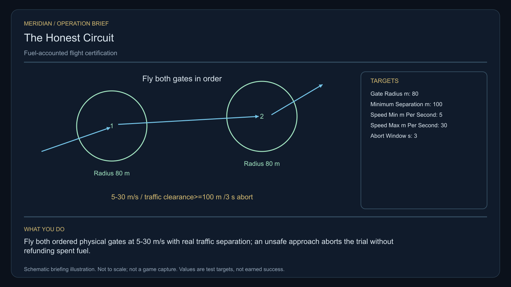

# C28 · The Honest Circuit

[Illustrated story](../../INTENDED-GAME-STORY-WALKTHROUGH.md#the-honest-circuit) · [Mission walkthrough checklist](../README.md)

Design walkthrough complete against `19a177e66093716928947f7246e0b664e4a6ad07`. Opening supplier `46cf45722292f767883a9eee8002aed289d451a5` and source-only integration `10c0053fa07f7db0d234a9b02e0315ba31c920e9` remain outside executable main. Main contains the clue registration. Original commissioning, physical stages and native acceptance remain open. [Frozen opening ledger](https://github.com/stephenlclarke/l337/blob/19a177e66093716928947f7246e0b664e4a6ad07/docs/COMPLETION-LEDGER.md#L7096), [Main clue and archive pin](https://github.com/stephenlclarke/l337/blob/19a177e66093716928947f7246e0b664e4a6ad07/Sources/L337Core/NativeCharterArchiveRegistryApproval.swift#L1280)

## Offer and motivation

Captain Elara Venn commissions the audit at Lonomon's living main orbital in Galaxy 4 after one ordinary purchase or sale. Require actual arrival, writable save and confirmation. No score or prior campaign gate. The original finite one-tonne timing reference is a separate confirmed pickup at Lonomon with one tonne free. **Beyond the Map** is the finished paid grouping. The independent no-fee core inquiry remains available.

A flight certificate rewards apparent speed while overlooking fuel disposal and dangerous passes. Venn wants the standard to fit ordinary working craft as well as the player's current ship. Relay Engineer Ivo Renn makes every limit visible before the run. The player flies the actual course, with real traffic and fuel accountability, then certifies measured efficiency or an enforceable safety margin.

## Route and fit

| Galaxy 4 route | Distance and service |
| --- | --- |
| Lonomon G04-S194 → Mobarum G04-S218 | 2.812 LY. Collect the original reference before reading three timebases. |
| Mobarum → Lobagom G04-S249 | 5.733 LY. Read the epochs before the physical corridor tests. |
| Lobagom ↔ Balmabol G04-S109 | 2.147 LY each way for the player's visit to the living receiver and return for branch proof. |
| Lobagom → Lonomon | 2.922 LY. Return the original instrument. |

All jumps fit nominal 7 LY reach. On the listed route with a 7 LY tank, arrange fuel at Mobarum, Lobagom before Balmabol and at Balmabol or Lobagom on the return. Verify actual native jump costs and any additional authorized fuel operations. Mobarum → Balmabol measures 5.915 LY and cannot by itself prove a pass through the actual Lobagom corridor. [World catalogue](https://github.com/stephenlclarke/l337/blob/19a177e66093716928947f7246e0b664e4a6ad07/Sources/L337Core/Resources/OriginalWorlds/catalogue.json), [Native jump cost](https://github.com/stephenlclarke/l337/blob/19a177e66093716928947f7246e0b664e4a6ad07/Sources/L337Core/FuelStorage.swift#L15), [Native arrival](https://github.com/stephenlclarke/l337/blob/19a177e66093716928947f7246e0b664e4a6ad07/Sources/L337Core/NativeStationServices.swift#L135)

The player flies their current commander and ship, with 1 t reserved for the reference and zero passenger places. No trial ship substitution. Qualify actual loaded geometry and control authority before arming the run. SH001 Mule is listed with two operators, 76 t nominal hold and 9 LY hull reach, without an issued role. The calibration tender is an actual **SH061 Saiga**, two native operators, one mandate-bound delegate, one powered four-place Standard Cabin and finite fuel. The design has 84 t hold, 22 equipment units, 9 LY hull reach and a 13 LY tank. The cabin uses 5 t and one equipment unit. Qualify its actual path and Balmabol berth separately. [Mule design](https://github.com/stephenlclarke/l337/blob/19a177e66093716928947f7246e0b664e4a6ad07/docs/fleet-design-v2/ships/SH001.toml), [Saiga design](https://github.com/stephenlclarke/l337/blob/19a177e66093716928947f7246e0b664e4a6ad07/docs/fleet-design-v2/ships/SH061.toml), [Mule art](../../assets/ships/SH001.png), [Saiga art](../../assets/ships/SH061.png)

The reviewed profile sets `accompanimentRequired: false`. The calibration tender may prepare and move independently after survey and consent. It still needs to fly the same certified corridor once safe and arrive alive at Balmabol. Root must issue the actual corridor entry, hold and departure sequence. The older escort wording does not gate the player. [Historical ledger wording](https://github.com/stephenlclarke/l337/blob/19a177e66093716928947f7246e0b664e4a6ad07/docs/COMPLETION-LEDGER.md#L2204)

## Play the nine stages

| Stage | Player action and qualifying evidence |
| --- | --- |
| 1. `accept` | Confirm Venn's reviewed commission at actual Lonomon dock after the trade. |
| 2. `collect-reference` | Take the original one-tonne timing instrument under exact serial custody. |
| 3. `survey` | At Mobarum observe three distinct actual timing beacons and compare independent sample epochs. Use front view, nearest unobstructed mesh, 2° aim and 12 continuous seconds at 250–1,500 native surface units per target. |
| 4. `field-work` | At Lobagom fly both physical **80 m-radius** gates in order at **5–30 m/s** and stay at least **100 m** from actual ordinary traffic. Measure ordered crossings, actual closest passage, elapsed simulation time and real fuel before/after. Count offloaded fuel. Unsafe approach fails or aborts. No hover requirement applies to a gate crossing. |
| 5. `independent-witness` | At Balmabol require the same independent calibration tender's actual corridor transit, native receiving of the living party and exact mandate. |
| 6. `choose-settlement` | At the actual receiver with the arrived authorized delegates choose **Certify measured route efficiency** or **Certify a minimum safety margin**. |
| 7. `apply-settlement` | At Lobagom obtain both selected proofs. For `plan-a`, publish actual receiving time and total accounted fuel including dumped fuel. For `plan-b`, issue a real abort request within **3 simulation seconds** of the controlled cue, cancel the active approach and retain the measured closest-pass envelope. No unsafe pass can receive certification. |
| 8. `return-and-audit` | At Lonomon return the exact original instrument and audit ordered passes, finite accounting, same tender arrival and both selected proofs. |
| 9. `close-case` | Preserve the selected certification and original observations. Commit 7,000 CR via `l337.honest-circuit/final-payment` and `l337.unwritten-route/clue/honest-circuit-trace` once. The anomaly lies between two valid circuit ticks. |

Project geometry uses actual swept crossings in the approved gate frames and measures traffic separation over the certified interval. Renn must publish the actual cue, gate reference frames and separation basis before arming. A controlled abort must work safely even when it earns no certification. Arm only the case trial clock. There is no overall deadline or leaderboard requirement.

Use native fuel transactions to reconcile before and after balances. Preserve actual debits, collected or purchased amounts, and any allowed offload as distinct recorded operations. A reset cannot refund fuel or erase spent simulation time. Current main exposes real jump debits. The mission's offload producer and attribution across the certification corridor still need issuance. Until qualified, this design does not assume a sublight consumption model or create a refuel credit from a displayed number. [Native jump transaction](https://github.com/stephenlclarke/l337/blob/19a177e66093716928947f7246e0b664e4a6ad07/Sources/L337Core/Game.swift#L6161)

[Editable operation drawing](../../assets/missions/revisions/honest-circuit-operation.svg)

## Failure, cold Continue and owners

Pause freezes active simulation. Restore the exact loan, committed timebase readings, gate order and active run time, actual fuel ledger, closest separation, abort scope, real tender receipt, choice and branch proofs. Unfinished survey dwell resets. Continue during an approach cannot reset its actual start or erase incurred costs. Check high/low speed, reversed gates, unsafe proximity, late abort, fuel disposal and saves during a gate, trial retry and terminal. The separate free inquiry always earns only the missing clue if the original becomes unavailable.

- **G4 physical requirement.** Pin three independent beacons, actual gate planes, radius, native metre calibration, true traffic envelopes and controlled abort route. Qualify player fit and actual loaded Saiga along the same corridor and at Balmabol.
- **MC1 mission requirement, via Root and G1.** Rebind original custody. Add actual ordered swept crossings, simulation/fuel accounting, safe abort and independent living corridor receipt. Bind selected physical and receiving proofs and one terminal. A reset, time shortcut, missing traffic or borrowed receiving cannot qualify.
- **Root source decisions.** Issue actual beacon and gate identities, geometry and clocks, traffic owners, legitimate fuel offload/receiving policy and measured certification scope. Issue tender, consent, corridor transit and Balmabol receiving, and the precise abort cue and authority.

Historical story and data are `docs/meridian/missions/C28.md` and `docs/meridian/missions/definitions/honest-circuit.json` at `c70110b292077588a0855fb48127adfb1b611c9d`, definition SHA-256 `b7a30dd4d3d37883c244f01c0a5c58bc5e643e262f27b85069d66696c91beb72`. The reviewed `docs/meridian/missions/gameplay/campaign-profiles.json#/profiles/honest-circuit` has SHA-256 `37fe5011de7bcc5874f6e6eef42151a712be4f69a3b9b23cd18cf660bd0dff0a`.
