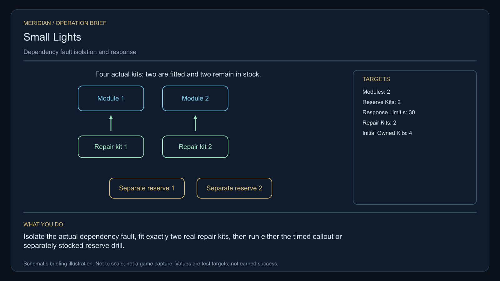

# C29 · Small Lights

[Illustrated story](../../INTENDED-GAME-STORY-WALKTHROUGH.md#small-lights) · [Mission walkthrough checklist](../README.md)

Design walkthrough complete against `19a177e66093716928947f7246e0b664e4a6ad07`. Opening supplier `832a6c5c777f866d92b7c3063ca18d63d3577a87` and source-only integration `884fd93e2b5d54b00b2f311cf7c173080549d936` remain outside executable main. Main contains clue registration. Original commissioning, physical stages and native acceptance remain open. [Main clue and archive pin](https://github.com/stephenlclarke/l337/blob/19a177e66093716928947f7246e0b664e4a6ad07/Sources/L337Core/NativeCharterArchiveRegistryApproval.swift#L1654)

## Offer and motivation

Dispatcher Evi Senn commissions Rowan at Duniler's living main orbital in Galaxy 5 after one actual ordinary trade. Require actual arrival, a writable save and confirmation. No rank or prior campaign gate. Separately collect Senn's original one-tonne utility lantern at Duniler with one tonne free. Accepting issues no repair parts. **Last Light** is the finished paid grouping. The no-fee core inquiry remains independently available.

Several small utility faults individually fall below an insurer's dispatch threshold. Together they isolate an orbital neighbourhood. Senn needs a coordinated response. Engineer Cato Lerr asks the player to find the dependency, isolate it and verify actual load before clearing faults. Two real repairs restore service. The eventual choice governs whether utilities pool their callouts or fund and stock separate reserves.

## Route and fit

| Galaxy 5 route | Distance and service |
| --- | --- |
| Duniler G05-S228 → Delenir G05-S112 | 2.385 LY. Collect the original lantern before reading the three faults. |
| Delenir → Siluel G05-S233 | 5.693 LY. Read the graph before both physical module repairs. |
| Siluel ↔ Ashilun G05-S156 | 3.863 LY each way for the player's visit to the living receiver and return for branch proof. |
| Siluel → Duniler | 3.995 LY. Return the original lantern. |

All direct jumps fit nominal 7 LY reach. Each consecutive pair exceeds a 7 LY tank. Arrange real refuelling at Delenir, Siluel, Ashilun and Siluel on the return. Delenir → Ashilun measures 3.767 LY if the source issues that independent tender departure. The 30-second response is a separate local test. Size its physical route and traffic so an actual permitted craft can meet it. [World catalogue](https://github.com/stephenlclarke/l337/blob/19a177e66093716928947f7246e0b664e4a6ad07/Sources/L337Core/Resources/OriginalWorlds/catalogue.json), [Reach and fuel](https://github.com/stephenlclarke/l337/blob/19a177e66093716928947f7246e0b664e4a6ad07/Sources/L337Core/FuelStorage.swift#L8), [Native arrival](https://github.com/stephenlclarke/l337/blob/19a177e66093716928947f7246e0b664e4a6ad07/Sources/L337Core/NativeStationServices.swift#L135)

The player carries the 1 t original lantern and needs zero passenger places. The four source kits are actual individually registered stock. Local source custody avoids imposing unissued kit mass or freight on the player. If actual kit transport is later required, issue the stock, dimensions, mass and owner and validate the fit. The maintenance tender is an actual **SH061 Saiga**, two operators, one mandate-bound delegate, one powered four-place Standard Cabin and finite fuel. The design has 84 t nominal hold, 22 equipment units, 9 LY hull reach and a 13 LY tank. The cabin costs 5 t and one equipment unit. Qualify actual crew and tools, power and loaded Ashilun approach. SH001 Mule is listed with two operators, 76 t nominal hold and 9 LY reach, without an exact issued role. [Mule design](https://github.com/stephenlclarke/l337/blob/19a177e66093716928947f7246e0b664e4a6ad07/docs/fleet-design-v2/ships/SH001.toml), [Saiga design](https://github.com/stephenlclarke/l337/blob/19a177e66093716928947f7246e0b664e4a6ad07/docs/fleet-design-v2/ships/SH061.toml), [Mule art](../../assets/ships/SH001.png), [Saiga art](../../assets/ships/SH061.png)

The reviewed profile sets `accompanimentRequired: false`. The source-owned maintenance tender travels independently after survey and consent while Rowan repairs the modules. The older escort wording does not gate the player. Require actual living Ashilun receipt and the signed mandate. [Historical ledger wording](https://github.com/stephenlclarke/l337/blob/19a177e66093716928947f7246e0b664e4a6ad07/docs/COMPLETION-LEDGER.md#L2205)

## Play the nine stages

| Stage | Player action and qualifying evidence |
| --- | --- |
| 1. `accept` | Confirm Senn's reviewed offer at actual Duniler dock after the ordinary trade. |
| 2. `collect-reference` | Confirm the exact original one-tonne lantern under its protected serial custody. |
| 3. `survey` | At Delenir observe three actual faults and reconcile the shared physical dependency graph. Use front view, nearest unobstructed mesh, 2° aim and 12 continuous seconds at 250–1,500 native surface units per distinct target. |
| 4. `field-work` | At Siluel isolate the actual dependency before restoring the two external failed modules. Start with **four individually registered kits**, two repair and two reserve. Fit one repair kit to each module, consume it once and retain both reserve kits. Verify real upstream load and downstream service. Use the 20-second qualified work minimum at 50–150 m, at most 1 m/s and 2° aim. A kit name or a cleared display earns no proof. |
| 5. `independent-witness` | At Ashilun verify actual living reception of the same independently travelling maintenance tender, crew and original mandate. |
| 6. `choose-settlement` | At the actual receiver, with the arrived authorized delegates, choose **Pool local callouts across utilities** or **Keep independently funded service reserves**. |
| 7. `apply-settlement` | At Siluel require both selected proofs. For `plan-a`, verify actual shared capacity and one real cross-utility callout reaching its receiver within **30 simulation seconds** of explicit arming. For `plan-b`, verify two separately funded physical reserve kits before an actual receiving drill. A stock promise cannot count. |
| 8. `return-and-audit` | Return the original lantern at Duniler. Reconcile the graph, both real installations, actual crew receiving and chosen proof pair. |
| 9. `close-case` | Preserve the service decision and original records. Commit 6,400 CR via `l337.small-lights/final-payment` and `l337.unwritten-route/clue/small-lights-trace` once. The clue is an inward pulse predating the equipment. |

The scenario must separate a shared dependency symptom from the two hardware failures. Proposed design checks upstream isolation and load, performs the two physical repairs, then verifies restored downstream service. The source must issue the actual graph, meter/device identities and safe thresholds. Two repairs require two serials, and the two reserve serials remain in stock until the selected policy authorizes real handling. The 30-second clock begins only when the player arms the actual test. A local route, dispatch actor and receiver must make the limit attainable under real acceleration and docking.

[Editable operation drawing](../../assets/missions/revisions/small-lights-operation.svg)

## Failure, cold Continue and owners

No overall deadline. Pause freezes active simulation. Save exact lantern, graph and isolation, module load, kit serials and custody, completed physical work, tender route and receiving, branch and test clock. Cold Continue drops unfinished survey dwell and restores legitimate stock and selected trial. Revalidate pending work before consuming stock. Exercise Continue between installations, after independent reception, during the 30-second callout and after terminal. Genuine damage, lost stock and failed deadlines remain recorded. The no-fee core inquiry can always earn only the missing clue when the original becomes unavailable.

- **G4 physical requirement.** Pin three fault sources, real graph, two actual module surfaces and verified load, four independent kits, local callout/drill geometry, powered Saiga and Ashilun receiving.
- **MC1 mission requirement, via Root and G1.** Rebind the frozen opening and exact custody. Require two distinct installed/consumed repair serials and two separately retained reserve serials, actual test and load output, independent living receiving, an actual branch proof pair and one terminal.
- **Root source decisions.** Issue original lantern and fault providers, safe isolation and restore authority, real module and kit owners, service fixture and thresholds, actual tender and receiver, and funded reserve or achievable timed callout authority.

Historical story and data are `docs/meridian/missions/C29.md` and `docs/meridian/missions/definitions/small-lights.json` at `c70110b292077588a0855fb48127adfb1b611c9d`, definition SHA-256 `2b8efb2ef80c459fa1bdbe852709fd69eeff45cfedc4773cc5b120f747fcd641`. The reviewed `docs/meridian/missions/gameplay/campaign-profiles.json#/profiles/small-lights` has SHA-256 `37fe5011de7bcc5874f6e6eef42151a712be4f69a3b9b23cd18cf660bd0dff0a`.
