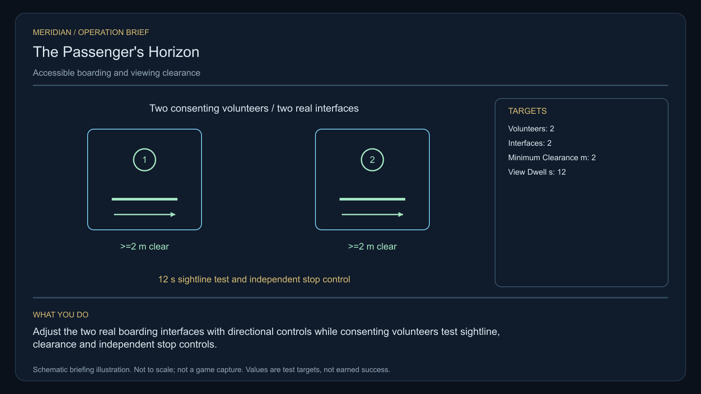

# C30 · The Passenger's Horizon

[Illustrated story](../../INTENDED-GAME-STORY-WALKTHROUGH.md#the-passengers-horizon) · [Mission walkthrough checklist](../README.md)

Design walkthrough complete against `19a177e66093716928947f7246e0b664e4a6ad07`. Opening supplier `4e6af511dff298b312bd458b8b3e15d1e159f01f` and source-only integration `ae7e865a413205618cbdf05dbced4769f47d54ac` remain outside executable main. Main contains clue registration. Original commissioning, physical stages and native acceptance remain open. [Main clue and archive pin](https://github.com/stephenlclarke/l337/blob/19a177e66093716928947f7246e0b664e4a6ad07/Sources/L337Core/NativeCharterArchiveRegistryApproval.swift#L1500)

## Offer and motivation

Captain Orin Sorel commissions Rowan at Aelara's living main orbital in Galaxy 6 after one ordinary purchase or sale. Require actual arrival, a writable save and confirmation. No rank or prior campaign gate. Collect the exact original one-tonne access console separately at Aelara with one tonne free. **Safe Passage** is the finished paid grouping. The no-fee core inquiry remains independently available.

A passenger cooperative sells a scenic orbital trip whose standard form excludes people with different access needs. Sorel needs actual compatible access and viewing. Coordinator Sera Dain insists on an empty test chair before any occupied trial. The player adjusts both physical interfaces, proves safety and preserves each volunteer's independent right to stop or decline. The resolution offers adaptable shared cabins or guarantees separate accessible places.

## Route and fit

| Galaxy 6 route | Distance and service |
| --- | --- |
| Aelara G06-S012 → Izaeth G06-S034 | 1.995 LY. Collect the exact console before observing the three sites. |
| Izaeth → Evanieri G06-S077 | 4.112 LY. Compare declared needs before the two empty-chair tests. |
| Evanieri ↔ Noaliena G06-S011 | 5.394 LY each way for the player's witness visit and return for branch proof. |
| Evanieri → Aelara | 2.522 LY. Return the original console. |

All direct jumps fit nominal 7 LY reach. On a full 7 LY tank at Aelara, refuel at Evanieri before Noaliena, Noaliena and Evanieri on the return. Izaeth → Noaliena measures 3.874 LY if the source issues that independent travel plan. It cannot bypass the actual safety permission. An Evanieri tender rendezvous can let the same volunteers witness both verified local interfaces before leaving independently. The actual origin, route and actors require issuance. [World catalogue](https://github.com/stephenlclarke/l337/blob/19a177e66093716928947f7246e0b664e4a6ad07/Sources/L337Core/Resources/OriginalWorlds/catalogue.json), [Reach and fuel](https://github.com/stephenlclarke/l337/blob/19a177e66093716928947f7246e0b664e4a6ad07/Sources/L337Core/FuelStorage.swift#L8), [Native arrival](https://github.com/stephenlclarke/l337/blob/19a177e66093716928947f7246e0b664e4a6ad07/Sources/L337Core/NativeStationServices.swift#L135)

The player reserves 1 t for the original console and needs zero passenger places. The empty chair is source-owned test equipment. Its actual geometry and custody matter. The assessment tender is an actual **SH061 Saiga** with two native operators, one mandate-bound delegate, one powered four-place Standard Cabin and finite fuel. Two volunteers and a distinct delegate occupy three places if they all travel aboard. Count a volunteer who holds the mandate only once. The Saiga design has 84 t hold, 22 equipment units, 9 LY hull reach and a 13 LY tank. Its cabin uses 5 t and one equipment unit. Seat count does not establish an accessible route or actual adaptation. Qualify the actual fit and declared individual needs, power, safe stop and berth. SH001 Mule has two operators, 76 t nominal hold and 9 LY hull reach, without an exact issued role. [Mule design](https://github.com/stephenlclarke/l337/blob/19a177e66093716928947f7246e0b664e4a6ad07/docs/fleet-design-v2/ships/SH001.toml), [Saiga design](https://github.com/stephenlclarke/l337/blob/19a177e66093716928947f7246e0b664e4a6ad07/docs/fleet-design-v2/ships/SH061.toml), [Mule art](../../assets/ships/SH001.png), [Saiga art](../../assets/ships/SH061.png)

The reviewed profile sets `accompanimentRequired: false`. The older escort wording does not gate the player. Source-owned preparations may happen during fieldwork. The project requires prior empty-path qualification and current consent before committing any occupied segment that uses the tested fitting. Keep the same actual people in the sequence. Noaliena still requires native living receiving and the signed delegation. [Historical ledger wording](https://github.com/stephenlclarke/l337/blob/19a177e66093716928947f7246e0b664e4a6ad07/docs/COMPLETION-LEDGER.md#L2206)

## Play the nine stages

| Stage | Player action and qualifying evidence |
| --- | --- |
| 1. `accept` | Confirm Sorel's reviewed offer at actual Aelara dock after an ordinary trade. |
| 2. `collect-reference` | Confirm the original one-tonne console under exact serial custody at Aelara. |
| 3. `survey` | At Izaeth compare three actual orbital sites against the two volunteers' separately consented access needs. Use front view, nearest unobstructed mesh, 2° aim and 12 continuous seconds per target at 250–1,500 native surface units. |
| 4. `field-work` | At Evanieri adjust both real boarding/viewing interfaces with directional controls and the original console. Sweep the empty source chair first. Require an actual occupied-path clearance of at least **2 m** and compatibility along each declared segment. Test sightlines and independent stop controls with consenting volunteers only after safe qualification. Apply 50–150 m clearance, at most 1 m/s, 2° aim and the 20-second qualified work minimum to the real interface operation. A test marker boards nobody. |
| 5. `independent-witness` | At Noaliena verify actual independent tender transit and native living reception at the independently verified berth, with identities, compatible occupancy and mandate. |
| 6. `choose-settlement` | At the actual receiver with the arrived authorized delegation, choose **Provide adaptable shared journey cabins** or **Guarantee individual accessible journey slots**. |
| 7. `apply-settlement` | At Evanieri earn both selected proofs. For `plan-a`, the actual adjustable fit meets both access needs and both volunteers separately consent to the itinerary. For `plan-b`, reserve two compatible real places and verify a **12-second** viewing stop with the actual receiver. Either traveller may decline to join. |
| 8. `return-and-audit` | Return the exact original console at Aelara and audit both safe tests, living receiving and the selected proof pair. |
| 9. `close-case` | Preserve the verified access policy and original records. Commit 7,500 CR through `l337.passengers-horizon/final-payment` and `l337.unwritten-route/clue/passengers-horizon-trace` once. The reference encloses a horizon belonging to none of the surveyed planets. |

The project design measures the actual swept clear path, then tests approved sightlines and each person's independent stop authority. G4 must issue the 2 m reference and path geometry, including the clearance basis against the occupied chair and adaptive fitting. A failed empty sweep prevents occupied use. Withdrawing consent stops prospective movement and cannot be overridden by available capacity. Keep declared access needs private outside their issued use scope. The case requires neither combat nor salvage.

[Editable operation drawing](../../assets/missions/revisions/passengers-horizon-operation.svg)

## Failure, cold Continue and owners

No overall deadline. Pause freezes active simulation. Save the exact loan, separate permissions, fixture settings and qualified safe-path proof, actual cabin and capacity, stop state, independent tender route, real living receiving and selected proof pair. Cold Continue resets unfinished survey dwell and revalidates consent before any pending movement. Resume only actual qualified dwell and do not rebook a reserved place. Test load after an empty trial, during the viewing stop, after a volunteer stops or declines, at receiving and after terminal. The separate no-fee core inquiry can always award only the missing clue if the original becomes unavailable.

- **G4 physical requirement.** Pin three actual sites and two adjustable interfaces, empty chair, clearances, sightlines and powered stop controls. Qualify loaded Saiga fit, actual cabin accessibility and Noaliena receiving.
- **MC1 mission requirement, via Root and G1.** Rebind frozen opening/custody, exact access consent and both physical tests, safe sequence, independent living reception and branch proofs. Refuse unsafe path, phantom boarding, unavailable place, coerced movement and replayed receipt.
- **Root source decisions.** Issue exact loan, fixtures, volunteer needs/permissions and empty stock, safe routes and measurement basis, actual tender manifest, Noaliena authority and final adaptation or reservation/receiving providers.

Historical story and data are `docs/meridian/missions/C30.md` and `docs/meridian/missions/definitions/passengers-horizon.json` at `c70110b292077588a0855fb48127adfb1b611c9d`, definition SHA-256 `1b86aea8e6b5600a0b748040ac1ad970406391cc26eebbdb0af92d67e95e2804`. The reviewed `docs/meridian/missions/gameplay/campaign-profiles.json#/profiles/passengers-horizon` has SHA-256 `37fe5011de7bcc5874f6e6eef42151a712be4f69a3b9b23cd18cf660bd0dff0a`.
