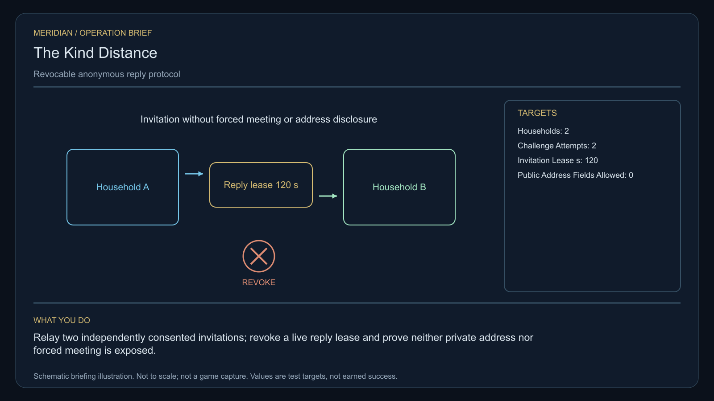

# C31 · The Kind Distance

[Illustrated story](../../INTENDED-GAME-STORY-WALKTHROUGH.md#the-kind-distance) · [Mission walkthrough checklist](../README.md)

Design walkthrough complete against `19a177e66093716928947f7246e0b664e4a6ad07`. Opening supplier `ab4f77353c47f623352a9df0a006a0e4dd5186c4` and source-only integration `dd11c98db7b10968eca1ff56c6793c8868ffa859` remain outside executable main. Main contains clue registration. Original commissioning, physical stages and native acceptance remain open. [Main clue and archive pin](https://github.com/stephenlclarke/l337/blob/19a177e66093716928947f7246e0b664e4a6ad07/Sources/L337Core/NativeCharterArchiveRegistryApproval.swift#L1302)

## Offer and motivation

Dispatcher Neris Sol commissions Rowan at Ravgakon's living main orbital in Galaxy 7 after a genuine ordinary purchase or sale. Require actual arrival, writable save and confirmation. No rank or prior campaign gate. Collect the original finite one-tonne passive receiver separately at Ravgakon with one tonne free. **Safe Passage** is the finished paid grouping. The independent free core inquiry remains available.

Two separated households want a way to speak without disclosing their new addresses. A broker proposes publishing both. Sol treats silence as absence of permission. Coordinator Sera Dain wants consented messages to pass without their source addresses following. The player validates two real anonymous reply paths and a scoped revocation. The households keep control over replies and meetings under either settlement.

## Route and fit

| Galaxy 7 route | Distance and service |
| --- | --- |
| Ravgakon G07-S046 → Rakdek G07-S252 | 3.161 LY. Collect the original receiver before reading three relays. |
| Rakdek → Ravvaesh G07-S235 | 2.007 LY. Observe the relays before both actual challenge exchanges. |
| Ravvaesh ↔ Zoraresh G07-S202 | 6.044 LY each way for the player's hearing visit and return for branch proof. |
| Ravvaesh → Ravgakon | 3.468 LY. Return the original receiver. |

All player jumps fit nominal 7 LY reach. On a full 7 LY tank at Ravgakon, refuel at Ravvaesh, Zoraresh and Ravvaesh again. A Rakdek → Zoraresh tender departure is a candidate 7.060 LY if approved. For a 7 LY jump limit use Ravgakon, 3.161 + 4.549 LY with real refuelling on a 7 LY tank. Publish only the custodian's authorized transit, independently of household addresses. [World catalogue](https://github.com/stephenlclarke/l337/blob/19a177e66093716928947f7246e0b664e4a6ad07/Sources/L337Core/Resources/OriginalWorlds/catalogue.json), [Reach and fuel](https://github.com/stephenlclarke/l337/blob/19a177e66093716928947f7246e0b664e4a6ad07/Sources/L337Core/FuelStorage.swift#L8), [Native arrival](https://github.com/stephenlclarke/l337/blob/19a177e66093716928947f7246e0b664e4a6ad07/Sources/L337Core/NativeStationServices.swift#L135)

The player reserves 1 t for the original receiver and needs zero passenger places. The source-owned **SH061 Saiga** carries two native operators and one mandate-bound custodian in one powered four-place Standard Cabin, with finite fuel. Its design has 84 t hold, 22 equipment units, 9 LY hull jump and a 13 LY tank. The cabin uses 5 t and one equipment unit. The custodian travels without either household. SH001 Mule has two operators, 76 t nominal hold and 9 LY hull reach, without an issued story role. Qualify the actual tender fit and protected hearing berth. The reviewed profile sets `accompanimentRequired: false`. The independent tender may depart after survey and consent while Rowan tests the relay. Actual living receiving and mandate still gate the choice. [Mule design](https://github.com/stephenlclarke/l337/blob/19a177e66093716928947f7246e0b664e4a6ad07/docs/fleet-design-v2/ships/SH001.toml), [Saiga design](https://github.com/stephenlclarke/l337/blob/19a177e66093716928947f7246e0b664e4a6ad07/docs/fleet-design-v2/ships/SH061.toml), [Mule art](../../assets/ships/SH001.png), [Saiga art](../../assets/ships/SH061.png), [Historical escort wording](https://github.com/stephenlclarke/l337/blob/19a177e66093716928947f7246e0b664e4a6ad07/docs/COMPLETION-LEDGER.md#L2207)

## Play the nine stages

| Stage | Player action and qualifying evidence |
| --- | --- |
| 1. `accept` | Confirm Sol's reviewed commission at actual Ravgakon dock after the ordinary trade. |
| 2. `collect-reference` | Confirm the exact serialled one-tonne passive receiver under protected original custody. |
| 3. `survey` | At Rakdek observe three actual private reply relays with no household-address request. Use front view, unobstructed nearest mesh, 2° aim and 12 continuous seconds at 250–1,500 native surface units per target. |
| 4. `field-work` | At Ravvaesh run two distinct actual consented challenge/reply exchanges through the original passive receiver. Revoke one live test invitation. Prove actual refusal of the revoked invitation and continued success of the unrelated consented reply. Keep **zero public address fields**. Use 50–150 m, at most 1 m/s and 2° aim plus the 20-second minimum at actual physical interfaces. |
| 5. `independent-witness` | At Zoraresh verify the original independently travelling tender, actual living custodian and original mandate at the protected hearing berth. |
| 6. `choose-settlement` | At the actual hearing, with the arrived authorized delegates, choose **Use an anonymous shared reply relay** or **Issue individually revocable invitations**. Silence or Back selects nothing. |
| 7. `apply-settlement` | At Ravvaesh earn both branch proofs. For `plan-a`, prove each household can independently revoke its own consent and an actual authorized reply reaches its named private receiver. For `plan-b`, independently issue both invitations and prove that each expires after **120 simulation seconds** and its later replay refuses. |
| 8. `return-and-audit` | Return the original passive receiver at Ravgakon. Audit distinct exchanges, actual independent reception and both selected proofs under their privacy scope. |
| 9. `close-case` | Preserve the approved contact policy and original private records. Commit 5,600 CR via `l337.kind-distance/final-payment` and `l337.unwritten-route/clue/kind-distance-trace` once. The dormant relay has a curved reply older than every household key. |

The project binds every test invitation and challenge to its own origin, recipient, consent revision and lease start. A revocation invalidates only the relevant invitation. Expiry is simulated from each actual issuance. A successful reply has no bearing on consent to meet. Remove address-bearing metadata from public journals, maps, notices and success receipts. A test cannot pass through an inferred silence, coerced response, public address or replay of unrelated consent.

[Editable operation drawing](../../assets/missions/revisions/kind-distance-operation.svg)

## Failure, cold Continue and owners

No overall deadline. Pause freezes active simulation. Preserve the exact loan, private endpoint scopes, challenge IDs, accepted replies, independent per-invitation clock and revocation, actual custodian reception, branch and receipt state. Reset unfinished survey dwell. On load an expired or revoked invitation cannot become active. Exercise saves before reply, during both leases, after revocation and expiry, during receiving and after terminal. Actual declined consent and losses remain recorded. The free core inquiry can always award only the missing clue when the original is unavailable.

- **G4 physical requirement.** Pin three actual relay surfaces and two distinct physical challenge interfaces, lawful endpoints and an independent loaded Saiga with real Zoraresh protected receiving.
- **MC1 mission requirement, via Root and G1.** Rebind original custody and implement two source-bound genuine exchanges, revoked/expired refusal and surviving unrelated reply. Require independent actual receiving, restricted projections, both selected proofs and one terminal.
- **Root source decisions.** Issue actual loan, protected physical endpoints and real household permissions, permitted reply paths, test invitations and withdrawal authority. Issue the custodian's private transit and hearing receiver, and both branch signers.

Historical story and data are `docs/meridian/missions/C31.md` and `docs/meridian/missions/definitions/kind-distance.json` at `c70110b292077588a0855fb48127adfb1b611c9d`, definition SHA-256 `c7196b310ab1f71ccc5e955e47a5f5723eccc2b5ef147e9490a18dc2f66826c6`. The reviewed `docs/meridian/missions/gameplay/campaign-profiles.json#/profiles/kind-distance` has SHA-256 `37fe5011de7bcc5874f6e6eef42151a712be4f69a3b9b23cd18cf660bd0dff0a`.
