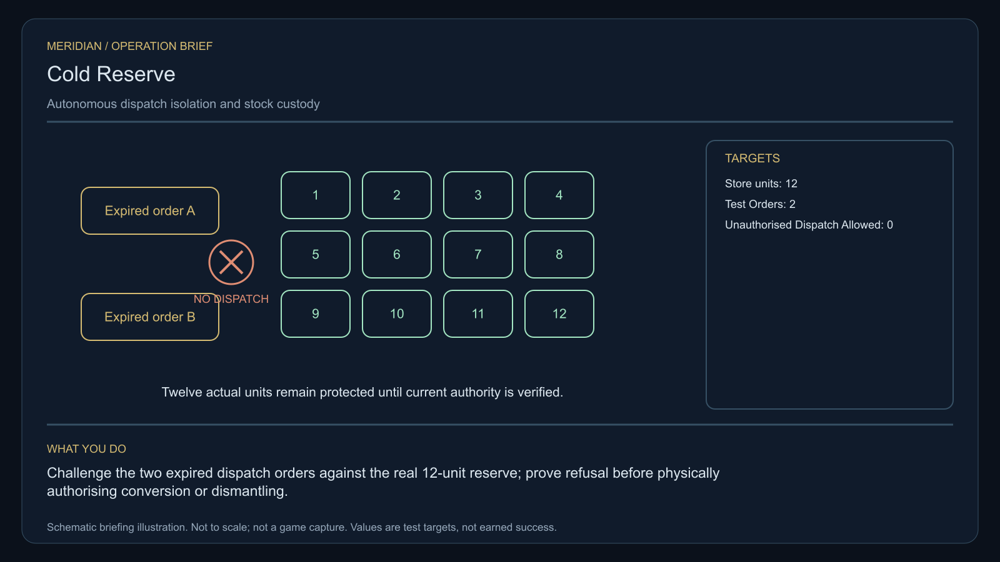

# C32 · Cold Reserve

[Illustrated story](../../INTENDED-GAME-STORY-WALKTHROUGH.md#cold-reserve) · [Mission walkthrough checklist](../README.md)

Design walkthrough complete against `19a177e66093716928947f7246e0b664e4a6ad07`. Opening supplier `368605ad3077a9f1e8bcf93ce74a17c4d779d757` and source-only integration `9cdef85a501695518a4fbc25635cc2a5c13dbc53` remain outside executable main. Main contains clue registration. Original commissioning, physical stages and native acceptance remain open. [Main clue and archive pin](https://github.com/stephenlclarke/l337/blob/19a177e66093716928947f7246e0b664e4a6ad07/Sources/L337Core/NativeCharterArchiveRegistryApproval.swift#L752)

## Offer and motivation

Marshal Nera Voss commissions Rowan at Fanerin's living main orbital in Galaxy 8 after one genuine ordinary purchase or sale. Require actual arrival, a writable save and Confirm. No rank or prior case gate. Collect the original finite one-tonne dispatch reference separately from Voss at Fanerin with one tonne free. **The Hearth Compact** is the finished paid grouping. The independent no-fee core inquiry remains available.

A decommissioned defence reserve is still spending resources on automatic cargo movements ordered under expired authority. Salvage Chief Ruan Pell needs the physical stock counted before new dispatch. Voss needs both real couplers isolated and the obsolete orders proved inert. Rowan preserves actual custody, receives a living inspection crew and verifies a capped civilian conversion or a controlled dismantling and return to store.

## Route and fit

| Galaxy 8 route | Distance and service |
| --- | --- |
| Fanerin G08-S084 → Allaeth G08-S062 | 1.883 LY. Collect the original reference before observing the three stores. |
| Allaeth → Illaven G08-S112 | 2.352 LY. Reconcile original stock before isolating both couplers. |
| Illaven ↔ Saleir G08-S225 | 4.215 LY each way for the player's visit to the inspection receiver and return for branch proof. |
| Illaven → Fanerin | 2.106 LY. Return the original reference. |

Each jump fits nominal 7 LY reach. On a full 7 LY tank at Fanerin, refuel at Illaven before Saleir and at Saleir before return. Allaeth → Saleir measures 1.927 LY if the inspection tender is issued that independent route. Its departure, berth and authority to inspect the real Illaven path are separate from its navigation fit. [World catalogue](https://github.com/stephenlclarke/l337/blob/19a177e66093716928947f7246e0b664e4a6ad07/Sources/L337Core/Resources/OriginalWorlds/catalogue.json), [Reach and fuel](https://github.com/stephenlclarke/l337/blob/19a177e66093716928947f7246e0b664e4a6ad07/Sources/L337Core/FuelStorage.swift#L8), [Native arrival](https://github.com/stephenlclarke/l337/blob/19a177e66093716928947f7246e0b664e4a6ad07/Sources/L337Core/NativeStationServices.swift#L135)

The player carries the 1 t reference and needs zero passenger places. Twelve stock units remain source-owned. Their physical mass, handling and actual carrier fit need issuance before any movement. SH001 Mule has two operators, 76 t nominal hold and 9 LY hull reach, with no exact native role. The inspection tender is an actual **SH061 Saiga**, two operators, one mandate-bound delegate, one powered four-place Standard Cabin and finite fuel. The design has 84 t hold, 22 equipment units, 9 LY hull jump and a 13 LY tank. The cabin uses 5 t and one equipment unit. Qualify its loaded geometry and Saleir berth separately from reserve freight. [Mule design](https://github.com/stephenlclarke/l337/blob/19a177e66093716928947f7246e0b664e4a6ad07/docs/fleet-design-v2/ships/SH001.toml), [Saiga design](https://github.com/stephenlclarke/l337/blob/19a177e66093716928947f7246e0b664e4a6ad07/docs/fleet-design-v2/ships/SH061.toml), [Mule art](../../assets/ships/SH001.png), [Saiga art](../../assets/ships/SH061.png)

The reviewed profile sets `accompanimentRequired: false`. The tender travels independently after survey and source permission while Rowan isolates the dispatch hardware. The older escort wording does not gate the player. The inspectors must actually observe the isolated dispatch path, which can be through an issued live inspection endpoint if they have already reached Saleir. A dock alone or an empty cargo list cannot certify that path. [Historical ledger wording](https://github.com/stephenlclarke/l337/blob/19a177e66093716928947f7246e0b664e4a6ad07/docs/COMPLETION-LEDGER.md#L2208)

## Play the nine stages

| Stage | Player action and qualifying evidence |
| --- | --- |
| 1. `accept` | Confirm Voss's reviewed commission at the actual Fanerin orbital after an ordinary trade. |
| 2. `collect-reference` | Confirm the exact serialled original one-tonne dispatch reference under protected custody. |
| 3. `survey` | At Allaeth read three actual ledgers and reconcile **12 finite units** with physical stores, actual receivers and recorded losses. Use front view, nearest unobstructed mesh, 2° aim and 12 continuous seconds at 250–1,500 native surface units per target. |
| 4. `field-work` | At Illaven physically isolate the two actual external dispatch couplers. Submit both obsolete test orders and prove neither launches cargo. Retain real stock and refusal receipts. Qualify the 20-second work minimum at 50–150 m, at most 1 m/s and at most 2° aim. Zero unauthorized dispatch is allowed. |
| 5. `independent-witness` | At Saleir verify the same independent tender, actual living inspectors, protected berth and mandate. Bind their observation to the actual tested dispatch path. |
| 6. `choose-settlement` | At the actual receiver with arrived authorized delegates, choose **Convert the finite reserve to civilian emergency use** or **Dismantle and reclaim the reserve**. |
| 7. `apply-settlement` | At Illaven require both selected proofs. For `plan-a`, issue a new signed capped civilian authorization and prove physical receipt of its declared real stock within quota. For `plan-b`, keep both couplers physically isolated and physically reclaim the authorized material to a real receiving store. Account for loss separately. |
| 8. `return-and-audit` | Return the exact original reference at Fanerin. Audit both refusals, conserved custody, actual inspection and both selected proofs. |
| 9. `close-case` | Preserve the verified disposition and original records. Commit 8,800 CR via `l337.cold-reserve/final-payment` and `l337.unwritten-route/clue/cold-reserve-trace` once. An expired order describes a receiving volume that never existed. |

Account for each stock unit or tracked material lineage exactly once, including genuine loss. The accepted old-order test changes neither stock nor authority. Register cross-system provenance between Allaeth's actual stores and Illaven's dispatch equipment. The project uses a separate lawful civilian channel or source-controlled dismantling service. Either route leaves the obsolete authority disabled. The quota, type and mass of each stock unit, actual custody and approved inspection path remain source decisions. This protected operation does not require player EMP, seizure, beam or acquisition. An unrelated wreck cannot supply reclaimed material.

[Editable operation drawing](../../assets/missions/revisions/cold-reserve-operation.svg)

## Failure, cold Continue and owners

No overall deadline. Pause freezes active simulation. Preserve exact loan, actual stock and lineage, coupler state, queued and refused order identities, old and new authority, inspection and actual receiving, selected branch and proof. Reset unfinished survey dwell. Continue cannot relaunch an obsolete order, replenish lost units or replay conversion, receipt or fee. Test load after one isolation, after each refusal, during authorized transfer, at receiving and after terminal. Retain genuine loss and refusal. A separate no-fee core inquiry always earns only the missing clue when the original is unavailable.

- **G4 physical requirement.** Pin three actual stores, two coupler interfaces, 12 finite stock units and native dispatch/dismantling surfaces, real branch receiving, and actual loaded Saiga and Saleir berth.
- **MC1 mission requirement, via Root and G1.** Rebind the frozen opening and original custody. Require physical isolation, both authentic old-order refusals, independent stock lineage and inspection, capped receipt or actual conserved material receipt and one terminal. Exercise stale queued orders, partial dispatch, actual losses and cold-load replay.
- **Root source decisions.** Issue loan, store and stock owners, exact cross-system topology, coupler and obsolete-order identities, actual inspectors and approved observation route, finite civilian quota or lawful dismantling and actual receiving.

Historical story and data are `docs/meridian/missions/C32.md` and `docs/meridian/missions/definitions/cold-reserve.json` at `c70110b292077588a0855fb48127adfb1b611c9d`, definition SHA-256 `7ef144813ca785c44fd0a07a4c94e0a9f529fef90c2c489b5f5f2b69b04d3aa8`. The reviewed `docs/meridian/missions/gameplay/campaign-profiles.json#/profiles/cold-reserve` has SHA-256 `37fe5011de7bcc5874f6e6eef42151a712be4f69a3b9b23cd18cf660bd0dff0a`.
