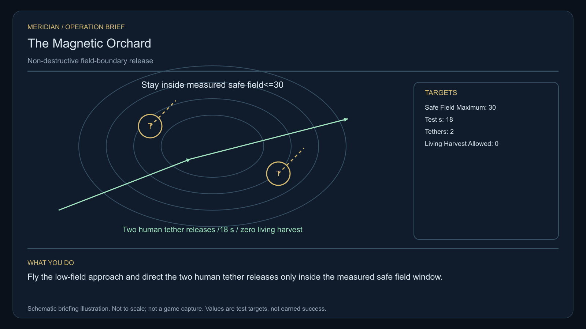

# C33 · The Magnetic Orchard

[Illustrated story](../../INTENDED-GAME-STORY-WALKTHROUGH.md#the-magnetic-orchard) · [Mission walkthrough checklist](../README.md)

Design walkthrough complete against `19a177e66093716928947f7246e0b664e4a6ad07`. Opening supplier `cc384db6049d424bbc0e04968999f0f4fcfcbe8c` and source-only integration `c9a66637a77143c0e66ec204e80a3fb8b88f2537` remain outside executable main. Main contains clue registration. Original commissioning, physical stages and native acceptance remain open. [Main clue and archive pin](https://github.com/stephenlclarke/l337/blob/19a177e66093716928947f7246e0b664e4a6ad07/Sources/L337Core/NativeCharterArchiveRegistryApproval.swift#L1368)

## Offer and motivation

Agent Mara Vale commissions Rowan at Laris's living main orbital in Galaxy 1 after one ordinary purchase or sale. Require actual arrival, a writable save and Confirm. No score or prior mission gate. Collect the finite original one-tonne isolated field reference separately at Laris with one tonne free. **Voices in the Static** is the finished paid grouping. The independent no-fee core inquiry remains available.

A Larvaal structure grows living magnetic fronds from charged dust. Human tethers disturb the growth, and some operators want to harvest it as weapon stock. Vale protects the structure and actual counterpart consent. Physicist Anja Kest requires safe release and custody of the human equipment. The player follows a low-field path, removes the two consented tethers without taking anything alive and helps choose separate boundaries or a jointly observed reserve.

## Route and fit

| Galaxy 1 route | Distance and service |
| --- | --- |
| Laris G01-S120 → Nevedor G01-S115 | 2.663 LY. Collect the isolated reference before reading three actual boundaries. |
| Nevedor → Nesel G01-S161 | 4.005 LY. Compare the boundary readings before the two actual releases. |
| Nesel ↔ Erron G01-S089 | 4.500 LY each way for the player's visit to the cradle and return for branch proof. |
| Nesel → Laris | 2.894 LY. Return the exact original reference. |

All direct jumps fit nominal 7 LY reach. On a full 7 LY tank at Laris, refuel at Nesel, Erron and Nesel on the return. Nevedor → Erron measures 5.610 LY but cannot by itself prove the measured low-field pass. The tender needs an authorized real route through the measured gap, independent of the player's jumps. [World catalogue](https://github.com/stephenlclarke/l337/blob/19a177e66093716928947f7246e0b664e4a6ad07/Sources/L337Core/Resources/OriginalWorlds/catalogue.json), [Reach and fuel](https://github.com/stephenlclarke/l337/blob/19a177e66093716928947f7246e0b664e4a6ad07/Sources/L337Core/FuelStorage.swift#L8), [Native arrival](https://github.com/stephenlclarke/l337/blob/19a177e66093716928947f7246e0b664e4a6ad07/Sources/L337Core/NativeStationServices.swift#L135)

The player reserves 1 t for the field reference and needs zero passenger places. Keep removed human tether mass in source custody. If actual carrier handling is needed, qualify measured mass, attachment and power separately. SH001 Mule has two operators, 76 t nominal hold and 9 LY hull reach, with no exact issued role. The independent observation tender is an actual **SH061 Saiga**, two native operators, one mandate-bound delegate, one powered four-place Standard Cabin and finite fuel. The design has 84 t hold, 22 equipment units, 9 LY jump reach and a 13 LY tank. The cabin uses 5 t and one equipment unit. Qualify loaded fit, real safe exposure and Erron cradle geometry. [Mule design](https://github.com/stephenlclarke/l337/blob/19a177e66093716928947f7246e0b664e4a6ad07/docs/fleet-design-v2/ships/SH001.toml), [Saiga design](https://github.com/stephenlclarke/l337/blob/19a177e66093716928947f7246e0b664e4a6ad07/docs/fleet-design-v2/ships/SH061.toml), [Mule art](../../assets/ships/SH001.png), [Saiga art](../../assets/ships/SH061.png)

The reviewed profile sets `accompanimentRequired: false`. The tender may depart independently after survey and consent while Rowan works. It must wait outside the protected area if the actual measured passage is still unsafe. Require the same living party's actual pass and Erron receiving. The older escort wording does not gate the player. [Historical ledger wording](https://github.com/stephenlclarke/l337/blob/19a177e66093716928947f7246e0b664e4a6ad07/docs/COMPLETION-LEDGER.md#L2209)

## Play the nine stages

| Stage | Player action and qualifying evidence |
| --- | --- |
| 1. `accept` | Confirm Vale's commission at actual Laris dock after the genuine trade. |
| 2. `collect-reference` | Confirm exact original one-tonne instrument custody by serial at Laris. |
| 3. `survey` | At Nevedor observe three actual boundaries from the safe side of the marked **30-unit** exposure contour. Use front view, nearest unobstructed mesh, 2° aim and 12 continuous seconds at 250–1,500 native surface units for each distinct target. |
| 4. `field-work` | At Nesel fly the actual low-field approach. Release each of the two specifically consented human tethers with the isolated reference only where measured field is **at most 30**. Preserve their real mass and custody, then observe a clear protected contour for **18 continuous simulation seconds** with **zero living harvest**. At actual interfaces use 50–150 m, at most 1 m/s and 2° aim. Hovering earns no release proof. |
| 5. `independent-witness` | At Erron verify the same independently travelling neutral tender, actual safe measured passage, native living receiving and original mandate. |
| 6. `choose-settlement` | At the actual protected cradle with arrived authorized delegates choose **Protect independent human and Larvaal growth boundaries** or **Establish a jointly observed growth reserve**. |
| 7. `apply-settlement` | At Nesel obtain both selected proofs. For `plan-a`, verify distinct actual human and Larvaal exclusion envelopes and both registered custodians' replies. For `plan-b`, verify both consents and an actual monitor refusal of an out-of-bounds survey tether. |
| 8. `return-and-audit` | Return the exact reference at Laris. Audit measured exposure, conserved equipment, living fronds, actual witness reception and the selected proof pair. |
| 9. `close-case` | Preserve the verified boundary agreement and original records. Commit 9,200 CR via `l337.magnetic-orchard/final-payment` and `l337.unwritten-route/clue/magnetic-orchard-trace` once. The clue shows a curved root around a quiet centre absent from the visible structure. |

The 30-unit contour and 18-second window are project calibration targets. Real field state, moving boundaries and a swept path must be observable. Root and G4 need to link the Nevedor observations, Nesel work and actual safe tender pass by source identity. Revoke or hold the operation when the field leaves the qualified range. Human tether recovery uses actual owner consent and custody. Fronds are protected living matter. EMP, tractor, cutter, extraction or sale cannot supply this case's proof.

[Editable operation drawing](../../assets/missions/revisions/magnetic-orchard-operation.svg)

## Failure, cold Continue and owners

No overall deadline. Pause freezes active simulation. Save exact loan and scope, measured field and protected contour, actual tether attachment and custody, continuous window, real living condition, tender path and receiving, branch and proof receipts. Cold Continue resets unfinished survey dwell. Resume the same valid field window only while actual native bounds still hold. Test load during each release, measured window, tender hold or passage, branch and terminal. Preserve real damage or loss. The independent free core inquiry can always award only the missing clue when the original case is unavailable.

- **G4 physical requirement.** Pin the three actual measurement surfaces, living structure and time-dependent contour, two exact human tethers and retention path, safe routes and the loaded tender/Erron cradle.
- **MC1 mission requirement, via Root and G1.** Rebind original custody and implement actual low-field measurement, lawful two-tether release, conserved custody and 18-second native check. Require independent actual safe passing and receiving, both selected branch proofs and one terminal. Refuse unsafe exposure, harvesting and borrowed consent.
- **Root source decisions.** Issue actual field sources and calibrated units, living and human custodians and scopes, tether identities, weights and receiving, actual hold/safe passage and Erron authority, and separate exclusion or joint monitoring permissions.

Historical story and data are `docs/meridian/missions/C33.md` and `docs/meridian/missions/definitions/magnetic-orchard.json` at `c70110b292077588a0855fb48127adfb1b611c9d`, definition SHA-256 `935ff7abd683c06d625b7331e233e5b45a6493423282f31ed8da205b0c71ce3c`. The reviewed `docs/meridian/missions/gameplay/campaign-profiles.json#/profiles/magnetic-orchard` has SHA-256 `37fe5011de7bcc5874f6e6eef42151a712be4f69a3b9b23cd18cf660bd0dff0a`.
