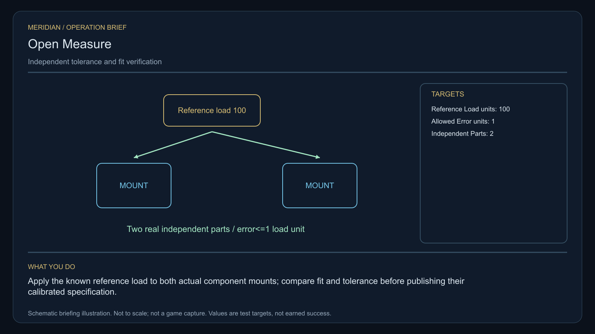

# C34 · Open Measure

[Illustrated story](../../INTENDED-GAME-STORY-WALKTHROUGH.md#open-measure) · [Mission walkthrough checklist](../README.md)

Design walkthrough complete against `19a177e66093716928947f7246e0b664e4a6ad07`. Opening supplier `e5aeee8015349374aa81204259afeeda95b59bef` and source-only integration `ca0a1edd8a6f888d81d8fd610df71def1531d4a5` remain outside executable main. Main contains clue registration. Original commissioning, physical stages and native acceptance remain open. [Main clue and archive pin](https://github.com/stephenlclarke/l337/blob/19a177e66093716928947f7246e0b664e4a6ad07/Sources/L337Core/NativeCharterArchiveRegistryApproval.swift#L1456)

## Offer and motivation

Engineer Cato Lerr commissions Rowan at Valtor's living main orbital in Galaxy 2 after a genuine ordinary trade. Require actual arrival, a writable save and confirmation. No rank or prior campaign gate. Separately collect the exact one-tonne original tolerance programmer at Valtor with one tonne free. **Beyond the Map** is the finished paid grouping. The independent no-fee core inquiry remains available.

Three workshops use incompatible reference loads and cannot exchange replacement parts. A supplier profits from treating each disagreement as a proprietary design. Lerr wants a physical standard and Physicist Anja Kest wants the actual measured fit recorded before looking at a label. Rowan tests two independently made parts and verifies a neutral technician's separate instrument and signature. The choice opens the standard publicly or establishes reciprocal bounded service and rejection rights.

## Route and fit

| Galaxy 2 route | Distance and service |
| --- | --- |
| Valtor G02-S157 → Vorvakar G02-S225 | 2.766 LY. Collect the original programmer before measuring three references. |
| Vorvakar → Voransen G02-S041 | 6.398 LY. Observe the signed loads before both real component tests. |
| Voransen ↔ Morkador G02-S077 | 5.449 LY each way for the player's visit to the technician and return for branch proof. |
| Voransen → Valtor | 4.811 LY. Return the exact original programmer. |

All direct jumps fit nominal 7 LY reach. Each consecutive pair exceeds a 7 LY tank. Arrange real refuelling at Vorvakar, Voransen, Morkador and Voransen on the return. Vorvakar → Morkador measures 3.781 LY if the source authorizes the independent tender to depart there. [World catalogue](https://github.com/stephenlclarke/l337/blob/19a177e66093716928947f7246e0b664e4a6ad07/Sources/L337Core/Resources/OriginalWorlds/catalogue.json), [Reach and fuel](https://github.com/stephenlclarke/l337/blob/19a177e66093716928947f7246e0b664e4a6ad07/Sources/L337Core/FuelStorage.swift#L8), [Native arrival](https://github.com/stephenlclarke/l337/blob/19a177e66093716928947f7246e0b664e4a6ad07/Sources/L337Core/NativeStationServices.swift#L135)

The player carries 1 t and needs zero passenger places. Both test parts and mounts remain source-owned. Any additional transport needs actual weight and handling qualification. SH001 Mule has two operators, 76 t nominal hold and 9 LY hull reach, with no exact issued role. The independent technician travels on an actual **SH061 Saiga**, with two operators, one mandate-bound delegate in a powered four-place Standard Cabin and finite fuel. The design has 84 t hold, 22 equipment units, 9 LY reach and a 13 LY tank. The cabin uses 5 t and one equipment unit. Include the technician's separate calibrated instrument in the actual cargo, power and berth check. [Mule design](https://github.com/stephenlclarke/l337/blob/19a177e66093716928947f7246e0b664e4a6ad07/docs/fleet-design-v2/ships/SH001.toml), [Saiga design](https://github.com/stephenlclarke/l337/blob/19a177e66093716928947f7246e0b664e4a6ad07/docs/fleet-design-v2/ships/SH061.toml), [Mule art](../../assets/ships/SH001.png), [Saiga art](../../assets/ships/SH061.png)

The reviewed profile sets `accompanimentRequired: false`. The neutral technician travels independently after survey and source permission while Rowan runs the fits. The older escort wording does not gate progress. Actual living Morkador receiving, separate instrument and signed mandate are necessary before choice. [Historical ledger wording](https://github.com/stephenlclarke/l337/blob/19a177e66093716928947f7246e0b664e4a6ad07/docs/COMPLETION-LEDGER.md#L2210)

## Play the nine stages

| Stage | Player action and qualifying evidence |
| --- | --- |
| 1. `accept` | Confirm Lerr's reviewed offer at actual Valtor dock after one ordinary trade. |
| 2. `collect-reference` | Confirm the exact serialled one-tonne original tolerance programmer under protected custody. |
| 3. `survey` | At Vorvakar compare three signed workshop loads against actual external fittings. Use front view, nearest unobstructed mesh, 2° aim and 12 continuous seconds at 250–1,500 native surface units per target. |
| 4. `field-work` | At Voransen fit both independently manufactured parts to actual mounts and use the original programmer. Apply **100 reference load units** and require **at most 1 load unit error** for each, with actual compatible fit. Keep identities and provenance separate. The physical work requires 50–150 m, at most 1 m/s, 2° aim and the 20-second qualified minimum. Matching names or a common vendor certificate cannot qualify. |
| 5. `independent-witness` | At Morkador verify the same independent tender, living technician, actual separate instrument and signing authority, native receiving and mandate. |
| 6. `choose-settlement` | At the common test berth with arrived authorized delegates choose **Publish an open physical measurement standard** or **Establish a witnessed interoperable calibration service**. |
| 7. `apply-settlement` | At Voransen require both selected proofs. For `plan-a`, verify an independent manufactured part's actual fit to the published standard and a signed measurement from its manufacturer. For `plan-b`, exercise each contracting workshop's independent out-of-tolerance refusal and verify both actual acceptances of the reciprocal bounded service. |
| 8. `return-and-audit` | Return the original programmer at Valtor. Audit all references, real load and fit results, the independent witness and both selected proofs. |
| 9. `close-case` | Preserve the verified standard or contract and original records. Commit 7,900 CR via `l337.open-measure/final-payment` and `l337.unwritten-route/clue/open-measure-trace` once. The clue is the inward response of a genuinely empty cradle. |

The three observed workshops and the two independently manufactured parts are separate requirements. The reciprocal ending needs both actual parties named in that contract. Root must issue how they relate to the three surveyed workshops. Use a measured, case-scoped refusal at each interface, without requiring a harmful loaded installation. Project load units need a physically calibrated native source. Signed limits, safe operating loads, fitting geometry and which independently made part verifies the published reference remain source decisions.

[Editable operation drawing](../../assets/missions/revisions/open-measure-operation.svg)

## Failure, cold Continue and owners

No overall deadline. Pause freezes active simulation. Preserve exact custody, part and maker identity, actual reference/load/fit results and limits, qualified work, actual independent receiving and selected proofs. Reset unfinished survey dwell. Resume an active load test only against the same qualified fit. Test Continue between loads, after a failed tolerance, during witness receiving, between both refusal tests and after terminal. Genuine losses, refusals and consent changes remain recorded. The no-fee core inquiry can always earn only the same missing clue if the original becomes unavailable.

- **G4 physical requirement.** Pin three actual reference load fixtures, two independent parts and mount surfaces, real native calibration and safe over-limit refusal, loaded Saiga and actual Morkador receiving.
- **MC1 mission requirement, via Root and G1.** Rebind exact original custody. Enforce both actual independent fit/load tests, separate live technician and signed source, and either real independent publication proof or both reciprocal refusal and consent proofs. Commit one terminal and test duplicate parts, vendor impersonation, wrong load and save replay.
- **Root source decisions.** Issue actual programmer, three makers and references, both independent parts/mounts and thresholds, separate technician instrument and signer, receiver and actual publication or reciprocal contract authorities.

Historical story and data are `docs/meridian/missions/C34.md` and `docs/meridian/missions/definitions/open-measure.json` at `c70110b292077588a0855fb48127adfb1b611c9d`, definition SHA-256 `9c712197b46f25e90514b3b6c0913dcbdf9d062123ffc99547085577845ee6d6`. The reviewed `docs/meridian/missions/gameplay/campaign-profiles.json#/profiles/open-measure` has SHA-256 `37fe5011de7bcc5874f6e6eef42151a712be4f69a3b9b23cd18cf660bd0dff0a`.
