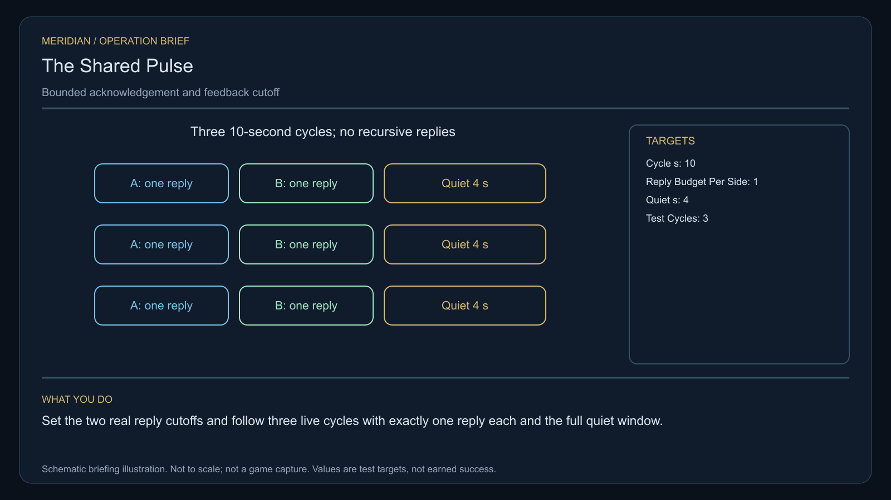

# C35 · The Shared Pulse

[Illustrated story](../../INTENDED-GAME-STORY-WALKTHROUGH.md#the-shared-pulse) · [Mission walkthrough checklist](../README.md)

Design walkthrough complete against `19a177e66093716928947f7246e0b664e4a6ad07`. Opening supplier `f0ce47b0f7ff1818a899e9983e333493c7c7402b` and source-only integration `81b344ec566333f3d41efc6d56dfa0b181a30b6f` remain outside executable main. Main contains clue registration. Original commissioning, physical stages and native acceptance remain open. [Main clue and archive pin](https://github.com/stephenlclarke/l337/blob/19a177e66093716928947f7246e0b664e4a6ad07/Sources/L337Core/NativeCharterArchiveRegistryApproval.swift#L1610)

## Offer and motivation

Agent Mara Vale commissions Rowan at the living Elaith main orbital in Galaxy 3 after a genuine ordinary trade. Require actual arrival, a writable save and confirmation. No rank or prior mission gate. Take the exact original one-tonne repair reference at Elaith in a separate confirmed loan with one tonne free. **Voices in the Static** is the finished paid grouping. The independent no-fee core inquiry remains available.

A human beacon and a Larvaal maintenance organ accelerate each other's automatic acknowledgement. Captain Tamsin Holt asks Rowan to listen first and keep ordinary collision signalling available. Vale requires consent and keeps the living organ with its actual custodian. Unlike C22's migration schedule, C35 is a feedback repair. The player limits recursive acknowledgements while keeping genuine custody and safety signals usable.

## Route and fit

| Galaxy 3 route | Distance and service |
| --- | --- |
| Elaith G03-S196 → Siaseven G03-S032 | 2.570 LY. Collect the original reference before the passive survey. |
| Siaseven → Elasil G03-S181 | 1.811 LY. Observe three points before repairing both couplers. |
| Elasil ↔ Varioria G03-S124 | 6.552 LY each way for the player's visit to the verification berth and return for branch proof. |
| Elasil → Elaith | 3.380 LY. Return the original reference. |

All direct jumps fit nominal 7 LY reach. On a full 7 LY tank at Elaith, refuel at Elasil, Varioria and Elasil on return. Siaseven → Varioria measures 6.006 LY if issued as the neutral tender's independent route. Its authorized departure, signal environment, fuel and actual berth need separate proof. [World catalogue](https://github.com/stephenlclarke/l337/blob/19a177e66093716928947f7246e0b664e4a6ad07/Sources/L337Core/Resources/OriginalWorlds/catalogue.json), [Reach and fuel](https://github.com/stephenlclarke/l337/blob/19a177e66093716928947f7246e0b664e4a6ad07/Sources/L337Core/FuelStorage.swift#L8), [Native arrival](https://github.com/stephenlclarke/l337/blob/19a177e66093716928947f7246e0b664e4a6ad07/Sources/L337Core/NativeStationServices.swift#L135)

The player carries 1 t and needs zero passenger places. The original reference must couple to the actual two devices under source permission. SH001 Mule is listed with two operators, 76 t nominal hold and 9 LY reach, without an exact role. The neutral relay tender is an actual **SH061 Saiga**, two operators, one mandate-bound delegate, one powered four-place Standard Cabin and finite fuel. Its design has 84 t hold, 22 equipment units, 9 LY hull jump and a 13 LY tank. The cabin costs 5 t and one equipment unit. Qualify actual loaded geometry, ordinary collision signal reception and protected Varioria berth. No hull registration identifies the living organ or the two consent authorities. [Mule design](https://github.com/stephenlclarke/l337/blob/19a177e66093716928947f7246e0b664e4a6ad07/docs/fleet-design-v2/ships/SH001.toml), [Saiga design](https://github.com/stephenlclarke/l337/blob/19a177e66093716928947f7246e0b664e4a6ad07/docs/fleet-design-v2/ships/SH061.toml), [Mule art](../../assets/ships/SH001.png), [Saiga art](../../assets/ships/SH061.png)

The reviewed profile sets `accompanimentRequired: false`. The neutral tender travels independently after survey and permission while Rowan tests the couplers. The earlier escort instruction does not gate progress. Protect its actual collision channel and require living Varioria receiving and the signed mandate. [Historical ledger wording](https://github.com/stephenlclarke/l337/blob/19a177e66093716928947f7246e0b664e4a6ad07/docs/COMPLETION-LEDGER.md#L2211)

## Play the nine stages

| Stage | Player action and qualifying evidence |
| --- | --- |
| 1. `accept` | Confirm Vale's reviewed commission at actual Elaith dock after the ordinary trade. |
| 2. `collect-reference` | Confirm the original one-tonne repair reference under its exact serial custody at Elaith. |
| 3. `survey` | At Siaseven observe three distinct actual points around the feedback loop without rebroadcasting. Use front view, unobstructed nearest mesh, 2° aim and 12 continuous seconds at 250–1,500 native surface units per target. |
| 4. `field-work` | At Elasil connect the original reference to both real handshake couplers and set each cutoff. Use 50–150 m clearance, at most 1 m/s and 2° aim and the 20-second qualified work minimum. Arm **three live 10-second cycles**. Each deliberate test must elicit one genuine reply from each side, allow no extra reply and retain **at least 4 continuous seconds of acknowledgement silence** in each cycle. Ordinary collision signalling stays available. |
| 5. `independent-witness` | At Varioria verify the actual independently travelling neutral tender, real living reception and the signed delegation. |
| 6. `choose-settlement` | At the actual protected receiver with arrived delegates choose **Separate human and Larvaal acknowledgement windows** or **Adopt a shared bounded handshake**. |
| 7. `apply-settlement` | At Elasil require both selected proofs. For `plan-a`, verify both independent reply budgets and the quiet interval while a genuine custody response remains available. For `plan-b`, obtain both actual custodians' acknowledgements, inject a source-authorized duplicate and prove it is rejected without reopening the actual feedback cutoff. |
| 8. `return-and-audit` | Return the exact original reference at Elaith. Audit both couplers, actual live cycles, living reception and both selected proofs. |
| 9. `close-case` | Preserve the verified policy and original traces. Commit 8,600 CR through `l337.shared-pulse/final-payment` and `l337.unwritten-route/clue/shared-pulse-trace` once. The passive trace curves before either known participant sends. |

The profile's one-reply limit is a cap. For the controlled positive trial the diagram expects one actual response on each side. Record a case-bound event identity and origin for each response. Proving only silence, suppressing a collision signal or feeding the duplicate back into the live loop cannot qualify. The project budgets need actual provider calibration and play balance. The organ remains living and in its custodian's care. Extraction, weapons and salvage cannot substitute for the repair.

[Editable operation drawing](../../assets/missions/revisions/shared-pulse-operation.svg)

## Failure, cold Continue and owners

No overall deadline. Pause freezes active simulation. Save exact loan, two sources, coupler settings, budget and simulation cycle, actual reply identities and cutoff, living organ custody, independent tender and actual receiving, branch and receipts. Reset unfinished survey dwell. Resume an active test only from the same valid configuration; replay cannot create a new reply or refill the active budget. Exercise Continue between couplers, inside quiet, after a duplicate test, at receiving and after terminal. The independent free core inquiry always earns only the same missing clue if the original becomes unavailable.

- **G4 physical requirement.** Pin three passive measurement sources, both actual couplers, human beacon and living Larvaal organ, independent collision channel and qualified Saiga/Varioria access.
- **MC1 mission requirement, via Root and G1.** Rebind original loan and custody. Implement two actual cutoff controls, saved bounded cycles and authentic independent replies, safe duplicate refusal and preserved safety signalling. Require actual independent receiving, branch proof pair and one terminal.
- **Root source decisions.** Issue actual organ, beacon and both custodians, test/reply and duplicate injection scope, collision channel, actual tender and route/receiver, and separate-window or shared-handshake authorities.

Historical story and data are `docs/meridian/missions/C35.md` and `docs/meridian/missions/definitions/shared-pulse.json` at `c70110b292077588a0855fb48127adfb1b611c9d`, definition SHA-256 `305f9ae59bd503a625704d9505e7114ccdb8d1094da10f2cc7edb2f4f9c168e7`. The reviewed `docs/meridian/missions/gameplay/campaign-profiles.json#/profiles/shared-pulse` has SHA-256 `37fe5011de7bcc5874f6e6eef42151a712be4f69a3b9b23cd18cf660bd0dff0a`.
