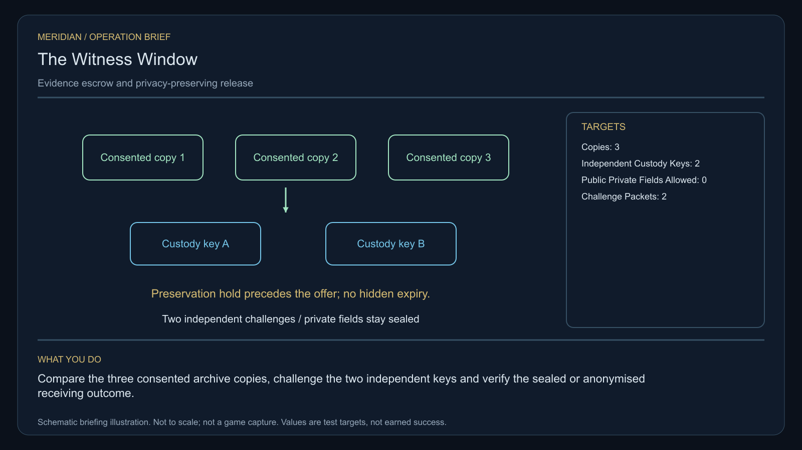

# C36 · The Witness Window

[Illustrated story](../../INTENDED-GAME-STORY-WALKTHROUGH.md#the-witness-window) · [Mission walkthrough checklist](../README.md)

Design walkthrough complete against `19a177e66093716928947f7246e0b664e4a6ad07`. Main contains clue registration, with no original mission pack or native opening located at that commit. Commissioning, physical stages and native acceptance remain open. [Main clue and archive pin](https://github.com/stephenlclarke/l337/blob/19a177e66093716928947f7246e0b664e4a6ad07/Sources/L337Core/NativeCharterArchiveRegistryApproval.swift#L2050)

## Offer and motivation

Coordinator Sera Dain commissions Rowan at Fonogom's living main orbital in Galaxy 4 after one genuine ordinary trade. Require actual docking, a writable save, **an existing witness-consented preservation-hold receipt** and confirmation. The hold must predate the offer. Acceptance cannot create or backdate it. No score, prior campaign or hidden expiry while preparing. Separately collect the original one-tonne witness verifier at Fonogom with one tonne free. **Safe Passage** is the finished paid grouping. The no-fee core inquiry remains independently available.

A shift worker witnessed an avoidable docking injury. Routine privacy expiry would have removed the original recording. A prior consented preservation order now protects it. Nia Toren keeps that evidence available while protecting the worker's location and control of later disclosure. Rowan checks three actual copies, tests independent custody keys and supports a sealed archive or a public finding with the unsafe docking rule corrected.

## Route and fit

| Galaxy 4 route | Distance and service |
| --- | --- |
| Fonogom G04-S234 → Anlanom G04-S181 | 2.911 LY. Verify the existing hold and collect the verifier before checking three copies. |
| Anlanom → Borbovar G04-S041 | 3.515 LY. Compare authorized copy receipts before both key challenges. |
| Borbovar ↔ Bogolan G04-S205 | 5.294 LY each way for the player's hearing and return for branch proof. |
| Borbovar → Fonogom | 3.055 LY. Return the original verifier. |

Each direct jump fits nominal 7 LY reach. With a full 7 LY tank at Fonogom, refuel at Borbovar, Bogolan and Borbovar on return. Anlanom → Bogolan measures 2.784 LY if approved for the independent tender. Its exact protected departure and receiving require issuance. Never publish the witness's private location as route evidence. [World catalogue](https://github.com/stephenlclarke/l337/blob/19a177e66093716928947f7246e0b664e4a6ad07/Sources/L337Core/Resources/OriginalWorlds/catalogue.json), [Reach and fuel](https://github.com/stephenlclarke/l337/blob/19a177e66093716928947f7246e0b664e4a6ad07/Sources/L337Core/FuelStorage.swift#L8), [Native arrival](https://github.com/stephenlclarke/l337/blob/19a177e66093716928947f7246e0b664e4a6ad07/Sources/L337Core/NativeStationServices.swift#L135)

The player reserves 1 t and needs zero passenger places. The actual **SH061 Saiga** tender needs two operators, one mandate-bound delegate, one powered four-place Standard Cabin and finite fuel. The design has 84 t hold, 22 equipment units, 9 LY jump reach and a 13 LY tank. The cabin costs 5 t and one equipment unit. Verify actual witness and delegate places if separate, signed consent and protected Bogolan approach. The reviewed profile sets `accompanimentRequired: false`. The original tender travels independently after survey and permission, while Rowan tests the keys. Actual living reception and mandate gate the choice. SH001 Mule is listed with two operators, 76 t nominal hold and 9 LY reach, without an exact role. [Mule design](https://github.com/stephenlclarke/l337/blob/19a177e66093716928947f7246e0b664e4a6ad07/docs/fleet-design-v2/ships/SH001.toml), [Saiga design](https://github.com/stephenlclarke/l337/blob/19a177e66093716928947f7246e0b664e4a6ad07/docs/fleet-design-v2/ships/SH061.toml), [Mule art](../../assets/ships/SH001.png), [Saiga art](../../assets/ships/SH061.png), [Historical escort wording](https://github.com/stephenlclarke/l337/blob/19a177e66093716928947f7246e0b664e4a6ad07/docs/COMPLETION-LEDGER.md#L2212)

## Play the nine stages

| Stage | Player action and qualifying evidence |
| --- | --- |
| 1. `accept` | At actual Fonogom dock, verify the prior signed preservation order against the original recording and current consent, then confirm after the ordinary trade. |
| 2. `collect-reference` | Confirm protected custody of the exact original one-tonne verifier at Fonogom. |
| 3. `survey` | At Anlanom read three distinct authorized copy receipts. Match preservation identity and keep the witness location private. Use front view, nearest unobstructed mesh, 2° aim and 12 continuous seconds per target at 250–1,500 native surface units. |
| 4. `field-work` | At Borbovar challenge both actual independent keys with the original verifier and replay both test packets. Prove refusal if either test key is revoked. Neither alone can reveal or erase testimony. The original stays unchanged. Use 50–150 m, at most 1 m/s, 2° aim and the 20-second qualified work minimum at both actual interfaces. No preview leaks private data. |
| 5. `independent-witness` | At Bogolan verify actual protected receiving of the same independently travelling tender, living witness party and arrived mandate. |
| 6. `choose-settlement` | At the actual hearing with arrived authorized delegates, choose **Keep testimony in an independently witnessed sealed archive** or **Publish an anonymised safety finding**. |
| 7. `apply-settlement` | At Borbovar require both selected proofs. For `plan-a`, both actual custody principals sign the sealed archive and the witness's revocation blocks future disclosure while preserving the inquiry record. For `plan-b`, verify a public output with **zero private fields** and use the corrected actual docking procedure to refuse the recorded unsafe allocation. |
| 8. `return-and-audit` | At Fonogom return the same verifier. Audit the original hold, three copies, both challenges, living reception and the selected proof pair. |
| 9. `close-case` | Preserve the verified custody or safety remedy and original records. Commit 8,100 CR via `l337.witness-window/final-payment` and `l337.unwritten-route/clue/witness-window-trace` once. The anomaly is an inward phase imprint between two authentic frames. |

Test revocation separately on each key using scoped challenges without revoking the original preservation order. Any view, route, exported journal or proof must preserve the authorized disclosure boundary. Verify the public branch with an actual controlled allocator refusal. There is no need to reproduce the injury or send an occupied hull into an unsafe slot. Exact allocator geometry and source authority remain to be issued.

[Editable operation drawing](../../assets/missions/revisions/witness-window-operation.svg)

## Failure, cold Continue and owners

The order protects the original before the offer and through ordinary preparation. There is no overall expiry. Pause freezes active simulation. Preserve exact loan, original and copy identities, hold, private scopes, challenge packets, actual tender and reception, selected branch and custody/proof receipts. Reset unfinished survey dwell. Cold Continue cannot reset revoked disclosure, replace a preserved original, leak a private field or run the unsafe allocation. Exercise load after each key challenge, before or after the hearing, after withdrawal and after terminal. The free core inquiry always earns only the same missing clue if the original becomes unavailable.

- **G4 physical requirement.** Pin three real copy endpoints, both custody key interfaces, actual controlled docking allocator case and geometry, powered loaded Saiga and Bogolan receiving.
- **MC1 mission requirement, via Root and G1.** Commission only with prior issued hold and ordinary docking/trade. Bind finite loan, three real copies, two actual key challenges and scoped replay, native independent receiving, sealed or zero-private public safety proof and one terminal.
- **Root source decisions.** Issue the prior preservation receipt and original custody, three copy sources, both actual custody principals and consent limits, witness/manifest and protected receiving, and actual authority and safe rig for the recorded unsafe allocation.

Historical story and data are `docs/meridian/missions/C36.md` and `docs/meridian/missions/definitions/witness-window.json` at `c70110b292077588a0855fb48127adfb1b611c9d`, definition SHA-256 `4edcb88c16f0a0aa6a815378d1b5db43d8d5723a9e6635f71b939ec28c87a29a`. The reviewed `docs/meridian/missions/gameplay/campaign-profiles.json#/profiles/witness-window` has SHA-256 `37fe5011de7bcc5874f6e6eef42151a712be4f69a3b9b23cd18cf660bd0dff0a`.
