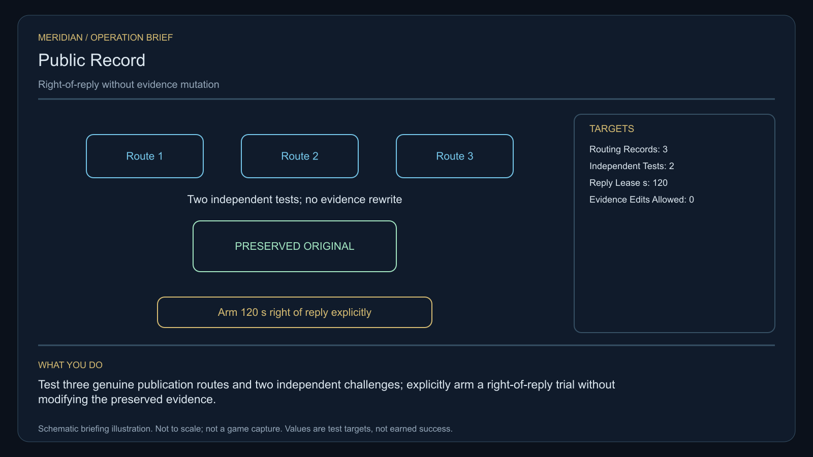

# C37 · Public Record

[Illustrated story](../../INTENDED-GAME-STORY-WALKTHROUGH.md#public-record) · [Mission walkthrough checklist](../README.md)

Design walkthrough complete against `19a177e66093716928947f7246e0b664e4a6ad07`. Main contains the commissioning, board, gallery and strict stage-zero save source. The audited runtime refuses the generated local receipt `l337.public-record/accept` before publishing the case. Main still has the slash in the receipt. Correction `f9a5581e230de1c6cf70647742cccfd5ce86884f` and later case-bound loan refusal `e0e2d46073b36196f89b304f70b305c737d4ad8e` are outside this main revision. The latter still refuses unissued stock. Original commissioning acceptance, live loan and later physical stages remain open. [Audited diagnostic](../../INTENDED-GAME-STORY-NOTES.md#public-record-commissioning), [Main receipt source](https://github.com/stephenlclarke/l337/blob/19a177e66093716928947f7246e0b664e4a6ad07/Sources/L337Core/NativePublicRecordDefinition.swift#L13), [Gallery](https://github.com/stephenlclarke/l337/blob/19a177e66093716928947f7246e0b664e4a6ad07/Sources/L337Core/NativePublicRecordGallery.swift#L19)

## Offer and motivation

Dispatcher Neris Sol commissions Rowan at Fenias's living main orbital in Galaxy 5 after one ordinary purchase or sale. Require actual arrival, a writable save and confirmation. No rank or previous mission gate. Separately collect Sol's exact finite one-tonne recorder at Fenias with one tonne free. Acceptance starts no reply clock. **Truth for Sale** is the finished paid grouping. The independent no-fee core inquiry remains available. [Main board source](https://github.com/stephenlclarke/l337/blob/19a177e66093716928947f7246e0b664e4a6ad07/Sources/L337Core/NativePublicRecordBoard.swift#L92)

A newsroom wants to report a dangerous routing fault. Its sponsor owns the only accepted recording instrument. Sol needs measurements that can withstand an independent check. Nia Toren preserves the sponsor's and independent versions side by side. Rowan observes actual cargo-routing decisions, measures both controllers and protects the witness's choice of disclosure. A public release or right of reply can add context without changing the evidence.

## Route and fit

| Galaxy 5 route | Distance and service |
| --- | --- |
| Fenias G05-S012 → Fenel G05-S166 | 1.851 LY. Collect the original recorder before observing three decisions. |
| Fenel → Heroeth G05-S024 | 2.974 LY. Verify consent before the two independent controller tests. |
| Heroeth ↔ Voron G05-S003 | 5.247 LY each way for the player's newsroom visit and return for branch proof. |
| Heroeth → Fenias | 2.127 LY. Return the exact original recorder. |

All direct jumps fit nominal 7 LY reach. On a full 7 LY tank at Fenias, refuel at Heroeth, Voron and Heroeth on return. Fenel → Voron measures 4.041 LY if the witness is authorized to depart independently from Fenel. Its actual route, permissions and reception are separate. [World catalogue](https://github.com/stephenlclarke/l337/blob/19a177e66093716928947f7246e0b664e4a6ad07/Sources/L337Core/Resources/OriginalWorlds/catalogue.json), [Reach and fuel](https://github.com/stephenlclarke/l337/blob/19a177e66093716928947f7246e0b664e4a6ad07/Sources/L337Core/FuelStorage.swift#L8), [Native arrival](https://github.com/stephenlclarke/l337/blob/19a177e66093716928947f7246e0b664e4a6ad07/Sources/L337Core/NativeStationServices.swift#L135)

The player needs 1 t and zero passenger places. The actual technical witness travels in a source-owned **SH061 Saiga** with two operators, one mandate-bound delegate, one powered four-place Standard Cabin and finite fuel. The design has 84 t hold, 22 equipment units, 9 LY hull reach and a 13 LY tank. The cabin costs 5 t and one equipment unit. Verify the actual manifest, private consent, loaded geometry and Voron newsroom berth. SH001 Mule has two operators, 76 t nominal hold and 9 LY hull reach, without an exact issued role. The reviewed profile sets `accompanimentRequired: false`. The witness travels independently after survey and permission while Rowan compares the controllers. Actual living receiving and mandate still gate the choice. [Mule design](https://github.com/stephenlclarke/l337/blob/19a177e66093716928947f7246e0b664e4a6ad07/docs/fleet-design-v2/ships/SH001.toml), [Saiga design](https://github.com/stephenlclarke/l337/blob/19a177e66093716928947f7246e0b664e4a6ad07/docs/fleet-design-v2/ships/SH061.toml), [Mule art](../../assets/ships/SH001.png), [Saiga art](../../assets/ships/SH061.png), [Historical escort wording](https://github.com/stephenlclarke/l337/blob/19a177e66093716928947f7246e0b664e4a6ad07/docs/COMPLETION-LEDGER.md#L2213)

## Play the nine stages

| Stage | Player action and qualifying evidence |
| --- | --- |
| 1. `accept` | Confirm Sol's reviewed commission while actually docked at Fenias after the genuine trade. |
| 2. `collect-reference` | Confirm exact original serialled one-tonne recorder custody at Fenias. |
| 3. `survey` | At Fenel observe three distinct actual cargo-routing decisions under authorized observer consent. Use front view, nearest unobstructed mesh, 2° aim and 12 continuous seconds per target at 250–1,500 native surface units. |
| 4. `field-work` | At Heroeth compare both actual external route controllers with the original recorder. Complete independent challenges, bind the signed measurements to their distinct sources, and freeze the independent version and both original hashes. Keep sponsor and independent records separate. Apply the 20-second qualified minimum, 50–150 m, at most 1 m/s and at most 2° aim. No evidence edits are allowed. |
| 5. `independent-witness` | At Voron verify actual living reception of the same independently travelling witness, tender and signed mandate at the newsroom berth. |
| 6. `choose-settlement` | At the actual receiver with arrived authorized delegates, choose **Release the complete anonymised evidence set** or **Use a witnessed right-of-reply hearing**. |
| 7. `apply-settlement` | At Heroeth require both proofs. For `plan-a`, prove the actual public receiver accepts the independently measured anonymised archive and a privacy audit finds zero private identity fields. For `plan-b`, start the **120-second** reply period only when the actual authorized receiver explicitly confirms. Preserve the original version and hashes. Expiry permits publication. It does not award the mission. |
| 8. `return-and-audit` | At Fenias return the exact recorder. Audit both independent measurements, actual witness reception and the selected proof pair. |
| 9. `close-case` | Preserve the approved publication or hearing record and original evidence. Commit 6,300 CR via `l337.public-record/final-payment` and `l337.unwritten-route/clue/public-record-trace` once. The anomaly lies outside the controllers' published bands. |

In the project design a reply is a separately signed appendage to a specific preserved version. It cannot overwrite either input or reset the original reply lease. Publication uses a separate privacy-safe projection and a real authorized receiver. Private identities and location remain out of public receipts and projections. The response interval is simulation time scoped to the selected hearing, with no mission-wide deadline. Sol's recorder, ordinary trade and initial witness arrival cannot start that interval.

[Editable operation drawing](../../assets/missions/revisions/public-record-operation.svg)

## Failure, cold Continue and owners

Pause freezes active simulation. Preserve exact loan, original provenance and hashes, sanitized projection, witness consent and route, actual receiving, selected branch, receiver-confirmed clock and replies. Cold Continue resets unfinished survey dwell. A load, a missing reply or a second confirmation cannot alter the original, restart a running lease or make expiry settle the case. Test before and after version freeze, after witness receiving, during and after the lease and after terminal. Genuine loss and refused consent remain recorded. The no-fee core inquiry always earns only the missing clue when the original becomes unavailable.

- **G4 physical requirement.** Pin the three actual routing observations, two controller interfaces and their independent signal calibration, actual Saiga fit and authorized Voron newsroom berth.
- **MC1 mission requirement, via Root and G1.** Reconcile receipt correction with actual current qualification, then issue exact finite stock. Bind actual independent evidence and immutable versions, real witness receiving, public privacy audit or explicitly confirmed hearing interval, and both selected proofs and one terminal. Keep board/gallery clear about actual acceptance and pickup boundaries.
- **Root source decisions.** Issue live Sol authority and finite recorder serial, independent and sponsor evidence owners, actual controllers and lawful observation, witness consent and protected receiver, public archive destination or reply authority and publication signers.

Historical story and data are `docs/meridian/missions/C37.md` and `docs/meridian/missions/definitions/public-record.json` at `c70110b292077588a0855fb48127adfb1b611c9d`, definition SHA-256 `0ebf720710dc5d7954158e2c25d6d0a346bc0883481d0d39fe4634f5f68e4bb5`. The reviewed `docs/meridian/missions/gameplay/campaign-profiles.json#/profiles/public-record` has SHA-256 `37fe5011de7bcc5874f6e6eef42151a712be4f69a3b9b23cd18cf660bd0dff0a`.
