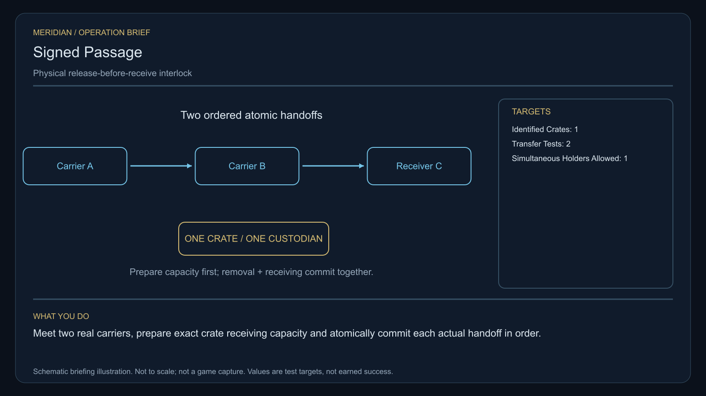

# C38 · Signed Passage

[Illustrated story](../../INTENDED-GAME-STORY-WALKTHROUGH.md#signed-passage) · [Mission walkthrough checklist](../README.md)

Design walkthrough complete against `19a177e66093716928947f7246e0b664e4a6ad07`. Main contains the native commissioning path, strict stage-zero save and opening history. The original reference source remains unavailable. The ledger records nine passing opening and cold-save tests on the earlier attributed candidate. That scope leaves the rest of the original mission open. Historical story identity is `l337.courier`. Native save and pack identity is `l337.contract/courier`. The generated courier pack has its own identity and cannot supply any C38 stage. [Native identity](https://github.com/stephenlclarke/l337/blob/19a177e66093716928947f7246e0b664e4a6ad07/Sources/L337Core/NativeSignedPassageOpening.swift#L42), [Native save guard](https://github.com/stephenlclarke/l337/blob/19a177e66093716928947f7246e0b664e4a6ad07/Sources/L337Core/NativeSignedPassageOpening.swift#L121), [Earlier opening tests](https://github.com/stephenlclarke/l337/blob/19a177e66093716928947f7246e0b664e4a6ad07/docs/COMPLETION-LEDGER.md#L7510)

## Offer and motivation

Dispatcher Evi Senn commissions Rowan at Neron's living main orbital in Galaxy 1 after one ordinary purchase or sale. Require actual arrival, a writable save and confirmation. No score or prior campaign gate. Acceptance reserves no cargo or stock. The original one-tonne carried reference requires separate confirmed pickup at Neron with one tonne free. It is distinct from the source-owned test crate used later. **The Wayfarer Union** is the finished paid grouping. The independent no-fee core inquiry remains available. [Current board requirements](https://github.com/stephenlclarke/l337/blob/19a177e66093716928947f7246e0b664e4a6ad07/Sources/L337Core/NativeSignedPassageOpeningBoard.swift#L93)

A receiving service signs for harmless calibration cargo before assigning a cradle. No original shipment is missing. Senn wants the actual consignment and allocation time verified. Nia Toren wants physical custody to determine when a signature can exist. Rowan observes three real receiving points, moves one exact test crate through two transfers and verifies a living independent witness before choosing separate locks or a bounded common register.

## Route and fit

| Galaxy 1 route | Distance and service |
| --- | --- |
| Neron G01-S049 → Lalen G01-S160 | 2.203 LY. Collect the original instrument before observing the three cradles. |
| Lalen → Illalis G01-S034 | 4.903 LY. Compare actual allocation and signing before both handoffs. |
| Illalis ↔ Aetaria G01-S002 | 6.078 LY each way for the player's archive visit and return for branch proof. |
| Illalis → Neron | 2.722 LY. Return the original reference. |

All listed jumps fit nominal 7 LY reach. Each consecutive pair exceeds a 7 LY tank. Arrange real refuelling at Lalen, Illalis, Aetaria and Illalis on return. Lalen → Aetaria measures 3.156 LY if the independent witness departure is issued there. Its exact source, permitted itinerary, fuel and actual receiving require independent proof. [World catalogue](https://github.com/stephenlclarke/l337/blob/19a177e66093716928947f7246e0b664e4a6ad07/Sources/L337Core/Resources/OriginalWorlds/catalogue.json), [Reach and fuel](https://github.com/stephenlclarke/l337/blob/19a177e66093716928947f7246e0b664e4a6ad07/Sources/L337Core/FuelStorage.swift#L8), [Native arrival](https://github.com/stephenlclarke/l337/blob/19a177e66093716928947f7246e0b664e4a6ad07/Sources/L337Core/NativeStationServices.swift#L135)

The player reserves 1 t for the reference and needs zero passenger places. The test crate has its own identity, mass and owner. Actual carrier capacities must qualify independently. SH001 Mule is listed with two operators, 76 t nominal hold and 9 LY reach, without an issued exact role. The witness tender is an actual **SH061 Saiga**, two operators, one mandate-bound delegate, one powered four-place Standard Cabin and finite fuel. Its design has 84 t hold, 22 equipment units, 9 LY jump reach and a 13 LY tank. The cabin costs 5 t and one equipment unit. Qualify the actual tender's loaded approach and archive berth. The SH063 Seriema's dry calculation alone cannot assign it as a physical carrier. [Mule design](https://github.com/stephenlclarke/l337/blob/19a177e66093716928947f7246e0b664e4a6ad07/docs/fleet-design-v2/ships/SH001.toml), [Saiga design](https://github.com/stephenlclarke/l337/blob/19a177e66093716928947f7246e0b664e4a6ad07/docs/fleet-design-v2/ships/SH061.toml), [Seriema source boundary](https://github.com/stephenlclarke/l337/blob/19a177e66093716928947f7246e0b664e4a6ad07/Sources/L337Core/OriginalSeriemaCourierPhysicalSource.swift#L3), [Mule art](../../assets/ships/SH001.png), [Saiga art](../../assets/ships/SH061.png)

The reviewed profile sets `accompanimentRequired: false`. The receiving witness travels independently after survey and permission while Rowan works on the transfers. The earlier escort wording does not gate progress. Require actual living Aetaria reception and examination of the same custody chain before choice. [Historical ledger wording](https://github.com/stephenlclarke/l337/blob/19a177e66093716928947f7246e0b664e4a6ad07/docs/COMPLETION-LEDGER.md#L2214)

## Play the nine stages

| Stage | Player action and qualifying evidence |
| --- | --- |
| 1. `accept` | Confirm Senn's reviewed commission at actual Neron dock after a genuine trade. |
| 2. `collect-reference` | Confirm the exact original one-tonne instrument loan and committed custody at Neron. |
| 3. `survey` | At Lalen observe three actual receiving cradles and their native allocation and signing times. Use front view, unobstructed nearest mesh, 2° aim and 12 continuous seconds at 250–1,500 native surface units per target. |
| 4. `field-work` | At Illalis move the same source-owned crate through both ordered physical transfers under the original instrument. Each actual receiver first validates its place, owner and ready capacity. Commit sender removal and receiver acquisition together with exactly one custodian throughout. Use 50–150 m, at most 1 m/s and at most 2° aim where the actual interface needs it. |
| 5. `independent-witness` | At Aetaria require actual native receiving of the same independently travelling witness, living party and mandate. Verify that the witness sees the exact crate custody chain. |
| 6. `choose-settlement` | At the actual archive berth with arrived authorized delegates, choose **Use independently signed receiving locks** or **Create a shared bounded custody register**. |
| 7. `apply-settlement` | At Illalis obtain both selected proofs. For `plan-a`, bind sender and independent receiver locks to the same actual crate and prove refusal of an early receipt. For `plan-b`, verify actual common receiving for each handoff and refusal of a duplicate consignment claim. |
| 8. `return-and-audit` | At Neron return the exact original instrument and audit the same crate chain, actual living reception and both selected proofs. |
| 9. `close-case` | Preserve the verified custody rule and original records. Commit 4,300 CR through `l337.courier/final-payment` and `l337.unwritten-route/clue/courier-empty-destination` once. The old receipt has a watermark for a destination absent from the charts. |

Receiver preparation can acknowledge readiness while the sender retains custody. Only actual committed receiving changes the holder. Model A → B → C using the same crate. No provisional acknowledgement can serve as an early receipt, and no new crate can stand in for a lost one. C18's neutral rehearsal concerns responsibility for person records. C38 tests actual material fit and custody. Confirm the specific crate's capacity and load at both physical interfaces. [Main transaction design](https://github.com/stephenlclarke/l337/blob/19a177e66093716928947f7246e0b664e4a6ad07/Sources/L337Core/NativeSignedPassageOpeningBoard.swift#L95)

[Editable operation drawing](../../assets/missions/revisions/courier-operation.svg)

## Failure, cold Continue and owners

No overall deadline. Pause freezes simulation. Preserve exact original loan, crate, sole holder and prepared capacity, actual receipts and clocks, tender transit and receiving, branch and proof pair. Reset unfinished survey dwell. Revalidate current authority before committing a pending handoff. Exercise Continue after preparation, between transfers, at actual witness arrival, after refusal and after terminal. Save or retry cannot duplicate stock, advance an early receipt or refund real loss. A separate free core inquiry can always earn only the same missing clue if the original becomes unavailable.

- **G4 physical requirement.** Pin three actual receiving surfaces, finite source crate and loaded carriers, both actual Illalis handoff interfaces and compatible capacity, actual loaded Saiga and Aetaria berth.
- **MC1 mission requirement, via Root and G1.** Preserve current native identity and accepted prefix. Issue finite separate loan, three authoritative observations, two atomic physical transfers, independent living reception and selected lock or register proof. Extend strict save/gallery only for issued native receipts and one terminal.
- **Root source decisions.** Issue Senn's finite original instrument, separate crate and owner, three source cradles, carrier assignments and load, actual tender/mandate and Aetaria receiving, and both branch authorities.

Historical story and data are `docs/meridian/missions/C38.md` and `docs/meridian/missions/definitions/courier.json` at `c70110b292077588a0855fb48127adfb1b611c9d`, definition SHA-256 `93061611f090d9e2b35a138f4026411ec425a35f38413f79586b44f17ecc63e3`. The reviewed `docs/meridian/missions/gameplay/campaign-profiles.json#/profiles/courier` has SHA-256 `37fe5011de7bcc5874f6e6eef42151a712be4f69a3b9b23cd18cf660bd0dff0a`.
