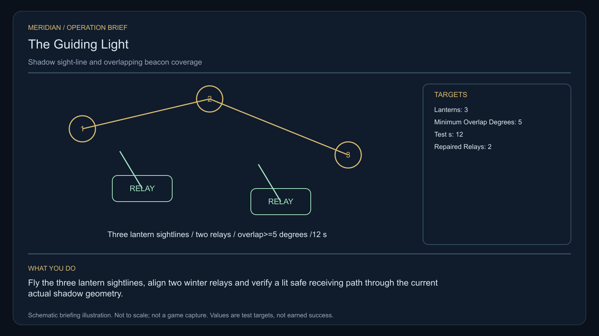

# C39 · The Guiding Light

[Illustrated story](../../INTENDED-GAME-STORY-WALKTHROUGH.md#the-guiding-light) · [Mission walkthrough checklist](../README.md)

Design walkthrough complete against `19a177e66093716928947f7246e0b664e4a6ad07`. The original nine-stage `l337.guiding-light` has a frozen opening supplier `0da19c9b306d5529940ef8d17265ae39a2c904e4` and source-only integration and fixture-cutover proposal `c14c5d61d180179b8e85e291612c23b0be5949cc`. Main ships the older `project.crimbo` convoy pack and native cohort infrastructure. It registers the original C39 clue. The original commission and later playable stages remain open. The same display title cannot confer original receipts or prove acceptance. [Legacy pack](https://github.com/stephenlclarke/l337/blob/19a177e66093716928947f7246e0b664e4a6ad07/Sources/L337Core/Resources/ScriptPacks/guiding-light/manifest.toml), [Identity ledger](https://github.com/stephenlclarke/l337/blob/19a177e66093716928947f7246e0b664e4a6ad07/docs/COMPLETION-LEDGER.md#L2965), [Main clue and archive pin](https://github.com/stephenlclarke/l337/blob/19a177e66093716928947f7246e0b664e4a6ad07/Sources/L337Core/NativeCharterArchiveRegistryApproval.swift#L1214)

## Offer and motivation

Dispatcher Evi Senn commissions Rowan at Crimbo's living main orbital in Galaxy 8 after a genuine ordinary trade. Require actual docking, a writable save and confirmation. No rank or prior campaign gate. Separately collect the finite original one-tonne reference lantern from Senn with one tonne free. **Beyond the Map** is the finished paid grouping. The independent no-fee core inquiry remains available.

A light-sharing agreement ignores Crimbo's long orbital shadow. A maintenance crew has been routed to an unlit pier. Relay Engineer Ivo Renn wants actual sight lines and the beam overlap measured from the receiving lane. Senn requires real receiving before the route is advertised. Rowan restores two physical relays and supports separate maintenance segments or a shared winter rota. The authored operating state is available in ordinary play without a real-world season or a planetary-day wait.

## Route and fit

Every stage is in **Crimbo G08-S008**. The player moves from Senn's actual issuer to the accessible orbital observation volume, both external relay faces and the winter service berth, then back for audit. There is no required intersystem jump after acceptance. Bind actual local distances, moving shadow geometry, safe holding approach and native docking before dispatch. The original world key is established. Its Christmas-convoy flag is a separate legacy setting and supplies no winter relay, berth or crew. [World catalogue](https://github.com/stephenlclarke/l337/blob/19a177e66093716928947f7246e0b664e4a6ad07/Sources/L337Core/Resources/OriginalWorlds/catalogue.json), [Legacy cohort system](https://github.com/stephenlclarke/l337/blob/19a177e66093716928947f7246e0b664e4a6ad07/Sources/L337Core/NativeCrimboRegistry.swift#L53), [Native arrival](https://github.com/stephenlclarke/l337/blob/19a177e66093716928947f7246e0b664e4a6ad07/Sources/L337Core/NativeStationServices.swift#L135)

The player reserves 1 t for the original lantern and needs zero passenger places. The actual maintenance tender uses **SH061 Saiga**, two native operators, one mandate-bound delegate, one powered four-place Standard Cabin and finite fuel. Its design has 84 t hold, 22 equipment units, 9 LY hull reach and a 13 LY tank. The cabin costs 5 t and one equipment unit. Qualify actual people, powered fit, safe approach and receiving aperture. SH001 Mule has two operators, 76 t nominal hold and 9 LY reach, without an exact issued role. Legacy cohort ship IDs SH150/SH151 do not assign the SH061 tender. The reviewed profile requires independent transit, superseding older escort wording. It may stage or depart after survey and permission. It enters the winter lane only after actual safe coverage and permission, then actually docks with the living crew. [Mule design](https://github.com/stephenlclarke/l337/blob/19a177e66093716928947f7246e0b664e4a6ad07/docs/fleet-design-v2/ships/SH001.toml), [Saiga design](https://github.com/stephenlclarke/l337/blob/19a177e66093716928947f7246e0b664e4a6ad07/docs/fleet-design-v2/ships/SH061.toml), [Legacy cohort hulls](https://github.com/stephenlclarke/l337/blob/19a177e66093716928947f7246e0b664e4a6ad07/Sources/L337Core/NativeCrimboRegistry.swift#L25), [Mule art](../../assets/ships/SH001.png), [Saiga art](../../assets/ships/SH061.png), [Historical escort wording](https://github.com/stephenlclarke/l337/blob/19a177e66093716928947f7246e0b664e4a6ad07/docs/COMPLETION-LEDGER.md#L2215)

## Play the nine stages

| Stage | Player action and qualifying evidence |
| --- | --- |
| 1. `accept` | Confirm Senn's commission at the actual Crimbo main orbital after the ordinary trade. |
| 2. `collect-reference` | Confirm protected custody of the exact original one-tonne reference lantern. |
| 3. `survey` | Observe three actual winter-shadow sight lines from the accessible marked orbital observation volume. Require front view, nearest unobstructed mesh, 2° aim and 12 continuous seconds at 250–1,500 native surface units per distinct target. |
| 4. `field-work` | Restore and align both actual external relays under permission. Use 50–150 m clearance, at most 1 m/s and at most 2° aim where the interface requires it. Test actual beam cones along the shadow-side receiving lane. Require **at least 5° overlap for 12 continuous simulation seconds** with no unlit gap. Record actual relay acknowledgements before advertising the lane. |
| 5. `independent-witness` | Verify the same independently travelling maintenance tender flew the actual lit approach and its living crew and mandate were received at the authorized winter service berth. |
| 6. `choose-settlement` | At the actual berth with arrived delegates choose **Maintain independent winter lantern segments** or **Publish a jointly maintained winter rota**. |
| 7. `apply-settlement` | Require both selected proofs. For `plan-a`, both local owners receive their actual repairs and the real shadow-side approach retains measured overlap. For `plan-b`, verify the actual signed rota maintains the same overlap and the real maintenance tender reaches its lit receiver under the selected agreement. |
| 8. `return-and-audit` | Return the exact original lantern to Senn. Audit actual sight lines, both repairs, living receiving and the selected proof pair. |
| 9. `close-case` | Preserve the winter agreement and original observations. Commit 5,700 CR via `l337.guiding-light/final-payment` and `l337.unwritten-route/clue/lantern-extra-echo` once. The verified array has one extra recorded inward phase absent from the hardware. |

Use the actual planetary occlusion and cone geometry. A visible glow or marker is not a measured overlapping lane. The project values need native geometry and balance. Qualification must use an authored playable shadow case rather than the legacy convoy calendar. If the shadow opens an unsafe gap, refuse lane certification and hold traffic. A previous provisional receipt does not automatically establish the selected rota's coverage and receiving. There is no combat or salvage requirement.

[Editable operation drawing](../../assets/missions/revisions/guiding-light-operation.svg)

## Failure, cold Continue and owners

No overall deadline. Pause freezes active simulation. Save exact lantern, actual source relays and alignments, recorded shadow and coverage, functional test time, actual tender state and receiving, branch and both proofs. Reset unfinished survey dwell. Resume live coverage time only while the same physical geometry qualifies. Exercise Continue after each relay, inside the 12-second window, during independent receiving, after rota and terminal. Retain actual loss and unsafe geometry. The separate no-fee core inquiry can always award only the missing clue if the original becomes unavailable.

- **G4 physical requirement.** Pin three actual orbital sight lines, two relay mount faces and beams, moving shadow geometry, real local route and safe hold, loaded SH061 and actual winter service aperture.
- **MC1 mission requirement, via Root and G1.** Reconcile the frozen original identity and any approved fixture separation. Bind exact custody, real shadow and both repairs, native measured overlap, actual independent lit receiving, branch-specific proof pair and one terminal. Keep original and legacy receipt identities disjoint.
- **Root source decisions.** Issue Senn's original lantern, actual winter shadow geometry, relay owners and thresholds, independent crew, route, winter berth and both maintenance or shared rota signers. Confirm any legacy resource cutover separately through G1.

Historical story and data are `docs/meridian/missions/C39.md` and `docs/meridian/missions/definitions/guiding-light.json` at `c70110b292077588a0855fb48127adfb1b611c9d`, definition SHA-256 `95204252f6c21570eb703108209c2759f62667d1c13036abd7109b29e47a4aa5`. The reviewed `docs/meridian/missions/gameplay/campaign-profiles.json#/profiles/guiding-light` has SHA-256 `37fe5011de7bcc5874f6e6eef42151a712be4f69a3b9b23cd18cf660bd0dff0a`.
