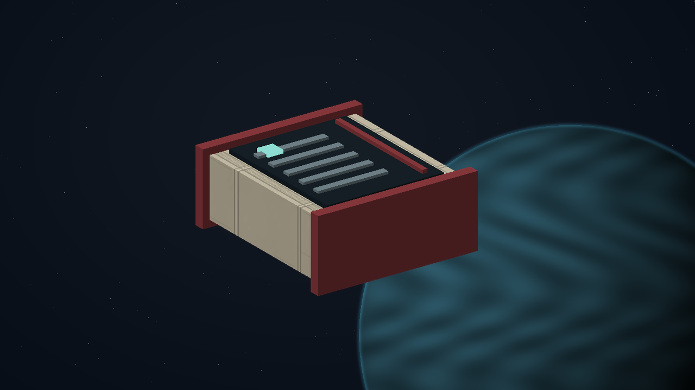

# G01 · Sealed dispatch

[Illustrated story](../../INTENDED-GAME-STORY-WALKTHROUGH.md#sealed-dispatch) · [Mission walkthrough checklist](../README.md)

Design walkthrough complete against `19a177e66093716928947f7246e0b664e4a6ad07`. Main includes the closed native courier-backed `l337.contract/sealed-dispatch` profile, actual receiving authority and trusted completion pin. Earlier focused dispatch regressions and exact-content clue trust passed in scoped runs. Full ordinary in-game family acceptance remains open, including distinct authored-origin resume qualification. [Current profile](https://github.com/stephenlclarke/l337/blob/19a177e66093716928947f7246e0b664e4a6ad07/Sources/L337Core/OriginalSealedDispatch.swift#L3), [Ledger family status](https://github.com/stephenlclarke/l337/blob/19a177e66093716928947f7246e0b664e4a6ad07/docs/COMPLETION-LEDGER.md#L2973), [Scoped tests](https://github.com/stephenlclarke/l337/blob/19a177e66093716928947f7246e0b664e4a6ad07/docs/COMPLETION-LEDGER.md#L8380)

## Offer, route and fit

A live sender wants one sealed record delivered to a named receiver with identity and custody intact. Review the exact origin, path, destination main orbital and named Sealed Dispatch Receiving Officer on the actual Contract Board. Native main orbitals and the authorized Avenor Salamander SH141, Frog SH034 and Dhole Haven SH102 sites can act as sources under current live service and pack bindings. The remote Dhole utility site lacks G01 board authority. A secondary station cannot supply destination main-orbital reception. [Origin sites](https://github.com/stephenlclarke/l337/blob/19a177e66093716928947f7246e0b664e4a6ad07/Sources/L337Core/OriginalStationSite.swift#L52), [Native receiver](https://github.com/stephenlclarke/l337/blob/19a177e66093716928947f7246e0b664e4a6ad07/Sources/L337Core/NativeOriginalSealedDispatchOrigin.swift#L245)

The current production profile uses package rows **1, 3 and 5** from six-draw generation. The generated path is **one to three quoted in-galaxy legs**. Its first leg uses actual current reach. Later legs use the fitted reach and refuelling assumptions in the stored route. Freeze displayed terms and require actual fuel and service access. This repeatable family has no fixed destination. The authored quote is 320 + 90 per leg + 80 per hazard unit CR. Current production is **H0**, so one, two or three quoted legs pay **410, 500 or 590 CR**. No deposit, donation, passenger place or rank gate. Job duration is zero with a nil deadline. The board refresh does not expire an accepted job. [Closed package rows](https://github.com/stephenlclarke/l337/blob/19a177e66093716928947f7246e0b664e4a6ad07/Sources/L337Core/OriginalSealedDispatch.swift#L17), [Native terms](https://github.com/stephenlclarke/l337/blob/19a177e66093716928947f7246e0b664e4a6ad07/Sources/L337Core/ScriptCourierState.swift#L29), [Native route generation](https://github.com/stephenlclarke/l337/blob/19a177e66093716928947f7246e0b664e4a6ad07/Sources/L337Core/ScriptCourierGeneration.swift#L70)

The current ship needs **1 t free**, actual fit, finite fuel and actual berth permissions. There is no required mission hull. The fleet design gives the SH025 Peregrine Mk V one operating place, 92 t nominal hold, 9 LY hull reach and a 13 LY tank. Gallery practice declares SH025 at Avenor. The ledger records a reused Salamander docking prerequisite refusal and a raw SH025 vertex outside that aperture. Qualify actual mesh fit separately. The proposed SH029 Okapi path requires its own fitted approach. The original corpus's three-active limit is a finished shared-family constraint. Native exclusivity uses the current closed profile group. [Peregrine design](https://github.com/stephenlclarke/l337/blob/19a177e66093716928947f7246e0b664e4a6ad07/docs/fleet-design-v2/ships/SH025.toml), [Peregrine art](../../assets/ships/SH025.png), [Salamander finding](https://github.com/stephenlclarke/l337/blob/19a177e66093716928947f7246e0b664e4a6ad07/docs/COMPLETION-LEDGER.md#L129)

## Play the three authored stages

| Stage | Player action and qualifying evidence |
| --- | --- |
| 1. `accept` | Review the route and fixed fee. Confirm at the same current sender with free hold and authority. Bind exact source, offer, version and commander, reserve 1 t and issue one original record atomically. Back changes nothing. |
| 2. `perform` | Fly the route and keep the same unique sealed consignment. Dock at the quoted living destination main orbital and obtain the actual receiving contact and current native arrival receipt. A copy, marker, other station or generic courier job cannot qualify. |
| 3. `receive` | Confirm with the named receiving officer. Validate the same item, issued job, owner, destination, live authority, current contact token and absence of pending loss. Transfer the record and publish the quoted payment once in one durable transaction. Award `l337.unwritten-route/clue/sealed-dispatch-family-trace` on the first trusted successful family terminal. |

The three authored phases map to two current published milestones, **Collect original sealed record** and **Confirm receiving officer handoff**. Actual arrival and preparation do not claim payment. Handoff consumes the exact item and releases its 1 t capacity. Each genuinely new job can earn its own fee. The first-family clue stays unique. No salvage, passenger fitting or combat prerequisite. [Board and milestones](https://github.com/stephenlclarke/l337/blob/19a177e66093716928947f7246e0b664e4a6ad07/Sources/L337Core/Resources/ScriptPacks/l337-sealed-dispatch/manifest.toml#L13), [Native confirmation](https://github.com/stephenlclarke/l337/blob/19a177e66093716928947f7246e0b664e4a6ad07/Sources/L337Core/ScriptCourier.swift#L336), [Trusted clue pin](https://github.com/stephenlclarke/l337/blob/19a177e66093716928947f7246e0b664e4a6ad07/Sources/L337Core/ScriptBaseClueCatalog.swift#L200)

[Offer artwork](../../assets/missions/services/sealed-dispatch-accept.png) · [Physical handoff artwork](../../assets/missions/services/sealed-dispatch-perform.png) · [Receiving artwork](../../assets/missions/services/sealed-dispatch-receive.png) · [Completed clue art](../../assets/missions/clues/sealed-dispatch-family-trace.svg)

## Failure, cold Continue and owners

Genuine loss, fatal loss or explicitly confirmed abandonment at the actual sender yields zero fee and no original clue. Preserve the cause and sole custody. Back changes nothing. Current-format Continue restores the exact job, item, frozen terms and pending, lost or terminal state. Missing content suspends or locks the case without replacing the item. Require the actual writer and current authority before resuming or settling. A terminal retry requires a genuinely new offer. The independent no-fee core inquiry can always earn only the missing clue.

- **G4 physical requirement.** Qualify the actual fitted hull and both doorways, especially Salamander. Measure main and secondary berth identities, real mesh fit and fuel independently.
- **MC1 mission requirement, via Root and G1.** Preserve the closed provider, exact item and live authority. Verify ordinary accept, flown and fuel-paid route, actual receiver, writer refusal and retry, loss, abandonment, missing-content restoration, duplicate Confirm and cold Continue. Preserve once-only family clue and per-job payment.
- **Root source decisions.** Confirm which live sender and fitted ship qualify end-to-end acceptance. Retain the closed H0 profile and exact declared roles. Other native sources need their own proof.

Historical source is `docs/meridian/missions/definitions/original-families.json#/templates/0` at `c70110b292077588a0855fb48127adfb1b611c9d`, SHA-256 `abf67f6506e9f392014913b3c9e9d08672283e9a8f830a7e4621f178fe8a40f5`. The historical handoff is `docs/meridian/missions/gameplay/contracts/ux/G01-SEALED-DISPATCH-CLOSED-PROFILE-HANDOFF-20261020.md` at the same commit.

